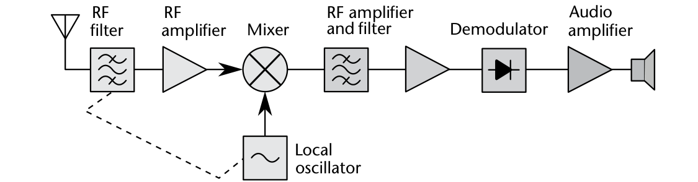
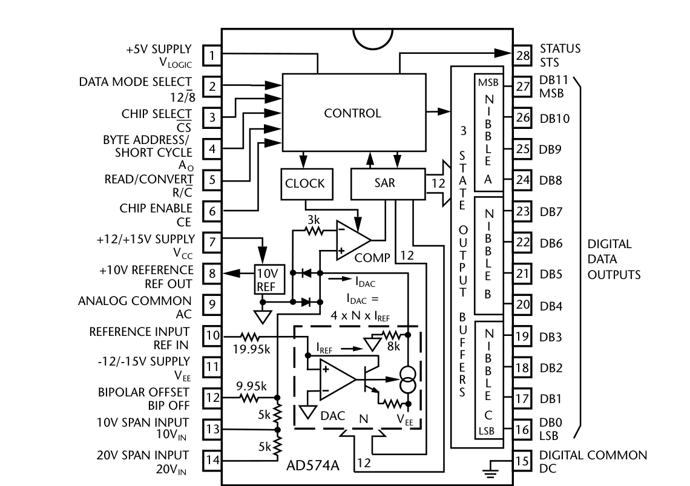

# 附录 A　更长的通信史

## A.1　历史总览

本节的目的既不是鼓励死记人名日期、也不是让读者不知所措，而是帮助理解通信系统如何变迁、新概念的采纳可以多么漫长、以及我们每天使用的现代通信基础设施技术从何而来。有人可能怀疑本节是否必要——但正如卡尔·萨根的名言："如果你想做一块从零开始的苹果派，你必须先发明宇宙" [1]。对通信史了解越多，就越能体会当今通信是何等的现代奇迹。仅仅 260 年前，一本杂志上的一封匿名信还只是设想用 26 根导线（每个字母一根；编码方案尚未普及）路由实现即时通信：沿导线发送静电脉冲、在另一端观察木髓球的移动（那时伏打还未发明电池）。这是多个世纪通信革命的早期导火索。

不言而喻，通信系统受限于当时可用的传输介质。澳大利亚西部沙漠的原住民、北美的原住民、驻守长城的古代中国士兵、以及古希腊人都设计了基于火信号或烟信号的复杂消息传输系统。希腊历史学家波利比乌斯在公元前 150 年左右开发了早期的字母烟信号编码系统，把希腊字母转换为数字字符 [2]。这些方法与现代通信系统面临着同样的工程折中——包括传输距离与数据率。

有些通信方案至今仍在使用，例如图 A.1 的旗语（semaphore）——当需要在视线之外的隐身通信时（旗帜不发射射频、不会暴露位置）。

直到 1990 年代初，一切才开始汇聚：RF 能力、软件、算法与计算机硬件的独特组合才真正具备实现条件。事实上，"软件定义无线电"一词直到 1993 年才被提出。

这段简史将略过约翰内斯·古腾堡约 1440 年发明的活字印刷机（它催生了整个印刷出版经济——到 1700 年，欧洲出版的各类书籍与学术期刊估计达 1.5 至 2 亿册 [3]）。这种与同时代及未来科学家、发明家、工程师共享思想概念的能力，帮助开启了持续的科学革命。

列奥纳多·达·芬奇这样的人不在本列表中。虽然他在解剖学、土木工程、地质学、光学与流体力学上做出了大量发现，但他没有发表其成果——未来的发明家、科学家与工程师没有正式的文档可供研究或拓展 [4]。

## A.2　1750–1850：工业革命

多方认为 1750 年开启了工业革命（约 1750 至 1850 年）。这一转型给许多人带来变化：

- 手工生产让位于机械化；
- 化学与钢铁生产的新工艺；
- 蒸汽动力的广泛采用；
- 工厂制度的兴起；
- 人们从家庭作坊走向工厂就业。

该时期后期发展出的创新——机车、汽船与蒸汽轮船的采用、热风炼铁以及电报等新技术——持续改变着许多人的日常生活 [5]。

**1748**：莱昂哈德·欧拉出版《无穷分析引论》[6]。欧拉不仅是极重要、极有影响力的数学家之一，还是最高产的——一生写了 500 多本书籍与论文 [7]。

**1752**：本杰明·富兰克林在费城著名的风筝实验中证明闪电由电引起 [8]。

**1753**：《苏格兰杂志》上一位匿名作者提出静电电报：用多根导线，通过观察木髓球的偏转来传输消息 [9]。

**1769**：詹姆斯·瓦特发明可驱动飞轮的往复式蒸汽机 [10]。

**1792**：克劳德·沙普在法国大革命期间建成横跨法国的旗语网络，提供快速可靠的通信系统。它能在不到一小时内把消息传到 230 公里外——比当时任何通信方式都快 [11]。

**1800**：亚历山德罗·伏打发明伏打电堆（即今天的电池）。有了恒定直流电压源，更实用的实验与新装置的发明成为可能 [12]。

**1804**：理查德·特里维西克改进瓦特蒸汽机，造出第一台全尺寸实用铁路蒸汽机车 [13]。

**1820**：约翰·施魏格造出第一台灵敏检流计——检测与指示电流的机电设备 [14]。

**1827**：格奥尔格·欧姆出版《伽伐尼电路的数学研究》[15]，分享了电路基本定律 V = I × R（后称欧姆定律）。当时欧姆的雇主科隆的三王中学并不欣赏他的工作，欧姆辞去了教职 [16]。

**1827**：安德烈-玛丽·安培出版《基于经验的电动力学现象的数学理论回忆录》[17]。正是这部著作把电动力学创建为一门学科。

**1831**：迈克尔·法拉第用运动的磁铁产生电流（盘形发电机，后来的发电机）[18]。

**1833**：卡尔·弗里德里希·高斯在哥廷根的屋顶上架设 1200 米长的导线做电报实验 [19]。

**1837**：查尔斯·巴贝奇设计机械分析引擎——第一台通用计算机 [20]。

**1837**：塞缪尔·摩尔斯获得记录式电报专利。为销售新设备，采用了称为摩尔斯电码的字母编码方案来通信字符串 [21]。电报简单易用，在 19 世纪大部分时间里被广泛使用，数据率取决于报务员的技能与设备能力。

## A.3　1850–1945：技术革命

技术革命（或称第二次工业革命）以制造业的进步为标志，使既有的技术系统——电报与铁路网络、燃气与供水、污水系统——得以大规模普及。1870 年后铁路与电报线路的巨大扩张带来了前所未有的人员与思想流动。同期还引入了新的技术系统，最重要的是电力与电话。

**1860**：乔瓦尼·卡塞利演示其传真电报机（pantelegraph）——早期传真机，通过普通电报线路在 140 公里距离上传输签名图像 [22]。

**1864**：詹姆斯·麦克斯韦发表论文《电磁场的动力学理论》，告诉世界他关于电磁波及其背后数学的发现。这组 20 个方程后来被称为麦克斯韦方程组 [23]。

**1865**：巴黎国际电报大会上成立了国际电报联盟（ITU），为欧洲日益增长的国际电报业务制定规范并保证互操作性 [24]。

**1869**：第一条横贯大陆铁路完工。这条 3077 公里的连续铁路把美国东部铁路网与旧金山湾的太平洋海岸连接起来 [25]。

**1873**：麦克斯韦出版《电磁通论》[26]。许多人读过此书，包括柏林大学的赫尔曼·冯·亥姆霍兹。

**1874**：卡尔·布劳恩发明猫须检波器（后称点接触整流器）。它由一根轻触半导体矿物晶体（通常为方铅矿）的细线构成，是 20 世纪初到 1945 年早期矿石收音机的检波器 [27]。

**1876**：亚历山大·格拉汉姆·贝尔成功实现世界第一部电话，开启了基于语音的电子通信新时代 [28]。任何个人都可以与地球上任何其他个人通信——唯一约束是连接二人的有线介质。

**1879**：托马斯·爱迪生申请美国专利："碳灯丝或碳带卷绕……连接到铂接触导线"的电灯 [29]。

**1879**：博士生海因里希·赫兹接到导师亥姆霍兹的挑战——证明麦克斯韦方程（几年前才发表）的实际用途。赫兹做了些分析后认为太难，转而研究电磁感应 [30]。

**1885**：卡尔·本茨造出第一台实用的机动汽车 [31]。

**1886**：赫兹在卡尔斯鲁厄理工学院获得教授职位，终于能完成导师的挑战，建造了生成与检测无线电波的装置 [30]。这消除了通信对有线介质的需求（不再需要电缆）：发射机产生的无线电波会在区域中传播，直到被接收机截获。

**1894**：贾格迪什·博斯用猫须检波器在他的微波先驱实验中检测无线电波 [32]，并于 1901 年为方铅矿检波器申请专利 [33]。

**1897**：布劳恩造出第一支阴极射线管（CRT）与阴极射线示波器 [34]。

**1901**：伽利尔摩·马可尼演示了史上第一次跨大西洋无线传输——英格兰康沃尔的波尔杜到纽芬兰圣约翰斯的信号山 [35]，消息用摩尔斯电码编码 [36]。超远距离无线传输信息的可行性得到证明。这一实验的成功使无线数据传输成为连接全球人民的选项——不再需要任何有线通信基础设施。

**1904**：约翰·弗莱明发明振荡阀（后称二电极真空管整流器，即二极管）[37]。弗莱明二极管此后几十年用于收音机与雷达，作为环形混频器的一部分（见图 A.2）。

**1905**：布劳恩在领取 1909 年诺贝尔物理学奖时描述了他如何精心布置三根天线发射定向信号 [38]。这项发明导致了雷达、智能天线与 MIMO 的发展。

**1905**：雷金纳德·费森登描述了从新的摩尔斯电码连续波发射机产生可闻信号的方法——他称之为外差原理 [39]。这在当时还不是实用设备，因为振荡真空管尚未发明。

**1906**：第一届国际无线电报大会在柏林召开，国际无线电报联盟非正式成立 [40]。

**1907**：李·德福雷斯特发明栅极 аудion（grid audion）——第一台基于真空管的放大器、三极管的前身 [41]。

**1912**：亨利·福特开发并制造第一辆大众化汽车，使汽车成为实用交通工具 [42]。

**1913**：哥伦比亚大学本科生埃德温·阿姆斯特朗准备了一系列全面演示与论文，仔细记录他对德福雷斯特栅极 аудion 的研究——采用再生（后称正反馈）产生比先前认为可能高数百倍的放大 [43]。

**1915**：贝尔与托马斯·沃森通过纽约到旧金山之间 3400 公里的导线通话 [44]。

**1917**：埃里克·蒂格斯泰特为一部折叠口袋电话申请专利，配有极薄的碳麦克风——是我们今天所知手机的雏形 [46]。

**1917**：超外差获专利。三个人（吕西安·莱维、阿姆斯特朗、瓦尔特·肖特基）分别提交了三份不同的专利申请，究竟谁最先已不可知。美国专利局最终承认阿姆斯特朗与莱维为发明人 [47]。超外差是几乎所有现代收音机使用的设计。图 A.3 给出了单变频超外差收音机的框图——许多现代收音机的基础架构。

![基于弗莱明振荡阀的二极管环形混频器 [45]](images/fig_A02.png)

**1924**：AT&T 开发与研究部（后来的贝尔电话实验室）的工程师哈里·奈奎斯特研究电报信令，目标是找出给定带宽信道可用的最大信令速率，发表论文《影响电报速度的若干因素》[48]。

**1927**：查尔斯·杜卡斯获得电镀电路图案方法的专利——印制电路板制造的基础技术 [49]。

**1928**：贝尔实验室的哈罗德·布莱克获得放大器负反馈专利。他把负反馈定义为降低放大器增益的一类耦合，同时极大地提高了稳定性与带宽 [50]。

**1928**：奈奎斯特又在论文《电报传输理论中的若干课题》中发表了进一步成果 [51]。这两篇论文为数据传输的定量理解做出了基础性贡献。

**1932**：国际电报公约与国际无线电报公约在马德里合并为国际电信联盟（ITU）。新公约覆盖电报、电话与无线电三个通信领域 [40]。

**1932**：由于超外差架构通常多级实现且需要大型元件，一组英国科学家开发了他们称为 homodyne（后改名 synchrodyne，即今天的零中频架构）的收音机 [52]。虽然 homodyne 相比超外差有性能改善，但受限于当时的元件容差（这类电路要求元件偏差极小才能成功工作）以及对 PLL 的需求（超外差只需要一个振荡器），难以实现。

**1940**：RADAR 一词被美国海军用作 radio detection and ranging（无线电探测与测距）的缩写 [53]。

**1945**：科幻作家亚瑟·克拉克给《无线电世界》编辑的信中描述了对地静止卫星将是理想的电信中继 [54]。

## A.4　1946–1960：喷气时代与太空时代

虽然喷气发动机的研究与专利从 1920 年代就开始了，但直到汉斯·冯·奥海因与马克斯·哈恩设计建造了第一台汽油燃料喷气发动机 HeS 3（推力 5 kN），装上简单紧凑的 He 178 机身，1939 年喷气时代才开始 [55]。商业航空的喷气时代始于 1952 年德·哈维兰彗星号（世界首架商用喷气客机）的首个定期航班 [56, 57]。当人们以每小时数百公里的速度飞驰空中时，对复杂通信的需求增长——知道自己的位置与他人的位置（避撞）变得更加关键。

**1946**：电子数值积分计算机（ENIAC）在宾夕法尼亚大学正式交付，成为最早的电子通用计算机之一 [58]。

**1947**：贝尔实验室的工程师观察到，当两个金触点接触锗晶体时，产生的信号输出功率大于输入——这个器件很快被称为晶体管。组长威廉·肖克利看到了其中的潜力，随后几个月大幅扩展了半导体知识 [59]。

**1948**：克劳德·香农在《贝尔系统技术期刊》发表《通信的数学理论》[60]。香农证明一切通信（语音、无线电、数据等）本质相同，且任何信源都可以用数字数据表示。他量化证明了通信信道存在速度极限（以比特每秒计）——这在当时是革命性的。香农用数学证明必然存在逼近该极限而不丢失任何信息的编码——该证明至今仍然成立 [61]。

数字通信的概念在 1950 年代后期腾飞：香农证明了无论噪声、失真或信号幅度如何，完美信息传输都是可能的。中继站的概念变得重要——数据可以从源 A 传输到 B（中继）再到 C（目的地）而不损失信息。

**1950**：美国陆军获得 Auto-Sembly 工艺专利——浸焊电路组装工艺，被军方与工业界广泛采用 [62, 63]。

**1950**：肖克利出版《半导体中的电子与空穴》[64]，成为其他科学家开发改进晶体管新变种的参考书。

**1954**：Epsco 公司（由前 UNIVAC 工程师伯尼·戈登创立）发布了第一款商用模数转换器（ADC）——采用移位可编程逐次逼近架构并包含采样保持功能。它叫 Datrac：11 位、50 kSPS、150 磅。用真空管实现、耗散 500 瓦、设计为机架安装（19"×15"×26"）、售价 8000 至 9000 美元。它是第一台适合数字化交流波形（如语音）的商用 ADC [65]。受真空管技术所限，这些转换器昂贵、笨重且高功耗——几乎没有商业化用量。

**1956**：肖克利搬到加州山景城创办肖克利半导体实验室，开启了硅谷革命 [66]。

**1957**：由于肖克利的管理风格，八位不满的员工离开肖克利半导体实验室创办仙童半导体 [66]。这开启了硅谷延续至今的传统。

**1957**：苏联把"基本卫星 1 号"（斯普特尼克 1 号）送入椭圆低地轨道 [67]。

**1958**：德州仪器（TI）的年轻工程师杰克·基尔比得出结论：电路元件的制造可以在一块半导体材料上完成。次年他申请了第一项集成电路专利——微型化电子电路 [68]。

**1962**：第一颗通信卫星 Telstar 1 发射 [69]。Telstar 1 在缅因州安德沃、英格兰西南部的贡希利与法国西北部的普勒默博杜之间中继数据、单电视频道或多路复用电话电路。由于其非对地静止轨道，跨大西洋信号每 2.5 小时中仅限 20 分钟（卫星经过大西洋上空时）[70]。

**1965**：两位 MIT 毕业生雷·斯塔塔与马修·洛伯创立 Analog Devices 公司 [71]。同年公司发布首款产品 101 型运放——曲棍球 puck 大小的模块，用于测试测量设备 [72]。

**1965**：仙童半导体研发总监戈登·摩尔观察到：密集集成电路中的元件数（晶体管、电阻、二极管或电容）大约每年翻一番，并推测这一趋势至少还会持续十年。后来他把预测修正为约每两年 [73]。这就是摩尔定律。

**1966**：ADC 没有享受到纯数字器件那样的规模缩放。Computer Labs（1978 年被 ADI 收购）当时卖 8 位 10 MSPS 转换器：机架安装、自带线性电源、耗散近 150 瓦、售价约 10000 美元 [65]。

**1967**：巴里·吉尔伯特发明基于晶体管的环形混频器——即吉尔伯特单元（四象限乘法器）[74]。在图 A.2 二极管环形混频器的基础上，把二极管替换为四个晶体管执行相同的开关功能。这构成了图 A.4 所示的经典双极性电路（全平衡版本的最简配置）。数以百万计的这种混频器被制造，如今包括 CMOS、BiCMOS 与 GaAs 变种。

吉尔伯特单元作为有源混频器有如下吸引力：

- 可与其他信号处理电路单片集成；
- 可提供变频增益（二极管环形混频器总是有插入损耗）；
- 驱动 LO 端口所需功率低得多；
- 信号端口间隔离度更好；
- 对负载匹配远不敏感，既不需要双工器也不需要宽带终端。

**1967**：UCLA 与 UCSD 电气工程教授安德鲁·维特比发表卷积编码数据的译码算法 [75]——即维特比算法。它至今仍广泛用于手机纠错码及其他众多应用。维特比没有为该算法申请专利——他不后悔这个决定 [76]。

**1969**：ARPANET（互联网的基础）上第一条成功消息由 UCLA 的学生程序员发出 [77]。

![经典集成有源混频器 [45]](images/fig_A04.png)

## A.5　1970–1979：信息时代

信息时代的特征是从工业革命的传统产业转向基于信息计算机化的经济。1970 年代由大量新兴应用驱动：大批量计算器、高分辨率数字电压表、工业过程控制、数字视频、军用相控阵雷达、医学成像、矢量扫描显示器与光栅扫描显示器。这些系统以前用的是（当时的）传统模拟信号处理技术或 ASIC，但低成本计算技术日益普及，激发了利用数字信号处理带来的更高性能与灵活性的渴望，以及对兼容数据转换器的需求。这个时代的核心是数字逻辑电路及其衍生技术（计算机与手机）的大规模生产与广泛应用。

**1970**："数字接收机"一词由美国国防部某实验室的研究者创造——那里创建了叫 Midas（多用户交互式数字分析系统）的软件基带分析工具，其操作由运行在当时大型机上的软件定义 [78]。

**1971**：英特尔公司发布 Intel 4004——第一款商用 4 位中央处理器（CPU）[79]。

**1971**：德州仪器发明并发布第一款微控制器（MCU）TMS1802NC [80]。

**1971**：ALOHAnet 用 UHF 无线分组网络连接夏威夷各岛。目标是用低成本商用无线设备把瓦胡岛与其他夏威夷岛屿的用户连接到瓦胡岛主校区的中央分时计算机 [81]。

**1972**：Signetics（后被飞利浦半导体收购，即现在的 NXP，写作本书时正在被高通收购）推出 NE555V 定时器。据 2003 年估计，每年制造 10 亿颗 [82]。

**1972**：语音频率的脉冲编码调制（PCM）——ITU-T 音频压扩标准 G.711 发布。它是窄带（300–3400 Hz）音频编解码器，提供与铜线上模拟传输（即普通老式电话业务 POTS）相当的语音质量 [83]。

**1973**：摩托罗拉的马丁·库珀在 DynaTAC 原型机上打了第一通公开的手持移动电话——重 4.4 磅（2 千克）。

**1973**：美国国防部启动国防导航卫星系统（DNSS）规划——很快更名 Navstar，最终成为全球定位系统（GPS）。1978 到 1985 年间发射了十颗原型卫星。

**1975**：保罗·艾伦与比尔·盖茨正式创立微软并授权 Altair BASIC [84]。

**1975**：ADI 发布 AD7570——单片器件上的 10 位 50 kHz CMOS SAR ADC。由于早期 CMOS 工艺难以设计好的比较器放大器与基准源，AD7570 需要外置比较器与外部电压基准 [65]。

**1975**：巴里·吉尔伯特加入 ADI 并发布 AD534 精密 IC 乘法器 [85]。这是第一款使用激光修整与吉尔伯特单元的器件，提供低于 ±0.25% 的四象限误差 [86]。

**1975**：史蒂文·赛森开发第一台数码相机 [87]。重 3.6 千克、用 100×100 像素（0.01 兆像素）传感器，生成的黑白数字图像记录到盒式磁带上，耗时 23 秒 [88]。

**1976**：史蒂夫·乔布斯、史蒂夫·沃兹尼亚克与罗纳德·韦恩创立苹果电脑公司 [89]。公司首款产品 Apple I 由沃兹尼亚克设计并手工打造 [90]。

**1977**：《Byte》杂志后来称之为个人计算 1977 三一体的 [91]：

- 苹果发布 Apple II（6502 处理器、1.023 MHz）
- Commodore 发布 PET（6502 处理器、1 MHz）
- Tandy 发布 TRS-80（Zilog Z80 处理器、1.77 MHz）

**1978**：EEPROM（电可擦除可编程只读存储器）由休斯微电子分部开发。相比 EPROM 有巨大改进：不再需要用紫外光照射存储器来擦除 [92]。

**1978**：德州仪器生产第一台 Speak & Spell——技术核心是 TMS5100：业界第一款数字信号处理器（DSP）。它还创下其他里程碑：第一颗用线性预测编码做语音合成的芯片 [93]。

**1978**：ADI 发布 AD574——有史以来最重要的 SAR ADC [94]。它是第一款完整解决方案的器件：内置齐纳基准、定时电路与三态输出缓冲器，可直接接口 8/12/16 位微控制器或微处理器总线 [65]。它成为当时的业界标准 12 位 ADC，但基于同封装两片裸片。

**1978**：圣地亚哥州立大学电气工程教授弗雷德·哈里斯发表他引用最高的论文《关于离散傅里叶变换谐波分析中窗的使用》[95]——他发表的论文与分享的信息获得超过 10000 次同行引用 [96]。哈里斯博士从 1962 年开始发表论文，至今仍在继续。

## A.6　1980–1989：数字革命

数字革命是从机械与模拟电子技术向数字电子技术的持续变革——依据细分市场不同，始于 1950 年代末到 1970 年代末，伴随数字信号处理与桌面计算的采用，延续至今。

**1981**：IBM 个人电脑问世——4.77 MHz Intel 8088、16 KB 内存、彩色图形适配器、无磁盘驱动器 [97]。

**1982**：互联网协议套件（TCP/IP）由美国国防部标准化——允许互联网络在全球扩散 [98]。

**1983**：摩托罗拉 DynaTAC 8000X 商用便携蜂窝电话发布。充满电约需 10 小时、通话 30 分钟。1984 年定价 3995 美元，使用称为高级移动电话系统（AMPS）的模拟调制方案。

**1983**：约翰·普罗基斯出版他关于数字通信与信号处理的十本书中的第一本，包括《数字通信》（McGraw Hill）[99, 100]。他继而写了该学科的许多书：《数字信号处理》[101]、《数字信号处理实验室》[101]、《高级数字信号处理》[101]、《语音信号的数字处理》[103] 与《通信系统工程》[104]。他的书教育了一代学生与工程师 SDR 相关的基础与理论。

**1983**：Altera 创立并于 1984 年交付业界第一款可重编程逻辑器件 EP300——封装上有石英窗，用户需用紫外灯照射裸片擦除保存器件配置的 EPROM 单元 [105]。

**1983**：罗纳德·里根总统发布指令：GPS 一旦充分发展，将作为公共品向民用免费开放。第一颗生产卫星于 1989 年 2 月 14 日发射，第 24 颗于 1994 年发射。

**1983**：欧洲开始制定数字蜂窝语音电信标准——最终成为 GSM。

**1984**：苹果电脑推出第一台 Macintosh。它是第一台商用成功的图形用户界面（GUI）+ 鼠标的个人电脑，这些成为电脑的标准配置 [106]。配置 7.83 MHz 32 位摩托罗拉 68000 CPU、内置 9 英寸单色屏、512×342 图形、400 kB 3.5 英寸索尼软驱、鼠标、128 KB 内存。重 20 磅，尺寸 9.7×10.9×13.5 英寸，售价 1995 至 2495 美元。

**1984**："软件无线电"一词由 E-Systems 公司（今雷神）德州加兰分部的一个团队创造，指数字基带接收机——团队在公司 E-Team 通讯上发布 [107]。

**1984**：MathWorks 创立，MATLAB 在内华达州拉斯维加斯的 IEEE 控制与决策会议上公开亮相 [108]。用于工业与教育（特别是线性代数与数值分析教学），深受信号处理领域的科学家欢迎。

**1984**：ITU 发布拨号调制解调器 V.32 建议——使用 QAM 调制、符号率 2400 波特、允许 9.6 kbit/s 双向数据传输 [109]。

**1985**：ADI 以单芯片单片形式重新发布 AD574（见图 A.5）。低价商用塑封转换器首次能够大量供应。

**1985**：美国联邦通信委员会裁定将 902–928、2400–2483.5 与 5725–5850 MHz 频段开放为免许可使用 [110]。这创造了工业、科学与医疗（ISM）无线电频段。

**1987**：来自 13 个欧洲国家的 15 位代表在哥本哈根签署谅解备忘录，开发部署全欧洲统一的蜂窝电话系统，欧盟通过法规使 GSM 成为强制标准。

**1987**：东芝开发闪速存储器（NOR 与 NAND 型），并在旧金山举行的 IEEE 1984 国际电子器件会议（IEDM）上发布 [111]。

**1987**：1980 至 1987 年间，超过 150 亿美元的风险投资投入半导体初创企业 [112]。半导体产业持续增长——初创公司如 Linear Technology（1987 年创立、2016 年被 ADI 收购）、Hittite Microwave（被 ADI 收购）、Wolfson Microelectronics（被 Cirrus Logic 收购）、Atmel（1984 年创立、2016 年被 Microchip 收购）、Xilinx（1984 年创立）、Altera（1983 年创立、2015 年被英特尔收购）、Maxim（1983）与 Micron（1978）。

**1988**：ITU-T 批准 G.722——宽带（50–7000 Hz）音频编解码器，工作在 48/56/64 kbit/s。该编解码器技术基于子带 ADPCM（SB-ADPCM）。凭借比 16 年前 G.711 更宽的带宽，G.722 提供了更好的语音质量 [113]。

**1988**：Crystal Semiconductor（后被 Cirrus Logic 收购）发布单片 CSZ5316——第一款商用 Σ-Δ ADC。16 位分辨率、20 kSPS 有效吞吐率，适合语音频带数字化 [65]。

**1989**：爱立信移动的 CTO 尼尔斯·吕德贝克提出短距离无线技术连接无线耳机与手机——最终成为蓝牙。

**1989**：互联网开始公众商用——MCI Mail 与 CompuServe 的电子邮件业务接入 [114]。

## A.7　1990–1999：公共互联网时代（Web 1.0）

数字信号处理与计算技术继续给 1990 年代带来革命。1990 到 1997 年间，美国个人 PC 拥有率从 15% 升至 35%。1990 年代早期及以前的手机非常庞大、缺乏附加功能、只有百分之几的人口使用。1990 年只有几百万人使用在线服务，万维网才刚刚发明。第一个网页浏览器 1993 年上线；到 2001 年，部分西方国家超过 50% 的人有互联网接入、超过 25% 的人有手机。调制解调器、ISDN、线缆调制解调器与 DSL 的进步带来了更快的互联网连接。

无线传输技术随时间逐渐演进：1917 年开发的超外差架构（图 A.3）仍是当时的首选无线架构。它利用当代集成电路，演化为多级接收机架构——通常一至两级混频、后接单片 ADC 与 DAC。多级超外差收发架构见图 A.6。第一变频级把射频（上/下）变换到较低的中频 IF1；IF1 再被搬移到更低的 IF2/基带频率供 ADC 或 DAC 数字化。除混频器外，每级还有滤波器、放大器与步进衰减器。滤波用于抑制带外（OOB）信号——不加抑制的话，OOB 信号会落在期望信号之上产生杂散（spur），使解调困难或不可能。实际的 IF1/IF2 频率取决于频率与杂散规划以及混频器性能和射频前端可用滤波器。这些无线电台多为固定频率（不太可调）——性能（灵敏度）的追求以牺牲灵活性为代价。

![多级超外差接收与发射信号链 [118]](images/fig_A06.png)

**1990**：Advanced RISC Machines 公司（ARM）作为 Acorn 电脑、苹果与 VLSI Technology 的合资企业成立。公司开发的 ARM 处理器如今用于每年售出的超过 10 亿部手机中的 98% [115]。

**1991**：MPEG-1 Audio Layer I/II/III 算法（即国际标准 ISO/IEC 11172-3，或称 mp3）1991 年获批、1992 年定稿 [116, 117]。

**1991**：ITU 发布拨号调制解调器 V.32bis 建议——用维特比算法做网格调制，允许 14.4 kbit/s 双向数据传输 [109]。

**1991**：计算机专业学生林纳斯·托瓦兹开始开发一个操作系统的简单构想——10239 行代码的 Linux 内核 0.01 版发布在 FTP 服务器上 [119]。

**1991**：芬兰前总理哈里·霍尔凯里打出世界第一个 GSM 电话，打给卡里娜·苏奥尼奥（坦佩雷市长——诺基亚的发源地）[120]。

**1991**：美国军方启动软件定义无线电项目 SpeakEasy I [121]。虽然 SDR 技术的不同部分自 1970 年代就已可用、第一个作为 SDR 原型（固定射频实现）的演示在 1988 年展示 [122]，但 SpeakEasy 是第一个大规模软件无线电。

当一台通信设备为唯一目的设计——只用一种波形、在一个频率上——不同人制造的不同设备彼此无法互操作。美军正是有这样的问题：每个军种与部门都有许多不同类型的电台与波形，冲突时期无法实时互通。这不是学术练习——生命因无法通信而逝去。他们需要一个能与十多种不同军用电台通信的系统。

这是 SDR 技术进展的关键里程碑。开发者想测试多频段（不同射频频率）、多模式（不同波形）无线电台在实际环境中的可行性。

**1991**：欧洲粒子研究组织 CERN 宣传新的万维网项目。

**1992**：第一条短消息服务（SMS 或短信）在 GSM 网络上发送。

**1993**：约瑟夫·米托拉创造"软件定义无线电"一词 [123]。

**1994**：SpeakEasy 项目成功演示。它不仅是成功，更是 SDR 技术的重大飞跃。它用了四片 40 MHz 的德州仪器 TMS320C40 处理器与一台 SUN Sparc 10 工作站做人机接口，实现了十多种军用通信标准，载波频率 2 至 2000 MHz——这在当时是通信系统工程的一大进展。SpeakEasy 实现允许新功能块（如调制方案与编码方案）的软件升级。注意，以当时的微处理器技术，SpeakEasy 原型体积大到要装在卡车背面、需要相当大的功率。

由于 SpeakEasy 项目花了 3 年完成（两轮摩尔定律），许多人以为缩小到更快、更低功耗的处理器会很容易。但由于一切都是手写汇编（为最大化性能），这做不到。开发陷入停滞。观察结论是：为一个平台写软件花了 3 年，而摩尔定律让该平台在 18 个月内就过时了。

**1994**：林纳斯·托瓦兹发布 Linux 内核 1.0——176,250 行代码 [124]。

**1995**：索尼在全球发布 PlayStation。它是第一个出货 1 亿台的计算机娱乐平台——在首发 9 年 6 个月后达到 [125]。

**1996**：约翰·奥沙利文把他 1977 年开发的射电天文图像清晰化技术（用傅里叶方法）重新用于减少无线信号的多径干扰——这原本是探测原子粒子大小的爆炸微型黑洞的研究项目的一部分。虽然他的主要实验失败了，但他的信号处理技术获得了专利并应用于后来的 802.11 标准。

**1996**：林纳斯·托瓦兹发布 Linux 内核 2.0——632,062 行代码 [126]。

**1997**：802.11 协议第一版发布，提供最高 2 Mbit/s 链路速率。

**1998**：蓝牙特别兴趣组（SIG）成立并发布第一版规范。

**1998**：ITU 发布拨号调制解调器 V.90 建议——数字下载 56 kbit/s、模拟上传 33.6 kbit/s [127]。

**1999**：IEEE 批准 802.11b 升级规范，允许 11 Mbit/s 链路速率。

**2000**：蓝牙产品开始出货，包括鼠标、PC 卡、耳机与手机 [128]。

**2001**：吉米·威尔士与拉里·桑格推出维基百科 [129]。

## A.8　2000 之后：万物汇聚

2000 年以来，研发活动量爆炸式增长。新的、更快的或更低功耗的通信方案几乎每年都在宣布。2008 年全球 GSM 用户超过 30 亿；而 2016 年，运营商正在退役网络为 LTE 与其他标准让路。变化的速度已大幅加快。

## 参考文献

[1] Sagan, C., *Cosmos*, New York: Random House, 1980.

[2] Polybius, *The Histories of Polybius*, published in Vol. IV of the Loeb Classical Library edition, 1922 through 1927. http://penelope.uchicago.edu/Thayer/E/Roman/Texts/Polybius/10*.html#45.6.

[3] Febvre, L., and H.-J. Martin, *The Coming of the Book: The Impact of Printing 1450–1800*, London: New Left Books, 1976. Quoted in Anderson, B., *Comunidades Imaginadas*, Fondo de Cultura Económica, Mexico, 1993, p. 58f.

[4] Capra, F., *The Science of Leonardo: Inside the Mind of the Genius of the Renaissance*, New York: Doubleday, 2007.

[5] Landes, D. S., *The Unbound Prometheus*, Cambridge, UK: Press Syndicate of the University of Cambridge, 1969.

[6] Euler, L., E101–*Introductio in Analysin Infinitorum*, Volume 1, 1748, The Euler Archive. http://eulerarchive.maa.org/pages/E101.html.

[7] Wilson, R., "Read Euler, Read Euler, He Is the Master of Us All," March 1, 2007. https://plus.maths.org/content/os/issue42/features/wilson/index.

[8] Franklin, B., "The Kite Experiment," *The Pennsylvania Gazette*, October 19, 1752, in *The Papers of Benjamin Franklin*, The American Philosophical Society and Yale University, digital edition by The Packard Humanities Institute, Vol. 4, p. 360a.

[9] Marland, E. A., *Early Electrical Communication*, London: Abelard-Schuman Ltd., 1964, pp. 17–19.

[10] Carnegie, A., *James Watt*, The Minerva Group, Inc., p. 215. http://www.jameswatt.info/andrew-carnegie/3-captured-by-steam.html.

[11] Grandstrand, O., "Semaphore Signalling," in R. W. Burns (ed.), *Communications: An International History of the Formative Years*, Herts, UK: The Institution of Engineering and Technology, 2004.

[12] Decker, F., "Volta and the 'Pile,'" *Electrochemistry Encyclopedia*, Case Western Reserve University, January 2005.

[13] Amgueddfa Cymru National Museum Wales, "Richard Trevithick's Steam Locomotive," 2008. https://museum.wales/articles/2008-12-15/Richard-Trevithicks-steam-locomotive/.

[14] Wickens, A. P., *A History of the Brain: From Stone Age Surgery to Modern Neuroscience*, London: Psychology Press, 2014.

[15] Ohm, G., *Die Galvanische Kette, Mathematisch Bearbeitet*. http://www2.ohm-hochschule.de/bib/textarchiv/Ohm.Die_galvanische_Kette.pdf.

[16] Chisholm, H. (ed.), "Ohm, Georg Simon," *Encyclopedia Britannica*, 20 (11th Edition), Cambridge, UK: Cambridge University Press, 1911, p. 34.

[17] Ampère, A.-M., *Mémoire sur la Théorie Mathématique des Phénomènes Électrodynamiques Uniquement Déduite de l'Expérience*. http://www.ampere.cnrs.fr/textes/theoriemathematique/pdf/theorie_mathematique.pdf.

[18] Alglave, M., and J. Boulard, *The Electric Light: Its History, Production, and Applications*, translated by T. O'Conor Sloan, New York: D. Appleton & Co., 1884, p. 224.

[19] Vail, A., *The American Electro Magnetic Telegraph*, 1847, Lea & Blanchard.

[20] Graham-Cumming, J., "The 100-Year Leap" (2010-10-04), O'Reilly Radar. http://radar.oreilly.com/2010/10/the-100-year-leap.html.

[21] Burns, R. W., *Communications: An International History of the Formative Years*, London: The Institution of Engineering and Technology, 2004.

[22] Huurdeman, A. A., *The Worldwide History of Telecommunications*, John Wiley & Sons, 2003.

[23] Maxwell, J., "A Dynamical Theory of the Electromagnetic Field," *Philosophical Transactions of the Royal Society of London*, 1865.

[24] International Telecommunications Union, "ITU History," 1993. http://www.itu.int/itudoc/about/itu/history/history.txt.

[25] Vernon, E. (ed.), *Travelers' Official Railway Guide of the United States and Canada*, Philadelphia: The National General Ticket Agents' Association, June, 1870, Tables 215, 216.

[26] Maxwell, J., *A Treatise on Electricity and Magnetism*, 1873. http://www.aproged.pt/biblioteca/MaxwellI.pdf.

[27] Braun, E., and S. MacDonald, *Revolution in Miniature: The History and Impact of Semiconductor Electronics*, Second Edition, Cambridge, UK: Cambridge University Press, 1982, pp. 11–12.

[28] Bell, A. G., *Improvement in Telegraphy*, U.S. Patent No. 174465, issued March 7, 1876.

[29] Levy, J., *Really Useful: The Origins of Everyday Things*, New York: Firefly Books, 2003, p. 124.

[30] Heilbron, J. L. (ed.), *The Oxford Guide to the History of Physics and Astronomy*, Oxford, UK: Oxford University Press, 2005, p. 148.

[31] Daimler AG, "Company History, Benz Patent Motor Car: The First Automobile (1885–1886)." https://www.daimler.com/company/tradition/company-history/1885-1886.html.

[32] Emerson, D. T., "The Work of Jagadish Chandra Bose: 100 Years of mm Wave Research," *IEEE Transactions on Microwave Theory and Techniques*, Vol. 45, No. 12, December 1997, pp. 2267–2273.

[33] Bose, J. C., *Detector for Electrical Disturbances*, U.S. Patent No. 755840, published September 30, 1901, issued March 29, 1904.

[34] "Karl Ferdinand Braun," *Encyclopædia Britannica*. https://www.britannica.com/biography/Karl-Ferdinand-Braun.

[35] "Guglielmo Marconi," *Encyclopædia Britannica*. https://www.britannica.com/biography/Guglielmo-Marconi.

[36] "Marconi's Transatlantic Signal," *Scientific American*. https://www.scientificamerican.com/article/marconis-transatlantic-signal/.

[37] Fleming, J. A., *Instrument for Converting Alternating Electric Currents into Continuous Currents*, U.S. Patent No. 803,684, issued November 7, 1905.

[38] Braun, K. F., "Electrical Oscillations and Wireless Telegraphy," Nobel Lecture, December 11, 1909. https://www.nobelprize.org/prizes/physics/1909/braun/lecture/.

[39] Fessenden, R. A., *Wireless Telegraphy*, U.S. Patent No. 1050441, issued January 14, 1913 (filed 1905).

[40] International Telecommunications Union, "ITU History: 1947–1992." http://www.itu.int/en/history/Pages/ITU-historical-timeline.aspx.

[41] "Lee de Forest," *Encyclopædia Britannica*. https://www.britannica.com/biography/Lee-de-Forest.

[42] "Henry Ford," *Encyclopædia Britannica*. https://www.britannica.com/biography/Henry-Ford.

[43] "Edwin Howard Armstrong," *Encyclopædia Britannica*. https://www.britannica.com/biography/Edwin-Howard-Armstrong.

[44] "First Telephone Call to San Francisco," AT&T. https://www.att.com/About/company-history/telephones.html.

[45] Analog Devices, "Mixers," in *The Linear Data Conversion Handbook*. http://www.analog.com/media/en/training-seminars/design-handbooks/Linear-Data-Conversion-Handbook/Chapter3-4.pdf.

[46] Eric Tigerstedt, "Kiinnityslaitos kuvien välittämiseen sähkölennätintä pitkin" ("Device for transmitting images over telegraph wires"), Finnish patent #3209, filed October 30, 1917.

[47] "Lev, Lucien," *Radio Hall of Fame*. http://www.radiohof.org/radiohistory/lev.html.

[48] Nyquist, H., "Certain Factors Affecting Telegraph Speed," *Bell System Technical Journal*, Vol. 3, April 1924, p. 324.

[49] Ducas, C., *Process of Electrically Plating Circuit Patterns*, U.S. Patent No. 1,699,147, issued January 15, 1929 (filed 1927).

[50] Black, H. S., *Wave Translation System*, U.S. Patent No. 1,686,792, issued October 9, 1928 (filed 1925).

[51] Nyquist, H., "Certain Topics in Telegraph Transmission Theory," *A.I.E.E. Transactions*, Vol. 47, April 1928, p. 617.

[52] "Synchrodyne," *Radio Museum*. http://www.radiomuseum.org/forum/synchrodyne.html.

[53] "Radar," *Encyclopædia Britannica*. https://www.britannica.com/technology/radar.

[54] Clarke, A. C., "Extra-Terrestrial Relays: Can Rocket Stations Give World-Wide Radio Coverage?" *Wireless World*, October 1945.

[55] "Heinkel He 178," *Encyclopædia Britannica*. https://www.britannica.com/technology/Heinkel-He-178.

[56] "De Havilland Comet," *Encyclopædia Britannica*. https://www.britannica.com/technology/de-Havilland-Comet.

[57] "The Jet Age," *U.S. Centennial of Flight Commission*. https://www.centennialofflight.net/essay/Evolution_of_Flight/jet_age/Ev26.htm.

[58] "ENIAC," *Encyclopædia Britannica*. https://www.britannica.com/technology/ENIAC.

[59] "Transistor," *Encyclopædia Britannica*. https://www.britannica.com/technology/transistor.

[60] Shannon, C. E., "A Mathematical Theory of Communication," *Bell System Technical Journal*, Vol. 27, July and October 1948.

[61] "Claude Shannon," *Encyclopædia Britannica*. https://www.britannica.com/biography/Claude-Shannon.

[62] U.S. Army, *Auto-Sembly Process*, U.S. Patent No. 2,565,533, issued August 28, 1951 (filed 1950).

[63] "The Auto-Sembly Process," *Electronic Industries*. http://www.edn.com/Pub/20/03/27.

[64] Shockley, W., *Electrons and Holes in Semiconductors*, D. Van Nostrand Company, 1950.

[65] Kester, W., *Data Conversion Handbook*, Analog Devices, 2005. http://www.analog.com/en/education/education-library/data-conversion-handbook.html.

[66] "Shockley Semiconductor Laboratory," *The Tech. Silicon Valley Historical Association*. https://www.computerhistory.org/siliconengine/shockley-semiconductor-laboratory/.

[67] "Sputnik," *NASA*. https://nssdc.gsfc.nasa.gov/nmc/spacecraftDisplay.do?id=1957-001B.

[68] "Jack Kilby," *Encyclopædia Britannica*. https://www.britannica.com/biography/Jack-Kilby.

[69] "Telstar," *NASA*. https://nssdc.gsfc.nasa.gov/nmc/spacecraftDisplay.do?id=1962-029A.

[70] "The Story of Telstar," *Space Daily*. http://www.spacedaily.com/news/telstar-62a.html.

[71] "Analog Devices History," Analog Devices. http://www.analog.com/en/about-analog-devices/history.html.

[72] "Model 101 Op Amp," Analog Devices. http://www.analog.com/media/en/news-marketing-collateral/product-highlight/AD101KP-Highlight.pdf.

[73] Moore, G. E., "Cramming More Components onto Integrated Circuits," *Electronics*, Vol. 38, No. 8, April 19, 1965.

[74] Gilbert, B., "A Precise Four-Quadrant Multiplier with Subnanosecond Response," *IEEE Journal of Solid-State Circuits*, Vol. SC-3, No. 4, December 1968.

[75] Viterbi, A. J., "Error Bounds for Convolutional Codes and an Asymptotically Optimum Decoding Algorithm," *IEEE Transactions on Information Theory*, Vol. 13, No. 2, April 1967, pp. 260–269.

[76] "Andrew Viterbi," *Encyclopædia Britannica*. https://www.britannica.com/biography/Andrew-Viterbi.

[77] "The First ARPANET Message," *Internet Society*. http://www.internetsociety.org/internet/what-internet/history-internet/brief-history-internet.

[78] "The History of Software Defined Radio," *Wireless Innovation Forum*. http://www.wirelessinnovation.org/History_of_SDR.

[79] "Intel 4004," *Intel Corporation*. https://www.intel.com/content/www/us/en/history/museum-story-of-intel-4004.html.

[80] "TMS1802NC," Texas Instruments. http://www.ti.com/lsds/ti/dsp/processors.page.

[81] "ALOHAnet," *University of Hawaii*. http://hprc.hawaii.edu/hawnaloha/aloha-history.

[82] "555 Timer IC," *Electronics Tutorials*. http://www.electronics-tutorials.ws/waveforms/555_timer.html.

[83] ITU-T, *G.711: Pulse Code Modulation (PCM) of Voice Frequencies*, 1972.

[84] "Microsoft Company History," *Microsoft*. https://www.microsoft.com/about/companyinformation/history.

[85] Gilbert, B., "A New Wide-Band Analogue Technique," *IEEE Journal of Solid-State Circuits*, Vol. SC-3, No. 4, December 1968.

[86] "AD534 Datasheet," Analog Devices. http://www.analog.com/media/en/technical-documentation/data-sheets/AD534.pdf.

[87] Sasson, S. A., *Electronic Still Camera*, U.S. Patent No. 4,131,919, issued December 26, 1978 (filed 1977).

[88] "Steven Sasson," *The Tech*. https://www.computerhistory.org/siliconengine/steven-sasson.

[89] "Apple Computer, Inc. History," *Apple Inc.* https://www.apple.com/about/.

[90] "Apple I," *Computer History Museum*. https://www.computerhistory.org/collections/search/object/102702798.

[91] "The 1977 Trinity," *Byte Magazine*. http://www.byte.com.

[92] "EEPROM," *Electronic Design*. http://www.electronicdesign.com.

[93] "Speak & Spell," *The Strong Museum of Play*. http://www.museumofplay.org.

[94] "AD574 Datasheet," Analog Devices. http://www.analog.com/media/en/technical-documentation/data-sheets/AD574.pdf.

[95] Harris, F. J., "On the Use of Windows for Harmonic Analysis with the Discrete Fourier Transform," *Proceedings of the IEEE*, Vol. 66, No. 1, January 1978.

[96] Fred Harris, "Google Scholar Profile." https://scholar.google.com/citations?user=Mte7H5cAAAAJ.

[97] "IBM Personal Computer," *IBM Archives*. https://www-03.ibm.com/ibm/history/exhibits/pc25/pc25_intro.html.

[98] "Internet Protocol Suite," *Wikipedia*. https://en.wikipedia.org/wiki/Internet_protocol_suite.

[99] "John G. Proakis," *Northeastern University*. https://www.northeastern.edu.

[100] Proakis, J. G., *Digital Communications*, McGraw Hill, 1983.

[101] Proakis, J. G., and D. G. Manolakis, *Digital Signal Processing*, Prentice Hall, 1996.

[102] Proakis, J. G., *Digital Signal Processing Laboratory*, Prentice Hall.

[103] Proakis, J. G., and D. G. Manolakis, *Digital Processing of Speech Signals*, Prentice Hall.

[104] Proakis, J. G., and M. Salehi, *Communication Systems Engineering*, Prentice Hall.

[105] "Altera Corporation History," *Altera*. https://www.altera.com.

[106] "Macintosh," *Computer History Museum*. https://www.computerhistory.org.

[107] "The History of Software Defined Radio," *Wireless Innovation Forum*. http://www.wirelessinnovation.org/History_of_SDR.

[108] "MATLAB's Origins," *MathWorks*. https://www.mathworks.com/company/newsletters/articles/the-origins-of-matlab.html.

[109] "ITU-T V-Series Recommendations," *ITU*. http://www.itu.int/ITU-T.

[110] FCC, *Title 47 CFR Part 15: Low Power Communication Devices*, 1985.

[111] "Flash Memory," *Toshiba*. https://www.toshiba.com.

[112] "Semiconductor Industry in the 1980s," *Semiconductor Industry Association*. http://www.semiconductors.org.

[113] ITU-T, *G.722: 7 kHz Audio-Coding within 64 kbit/s*, 1988.

[114] "Brief History of the Internet," *Internet Society*. http://www.internetsociety.org.

[115] "ARM Holdings," *Encyclopædia Britannica*. https://www.britannica.com/topic/ARM-Holdings.

[116] ISO/IEC 11172-3:1993, *Coding of Moving Pictures and Associated Audio for Digital Storage Media at up to About 1,5 Mbit/s — Part 3: Audio*.

[117] "MPEG-1 Audio Layer III," *Wikipedia*. https://en.wikipedia.org/wiki/MP3.

[118] Hall, B., and W. Taylor, "X- and Ku-Band Small Form Factor Radio Design." http://www.analog.com/en/technical-articles/x-and-ku-band-small-form-factor-radio-design.html.

[119] "Linux Kernel Release History," *The Linux Kernel Archives*. https://www.kernel.org.

[120] "History of GSM," *GSM Association*. http://www.gsma.com/aboutus/history.

[121] "SpeakEasy," *Wireless Innovation Forum*. http://www.sdrforum.org.

[122] "The History of Software Defined Radio," *Wireless Innovation Forum*. http://www.wirelessinnovation.org/History_of_SDR.

[123] Mitola, J., "Software Radios: Survey, Critical Evaluation and Future Directions," *IEEE Communications Magazine*, Vol. 33, No. 5, May 1995.

[124] "Linux Kernel Release History," *The Linux Kernel Archives*. https://www.kernel.org.

[125] "PlayStation," *Sony Computer Entertainment*. https://www.playstation.com.

[126] "Linux Kernel Release History," *The Linux Kernel Archives*. https://www.kernel.org.

[127] ITU-T, *V.90: Digital Transmission and Functional Characteristics for a 56 kbit/s Modem*, 1998.

[128] "Bluetooth History," *Bluetooth SIG*. https://www.bluetooth.com.

[129] "Wikipedia," *Wikipedia*. https://en.wikipedia.org.
