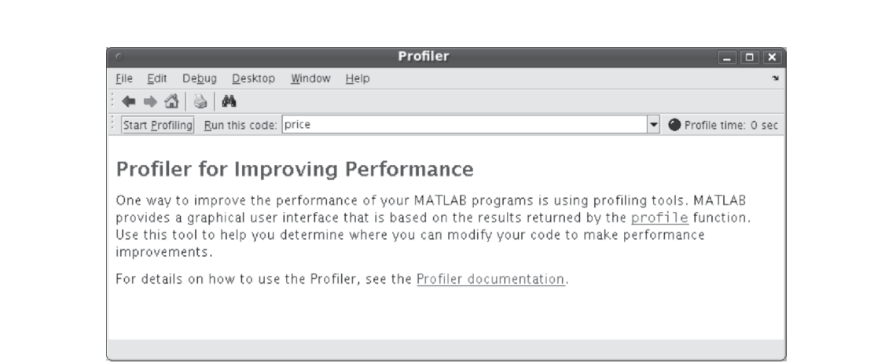

# 附录 B　MATLAB 与 Simulink 入门

本书的实验与开放式设计项目将使用 MATLAB 与 Simulink。本附录作为 MATLAB 的简要复习（你应当用过它）；若你对 Simulink 没有太多经验，本附录将带你入门。请注意：MATLAB 部分主要基于 [1] 的 MATLAB 文档、Simulink 部分基于 [2] 的 Simulink 基础教程——这里提取最重要与最根本的概念，让你读完后快速上手。两款产品的更多信息请查阅 [1] 与 [2]。

## B.1　MATLAB 简介

MATLAB 广泛应用于应用数学的各个领域、大学的教研以及工业界。MATLAB 代表 Matrix Laboratory（矩阵实验室），软件围绕向量与矩阵构建。因此它特别适合解线性代数问题，也适合解代数方程、微分方程与数值积分。MATLAB 拥有一组图形工具，能生成高级 GUI 与 2-D/3-D 数据图。MATLAB 还有若干工具箱，用于通信、信号处理、图像处理、优化及其他专门操作。

MathWorks 创建了优秀的在线教程，复习基础与高级概念，并提供讲师引导的教程展示 MATLAB 的各种能力，见 https://matlabacademy.mathworks.com。

## B.2　有用的 MATLAB 工具

本节介绍寻找错误的通用技术，以及用自动代码分析功能检测 MATLAB 代码中可能需要改进的地方。特别是编辑器中的 MATLAB 调试器功能与等效的命令窗口调试函数。

调试是隔离并修复代码问题的过程。调试帮助纠正两类错误：

- **语法错误**：例如函数名拼错或漏掉括号。
- **运行时错误**：这类错误通常是算法性的。例如你可能修改了错误的变量或把计算写错了。运行时错误通常在 M 文件产生意外结果时显现。运行时错误难以追踪，因为出错强制返回 MATLAB 基工作区时，函数的局部工作区会丢失。

### B.2.1　代码分析与 M-Lint 消息

MATLAB 可以检查代码问题并通过消息（有时称为 M-Lint 消息）推荐修改以最大化性能与可维护性。lint 一词来自其他编程语言（如 C）中类似工具的名字。MATLAB 的 M-Lint 工具对它判定有改进潜力的 M 文件的每一行显示一条消息。例如常见的 M-Lint 消息是"某变量已定义但在 M 文件中从未使用"。

你可以用三种方式检查代码问题，三者报告相同的消息：

- 在编辑器中工作时持续检查代码。查看 M-Lint 消息并基于消息修改文件。消息自动持续更新，可以看到你的修改是否解决了消息指出的问题。有些消息提供扩展信息、自动代码修正或两者兼有。
- 为现有 MATLAB 代码文件运行报告：在编辑器中打开文件，选择 Tools > Code Analyzer > Show Code Analyzer Report。
- 为文件夹中所有文件运行报告：在当前文件夹浏览器中点击 Actions 按钮，选择 Reports > Code Analyzer Report。

对每条消息，查看消息及相关代码，按以下流程基于消息修改代码：

- 点击行号在编辑器/调试器中打开 M 文件并定位到该行。
- 查看报告中的 M-Lint 消息，基于消息修改 M 文件中的代码。
- 注意：某些情况下不应基于 M-Lint 消息做任何修改——M-Lint 消息不适用于该特定场景。M-Lint 不能对每种场景提供完美信息。
- 保存 M 文件。若做了可能引入错误的重大修改，考虑保存为不同文件名——这样在解决更新文件的问题时可以参照原文件。
- 若不确定某条消息的含义或该改什么，用帮助浏览器查找相关主题。

还可以用 `mlint` 函数获取 M-Lint 消息。在命令窗口输入 `help mlint` 了解该函数的更多信息。该工具的更多内容见在线文档 [3]。

### B.2.2　调试器

MATLAB 编辑器、图形化调试器与 MATLAB 调试函数是纠正运行时问题的利器。它们能访问函数工作区、查看或修改其中的值；还可以设置与清除断点——断点是在文件中临时暂停执行的指示器。在断点处暂停时，可以更改工作区上下文、查看函数调用栈、逐行执行文件中的代码。

调试有两个重要技术：**断点**与**单步**。设置断点暂停函数的执行，让你检查认为可能出问题的位置的值。调试时还可以单步执行 M 文件，在想检查值的位置暂停。

M 文件中可以设置三种基本断点：

- **标准断点**：在 M 文件的指定行停止。
- **条件断点**：仅在指定条件下在 M 文件的指定行停止。
- **错误断点**：任何 M 文件产生指定类型的警告、错误、NaN 或无穷值时停止。

MATLAB 忙碌时（例如正在运行 M 文件，除非该 M 文件已在断点处暂停）不能设置断点。程序暂停时可以查看工作区中任何变量的当前值——从而在你想看某行代码是否产生期望结果时检查值。若结果符合预期，继续运行或单步到下一行；若不符合预期，则该行或之前的某行含有错误。调试时可以更改当前工作区中变量的值，看新值是否产生期望结果：程序暂停时在命令窗口、工作区浏览器或数组编辑器中给变量赋新值，然后继续运行或单步执行。若新值没有产生期望结果，程序还有别的问题。

除使用编辑器（图形用户界面）外，还可以在命令窗口用调试函数调试 MATLAB 文件，或两种方式交替使用。更多内容见在线文档 [4]。

### B.2.3　分析器

**性能分析**（profiling）是度量程序执行各函数所花时间的方法。用 MATLAB 分析器（Profiler）可以识别代码中哪些函数最耗时间，进而确定为什么调用它们、寻找最小化使用的方法。判断特定函数被调用的次数是否合理往往很有帮助。由于程序通常有多层，你的代码可能并不显式调用最耗时的函数——而是你代码中的函数在调用往下好几层的其他耗时函数。此时确定你的哪些函数应对这些调用负责很重要。

性能分析帮助发现可以通过以下方式解决的性能问题：

- 避免不必要的计算（可能因疏忽而起）；
- 更改算法以避免高代价函数；
- 避免重复计算——存储结果供将来使用。

当大部分时间花在对少量内置函数的调用上时，代码可能已经优化到你所能期望的极限。可以用以下任一方式打开分析器：

- 从 MATLAB 桌面选择 Desktop → Profiler；
- 从 MATLAB 编辑器/调试器的菜单选择 Tools → Open Profiler；
- 在命令历史窗口选中一条或多条语句，右键查看上下文菜单，选择 Profile Code；
- 在命令窗口输入 `profile viewer`。

打开分析器后按以下步骤分析 M 文件或代码行（如图 B.1）：

1. 在分析器的 Run this code 字段输入要运行的语句。
2. 点击 Start Profiling（或输入语句后按 Enter）。
3. 分析完成后，Profile Summary 报告出现在分析器窗口。

更多内容见在线文档 [5]。



## B.3　系统对象

系统对象（System Objects）是 MATLAB 中类的特化，定义了一组让初始化、运行时操作与拆除都变简单的方法。

类本身基本上是一组共享一组变量（称为参数）的函数。这些参数在类内定义并有确定的作用域。虽然系统对象实现了许多方法，但用户应理解的三个主要方法是 `setupImpl`、`stepImpl` 与 `releaseImpl`。写法如下：

```matlab
methods (Access = protected)
    function setupImpl(obj)
        % Set parameter
        obj.x = 1;
    end
end
```

`setupImpl` 用于初始化参数、执行系统对象生命周期内需要的计算。`stepImpl` 是运行时函数（方法），通常被调用多次、消耗或产生输入/输出。最后 `releaseImpl` 用于拆除对象——清除其内存或执行关闭动作。例如对象要向文件写数据时，该方法被调用时会关闭文件。

调用系统对象的 operator 或 step 方法时，首次调用会实际先调用 `setupImpl` 方法。此时系统对象被视为**锁定**（locked）。然后调用 `stepImpl`。后续的 operator 或 step 调用只调用 `stepImpl`。要解锁对象必须调用 `releaseImpl`。解锁后，下一次 operator 或 step 调用会再次调用 `setupImpl`。脚本演示如下：

```matlab
% Instantiate object
ss = dsp.SignalSource;
% setupImpl and stepImpl are called
data = ss();
% stepImpl is only called
data = ss();
% Object is unlocked
ss.release();
% setupImpl and stepImpl are called
data = ss.step();
```

系统对象极其适合封装大量功能、以及需要维护状态的场合。例如滤波器需要状态，是系统对象的显然用例。组成 MATLAB 的各工具箱用与其缩写相关的扩展名标识其系统对象。例如来自 Communication Systems Toolbox 的系统对象有 comm 扩展：`comm.AGC`、`comm.CarrierSynchronizer`、`comm.EVM` 等。DSP Systems Toolbox 的例子有 `dsp.FIRDecimator`、`dsp.SpectrumAnalyzer` 与 `dsp.SignalSource`。系统对象的更多内容（实现与使用的详尽细节）见 MathWorks 文档。

## 参考文献

[1] The MathWorks, *MATLAB Documentation*. http://www.mathworks.com/help/techdoc/.

[2] University of Michigan, *Simulink Basics Tutorial*. http://www.engin.umich.edu/group/ctm/working/mac/simulink_basics/.

[3] The MathWorks, "Avoid Mistakes While Editing Code." http://www.mathworks.com/help/techdoc/matlab_env/brqxeeu-151.html.

[4] The MathWorks, "Debugging Process and Features." http://www.mathworks.com/help/techdoc/matlab_env/brqxeeu-175.html.

[5] The MathWorks, "Profiling for Improving Performance." http://www.mathworks.com/help/techdoc/matlab_env/f9-17018.html.
