# 第 2 章　信号与系统

SDR 是信号处理中一个面向特定应用的领域，每个参与 SDR 开发的人不仅需要扎实的信号与系统功底，还需要射频与模拟基带处理的知识。本章覆盖线性时不变（LTI）信号与系统、模拟处理与射频的诸多方面，它们构成后续章节的基础。并不要求读者逐个专题深挖，但如果哪个短专题对你来说是新的，应该去查阅这些 subjects 的更全面的专著。

## 2.1　时域与频域

时域和频域是同一个信号的两种替代表示。傅里叶变换——以它的最初提出者、法国数学家兼物理学家让-巴蒂斯特·约瑟夫·傅里叶命名——就是这两种表示之间的数学关系。如果信号在一个域里被修改，它在另一个域里也会随之改变，只是通常方式不同。例如，时域卷积等价于频域相乘。其他数学运算，如加法、缩放与移位，在另一个域里也有对应的运算。这些关系称为傅里叶变换的性质，描述一个域中的数学变化如何在另一个域中产生对应的数学变化。

傅里叶变换只是描述信号的另一种方式。例如，考察吉布斯现象（Gibbs phenomenon）——它说的是：把特定频率/相位/幅度组合的正弦波叠加起来，可以逼近一个方波——可以数学地表达为 (2.1)，如图 2.1 所示。

$$x(t)=\sin(t)+\frac{\sin(3t)}{3}+\frac{\sin(5t)}{5}+\cdots=\sum_{n=1}^{n=\infty}\frac{\sin(n\times t)}{n};\quad n=\text{odd}$$

当我们沿着垂直于频率轴的时间轴观察信号时，看到的是时域。由于视线垂直于频率轴，我们不容易看出正弦波的频率。当我们变换域、沿垂直于时间轴的频率轴观察时，看到的就是频域（傅里叶域）。我们可以轻松辨认信号的幅度与频率，却失去了时间信息。两种视图代表同一个信号——只是通过变换从不同的域去观察而已。

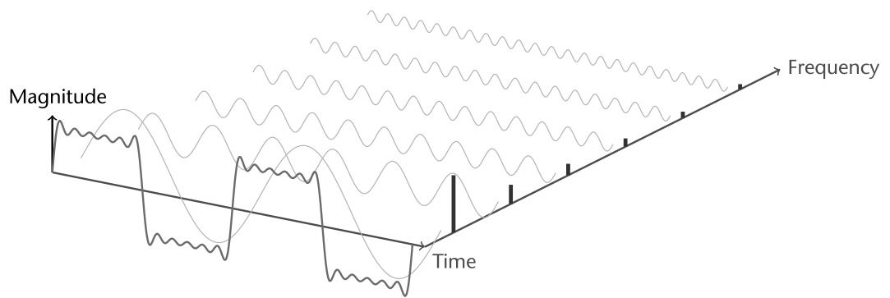

> **思考题**：在 MATLAB 中用代码 2.1 研究吉布斯现象，更好地理解改变频率/相位/幅度如何影响正弦波叠加在时域与频域中的结果。

**代码 2.1　吉布斯现象：gibbs.m**

```matlab
max = 9;
fs = 1000;

for i = 1:2:max
    % dsp.SineWave(amp,freq,phase,Name,Value);
    wave = dsp.SineWave(1/i, i*2*pi, 0, ...
    'SamplesPerFrame', 5000, 'SampleRate', fs);
    y = wave();
    if i == 1
        wavesum = y;
    else
        wavesum = wavesum + y;
    end

    scope(wavesum());
    pause(.5);
    % waitforbuttonpress;
end
```

### 2.1.1　傅里叶变换

傅里叶变换家族有四个成员：傅里叶变换（FT）、傅里叶级数、离散傅里叶变换（DFT）和离散时间傅里叶变换（DTFT）。常被提到的 FFT（快速傅里叶变换）及其逆变换 IFFT，是 DFT 的一种具体实现。

$x(t)$ 的傅里叶变换定义为 [1]：

$$X(\omega)=\int_{-\infty}^{\infty}x(t)e^{-j\omega t}dt,$$

其中 $t$ 是时域的时间变量（秒），$\omega$ 是频域的频率变量（弧度/秒）。

对 $X(\omega)$ 施加类似的变换，得到傅里叶逆变换 [1]：

$$x(t)=\int_{-\infty}^{\infty}X(\omega)e^{j2\pi\omega t}d\omega,$$

它把 $x(t)$ 写成复指数的加权和。

上面的傅里叶变换对可以记为 [2]：

$$x(t)\xleftrightarrow{\;\mathcal{F}\;}X(\omega),$$

符号左侧是变换前的信号，右侧是变换后的信号。研究 SDR 频域时，有几个常用的傅里叶性质很有用，汇总于表 2.1 供参考。

**表 2.1　傅里叶变换性质**（设时间信号为 $x(t)$，其傅里叶变换为 $X(\omega)$；据 [2]）

| 性质 | 时间信号 | 傅里叶变换信号 |
|---|---|---|
| 定义 | $x(t)$ | $\int_{-\infty}^{\infty}x(t)e^{-j\omega t}dt$ |
| 反演公式 | $\int_{-\infty}^{\infty}X(\omega)e^{j2\pi\omega t}d\omega$ | $X(\omega)$ |
| 线性 | $\sum_{n=1}^{N}a_n x_n(t)$ | $\sum_{n=1}^{N}a_n X_n(\omega)$ |
| 对称性 | $x(-t)$ | $X(-\omega)$ |
| 时移 | $x(t-t_0)$ | $X(\omega)e^{-j\omega t_0}$ |
| 频移 | $x(t)e^{j\omega_0 t}$ | $X(\omega-\omega_0)$ |
| 尺度变换 | $x(\alpha t)$ | $\frac{1}{\|\alpha\|}X(\frac{1}{\alpha}\omega)$ |
| 微分 | $\frac{d^n}{dt^n}x(t)$ | $(j\omega)^n X(\omega)$ |
| 积分 | $\int_{-\infty}^{t}x(\tau)d\tau$ | $\frac{X(\omega)}{j\omega}+\pi X(0)\delta(\omega)$ |
| 时域卷积 | $x(t)\ast h(t)$ | $X(\omega)H(\omega)$ |
| 频域卷积 | $x(t)h(t)$ | $\frac{1}{2\pi}X(\omega)\ast H(\omega)$ |

### 2.1.2　DFT 的周期性

与其他三种傅里叶变换不同，DFT 把时域和频域信号都视为周期的（永远重复）。这既让人困惑也不方便，因为许多信号处理应用中的信号并不是周期的。然而，想用 DFT（及其快速实现 FFT），就必须接受 DFT 的世界观。

图 2.2 给出了时域信号的两种解读。先看上方的信号：时域被视为 $N$ 个点。这代表 SDR 采集信号的典型方式——一个 $N$ 点的缓冲区。例如，这 128 个采样可能来自对某模拟信号按固定时间间隔的采样。采样 0 与采样 127 是截然不同、彼此分离的，因为它们是在不同时刻采集的。从这段信号的形成方式看，没有任何理由认为信号左边的采样与右边的采样有关联。

不幸的是，DFT 不这么看。如图 2.2 下方所示，DFT 把这 128 个点视为一个无限长周期信号的一个周期。这意味着采集信号的左侧连接着一份副本信号的右侧；同样，采集信号的右侧连接着一份相同周期的左侧。也可以理解为：采集信号的右侧"卷绕"回去接到它自己的左侧。在这种视图下，采样 127 紧挨着采样 0，就像采样 43 紧挨着采样 44 一样。这称为**循环**（circular）视角，与把信号视为周期信号完全等价。这正是为什么在调用 FFT 之前需要先给信号采集预乘**窗函数** [3] 的原因——窗函数乘以信号、通过把不连续处强压为零来消除它们 [4]。

![DFT 时域信号的周期性：上图为 N 个采样长度的视图，下图为无限长周期信号视图 [4]](images/fig_0202.png)

### 2.1.3　快速傅里叶变换

计算 DFT 有多种方法，比如求解联立线性方程或相关法。FFT 是计算 DFT 的另一种方法。它与其他方法结果相同，但效率惊人地高，常把计算时间降低多个数量级。

FFT 只需要几十行代码，却是信号处理中较复杂的算法之一，其内部细节留给专门研究它的人。只要理解它的工作方式，完全可以放心使用现有的、经过验证的 FFT 例程 [4, 5]，不必彻底理解内部实现。

用图 2.3 所示的通用测试设置做一次 FFT 分析。FFT 的频谱输出是频域中的 $M$ 个点（$M$ 是 FFT 的规模，即缓冲存储器中保存的采样数）。点与点的间距是 $\frac{f_s}{M}$，覆盖的总频率范围是从 DC 到 $\frac{f_s}{2}$，其中 $f_s$ 是采样率。每个频率 bin 的宽度（有时称为 FFT 的分辨率）是 $\frac{f_s}{M}$。

![ADC 输出 FFT 分析的通用测试设置 [6]](images/fig_0203.png)

图 2.4 给出了用 Analog Devices 的 ADIsimADC® 程序对一个理想 12 位 ADC 做出的 FFT 输出。注意，FFT 的理论噪底等于理论信噪比（SNR）加上 $10\log_{10}(\frac{M}{2})$ 的 FFT 处理增益。要记住：SNR 计算中用到的噪声是延伸在整个奈奎斯特带宽（DC 到 $\frac{f_s}{2}$）上的噪声，而 FFT 相当于一台带宽为 $\frac{f_s}{M}$、在频谱上扫掠的窄带频谱分析仪。这会把噪底压低一个等于处理增益的量——与收窄模拟频谱分析仪带宽的效果相同。

FFT 输出可以像模拟频谱分析仪一样，用来测量数字化信号中各次谐波与噪声分量的幅度。输入信号的谐波可以通过它们在频谱中的位置与其他失真产物区分开。

![理想 12 位 ADC 的 FFT 输出，fa = 2.111 MHz，fs = 82 MSPS，5 次 FFT 平均，M = 8192，数据由 ADIsimADC® 生成 [6]](images/fig_0204.png)

## 2.2　采样理论

连续时间模拟信号可以经由采样与量化转换为离散时间数字信号，如图 2.5 所示：连续模拟输入信号 $x_a(t)$ 被转换为离散数字输出信号 $x[n]$。**采样**是在离散时间点上取连续时间信号的样值，把连续时间信号变为离散时间信号 [1]。**量化**过程把采样幅度转换为数字格式。2.2.1 节将介绍一种最常用的采样方法——均匀采样。

类似地，离散时间信号也可以通过**重建**（reconstruction）转换为连续时间信号。但重建并非总能成功：有时重建出的信号与原信号不同。因为一段给定的采样信号，可以对应无穷多条穿过这些量化采样点的连续时间曲线。不过，如果采样满足特定准则，信号就可以无损重建。该准则称为奈奎斯特采样定理，将在 2.2.3 节与 2.5.1 节介绍。

![模数转换器（ADC）的基本组成 [1]。采样发生在采样器模块。xa(t) 为模拟连续时间信号；fs 为数字采样率；xa[n] 为离散时间连续幅度信号；xq[n] 为离散时间离散幅度数字信号（可能以格雷码输出）；x[n] 是编码器以二补码形式输出的结果 [7]](images/fig_0205.png)

### 2.2.1　均匀采样

把模拟信号采样成数字表示有很多方法。但若把采样间隔指定为常数 $T_s$，就得到了使用最广泛的采样——**均匀采样**（uniform sampling），也叫周期采样。用这种方法，我们每隔 $T_s$ 秒对连续时间信号取一次样，可定义为

$$x[n]=x(nT_s),\quad -\infty<n<\infty,$$

其中 $x(t)$ 是输入连续时间信号，$x[n]$ 是输出离散时间信号，$T_s$ 是采样周期，$f_s=1/T_s$ 是采样频率。

均匀采样操作的一个等效模型如图 2.6(a) 所示：连续时间信号 $x(t)$ 与冲激串 $p(t)$ 相乘，形成采样信号 $x_s(t)$，即

$$x_s(t)=x(t)p(t),$$

其中 $p(t)$ 称为采样函数。

采样函数被假定为一串窄脉冲，取值为 0 或 1。于是 $p(t)=1$ 时 $x_s(t)=x(t)$，$p(t)=0$ 时 $x_s(t)=0$。由于 $p(t)$ 只在 $T_s$ 的整数倍时刻等于 1，得到的 $x_s(t)=x(nT_s)=x[n]$，证明这确实是均匀采样操作的等效模型。这个模型将帮助我们在 2.2.2 节得到均匀采样的频域表示。

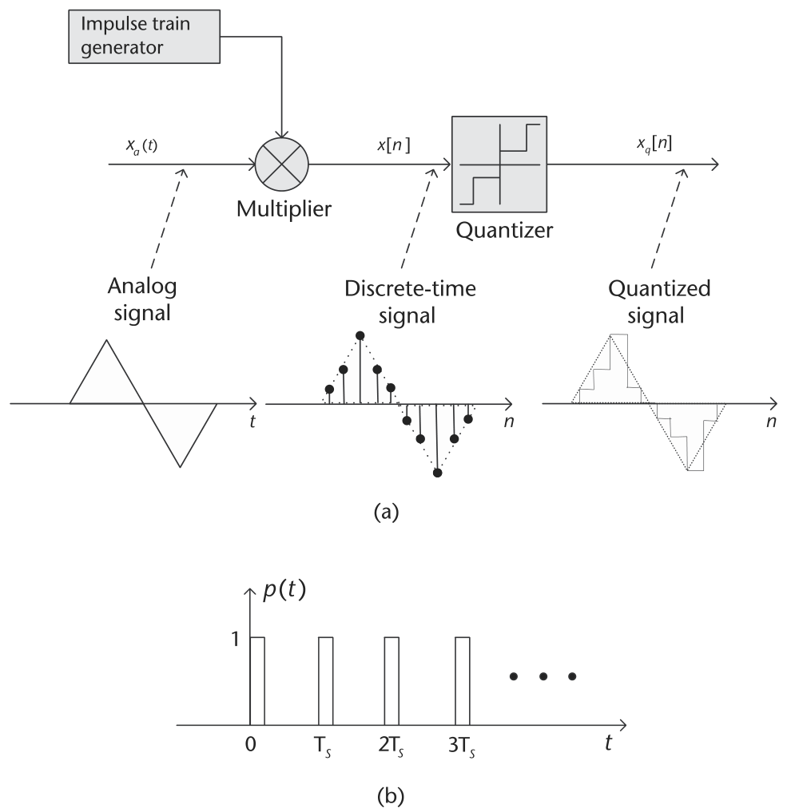

### 2.2.2　均匀采样的频域表示

由于在频域推导奈奎斯特采样定理更容易，本节尝试在频域表示均匀采样过程。根据图 2.6(b)，可以把采样函数定义为

$$p(t)=\sum_{k=-\infty}^{\infty}\delta(t-kT_s),\quad k=0,1,2,\ldots$$

在 $kT_s$ 时刻 $p(t)=1$。根据 [8]，$p(t)$ 是由狄拉克 $\delta$ 函数构成的狄拉克梳（Dirac comb）。

把 (2.7) 代入 (2.6) 得

$$x_s(t)=x(t)p(t)=x(t)\sum_{k=-\infty}^{\infty}\delta(t-kT_s).$$

要在频域理解采样过程，需要对 $x_s(t)$ 取傅里叶变换。根据表 2.1 的频域卷积性质，时域相乘对应频域卷积。因此 $x(t)$ 与 $p(t)$ 的乘积将得到 $X(\omega)$ 与 $P(\omega)$ 的卷积：

$$X_s(\omega)=\frac{1}{2\pi}X(\omega)\ast P(\omega),$$

其中 $X(\omega)$ 是 $x(t)$ 的傅里叶变换，$P(\omega)$ 是 $p(t)$ 的傅里叶变换。

狄拉克梳的傅里叶变换还是狄拉克梳 [8]，即

$$P(\omega)=\frac{2\pi}{T_s}\sum_{k=-\infty}^{\infty}\delta\!\left(\omega-k\frac{2\pi}{T_s}\right)=\frac{2\pi}{T_s}\sum_{k=-\infty}^{\infty}\delta(\omega-k\omega_s),$$

其中 $\omega_s=2\pi f_s$ 是采样频率。

与一串位于脉冲位置处的 $\delta$ 函数做卷积，得到

$$X_s(\omega)=\frac{1}{T_s}\sum_{k=-\infty}^{\infty}X(\omega-k\omega_s).$$

(2.11) 告诉我们：均匀采样使输入信号傅里叶变换产生**镜像**，镜像以采样频率 $f_s$ 为周期重复。

### 2.2.3　奈奎斯特采样定理

基于 (2.11)，我们在频域画出原始信号 $x(t)$ 与采样信号 $x_s(t)$ 的频谱，如图 2.7 所示。设原始信号带宽为 $[-f_h, f_h]$，如图 2.7(a) 所示。这里暂不关心幅度，分别用 $A$ 与 $A_s$ 表示。设采样频率为 $f_s$，则采样信号的频谱将在 $k f_s$ 处出现副本。为了从采样信号重建原始信号，我们对采样信号施加低通滤波，试图从 $X_s(f)$ 中提取 $n=0$ 那一项，如图 2.7(b) 所示。因此，要无误差地完成重建，就要求 $X_s(f)$ 在 $f=\pm f_s$ 处的部分与 $f=0$ 处的部分不重叠。换言之，要求 $f_s-f_h>f_h$，即 $f_s>2f_h$——由此得到奈奎斯特采样定理。

奈奎斯特采样定理适用于**带限信号**：即没有超过 $B$ Hz 频谱分量的信号 $x(t)$ [9]，即

$$X(\omega)=0,\quad |\omega|>2\pi B.$$

**奈奎斯特采样定理**：一个带限于 $B$ Hz 的实信号 $x(t)$，可以用每秒 $R>2B$ 个采样的均匀速率无误差地重建。这一最小采样频率 $F_s=2B$ Hz 称为奈奎斯特速率或奈奎斯特频率；对应的采样间隔 $T=\frac{1}{2B}$ 称为奈奎斯特间隔 [1]。带限于 $B$ Hz、但以低于 $2B$ 奈奎斯特频率（即以 $T>\frac{1}{2B}$ 的间隔）采样的信号，称为**欠采样**（undersampled）。

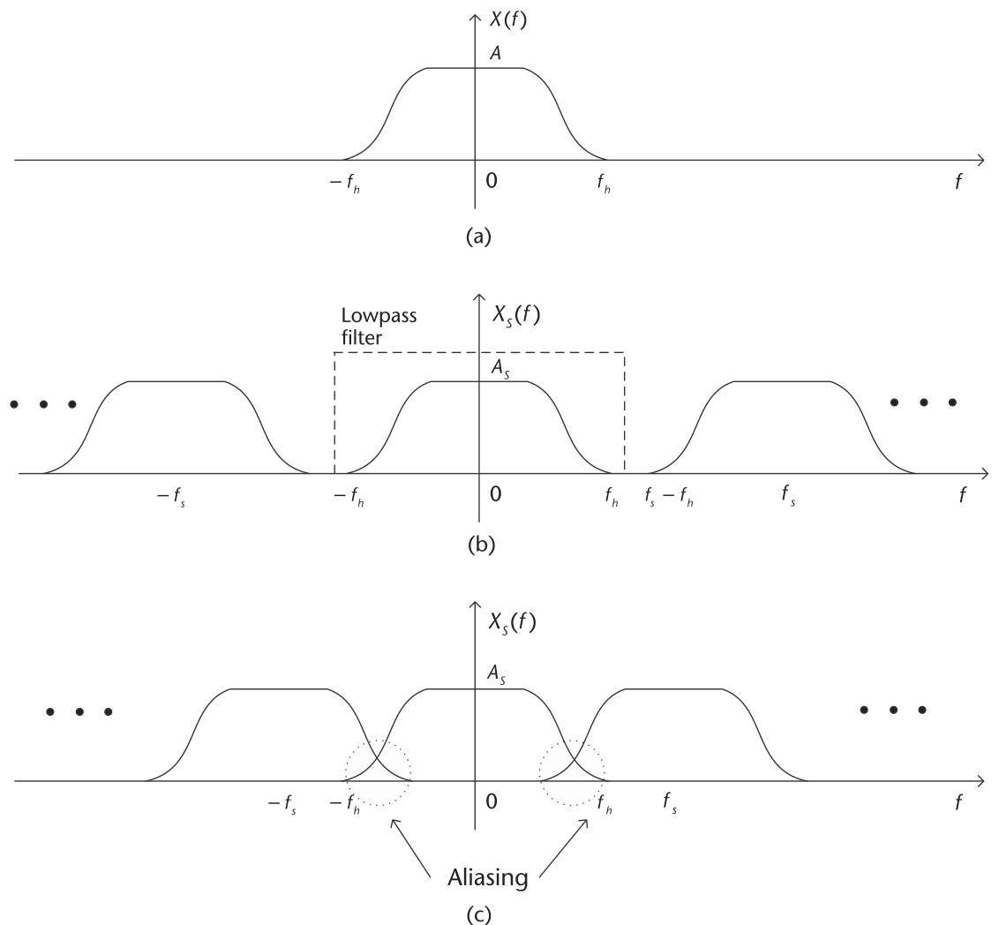

信号欠采样时，其频谱的尾部（镜像）相互重叠，$X_s(f)$ 不再完整保留频谱信息，也就无法从采样信号恢复 $x(t)$。此时尾部频谱并不归零，而是折叠回表观频谱之上。这种尾部翻转称为**频谱折叠**或**混叠**（aliasing），如图 2.7(c) 所示 [10]。

**动手 MATLAB 示例**：现在用计算机仿真解释：为什么奈奎斯特准则要求采样频率至少是信号最高频率的两倍，否则信息就会丢失。而且，正如 2.5.1 节将展示的，此时会发生混叠，频率被折叠回第一奈奎斯特区。为了说明混叠的后果，可以从时域考察。

考虑图 2.8(a) 所示的单音正弦波的时域采样。这个例子里，采样频率 $f_s$ 并未达到模拟输入频率 $F_A$ 的两倍，而只是略高于 $F_A$。因此按定义就违反了奈奎斯特准则。注意，实际采样点的排列产生了一个频率更低的混叠正弦波，如图 2.8(b) 所示。

代码 2.2 可以生成图 2.8(a) 与 (b) 的图形，通过调整 $F_s$ 与 $F_a$ 更好地理解混叠的机理。图 2.7 与图 2.25 在频域演示了同样的效果。

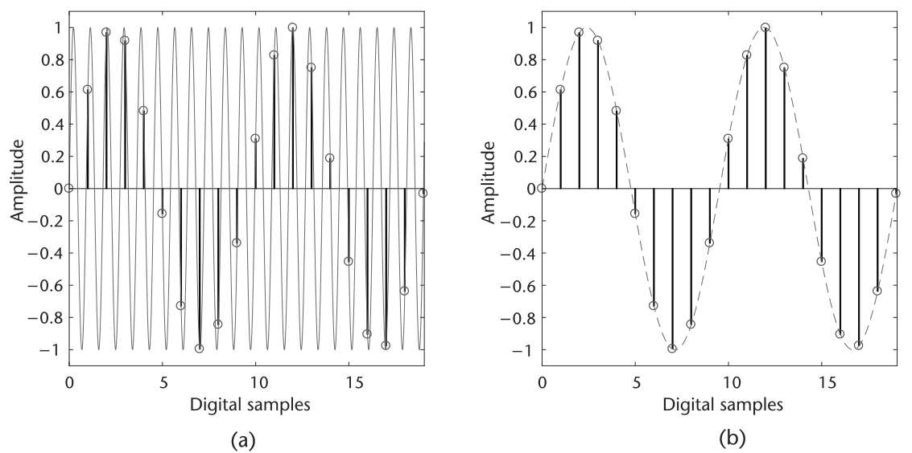

**代码 2.2　时域混叠：nyquist.m**

```matlab
Fs = 1000;      % Sample rate (Hz)
Fa = 1105;      % Input Frequency (Hz)

% Determine Nyquist zones
zone = 1 + floor(Fa / (Fs/2));
alias = mod(Fa, Fs);
if ~mod(zone,2) % 2nd, 4th, 6th, ... Nyquist Zone
    % Its not really a negative amplitude, but it is 180 degrees out
    % of phase, which makes it harder to see on the time domain side,
    % so we cheat to make the graphs look better.
    alias = -(Fs - alias)/Fs;
else            % 3rd, 5th, 7th, ... Nyquist Zone
    alias = (alias)/Fs;
end

% Create the analog/time domain and digital sampling vectors
N = 2*1/abs(alias) + 1;        % Number of Digital samples
points = 256;                  % Analog points between digital samples
analogIndexes = 0:1/points:N-1;
samplingIndexes = 1:points:length(analogIndexes);
wave = sin(2*pi*Fa/Fs*analogIndexes);
```

### 2.2.4　奈奎斯特区

奈奎斯特带宽本身定义为从 DC 到 $\frac{f_s}{2}$ 的频谱。但频谱其实被划分为无穷多个奈奎斯特区，每个区宽度为 $0.5f_s$，如图 2.9 所示。频谱不会因为你不关心那些频率就到此为止。

这意味着采样器（或 ADC）之前需要一些滤波，来去除那些位于奈奎斯特带宽之外、但其混叠分量落入带宽之内的频率成分。滤波器的性能取决于带外信号距离 $\frac{f_s}{2}$ 有多近以及所需的衰减量。要注意：理想采样器（ADC）输入端若不加输入滤波，任何落在奈奎斯特带宽之外的任何奈奎斯特区中的频率分量（无论信号还是噪声）都会混叠回第一奈奎斯特区。正因如此，几乎所有采样 ADC 应用都会使用模拟**抗混叠滤波器**来去除这些不需要的信号。

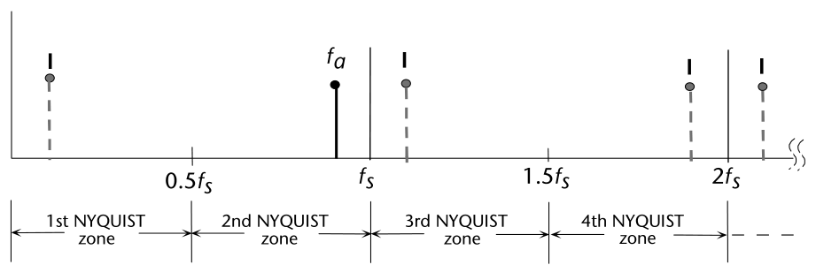

> **思考题**：当频率升入第三、第四或更高奈奎斯特区时，测量频率与绝对频率的关系会怎样变化？你可以按图 2.9 修改代码 2.2，以绝对频率为 x 轴、测量频率为 y 轴作图来验证你的假设。

### 2.2.5　采样率转换

真实应用中，我们常想降低采样率以减少存储与计算量；很多场景下我们又偏爱高采样率以保真。**采样率转换**是改变相邻采样间隔的过程的统称，这里的序列由连续时间函数的采样构成 [10]。

**抽取（decimation）**：降低采样率的过程称为抽取，通过只保留每第 $D$ 个采样、丢弃其余来实现。时域上可定义为

$$y[n]=x[nD],\quad D=1,2,3,\ldots$$

其中 $x[n]$ 是原始信号，$y[n]$ 是抽取后的信号，$D$ 是抽取率。由 (2.13)，原始信号与抽取后信号的采样率满足

$$F_y=\frac{F_x}{D},$$

其中 $F_x$ 为原始信号采样率，$F_y$ 为抽取后信号采样率。

由于弧度频率变量 $\omega_x$ 与 $\omega_y$ 和采样率的关系是

$$\omega_x=2\pi F T_x=\frac{2\pi F}{F_x},\qquad \omega_y=2\pi F T_y=\frac{2\pi F}{F_y},$$

由除法性质可得 $\omega_x$ 与 $\omega_y$ 的关系为

$$\omega_y=D\,\omega_x,$$

即 $\omega_x$ 的频率范围被拉伸 $D$ 倍成为 $\omega_y$ 的频率范围。

为避免抽取序列 $y[n]$ 混叠，要求 $0\le|\omega_y|\le\pi$。由 (2.17)，这意味着原始序列频谱应满足 $0\le|\omega_x|\le\frac{\pi}{D}$。因此实际中抽取通常是两步过程：低通抗混叠滤波器 + 下采样器，如图 2.10 所示。低通抗混叠滤波器用来把下采样器输入 $x[n]$ 的带宽约束到 $0\le|\omega_x|\le\frac{\pi}{D}$。

频域上，抽取后信号 $y[n]$ 的频谱可表示为 [1]

$$Y(\omega_y)=\frac{1}{D}\sum_{k=0}^{D-1}H_D\!\left(\frac{\omega_y-2\pi k}{D}\right)S\!\left(\frac{\omega_y-2\pi k}{D}\right),$$

其中 $S(\omega)$ 是输入信号 $s[n]$ 的频谱，$H_D(\omega)$ 是低通滤波器 $h_D[n]$ 的频率响应。滤波器 $H_D(\omega)$ 设计得当，混叠即被消除，(2.18) 中除 $k=0$ 外的项都消失 [1]。于是 (2.18) 变为

$$Y(\omega_y)=\frac{1}{D}H_D\!\left(\frac{\omega_y}{D}\right)S\!\left(\frac{\omega_y}{D}\right),\quad 0\le|\omega_y|\le\pi.$$

序列 $x[n]$ 与 $y[n]$ 的频谱示于图 2.11：中间信号的频率范围是 $0\le|\omega_x|\le\frac{\pi}{D}$，抽取后信号的频率范围是 $0\le|\omega_y|\le\pi$。

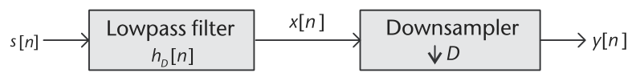

![序列 x[n] 与 y[n] 的频谱，ωx 的频率范围被拉伸 D 倍成为 ωy 的范围：(a) 中间序列频谱；(b) 抽取后序列频谱](images/fig_0211.png)

**插值（interpolation）**：提高采样率的过程称为插值，通过在相邻信号值之间插入（塞零）$I-1$ 个新采样实现。时域上可定义为

$$y[n]=\begin{cases}x[n/I] & n=0,\pm I,\pm 2I,\ldots\\ 0 & \text{otherwise}\end{cases},\quad I=1,2,3,\ldots$$

其中 $x[n]$ 是原始信号，$y[n]$ 是插值后信号，$I$ 是插值率。

由 (2.20)，原始信号与插值后信号的采样率满足

$$F_y=IF_x.$$

由于 (2.15)(2.16) 在这里同样成立，可得

$$\omega_y=\frac{\omega_x}{I},$$

即 $\omega_x$ 的频率范围被压缩 $I$ 倍成为 $\omega_y$ 的频率范围。因此插值之后，$x[n]$ 的频谱将出现 $I$ 个副本，每个副本占据 $\frac{\pi}{I}$ 的带宽。

由于 $y[n]$ 中只有 $0\le|\omega_y|\le\frac{\pi}{I}$ 范围内的频率分量是唯一的（其余副本都与其相同），$\frac{\pi}{I}$ 以上的镜像应通过低通滤波器去除，滤波器频率响应为

$$H_I(\omega_y)=\begin{cases}C & 0\le|\omega_y|\le\frac{\pi}{I}\\ 0 & \text{otherwise}\end{cases},$$

其中 $C$ 是尺度因子。

因此实际中插值也是两步过程：上采样器 + 低通滤波器，如图 2.12 所示。输出信号 $z[n]$ 的频谱为

$$Z(\omega_z)=\begin{cases}CX(I\omega_z) & 0\le|\omega_z|\le\frac{\pi}{I}\\ 0 & \text{otherwise}\end{cases},$$

其中 $X(\omega)$ 是信号 $x[n]$ 的频谱。

序列 $x[n]$、$y[n]$ 与 $z[n]$ 的频谱示于图 2.13：原始信号的频率范围是 $0\le|\omega_x|\le\pi$，插值后信号的频率范围是 $0\le|\omega_z|\le\frac{\pi}{I}$。

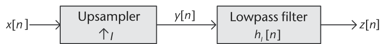

![序列 x[n]、y[n] 与 z[n] 的频谱，ωx 的频率范围被压缩 I 倍成为 ωy 的范围：(a) 原始序列频谱；(b) 中间序列频谱；(c) 插值后序列频谱](images/fig_0213.png)

**动手 MATLAB 示例**：现在用 MATLAB 实验抽取与插值。下面的例子会操作两类信号：连续波（CW）信号（正弦波）与随机信号，并在时域和频域可视化上/下采样的效果。先用代码 2.3 生成信号，再用代码 2.4 的低通滤波器把它们带限。基于这些带限版本，我们将观察正确与错误的上/下采样在时域和频域的效果。

图 2.14(a) 与 (e) 中未滤波的正弦信号就是正弦函数的离散版本；图 2.14(b) 与 (f) 中，随机二进制信号是一串随机的 +1 与 −1。用最小二乘线性相位 FIR 滤波器设计（MATLAB 的 `firls` 函数），我们能快速生成截止频率约在 $0.21\pi$ 的 FIR 滤波器系数。

数据经过代码 2.4 后，滤波后离散信号（正弦与随机二进制）的时域与频域示于图 2.14(c) 与 (g)。图 2.14(e) 的原始正弦与图 2.14(g) 的带限正弦几乎没有差别，因为正弦频率低于代码 2.4 中低通/带限滤波器的截止频率。图 2.14(b) 与 (d) 的随机数据差异一眼可见，频域上图 2.14(h) 相对图 2.14(f) 的带宽收缩也非常明显。时域上我们从足够大的采样处开始观察信号，以避开低通滤波器的起始暂态——这就是为什么我们不看 $t=0$ 附近的波形。频域上，低通滤波有效限制了这些信号的带宽，让它们在本节后续练习中看得更清楚。

**代码 2.3　创建数据集：up-down-sample.m**

```matlab
% Create deterministic and stochastic digital data streams
n = 0:1/Fs1:100-(1/Fs1);                % Time index vector
sin_wave = sin(5*n*2*pi);               % Generation of sinusoidal
                                         % signal
random = 2*round(rand(1,length(n)))-1;  % Random string of +1 and
                                         % -1 values
```

**代码 2.4　创建低通滤波器并带限信号：up-down-sample.m**

```matlab
% Create lowpass filter and apply it to both data streams
% b = firls(n,f,a),
%    n is the FIR filter order
%    f is a vector of pairs of frequency points,
%    a is a vector containing the desired amplitude at the points in f
coeffs1 = firls(taps,[0 0.2 0.22 1],[1 1 0 0]);   % FIR filter
                                                   % coefficients
sin_bwlimited = filter(coeffs1,1,sin_wave);
random_bwlimited = filter(coeffs1,1,random);
```

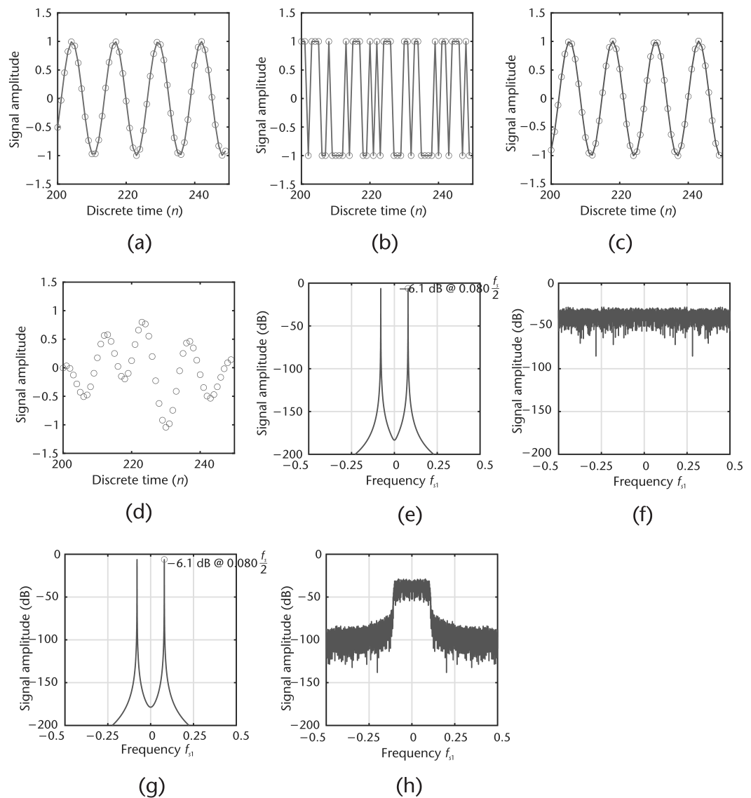

有了滤波后的正弦与随机二进制信号，我们通过观察频域结果来探索上采样的影响。用代码 2.5 的 `upsample` 函数，把滤波后信号上采样 $N$ 倍（本例 $N=5$）。注意 `upsample` 只是在相邻输入采样之间插入 $N-1$ 个零。它与 `interp` 插值函数很不一样——后者把上采样与滤波操作合在一起。

上采样的影响从信号前后的频率响应可以清楚观察：我们预期频率响应被上采样因子 $N$ 压缩，并且在原频带上出现 $N$ 个周期副本。看图 2.15(a) 与 (b)，经代码 2.5 以 $N=5$ 上采样后的正弦与随机二进制信号正是如此。

对比图 2.14(g) 与图 2.15(e) 的滤波正弦，或图 2.14(h) 与图 2.15(f) 的滤波随机数据：两种情形都能清楚看到频谱被上采样因子压缩、并出现周期副本。幅度显然也变了，因为插零影响了平均信号幅度。虽然文献常称之为"压缩"，有趣的是信号频率其实并没有变——只是相对于 $-\frac{f_s}{2}$ 到 $\frac{f_s}{2}$ 的刻度出现在了不同位置。因此要记住：两幅图中的 $f_s$ 并不相同（相差 5 倍），这里对记号略有滥用。

看过上采样如何压缩频率响应并在频谱上制造周期副本，现在探索下采样这些信号会怎样——频率扩张但不混叠，或者产生大量混叠。回忆下采样过程是周期性地丢弃 $M-1$ 个采样，其结果是频率响应扩张 $M$ 倍。当频谱开始与它以 $2\pi$ 为周期的副本（采样信号的频谱每 $2\pi$ 重复一次）重叠时，问题就来了。重叠导致混叠，信号失真，接收端很难恢复。代码 2.6 将对带限信号下采样，代码 2.5 先把信号上采样 $M=3$ 倍。注意 MATLAB 的 `downsample` 函数与 `decimate` 不同，后者把下采样与滤波合并完成抽取。

代码 2.6 生成的图 2.15(g) 与 (h) 展示了错误情形：下采样前没有滤除周期副本，产生混叠。接着代码 2.7 做必要的滤波，在下采样前去除周期副本；这段代码还按上采样率做了幅度校正以补偿这些操作。

**代码 2.5　上采样信号：up-down-sample.m**

```matlab
% y = upsample(x,n)
%     increases the sampling rate of x by inserting (n − 1) zeros
%     between samples.
N = 5;
sin_up = upsample(sin_bwlimited,N);
random_up = upsample(random_bwlimited,N);
```

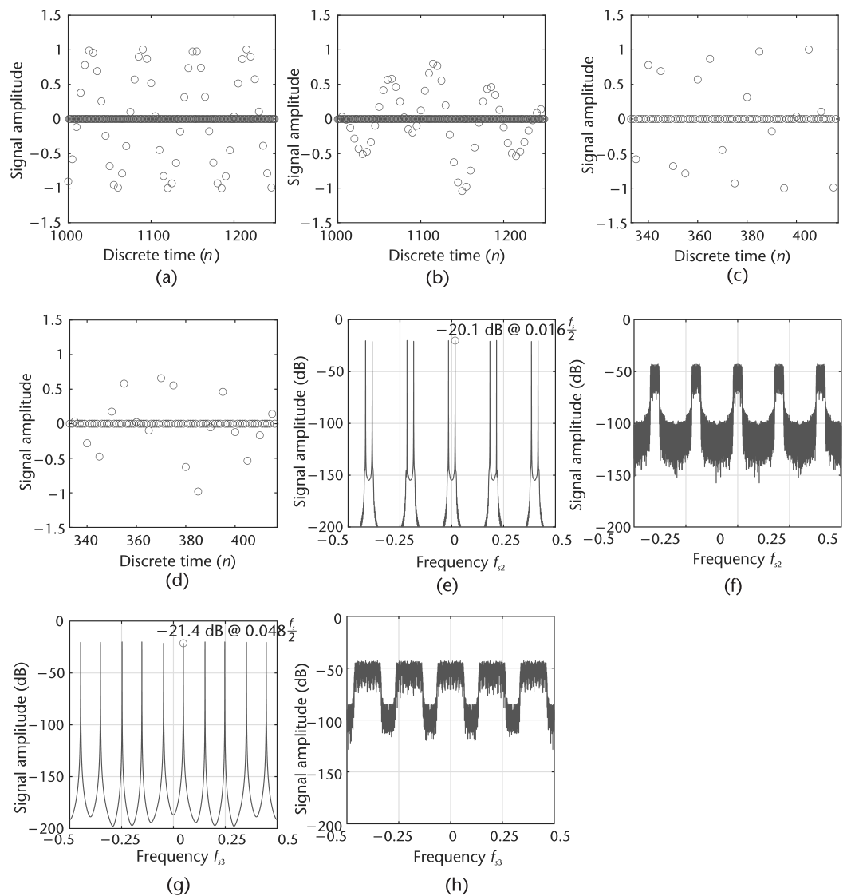

**代码 2.6　下采样信号：up-down-sample.m**

```matlab
% Attempt to downsampling by M without filtering
% This is incorrect, but is instructive to show what artifacts occur
M = 3;
sin_up_down = downsample(sin_up,M);
random_up_down = downsample(random_up,M);
```

**代码 2.7　先低通滤波再下采样：up-down-sample.m**

```matlab
% Lowpass filtering of baseband periodic replica followed by
% downsampling
% (correct approach)
coeffs2 = firls(taps,[0 0.15 0.25 1],[N N 0 0]); % FIR filter
                                                   % coefficients
sin_up_filtered = filter(coeffs2,1,sin_up);
sin_up_filtered_down = downsample(sin_up_filtered,M);
random_up_filtered = filter(coeffs2,1,random_up);
random_up_filtered_down = downsample(random_up_filtered,M);
```

信号被上采样后，此过程产生的周期副本铺满 $-\pi$ 到 $\pi$ 弧度（即 $-\frac{f_s}{2}$ 到 $\frac{f_s}{2}$）的频谱。下采样前若不对这些副本充分滤波，它们会扩张进其他周期副本并导致混叠。图 2.15(d) 与 (h) 演示了这一现象：对上采样后的滤波正弦与随机二进制信号下采样。对上采样滤波正弦的下采样，在图 2.15(g) 中看到来自其他整数奈奎斯特带的频谱混叠。操作正确时，应当只剩一个被下采样因子扩张的副本，如图 2.16(g) 与图 2.17(b) 所示。

由于正弦信号频谱很窄、不易观察扩张，再看随机二进制信号的频响（图 2.15(h) 与图 2.17(b)）。两图中混叠清晰可见——上采样副本没有被滤除。相反，滤除上采样副本后，图 2.17(b) 中下采样信号的频响干净、无混叠。

最后在时域比较信号：时域波形在幅度与绝对时间（秒）上几乎完全一致，只是采样率从 $f_s$ 转换到了 $\frac{5}{3}f_s$，同一信号有了更多采样。

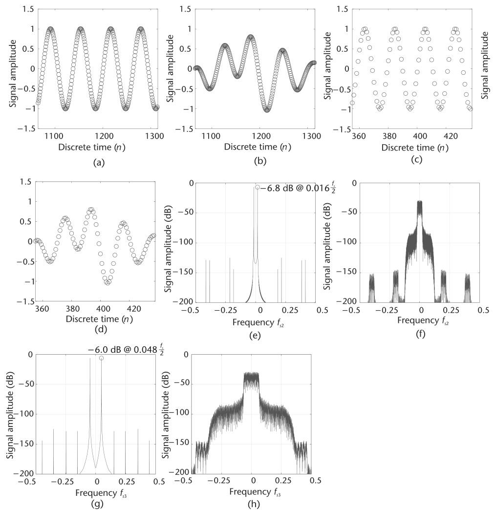

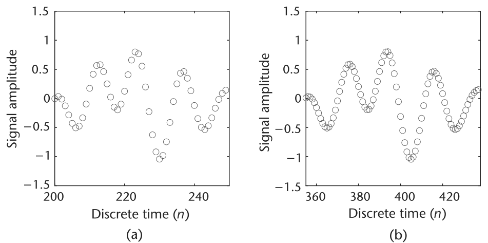

## 2.3　信号表示

理解信号如何表示，能极大提升分析与设计数字通信系统的能力。我们需要多种便利的数学框架来表示真实的射频、基带与噪声信号。通常有两种：**包络/相位**与**同相/正交**，两者都能在时域与频域中表达。

### 2.3.1　频率转换

要理解信号如何从基带搬到射频、又从射频搬回基带，需要细看调制器与解调器。例如图 2.18 是一个非常经典的正交调制器：ADL5375 接收两路差分基带输入与一个单端本振（LO），产生单端输出。LO 接口在内部生成两路相互正交（相差 90°）的本振信号，驱动混频器——混频器做的就是把 LO 信号与输入相乘。

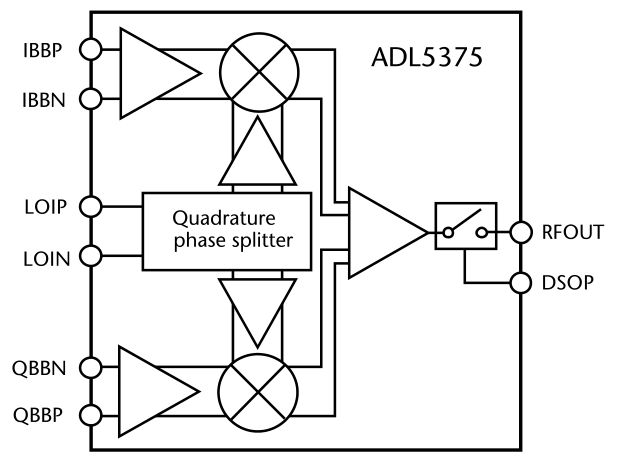

数学上，这个混频过程取两路输入 $I_{BB}$ 与 $Q_{BB}$（记作 $I(t)$ 与 $Q(t)$），分别与频率 $\omega_c$ 的 LO 相乘，再把结果相加得到发射信号 $r(t)$。与 $Q(t)$ 相乘的 LO 被移相 90°，使之与乘 $I(t)$ 的 LO 正交。于是有：

$$r(t)=I(t)\cos(\omega_c t)-Q(t)\sin(\omega_c t).$$

LO 频率记作 $\omega_c$，因为它通常被称为**载波频率**——这里利用了同相分量（$I(t)\cos\omega_c t$）与正交分量（$Q(t)\sin\omega_c t$）之间的相位关系。于是发射信号同时包含两个分量，但看上去只是一条单一的正弦曲线。

接收端，我们用相似而相反的过程把 $r(t)$ 下变频回同相与正交基带信号。把同一 LO（含第二路移相分量）作用于 $r(t)$ 再低通滤波，得到

$$I_r(t)=\mathrm{LPF}\{r(t)\cos(\omega_c t)\}=\mathrm{LPF}\{(I(t)\cos(\omega_c t)-Q(t)\sin(\omega_c t))\cos(\omega_c t)\}=\frac{I(t)}{2},$$

$$Q_r(t)=\mathrm{LPF}\{-r(t)\sin(\omega_c t)\}=\mathrm{LPF}\{(-I(t)\cos(\omega_c t)+Q(t)\sin(\omega_c t))\sin(\omega_c t)\}=\frac{Q(t)}{2}.$$

实践中，发射机 LO 与接收机 LO 之间存在相差，会使 $r(t)$ 发生旋转，但 $I(t)$ 与 $Q(t)$ 之间的相位关系总能保持。

### 2.3.2　虚数信号

把信号称为"正交信号"或"复信号"，是在借用欧拉等人创造的数学构造来简化分析。我们尽量用同相（I）/正交（Q）来称呼信号，因为那才是严格正确的说法。如 2.3.1 节所述，**同相**（I）指与本振同相位的信号分量，**正交**（Q）指与移相 90° 后的本振同相位的分量。

把 I 看作实部、Q 看作虚部很方便，因为这能启用许多数学技巧，但归根结底只是个构造。这种便利的典型例子就是混频器完成的频率搬移。从欧拉关系式出发：

$$e^{jx}=\cos(x)+j\sin(x),$$

其中可把 $x$ 定义为目标频率乘时间。沿用 2.3.1 节的约定但把 $I(t)$、$Q(t)$ 重新定义为实部与虚部，得到

$$y(t)=I(t)+jQ(t).$$

假设 $y(t)$ 是频率 $\omega_a$ 的连续波单音（便于说明），则

$$y(t)=\cos(\omega_a t)+j\sin(\omega_a t).$$

应用 (2.28)，可以把 $y(t)$ 搬移到期望频率 $\omega_c$：

$$\begin{aligned}
y(t)e^{j\omega_c t}&=I(t)\cos(\omega_c t)-Q(t)\sin(\omega_c t)\\
&\quad+j\!\left(Q(t)\cos(\omega_c t)+I(t)\sin(\omega_c t)\right)\\
&=\cos((\omega_c+\omega_a)t)+j\sin((\omega_c+\omega_a)t).
\end{aligned}$$

简单套用欧拉恒等式，我们的信号就出现在了频率 $\omega_a+\omega_c$ 上。

再从硬件角度体会复数表示的用处。考虑图 2.18 的混频器：IQ 混频器可以发射任意相位与幅度的信号（在功率约束内）。这就是我们通过相位与幅度的差异把信息编码进发射数据的例子。它实际上正是通过同相与正交信号的关系实现的——可以用来产生具有任意相位与幅度的单一正弦波。数学上，用两个正交分量（正弦与余弦）可以合成具有特定包络与相位 $(A,\varphi)$ 的正弦波：

$$A\sin(\omega t+\varphi)=(A\cos\varphi)\sin(\omega t)+(A\sin\varphi)\cos(\omega t).$$

因此，只需随时间调整正弦与余弦分量的幅度，就能用固定频率与相位的 LO 产生想要的波形。也可以换用其他坐标系来观察复数值：直角坐标形式的复数可以变换为幅值-角度（极坐标）表示，甚至画成矢量。

图 2.19 中的同相与正弦正交正弦波展示了相量图（phasor plot）随时间推移的样子——指示幅度的矢量绕轴旋转，I 与 Q 之间的相移清晰可见。时域中也能看出同相与幅度之间的差异，只是相位差稍微隐蔽些。在笛卡尔平面上，信号随时间呈现为一个旋转的圆。相量图总是随时间逆时针旋转；笛卡尔图则可顺可逆，取决于 I 与 Q 之间相位差的正负。时域图显示的是随时间的变化，而相量图与笛卡尔平面是某个时刻的快照（取时域图的 $t=0$）。频域图给出相量的频谱，但只传达幅度、丢失相位信息——因为我们只画了频谱的实部分量。对比图 2.19 与图 2.20：I 与 Q 分量的变化（幅度与相位关系）也会体现在其他域中。

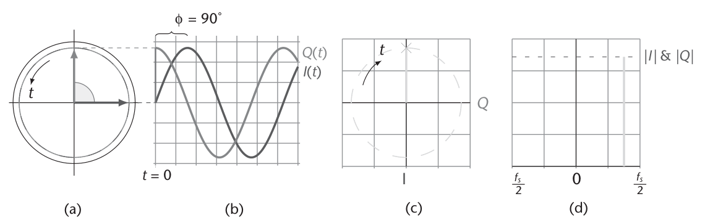

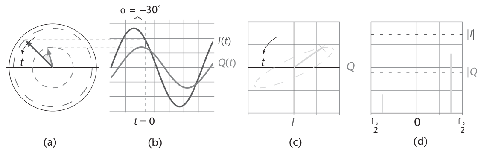

## 2.4　信号指标与可视化

工程师要判断一个项目是否完成，需要某种形式的验证。但通信系统收发链路之深、集成度之高，使其评估相当复杂。如 1.4 节所述，通信系统除尺寸、重量、功耗与成本（SWaP-C）外还有许多指标。误码率（BER）、数据吞吐量与通信距离等性能指标也只是**顶层**系统指标。正如整个系统有系统级指标，各子系统与 SDR 构建模块也有各自的指标与测量方法——这样我们才知道不会把特定组件设计得过剩或不足。但折中永远要在系统层面考量，因为上游的改动会影响下游的组件与实现。

系统级指标的达成，靠的是确保系统中每一块都能支撑这些指标。打造世界一流的通信系统，需要世界一流的硬件与世界一流的算法设计及实现。这正是工程学许多方面的难点所在——定量地判断某件事是否完成、是否可用、能否接入系统的其余部分。通信系统"整体性能取决于最薄弱的环节"这句话再正确不过：如果你把一切都拼装好，而误码率这类系统级指标不达标，你又不会测量通信系统的每一部分——从射频到 SDR 到算法——那你就会束手无策，不知道下一步怎么办。

取决于你要看什么，有无数技术与工具几乎可以测量一切。学通信的人，不适合不愿严谨的人。

### 2.4.1　SINAD、ENOB、SNR、THD、THD+N 与 SFDR

量化模拟动态性能的六个流行指标见表 2.2 [6]。列出并理解这些测量，会帮助你分析设计、确保设计足够稳健。尽管多数器件与系统厂商对这些指标采用了相同定义，例外仍然存在。由于它们在器件与系统比较中的重要性，不仅要准确理解每个指标的含义，还要理解指标之间的关系。

**表 2.2　六个流行指标**

| 指标 | 含义 | MATLAB 函数 |
|---|---|---|
| SFDR | 无杂散动态范围 | `sfdr` |
| SINAD | 信纳比（信号对噪声加失真比） | `sinad` |
| ENOB | 有效位数 | — |
| SNR | 信噪比 | `snr` |
| THD | 总谐波失真 | `thd` |
| THD+N | 总谐波失真加噪声 | — |

- **无杂散动态范围（SFDR）**是信号均方根（RMS）值与最差杂散信号 RMS 值之比，无论该杂散落在频谱何处。最差杂散可能是也可能不是原信号的谐波。它通常在感兴趣带宽上测量——除非另有说明，该带宽即奈奎斯特带宽：基带为 DC 到 $\frac{f_s}{2}$，复数（射频）转换器为 $-\frac{f_s}{2}$ 到 $\frac{f_s}{2}$，Pluto SDR 这类器件用的就是后者。SFDR 在通信系统中很重要，因为它代表了能从大干扰信号（阻塞信号）中分辨出的最小信号值。SFDR 一般随信号幅度变化绘制，可以相对于信号幅度（dBc）或 ADC 满量程（dBFS）表示，如图 2.21 所示。MATLAB 的 `sfdr` 函数以 dBc 给出结果。对接近满量程的信号，峰值频谱杂散通常由基频的前几次谐波决定；但当信号低于满量程若干 dB 时，通常出现并非输入信号直接谐波的杂散——这是系统的微分非线性在较小信号时占主导所致。因此 SFDR 考虑所有来源的失真而不问出处，是评估各类通信系统的有力工具。
- **总谐波失真（THD）**是基波信号 RMS 值与其各次谐波均方根值平均之比（一般只有前五次谐波显著）。ADC 的 THD 通常也以接近满量程的输入来规定，但可以在任意电平规定。
- **总谐波失真加噪声（THD+N）**是基波信号 RMS 值与其各次谐波加全部噪声分量（不含 DC）的均方根平均之比。必须规定噪声测量的带宽：FFT 情形下为 DC 到 $\frac{f_s}{2}$（若测量带宽就是奈奎斯特带宽，THD+N 等于 SINAD）。
- **信纳比（SINAD，或 S/(N+D)）**是信号 RMS 幅度与其余所有频谱分量（含谐波、不含 DC）均方根平均之比。SINAD 是模拟系统整体动态性能的好指标，因为它涵盖了构成噪声与失真的所有分量。SINAD 常针对不同输入幅度与频率表征。给定输入频率与幅度时，只要两者噪声测量带宽相同（奈奎斯特带宽），SINAD 等于 THD+N。
- **信噪比（SNR，有时称不含谐波的 SNR）**从 FFT 数据按与 SINAD 相同的方式计算，只是把信号谐波排除在外、只留噪声项。实践中只需排除前五次谐波，因为它们占主导。SNR 在高输入频率时会恶化，但由于排除了谐波项，一般不像 SIND 那样快。

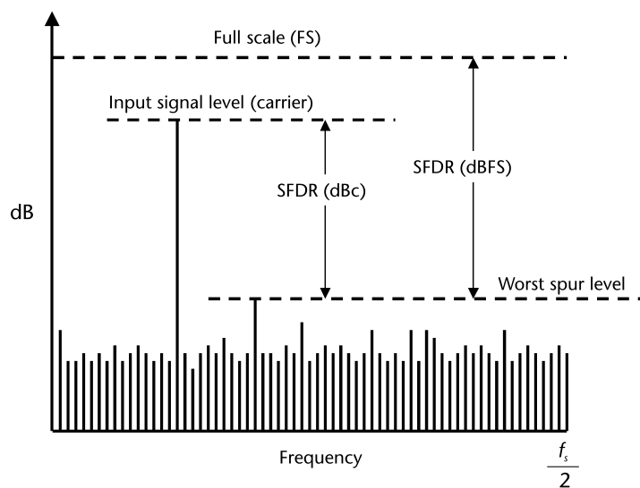

### 2.4.2　眼图

虽说有点废话：时域图用来观察电信号随时间的变化。幅度、频率、上升时间、时间间隔、失真、噪底等任何现象都可以被经验地测定，也可以看这些特性如何随时间变化。在电信中，**眼图**（eye diagram，又称眼型图）是一种时域显示：把接收机的数字数据信号反复采样加到垂直输入，用数据速率触发水平扫描 [9]。之所以叫眼图，是因为图案看起来像一对轨道之间的一系列"眼睛"。

通过分析这种显示可以导出若干系统性能度量，尤其是**码间串扰**（ISI）的程度：眼闭合，ISI 增大；眼张开，ISI 减小。此外，信号太长、太短、与时钟同步不佳、太高、太低、太噪、跳变太慢、下冲或上冲过大，都能从眼图观察到。例如，图 2.22 给出了带噪声的 QPSK 信号的典型眼图。

由于眼图传达并测量许多不同类型的关键数据，它有助于量化一个算法或系统工作得如何。两个关键测量是：**垂直张开度**（BER 判决门限点之间的距离）与**眼高**（眼电平之间的最小距离）。眼的垂直与水平张开度总是越大越好。

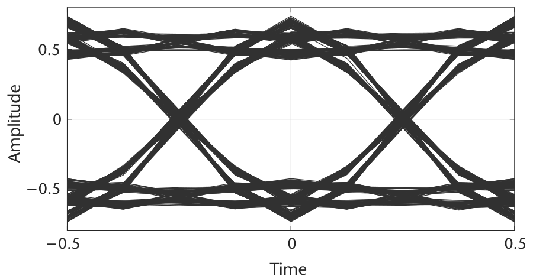

**动手 MATLAB 示例**：为获得眼图的动手经验，用 MATLAB 的 `eyediagram` 函数——这是可视化分析传输中噪声量与码间串扰的利器。用脉冲成形后的信号，应当能观察到传输中存在的任何失真。

从图 2.23 可见，脉冲成形传输不含任何失真（我们预先知道，因为一开始就没往传输里加噪声与失真）。图 2.23(a) 与 (b) 这样的眼图，我们称为眼**张开**。传输中存在失真的首要标志，是时刻 0 处的孔径没有达到最大。

再来考察传输中存在失真的情形及其眼图表现。取代码 2.8 的 `y_impulse1` 与 `y_impulse2` 输出信号，往里加一些噪声——代码 2.9 用 `randn` 函数加了高斯噪声。

在图 2.24 中能清楚看到附加噪声对发射信号眼图的影响：图 2.24(a) 与 (b) 中眼图的眼壁相比图 2.23(a) 与 (b) 不再平滑。两种情形下眼仍张开——我们只加了少量噪声；大量噪声有可能把眼闭上，意味着时刻 0 处期望的采样时刻可能被破坏、转化为误码。本书后面还会探索其他形式的失真如何影响眼图的孔径。

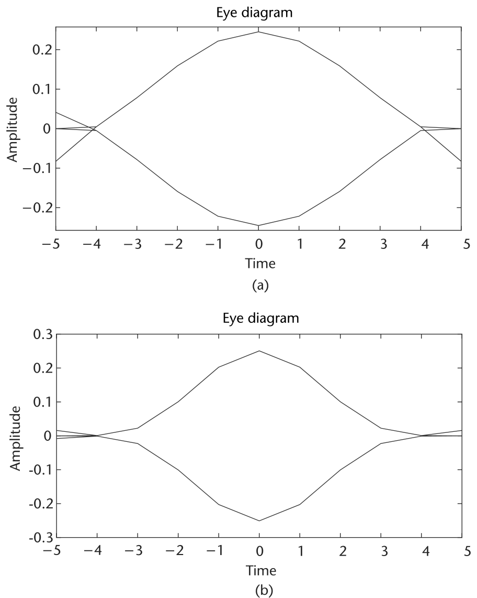

**代码 2.8　眼图示例：eye_example.m**

```matlab
% Create impulse train of period L and length len with random +/- one
% values
L = 10;
impulse_num = 100; % Total number of impulses in impulse train
len = L*impulse_num;
temp1 = [2*round(rand(impulse_num,1))-1 zeros(impulse_num,L-1)];
x_impulse = reshape(temp1.',[1,L*impulse_num]);

% Create two transmit filter pulse shapes of order L
% Approximate rectangular frequency response --> approximate
% sinc(x) impulse response
txfilt1 = firls(L,[0 0.24 0.25 1],[4 4 0 0]);
% Approximate triangular frequency response --> approximate
% sinc(x)^2 impulse response
txfilt2 = firls(L,[0 0.5 0.52 1],[4 0 0 0]);

% Pulse shape impulse train
y_impulse1 = filter(txfilt1,1,x_impulse);
y_impulse2 = filter(txfilt2,1,x_impulse);

% eyediagram(x,n,period,offset)
% creates an eye diagram for the signal x, plotting n samples in each
% trace, horizontal axis range between -period/2 and period/2.
eyediagram(y_impulse1,L,L,floor(L/2));
eyediagram(y_impulse2,L,L,floor(L/2));
```

**代码 2.9　眼图示例：eye_example.m**

```matlab
eyediagram((y_impulse1+0.1*randn(1,length(y_impulse1))),L,L,floor(L/2));
eyediagram((y_impulse2+0.1*randn(1,length(y_impulse2))),L,L,floor(L/2));
```

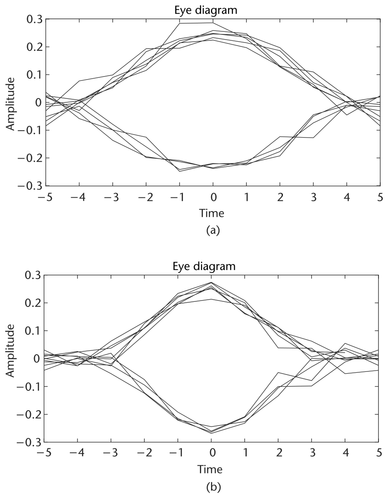

## 2.5　SDR 接收技术

现代通信的研究在模拟与数字两个域之间保持着极大的二元性。两个域都被高效、高速地处理。但模拟信号保持着"无限精度"的视角，本质上又总带有某种随机性；数字信号则精确、定义明确，却受限于计算复杂度与基本原理的边界。数字通信必须同时管好这两个世界，才能在节点之间设计出稳健的链路。因此两个域高度相互依赖。

即使在当今 DSP 器件丰富而廉价的世界上，模拟信号仍然是先被处理、放大、滤波，然后才由 ADC 转换为二进制形式。ADC 的输出只是模拟信号的二进制表示，交给从 FPGA 到通用 CPU 的各种计算单元处理。处理完毕后，从数字化信号获得的信息又可以用数模转换器（DAC）变回模拟形式。SDR 物理接收的信号始于时变电场——它在接收天线上感应电流、在接收机处形成可检测的电压；而 SDR 的发射则是把时变电压加到天线上，驱动电子运动形成向外辐射的电场。

### 2.5.1　奈奎斯特区

2.2.3 节考虑的是基带采样的情形（即所有感兴趣的信号都在第一奈奎斯特区内）。图 2.25 展示了这样一种情形：被采样信号的频带限制在第一奈奎斯特区内，原始频带的镜像出现在其余每个奈奎斯特区。再看图 2.25 B 所示的情形：被采样的信号频带完全落在第二奈奎斯特区内。对第一奈奎斯特区之外的信号采样，常称为**欠采样**或**谐波采样**。注意落入第一奈奎斯特区的那份镜像，除原始位置外包含了原信号的全部信息。

图 2.25 还展示了被限制在第三奈奎斯特区内的采样信号。注意落入第一奈奎斯特区的镜像没有发生频率翻转。事实上，被采样信号可以位于任何一个奈奎斯特区内，落入第一奈奎斯特区的镜像仍是准确的表示。至此我们可以把奈奎斯特准则重述为：

> **信号必须以等于或大于其带宽两倍的速率采样，才能保留全部信号信息。**

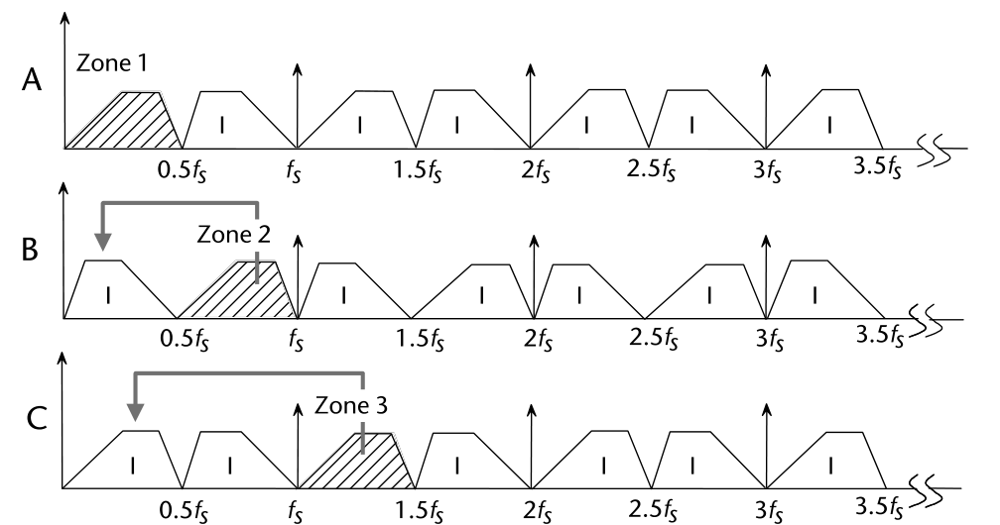

注意，这里完全没有提及被采样信号频带在频谱中的**绝对位置**相对于采样频率的关系。唯一的约束是：被采样信号的频带必须限于单个奈奎斯特区内（即不得跨越 $\frac{f_s}{2}$ 的任何整数倍）。事实上，这正是抗混叠滤波器的主要功能。

对第一奈奎斯特区以上的信号采样，在通信中已经流行起来，因为该过程等价于模拟解调。直接采样中频（IF）信号再用数字技术处理正成为常见做法，从而省去 IF 解调器与滤波器。但随着 IF 频率升高，对 ADC 的动态性能要求（带宽、线性度、失真等）变得更苛刻——因为性能必须在第二或第三奈奎斯特区依然够用，而不只是基带。这对许多为第一奈奎斯特区设计的 ADC 是个难题。因此适合欠采样应用的 ADC 必须在更高阶奈奎斯特区保持动态性能。这在 Pluto SDR 这类器件上尤为重要：它内置 DC 校正来去除本振泄漏。该 DC 校正可以理解为紧贴 DC（25 kHz）的高通滤波器。对 QPSK、QAM 这类并不严格在 DC 传信息的调制方案，这无关紧要；而对在 DC 传信息的调制方案，不用上述欠采样技术就很难绕开这个问题。在 DC 以上采集数据、再用数字方式搬下来，可以改善性能。

### 2.5.2　定点量化

理想 $N$ 位数据转换器仅有的误差（DC 或 AC）只与采样和量化过程有关。理想转换器数字化信号时的最大误差是 $\pm\frac{1}{2}$ LSB，正好落在两个数字值中间。这一点从图 2.26 理想 $N$ 位 ADC 的传递函数看很明显。对任何跨越多个 LSB 的交流信号，其量化误差可以近似为一个峰峰幅度为 $q$（一个 LSB 的权重）的不相关锯齿波。这一分析虽不精确，但对大多数应用足够准确。

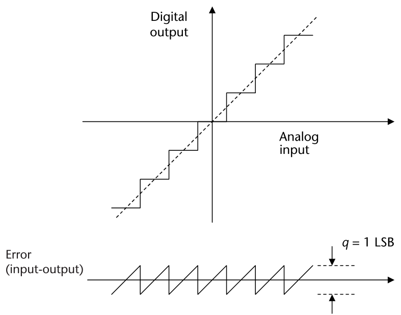

量化误差随时间的变化示于图 2.27。同样，一个简单的锯齿波就提供了足够精确的分析模型。锯齿误差的方程为

$$e(t)=st,\quad -\frac{q}{2s}<t<\frac{q}{2s},$$

其中 $s$ 是量化噪声的斜率。$e(t)$ 的均方值可写为

$$\overline{e^2(t)}=\frac{1}{q/s}\int_{-q/2s}^{q/2s}(st)^2dt=\frac{q^2}{12}.$$

(2.34) 的平方根即 RMS 量化噪声误差，近似为高斯分布、或多或少均匀地分布在 DC 到 $\frac{f_s}{2}$ 的奈奎斯特带宽内。

现在可以计算满量程正弦输入 $v(t)$ 下的理论 SNR：

$$v(t)=\frac{q2^N}{2}\sin(\omega t),$$

先算输入信号的 RMS 值：

$$\overline{v(t)}=\frac{q2^N}{2\sqrt{2}}.$$

于是理想 $N$ 位转换器的 RMS 信噪比为

$$\mathrm{SNR}=20\log_{10}\frac{\text{满量程输入的 RMS}}{\text{量化噪声的 RMS}}=20\log_{10}\frac{\frac{q2^N}{2\sqrt{2}}}{\frac{q}{\sqrt{12}}}.$$

化简 (2.37) 后得到以 dB 表示的 SNR：

$$\mathrm{SNR}=20\log_{10}2^{2N}\sqrt{3}=6.02N+1.76.$$

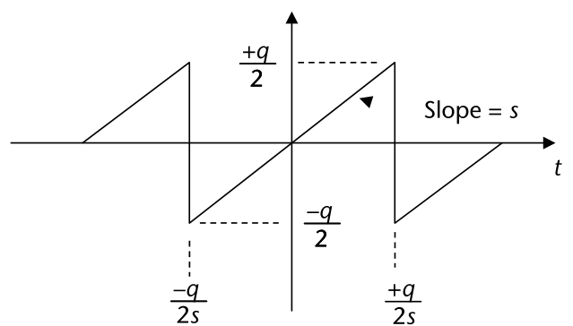

同样，这是 DC 到 $\frac{f_s}{2}$ 带宽上的结果。许多应用中，感兴趣的信号实际只占更小的带宽（BW）。例如用数字滤波滤除 BW 之外的噪声分量后，就要在公式里加一个修正因子（称为**处理增益**）来体现 SNR 的提高。以大于信号带宽两倍的速率采样，常称为**过采样**（oversampling）。过采样配合量化噪声整形与数字滤波，正是 sigma-delta 转换器的核心概念，将在 2.5.4 节讨论。

**动手 MATLAB 示例**：2.5.2 节中我们做了如下假设 [11]：

- 误差样本序列 $e(t)$ 是某平稳随机过程的样本序列；
- 误差序列与精确样本序列 $v(t)$ 不相关；
- 误差过程的随机变量互不相关，即误差是白噪声过程；
- 误差过程的概率在量化误差范围内均匀分布。

这里的根本假设是量化噪声与输入信号不相关。我们会看到，在某些常见且不起眼的例子中这并不成立。当采样时钟与信号谐波相关时，量化噪声变得相关，能量集中在信号的谐波处。在实际 ADC 应用中，由于宽带输入信号的随机性、以及系统中通常存在的少量噪声（起着抖动信号的作用、进一步随机化量化误差谱），量化误差一般表现为随机噪声。理解上面这点很重要，因为 ADC 的单音正弦 FFT 测试是普遍接受的性能评估方法之一。要准确测量 ADC 的谐波失真，必须采取措施确保测试设置测到的真是 ADC 的失真，而不是量化噪声相关性的伪影。

我们将用代码 2.10 的变体来探索 SFDR，并围绕计算所允许的精度展开这个概念。先从双精度浮点表示（MATLAB 默认）开始。为保持信号不相关，我们选了 3,959,297 Hz 的单音（一个质数）。

这给出了图 2.28 的结果：SFDR 测得 288.96 dBc，非常可观。但 Pluto SDR 这样的真实电台不能接受双精度浮点数，必须使用定点（12 位）表示。

Pluto SDR 与许多其他器件使用的定点格式是带符号格式：最高位（MSB）是符号位，其余 11 位表示幅度。MATLAB 脚本里我们用 $2^{11}$ 作幅度，在发射前最大化信号动态范围。于是乘上该整数值、取整、再缩回 $\pm1$ 以归一化幅度。

这得到了图 2.29 中不太拿得出手的 45.97 dBc SFDR——连 8 位性能都不到。原因是示例中我们把信号缩放到 $10^{-3}$，而定点数的动态范围不像双精度浮点那样等比例缩放。

为解决动态范围问题，去掉 $10^{-3}$ 缩放、使用 12 位满量程。这给出图 2.30(a) 中体面的 86.82 dBc。要更进一步，可以利用 **FFT 处理增益**的概念：把采样数增加到 10,000（代码 2.15 只是改变了 $t$ 的长度），得到图 2.30(b) 的 93.98 dBc。这只是增加了采样数→增加了 FFT bin 数→每个 bin 累积的能量减少。

代码 2.10、2.11、2.12 与 2.15 用的是不相关的 $F_A$ = 3,959,297 Hz。如果相关会怎样？把示例中的 $F_A$ 直接取整为 4 MHz（代码 2.13 与 2.14），结果见图 2.31(a)：SFDR 为 82.58 dBc，比图 2.30(b) 损失了 11.4 dB。

为在图 2.31(b) 中挽回损失，可以用**抖动**（dithering）技术：把谐波上累积的能量摊到其余噪底上。噪底更高了，但最差杂散更低——而后者才是计算 SFDR 的考量指标。结果为 91.68 dBc，与图 2.30(b) 的不相关结果只差 2.3 dB。

与其按固定模式向上或向下取整，我们在取整前给向量加上 $\pm0.5$ 的随机偏置，实现随机地向上或向下取整。这是个非常简单的抖动算法，硬件中会有更复杂的实现。

在把数据送给硬件之前，应当理解有限位宽与数据相关性的影响。硬件只会让影响更糟，不会更好。

**代码 2.10　SFDR 测试：sfdr_test.m**

```matlab
deltat = 1e-8;
fs = 1/deltat;
t = 0:deltat:1e-5-deltat;
fundamental = 3959297;
x = 10e-3*sin(2*pi*fundamental*t);
r = sfdr(x,fs)

sfdr(x,fs);
```

**代码 2.11　SFDR 测试：sfdr_test.m**

```matlab
bits = 2^11;
x = round(10e-3*bits*sin(2*pi*fundamental*t))/bits;

sfdr(x,fs)
```

**代码 2.12　SFDR 测试：sfdr_test.m**

```matlab
bits = 2^11;
x = round(bits*sin(2*pi*fundamental*t))/bits;
sfdr(x,fs)
```

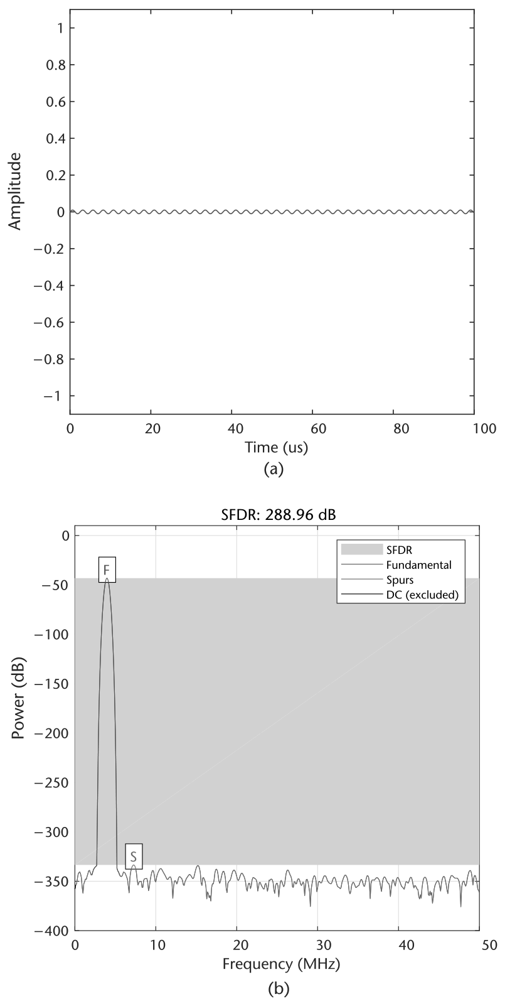

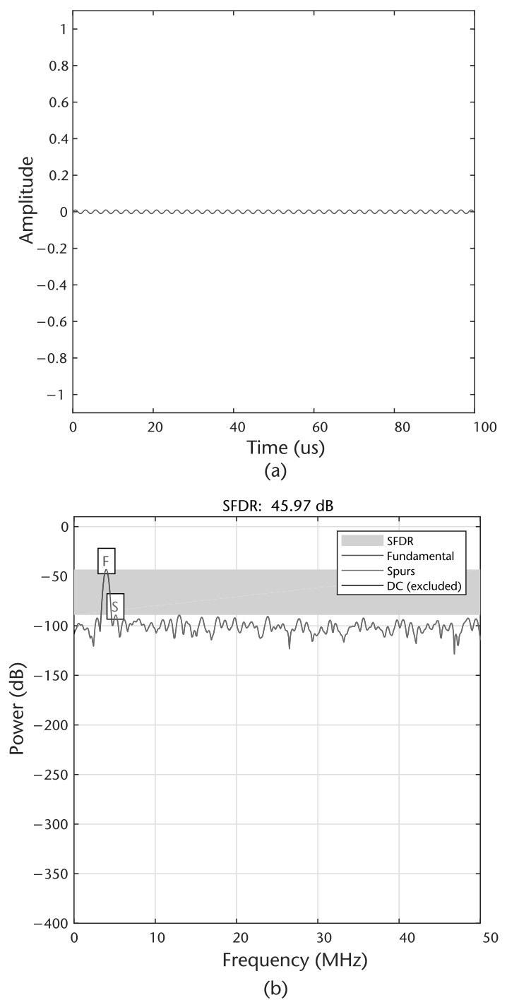

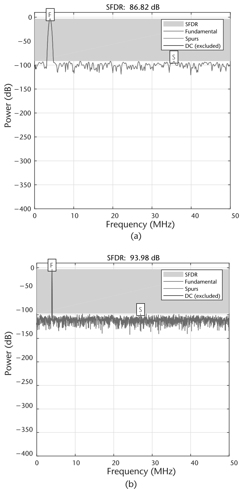

**代码 2.13　SFDR 测试：sfdr_test.m**

```matlab
t = 0:deltat:1e-4-deltat;
x = round(bits*sin(2*pi*fundamental*t))/bits;
r = sfdr(x,fs)

sfdr(x,fs);
```

**代码 2.14　SFDR 测试：sfdr_test.m**

```matlab
fundamental = 4000000;
x = round(bits*sin(2*pi*fundamental*t))/bits;
r = sfdr(x,fs)

sfdr(x,fs);
```

**代码 2.15　SFDR 测试：sfdr_test.m**

```matlab
ran = rand(1,length(t)) - 0.5;
x = round(bits*sin(2*pi*fundamental*t) + ran)/bits;

sfdr(x,fs);
```

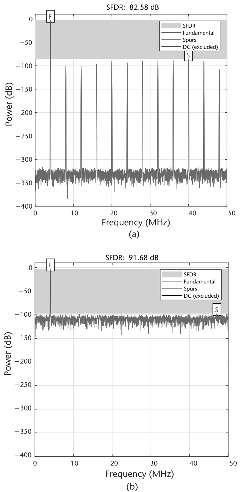

### 2.5.3　位数、成本、功耗等的设计折中

关于两条接收链（I/Q），最需要记住的是 ADC 本身量化的影响：一个 $N$ 位字表示 $2^N$ 种可能状态之一，因此一个 $N$ 位 ADC（基准固定）只能有 $2^N$ 种数字输出。数据转换器的分辨率有多种表达：最低有效位（LSB）的权重、满量程百万分比（ppm FS）、毫伏（mV）。不同器件——哪怕同厂——的规定方式也不同。因此转换器用户必须学会在不同指标之间换算，才能成功比较器件。

表 2.3 列出了 10 W（20 V 峰峰）输入下各种分辨率的最低有效位大小。

**表 2.3　量化：最低有效位的大小**（电压按 20 Vpp 计算）

| 分辨率 (N) | $2^N$ | 电压 | ppm FS | %FS | dBFS |
|---|---|---|---|---|---|
| 2 位 | 4 | 5.00 V | 250,000 | 25 | −12 |
| 4 位 | 16 | 1.25 V | 62,500 | 6.25 | −24 |
| 6 位 | 64 | 313 mV | 15,625 | 1.56 | −36 |
| 8 位 | 256 | 78.1 mV | 3,906 | .391 | −48 |
| 10 位 | 1,024 | 19.5 mV | 977 | .097 | −60 |
| 12 位 | 4,096 | 4.88 mV | 244 | .024 | −72 |
| 14 位 | 16,384 | 1.22 mV | 61.0 | .0061 | −84 |
| 16 位 | 65,536 | 305 µV | 15.2 | .0015 | −96 |
| 18 位 | 262,144 | 76.2 µV | 3.81 | .00038 | −108 |
| 20 位 | 1,048,576 | 19.0 µV | .953 | .000095 | −120 |
| 22 位 | 4,194,304 | 4.77 µV | .238 | .000024 | −132 |
| 24 位 | 16,777,216 | 1.19 µV | .0596 | .0000060 | −144 |
| 26 位 | 67,108,864 | 298 nV | .0149 | .0000015 | −156 |

> 注：600 nV 是 2.2 kΩ 电阻在 25°C、10 kHz 带宽内的约翰逊（热）噪声。

性能 −144 dB 的 24 位转换器听起来不错，但从功耗与速度角度看并不现实。虽然 24 位 ADC 存在，但它们不是宽带的——例如 AD7177 是最先进的 32 位转换器，输出数据率限制在 5 SPS 到 10 kSPS，不适合 SDR，但非常适合温度压力测量、色谱分析或电子秤 [12]。另一方面，高速 ADC 也存在：AD9208 是双通道 14 位 3 GSPS ADC，SFDR 达 70 dBFS、9 GHz 模拟输入满功率带宽（第六奈奎斯特区）。但 AD9208 功耗超过 3 W，超过了 Pluto SDR 通过 USB 流式传输时的整机功耗 [13]。尽管如此，基于 AD9208 的系统可提供高达 12 Gbytes/秒的数据，这超出了软件可处理的范围，需要 FPGA 内的定制信号处理硬件。AD9208 这类器件用于 60 GHz 频段——单信道带宽超过 2 GHz。这些高速宽带链路使用与本书剩余部分相同的概念与技术，只是数据率更高、更耗电、也更贵。不过，学习数字通信的基础技术，用 Pluto SDR 这样 20 MHz（很多情况下远小于此带宽）的高性价比器件就够了。

就 ADC 而言，要让 12 位器件用于 Pluto SDR 这类电台应用，AD9361 的信号链包含了可编程模拟增益，如图 2.32 所示。这使 ADC 的输入尽可能被驱动到满量程——如 2.4.1 节所学，这样能提供最佳性能。

简要回顾运放理论：放大器有两种增益——信号增益与噪声增益。我们想增大信号、同时把噪声压得尽量低。做法是在用 ADC 数字化之前，先在模拟域放大信号，如图 2.32 所示。

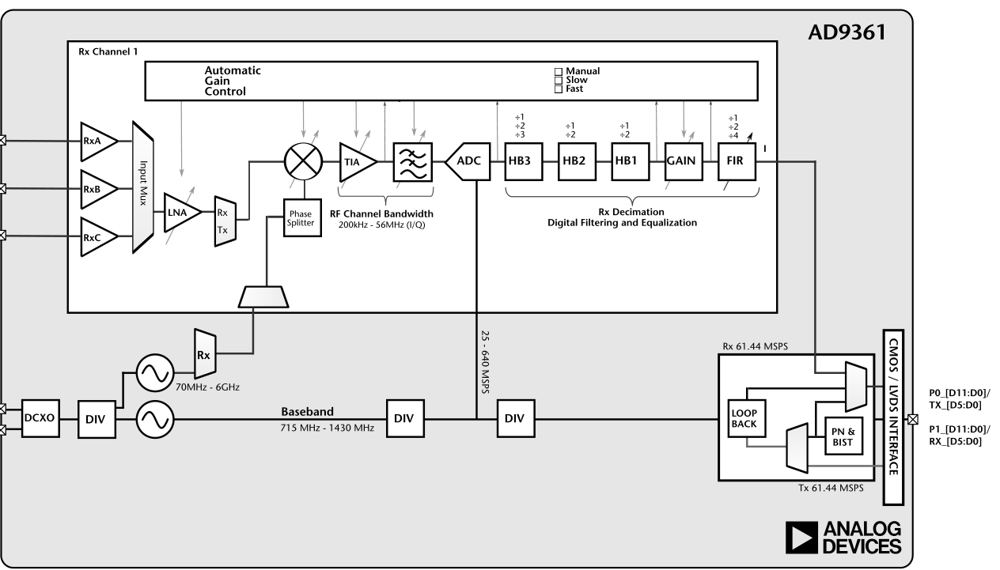

### 2.5.4　Sigma-Delta 模数转换器

Sigma-delta（$\Sigma$-$\Delta$）ADC 问世已超过 50 年，但直到最近，高密度数字 VLSI 技术才使它得以制造成廉价的单片集成电路。如今它用于许多需要低成本、中等带宽、低功耗、高分辨率 ADC 的场合。关于 $\Sigma$-$\Delta$ ADC 的架构与理论已有无数论述，但大多从深奥的数学推导开始。这不是一本 ADC 教科书，我们尽量避开数学展开，基于本章前文已覆盖的主题来理解它。

$\Sigma$-$\Delta$ ADC 没有什么特别难懂的。它包含非常简单的模拟电路（一个比较器、基准电压、一个开关、一个或多个积分器与模拟求和电路），以及数字运算电路。该电路由一个滤波器构成——通常（但不总是）是低通滤波器。不必精确知道滤波器如何工作，也能理解它做了什么。要理解 $\Sigma$-$\Delta$ ADC 的工作，需要熟悉**过采样、量化噪声整形、数字滤波与抽取**这几个概念——全部是本章前面讲过的主题。

从频域分析过采样技术。直流转换的量化误差最多 $\frac{1}{2}$ LSB，而采样数据系统则有量化噪声。理想的经典 $N$ 位采样 ADC 的 RMS 量化噪声为 $\frac{q}{\sqrt{12}}$，均匀分布在 DC 到 $\frac{f_s}{2}$ 的奈奎斯特带内（$q$ 为 LSB 值），如图 2.33(a) 所示。因此满量程正弦输入下其 SNR 为 $(6.02N+1.76)$ dB。若 ADC 不够完美、噪声大于理论最小量化噪声，其实际分辨率将低于 $N$ 位。实际分辨率常称为**有效位数**（ENOB），定义为

$$\mathrm{ENOB}=\frac{\mathrm{SNR}-1.76\,\mathrm{dB}}{6.02\,\mathrm{dB}}.$$

实践中，ENOB 由测量信纳比（SINAD，即 S/(N+D)——信号 RMS 幅度对其余全部频谱分量含谐波、不含 DC 的均方根平均之比）并对非满量程输入信号做修正得到 [6]。把 (2.39) 改写为计入满量程幅度 $A_{FS}$ 与实际输入幅度 $A_{IN}$ 的形式：

$$\mathrm{ENOB}=\frac{\mathrm{SINAD}-1.76\,\mathrm{dB}+20\log_{10}\frac{A_{FS}}{A_{IN}}}{6.02\,\mathrm{dB}}.$$

如果选择高得多的采样率 $Kf_s$（见图 2.33(b)），RMS 量化噪声仍是 $\frac{q}{\sqrt{12}}$，但噪声分布在 DC 到 $\frac{Kf_s}{2}$ 的更宽带宽上。此时对输出施加数字低通滤波（LPF），就能去除大部分量化噪声而不影响有用信号，从而改善 ENOB。于是我们用低分辨率 ADC 实现了高分辨率 A/D 转换。因子 $K$ 通常称为**过采样比**。还要指出，过采样有个额外好处：放宽了对模拟抗混叠滤波器的要求。

由于带宽被数字输出滤波器收窄，输出数据率可以低于原始采样率（$Kf_s$）且仍满足奈奎斯特准则。做法是把每第 $M$ 个结果送到输出、丢弃其余，即**按因子 $M$ 抽取**。只要不违反奈奎斯特准则，抽取不损失任何信息（见图 2.33(b)）。对给定输入频率，更高阶的模拟滤波器提供更大衰减。$\Sigma$-$\Delta$ 调制器也一样——前提是采取适当预防措施。在 $\Sigma$-$\Delta$ 调制器中使用多于一级积分与求和级，可以在给定过采样比下实现更高阶的量化噪声整形与更好的 ENOB，如图 2.34 所示。

Pluto SDR 所用 AD9363 中实际的 $\Sigma$-$\Delta$ ADC 是四阶的，如图 2.35 所示（Analog Devices 收发信机支持 Simulink 模型中的描述）。可见，现实总比理论或一阶近似复杂一点。

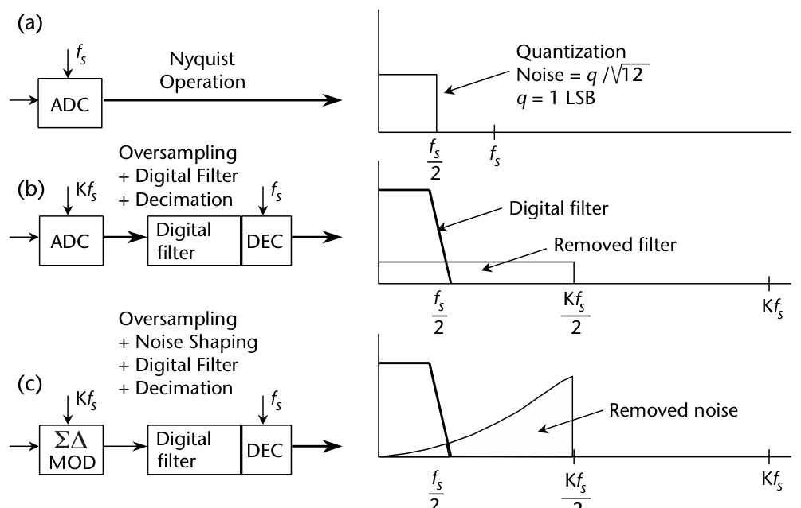

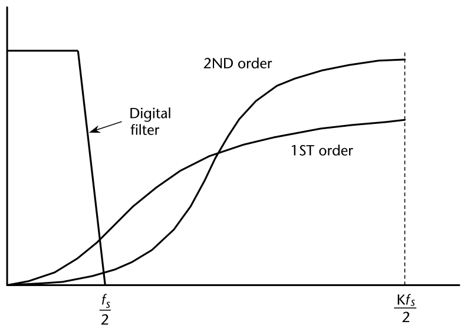

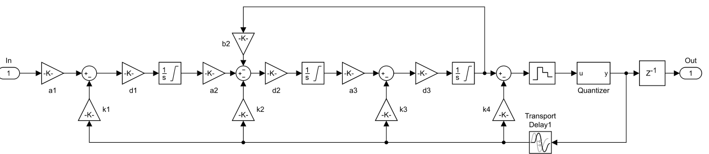

## 2.6　SDR 数字信号处理技术

DSP 是一个始终站在数学复杂性、计算性能与日益增长的移动性交汇点上的领域，影响着通信、医学成像、雷达、娱乐乃至科学探索。所有这些领域都依赖"把模拟信息转换为数字表示、再以某种机制处理数据"的范式。为此，工程师与科学家依赖通用工具与语言，包括 C 和 Verilog——它们都能高效、过程化地操纵数字信息。无论语言为何，许多重要的 DSP 软件问题是硬件相关的，例如截断误差、位模式、处理器的计算速度与效率 [14]。眼下我们基本忽略这些问题，专注于信号处理的算法问题，讨论常用算法。

### 2.6.1　离散卷积

卷积是把两个信号结合形成第三个信号的数学工具，是全部 DSP 的基石。利用冲激分解策略，系统由称为**冲激响应**的信号描述。卷积之所以重要，是因为它把三个关心的信号联系在一起：输入信号、输出信号与冲激响应。

图 2.36 给出卷积在线性系统中的应用记号。离散采样输入信号 $x[n]$ 进入冲激响应为 $h[n]$ 的线性系统，产生输出信号 $y[n]$。用文字表达：输入信号与冲激响应卷积等于输出信号。如 (2.41) 所记，卷积用 $\ast$ 算符表示。遗憾的是多数编程语言（如 MATLAB）用星号表示乘法、用 `conv` 这类专用函数表示卷积。程序里的星号是乘法，这里的星号是卷积。

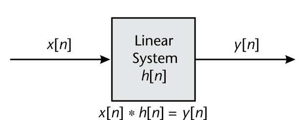

从根本上说，卷积的数学就是若干乘法与加法。若 $x[n]$ 是从样本 0 到 $N-1$ 的 $N$ 点信号，$h[n]$ 是从 0 到 $M-1$ 的 $M$ 点信号，则两者的卷积 $y[n]=x[n]\ast h[n]$ 是从 0 到 $N+M-2$ 的 $N+M-1$ 点信号：

$$y[i]=\sum_{j=0}^{M-1}h[j]\times x[i-j]=h[i]\ast x[i].$$

这个方程称为**卷积和**。它允许输出信号的每个点独立于其他所有点计算。下标 $i$ 决定正在计算输出信号的哪个采样。不要被 $y[n]=x[n]\ast h[n]$ 中的 $n$ 搞混——它只是数组下标的占位符。两个向量卷积和的 MATLAB 实现见代码 2.16。

在信号处理中，卷积可以从两个角度理解。第一从输入信号的观点：分析输入信号的每个采样如何贡献到输出信号的许多点。第二从输出信号的观点：考察输出信号的每个采样如何从输入信号的许多点获取信息。记住，这两个视角是同一数学运算的不同思考方式。第一个视角重要，因为它提供卷积与信号处理关系的概念性理解；第二个视角描述卷积的数学。这体现了信号处理领域最困难的任务之一：把概念性理解与表达思想的一堆数学对上号。

图 2.37 展示了卷积用于低通与高通滤波（2.6.4 节详述）。示例输入信号是两个分量之和：三个周期的正弦波（代表高频）加一个缓升的斜坡（由低频构成）。在 (a) 中，低通滤波器的冲激响应是平滑的拱形，结果只有缓变的斜坡波形通过到输出；类似地，高通滤波器 (b) 只让变化更快的正弦通过。

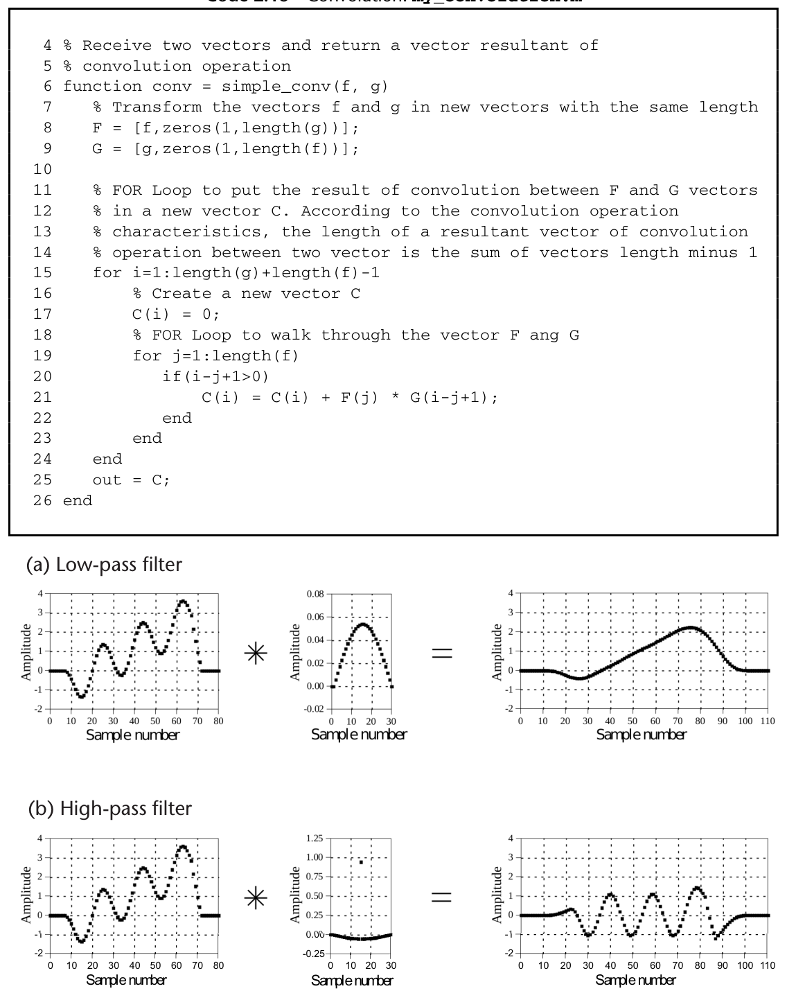

**代码 2.16　卷积：my_convolution.m**

```matlab
% Receive two vectors and return a vector resultant of
% convolution operation
function conv = simple_conv(f, g)
   % Transform the vectors f and g in new vectors with the same length
   F = [f,zeros(1,length(g))];
   G = [g,zeros(1,length(f))];

   % FOR Loop to put the result of convolution between F and G vectors
   % in a new vector C. According to the convolution operation
   % characteristics, the length of a resultant vector of convolution
   % operation between two vector is the sum of vectors length minus 1
   for i=1:length(g)+length(f)-1
       % Create a new vector C
       C(i) = 0;
       % FOR Loop to walk through the vector F and G
       for j=1:length(f)
          if(i-j+1>0)
             C(i) = C(i) + F(j) * G(i-j+1);
          end
       end
   end
   out = C;
end
```

### 2.6.2　相关

互相关与自相关是 SDR 中两个重要概念。**互相关**（cross-correlation）度量两个序列当其中一个相对另一个位移时的相似程度。

相关的概念最好用例子讲。图 2.38 展示了雷达系统的关键组成。特制天线在选定方向发射一短脉冲射频能量。若传播的波碰到物体（如本图中的直升机），一小部分能量被反射回位于发射机附近的接收机。发射脉冲是我们选定的特定形状（如本例的三角形）。接收信号由两部分组成：(1) 发射脉冲的移位加缩放版本；(2) 随机噪声——来自干扰无线电波、电子器件热噪声等。由于无线电波以已知速度（光速）传播，给定形状已知的信号，发射与接收脉冲之间的移位就是对物体距离的直接量度。挑战在于确定一条信号出现在另一条信号中的最佳方式。**相关**就是这一问题的解。

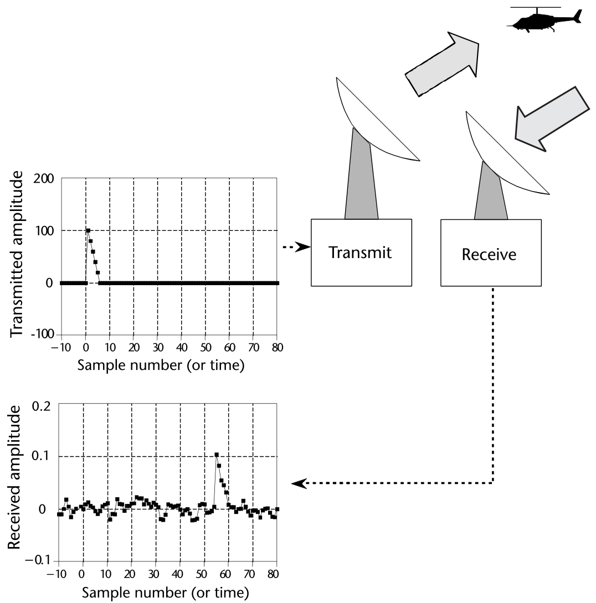

相关是与卷积非常相似的数学运算。和卷积一样，相关用两个信号产生第三个信号。这第三个信号称为两输入信号的互相关。若信号与自身相关，结果称为**自相关**（autocorrelation）。互相关信号每个采样的幅度，度量接收信号在该位置与目标信号的相似程度。这意味着：接收信号中每出现一个目标信号，互相关信号中就会出现一个峰。换言之，当目标信号与接收信号中的相同特征对齐时，互相关值最大。

在随机噪声中检测已知波形，相关是最优技术之一：用相关得到的峰高出噪声的幅度，比任何其他线性系统所能产生的都高。（严格说，只对随机白噪声最优。）用相关检测已知波形常称为**匹配滤波**。详见 4.7.1 节。

对离散函数 $f$ 与 $g$，互相关定义为

$$(f\star g)[n]=\sum_{j=-\infty}^{\infty}f^{\ast}[m]\times g[m+n],$$

其中 $h^{\ast}$ 表示 $h$ 的复共轭。函数 $f(t)$ 与 $g(t)$ 的互相关等价于 $f^{\ast}(-t)$ 与 $g(t)$ 的卷积，即

$$(f\star g)[n]=f^{\ast}(-t)\ast g(t).$$

不要被卷积与相关的数学相似性糊弄：它们代表截然不同的信号处理概念。卷积是系统输入信号、输出信号与冲激响应之间的关系；相关是在噪声背景中检测已知波形的方法。相似的数学只是便于算法优化的巧合。

### 2.6.3　Z 变换

2.1.1 节介绍了处理连续时间信号频域的傅里叶变换。本节聚焦数字滤波器设计、涉及离散时间信号，需要引入新的变换——**z 变换**。

离散时间信号 $x[n]$ 的 z 变换定义为幂级数：

$$X(z)=\sum_{n=-\infty}^{\infty}x[n]z^{-n},$$

其中 $z$ 是复变量 [1]。

z 变换用于分析离散时间系统。它的连续时间对应物是拉普拉斯变换，定义为

$$X(s)=\int_{-\infty}^{\infty}x(t)e^{-st}dt,$$

其中 $t$ 是时域时间变量（秒），$s=\sigma+j\omega$ 是复变量。沿 $j\omega$ 轴（即 $\sigma=0$）求值时，拉普拉斯变换退化为 (2.2) 定义的傅里叶变换。因此拉普拉斯变换把傅里叶变换从实轴（频率轴 $j\omega$）推广到了整个复平面。

根据 2.2.2 节，连续时间信号 $x(t)$ 被均匀采样后，采样信号 $x_s(t)$ 可表示为

$$x_s(t)=\sum_{n=-\infty}^{\infty}x(nT)\delta(t-nT),$$

其中 $T$ 是采样间隔。对两边取拉普拉斯变换：

$$X_s(s)=\int_{-\infty}^{\infty}x_s(t)e^{-st}dt=\int_{-\infty}^{\infty}\sum_{n=-\infty}^{\infty}x(nT)\delta(t-nT)\;e^{-st}dt.$$

由于积分与求和都是线性算子，可以交换次序。再利用 $\delta$ 函数的采样性质：

$$X_s(s)=\sum_{n=-\infty}^{\infty}x(nT)\int_{-\infty}^{\infty}\delta(t-nT)e^{-st}dt=\sum_{n=-\infty}^{\infty}x(nT)e^{-snT}.$$

令 $z=e^{sT}$（即 $s=\frac{1}{T}\ln z$），则 (2.48) 变为

$$X(z)=\sum_{n=-\infty}^{\infty}x(nT)z^{-n}.$$

由于 $T$ 是采样间隔，$x(nT)=x[n]$，上式进一步写成

$$X(z)=\sum_{n=-\infty}^{\infty}x[n]z^{-n},$$

这正是 (2.44) 的 z 变换定义。因此 z 变换与拉普拉斯变换通过

$$z=e^{sT},\qquad s=\frac{1}{T}\ln(z)$$

相联系。

根据 (2.44)，z 变换是 $z^{-1}$ 的级数。实际上，级数不收敛时 z 变换没有意义。给定幅度有限的序列 $x[n]$，使其 z 变换收敛的全部 $z$ 值的集合称为**收敛域**（ROC）。由级数理论，这些 $z$ 值须满足

$$\sum_{n=-\infty}^{\infty}|x[n]z^{-n}|<\infty.$$

常用的 z 变换对及其收敛域列于表 2.4。

**表 2.4　z 变换表：选列**（据 [15]）

| $x[n]$ | $X(z)$ | 收敛域 |
|---|---|---|
| $\delta[n]$ | $1$ | 全部 $z$ |
| $a^n u[n]$ | $\frac{z}{z-a}$ | $\|z\|>\|a\|$ |
| $na^n u[n]$ | $\frac{az}{(z-a)^2}$ | $\|z\|>\|a\|>0$ |
| $n^2a^n u[n]$ | $\frac{az(z+a)}{(z-a)^3}$ | $\|z\|>a>0$ |
| $\frac{1}{3}(1+a^n+b^n)u[n]$ | $\frac{1}{3}\left(\frac{z}{z-1}+\frac{z}{z-a}+\frac{z}{z-b}\right)$ | $\|z\|>\max(\|a\|,\|b\|,1)$ |
| $a^n u[n]\sin(\omega_0 n)$ | $\frac{az\sin\omega_0}{z^2-2az\cos\omega_0+a^2}$ | $\|z\|>a>0$ |
| $a^n u[n]\cos(\omega_0 n)$ | $\frac{z^2-az\cos\omega_0}{z^2-2az\cos\omega_0+a^2}$ | $\|z\|>a>0$ |
| $e^{a}u[n]$（$e^{-an}u[n]$ 见下两行） | $\frac{z}{z-e^{-a}}$ | $\|z\|>e^{-a}$ |
| $e^{-an}u[n]\sin(\omega_0 n)$ | $\frac{ze^{-a}\sin\omega_0}{z^2-2ze^{-a}\cos\omega_0+e^{-2a}}$ | $\|z\|>e^{-a}$ |
| $e^{-an}u[n]\cos(\omega_0 n)$ | $\frac{z^2-ze^{-a}\cos\omega_0}{z^2-2ze^{-a}\cos\omega_0+e^{-2a}}$ | $\|z\|>e^{-a}$ |

讨论线性时不变系统时，其系统冲激响应的 z 变换可以表示为两个多项式之比：

$$H(z)=\frac{b_mz^m+b_{m-1}z^{m-1}+\cdots+b_1z+b_0}{a_nz^n+a_{n-1}z^{n-1}+\cdots+a_1z+a_0}=\frac{B(z)}{A(z)},$$

其中 $A(z)=0$ 的根称为系统的**极点**，$B(z)=0$ 的根称为系统的**零点**。系统可以有多个极点与零点。

把分子 $B(z)$ 与分母 $A(z)$ 因式分解，(2.54) 可写为

$$H(z)=C\,\frac{(z-z_1)(z-z_2)\cdots(z-z_m)}{(z-p_1)(z-p_2)\cdots(z-z_n)},$$

其中 $C$ 是常数，$\{p_k\}$ 是全部极点，$\{z_k\}$ 是全部零点。这有助于画出 $H(z)$ 的零极点图。

设某线性时不变系统的冲激响应为

$$h[n]=n^2a^n u[n].$$

查表 2.4，其 z 变换为

$$H(z)=\frac{az(z+a)}{(z-a)^3}.$$

把 (2.57) 与 (2.55) 对照，容易得到该系统有两个零点 $z_1=0$、$z_2=-a$，三个极点 $p_1=p_2=p_3=a$。其零极点图示于图 2.39。

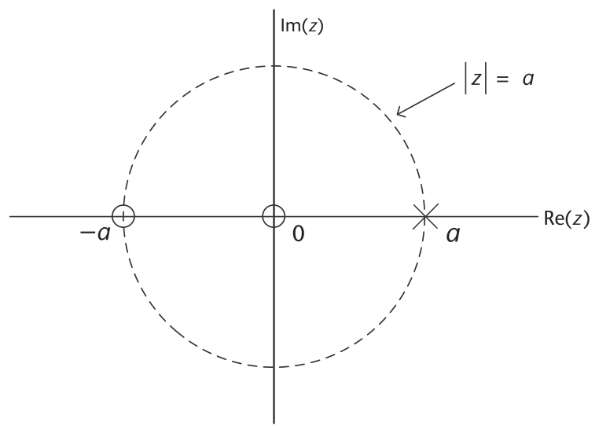

z 变换还有若干对研究 z 域信号与系统有用的性质。由于它们与 2.1.1 节的傅里叶变换性质非常相似，直接列于表 2.5，不再展开。

**表 2.5　z 变换性质**（据 [15]；设时间信号为 $x[n]$，其 z 变换为 $X(z)$）

| 性质 | 时间信号 | z 变换信号 |
|---|---|---|
| 线性 | $\sum_{m=1}^{N}a_m x_m[n]$ | $\sum_{m=1}^{N}a_m X_m(z)$ |
| 对称性 | $x[-n]$ | $X(z^{-1})$ |
| 移位 | $x[n-m]$ | $z^{-m}X(z)$ |
| 缩放 | $a^n x[n]$ | $X(\frac{z}{a})$ |
| 微分 | $nx[n]$ | $-z\frac{dX(z)}{dz}$ |
| 累加 | $\sum_{m=-\infty}^{n}x[m]$ | $\frac{z}{z-1}X(z)$ |
| 时域卷积 | $x[n]\ast h[n]$ | $X(z)H(z)$ |
| 频域卷积 | $x[n]h[n]$ | $\frac{1}{2\pi j}\oint X(v)H(\frac{z}{v})\frac{dv}{v}$ |

### 2.6.4　数字滤波

做信号处理时，我们通常需要去除噪声、提取有用信号。这个过程称为**滤波**，所用器件称为**滤波器**——它根据输入对象某种属性甄别放行什么。典型的滤波器是频率选择电路。若噪声与有用信号频率分布不同、同时出现在滤波器输入端，则施加该电路后噪声被衰减甚至消除，而有用的信号被保留。

滤波器可以从不同角度分类。例如按频率响应可分为低通、高通、带通与带阻；按处理的信号可分为模拟滤波器与数字滤波器 [1]。具体地说，模拟滤波器处理连续时间信号，数字滤波器处理离散时间信号。本节聚焦数字滤波器。这些滤波器的理想幅度响应特性示于图 2.40。由图 2.40，理想滤波器的幅度响应可以概括为：通带内幅度为常数，阻带内幅度降为零。但现实中这种理想滤波器无法实现，实际滤波器其实是理想滤波器的最佳逼近。

![频率范围 [0, 2π] 上四类滤波器的理想幅度响应特性：(a) 低通；(b) 高通；(c) 带通（ωc1, ωc2 为通带）；(d) 带阻（ωc1, ωc2 为阻带）](images/fig_0240.png)

要进行数字滤波，数字系统的输入输出必须都是离散时间序列。若输入序列为 $x[n]$，滤波器冲激响应为 $h[n]$，则输出序列 $y[n]$ 为

$$y[n]=x[n]\ast h[n].$$

根据表 2.5 的时域卷积性质，频域上 (2.58) 等价于

$$Y(z)=X(z)H(z),$$

其中 $X(z)$、$Y(z)$ 是输入输出序列的 z 变换，$H(z)$ 是 $h[n]$ 的 z 变换。

由于理想砖墙滤波器实际做不出来，我们把注意力限制在由差分方程描述的线性时不变系统类 [1]：

$$y[n]=-\sum_{k=1}^{N}a_k y[n-k]+\sum_{k=0}^{M}b_k x[n-k],$$

其中 $y[n]$ 是当前滤波输出，$y[n-k]$ 是以前的滤波输出，$x[n-k]$ 是当前或以前的滤波输入。该系统的频率响应为

$$H(z)=\frac{\sum_{k=0}^{M}b_k z^{-k}}{1+\sum_{k=1}^{N}a_k z^{-k}},$$

其中 $\{a_k\}$ 是滤波器对应极点的反馈系数，$\{b_k\}$ 是对应零点的前馈系数，$N$ 是滤波器阶数。

数字滤波器设计的基本问题是：通过恰当选择系数 $\{a_k\}$ 与 $\{b_k\}$，使频率响应为 (2.61) 的系统逼近任一种理想频率响应特性 [1]。

数字滤波器有两大基本类型：有限冲激响应（FIR）与无限冲激响应（IIR）滤波器。当以单位样本 $\delta[n]$ 激励时，系统的冲激响应 $h[n]$ 可能只持续有限时长（图 2.41(a)），也可能永远持续（图 2.41(b)）。前者即有限冲激响应系统，后者即无限冲激响应系统。

长度为 $M$ 的 FIR 滤波器，输入 $x[n]$、输出 $y[n]$，可用差分方程描述 [1]：

$$y[n]=b_0x[n]+b_1x[n-1]+\cdots+b_{M-1}x[n-M+1]=\sum_{k=0}^{M-1}b_kx[n-k],$$

该滤波器没有反馈系数 $\{a_k\}$，因此 $H(z)$ 只有零点。

IIR 滤波器已在 (2.60) 中定义，它有一个或多个非零反馈系数 $\{a_k\}$。因此一旦被冲激激励，输出将永远持续。

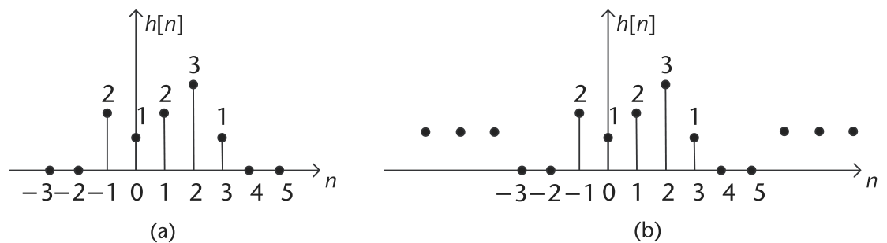

#### 2.6.4.1　案例研究：级联积分梳状滤波器

级联积分梳状滤波器（CIC 滤波器）在 SDR 硬件中扮演重要角色。它由 Eugene B. Hogenauer 发明，是用于多速率信号处理的一类 FIR 滤波器。CIC 滤波器应用于插值与抽取。但与多数 FIR 滤波器不同，它的架构内置了抽取器或插值器 [16]。

CIC 滤波器由一级或多级积分器-梳状滤波器对组成。对抽取型 CIC，输入信号先经过一级或多级级联积分器，然后是下采样器，再接数目与积分器相同的梳状节。插值型 CIC 就是该架构的镜像，只是把下采样器换成上采样器，如图 2.42 所示。

为说明梳状滤波器的简单形式，考虑由差分方程描述的滑动平均 FIR 滤波器：

$$y[n]=\frac{1}{M+1}\sum_{k=0}^{M}x[n-k].$$

该 FIR 滤波器的系统函数为

$$H(z)=\frac{1}{M+1}\sum_{k=0}^{M}z^{-k}=\frac{1}{M+1}\cdot\frac{[1-z^{-(M+1)}]}{(1-z^{-1})}.$$

假设把 $z$ 换成 $z^L$（$L$ 为正整数），得到的梳状滤波器系统函数为

$$H_L(z)=\frac{1}{M+1}\cdot\frac{1-z^{-L(M+1)}}{1-z^{-L}},$$

其中 $L$ 是抽取或插值比，$M$ 是每级采样数（通常为 1 或 2）。

该滤波器的零点在单位圆上：

$$z_k=e^{j2\pi k/L(M+1)},$$

取除 $k=0, L, 2L, \ldots, ML$ 之外的所有整数 $k$，如图 2.43 所示。

常用形式的 CIC 滤波器由若干级组成，复合 CIC 滤波器的系统函数为

$$H(z)=H_L(z)^N=\left[\frac{1}{M+1}\cdot\frac{1-z^{-L(M+1)}}{1-z^{-L}}\right]^{N},$$

其中 $N$ 是复合滤波器的级数。

![插值级联积分梳状滤波器的结构 [17]，输入 x[n]、输出 y[n]。由一对梳状与积分滤波器及插值比为 L 的上采样器组成](images/fig_0242.png)

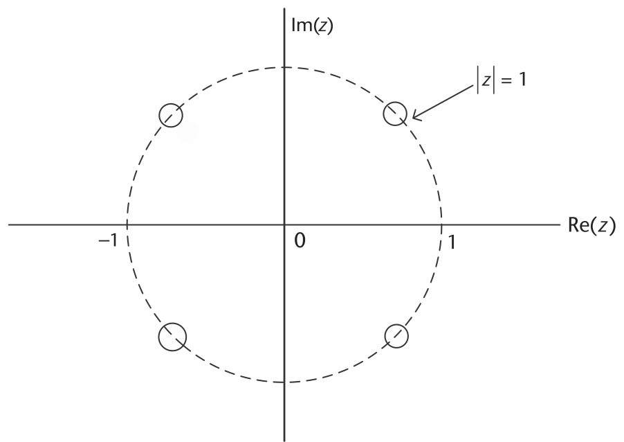

CIC 滤波器的特点包括线性相位响应，且只用到延迟与加减法。换言之，它不需要乘法运算，因此非常适合硬件实现。

#### 2.6.4.2　案例研究：FIR 半带滤波器

FIR 半带滤波器同样广泛用于插值/抽取的多速率信号处理。半带滤波器以多相形式高效实现，因为其系数约有一半为零。半带滤波器有两个重要特征：通带与阻带波纹必须相等；通带边缘与阻带边缘频率与半带频率 $\frac{f_s}{4}$ 等距。

例如 Pluto SDR 的收发链中就有多个可编程半带滤波器。RX HB3/DEC3 提供两种固定系数抽取滤波器可选，抽取因子为 2、3 或 1（旁路）。滤波器输入（ADC 输出）是 24 或 16 个值。使用 RX HB3 滤波器时抽取因子设为 2，使用系数 [1, 4, 6, 4, 1]，注意 RX HB3 的满量程范围是 16（$2^4$）。使用 RX DEC3 滤波器时抽取因子设为 3，系数为 [55, 83, 0, −393, −580, 0, 1914, 4041, 5120, 4041, 1914, 0, −580, −393, 0, 83, 55]，满量程范围是 16384（$2^{14}$）。

## 2.7　SDR 发射技术

2.2 节已经介绍了模拟信号如何用 ADC 转换为数字信号（图 2.5）。这些由 0 和 1 构成的数字信号虽然可以用各种数字信号处理技术处理，却不能直接用于发射：必须先整形，再用 DAC 转换回模拟信号。

由此可见，额外的抽取会带来位增长并让系统获得额外的保真度。

图 2.44(a) 是一条连续模拟正弦波，以采样率 $f_s$ 采样。这些采样经过 2.2 节描述的量化器，输出如图 2.44(b)。本例使用 4 位转换器，只有 16 个状态（便于观察）。很自然地，许多人想用平滑曲线把采样点连起来。但真实波形在采样之间确实存在多个离散台阶，如图 2.44(b) 所示。采样之间的那些值被忽略、不会从 ADC 输出。

从 ADC 出来、被数字信号处理算法处理、最终到达 DAC 的数据，并不需要波形平滑。于是就有了图 2.45(a) 的情形：信号不连续、不平滑。只要理解 2.2.3 节的内容、不违反奈奎斯特采样定理，这就足够了。唯一出问题的时刻，是当我们真想把采样数据变回连续模拟域时：连续模拟域的带宽是无限的，并不会停在 $\frac{f_s}{2}$，如图 2.45(b) 所示。在数字界限之外考察时域数据，信号的镜像仍然可见。

这就是为什么 SDR 的发射端传统上有两个滤波器：数字的**发射（脉冲成形）滤波器**，把数字消息中的每个符号变成送入 DAC 的数字脉冲流；随后是模拟**重建滤波器**，去除 DAC 造成的混叠 [9]。该过程示于图 2.46。

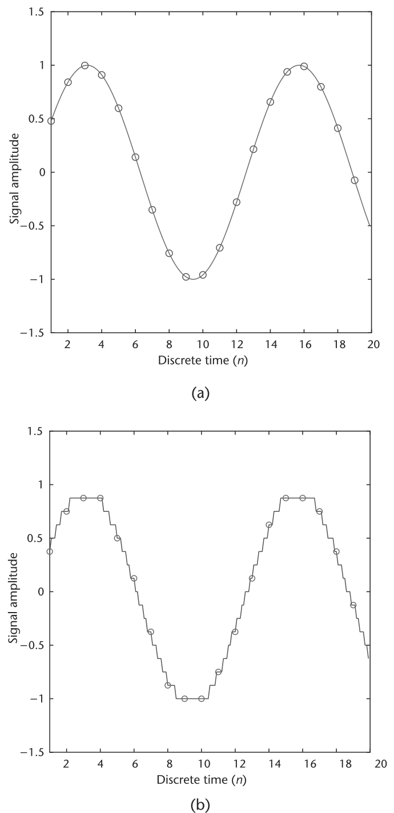

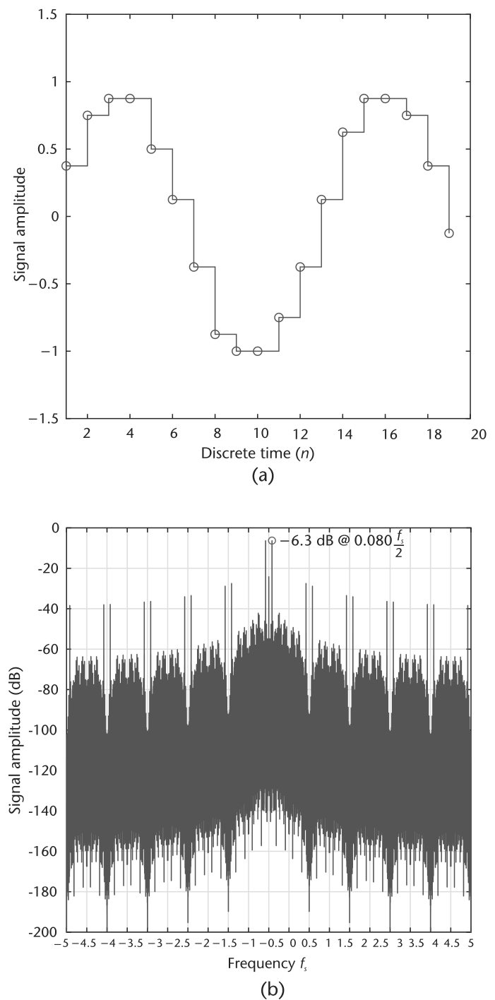

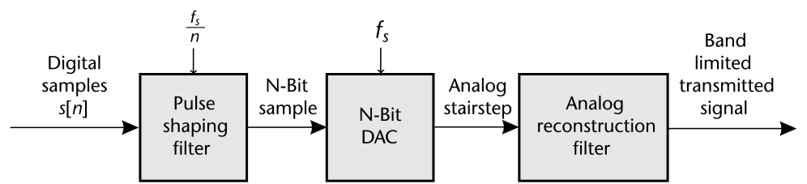

### 2.7.1　模拟重建滤波器

2.5.4 节讨论过过采样如何放宽对抗混叠滤波器的要求，以及 sigma-delta ADC 如何天然具备这一优势。在基于 DAC 的系统中，插值的概念可以类似地配合模拟重建滤波器使用。这在数字音频 CD 播放器中很常见：CD 数据的基础更新率约 44.1 kSPS。如 2.2.5 节所述，往数据中插零、再过数字滤波器，把有效采样更新率提高到原来的 4 倍、8 倍或 16 倍。高过采样率把镜像频率推得更高，允许使用过渡带更宽、更简单的滤波器。

同一概念可以用于高速 DAC。设传统 DAC 以 30 MSPS 的输入字速率驱动（图 2.47 A），DAC 输出频率 $f_s$ 为 10 MHz。20 MHz 处的镜像频率分量必须由模拟重建滤波器衰减，滤波器过渡带为 10 到 20 MHz。镜像须衰减 60 dB。因此滤波器要覆盖 10 MHz 通带，并在 10 到 20 MHz（一个倍频程）的过渡带内提供 60 dB 阻带衰减。模拟巴特沃斯滤波器每极点每倍频程提供 6 dB 衰减，因此至少需要 10 个极点。过渡带越窄，所需滤波器越复杂。

接下来，假设把 DAC 更新率提高到 60 MSPS、对原始数据采样做 2 倍插值，得到 60 MSPS 数据流。DAC 相对两倍过采样频率的响应示于图 2.47 B。模拟重建滤波器的过渡区变为 10 到 50 MHz（第一个镜像出现在 $2f_c-f_o=60-10=50$ MHz）。该过渡区超过两个倍频程，意味着五或六极点的巴特沃斯滤波器就足够了——设计与制作都容易得多。

![fo = 10 MHz、fs = 30 MSPS 与 fs = 60 MSPS 时模拟重建滤波器的要求 [18]](images/fig_0247.png)

### 2.7.2　DAC

理论上，数模转换最简单的方法是把采样从存储器取出、转换成冲激串。与 2.2.2 节的采样函数类似，冲激调制器可定义为

$$p(t)=\sum_{k=-\infty}^{\infty}\delta(t-kT),$$

其中 $t=kT$ 时 $p(t)=1$，其余时刻 $p(t)=0$。因此冲激调制器之后的模拟脉冲串为

$$s_a(t)=s[n]p(t)=\sum_{k=-\infty}^{\infty}s(kT)\delta(t-kT)=\begin{cases}s(kT) & t=kT\\ 0 & t\neq kT\end{cases},$$

其中每个数字符号 $s[n]$ 触发一个被符号值缩放的模拟脉冲。把这个冲激串通过截止频率为采样率一半的低通滤波器，即可重建原始模拟信号。

虽然这个方法在数学上纯净，但即使在现代电子技术中，也难以产生所需的无限窄冲激脉冲。为了绕开这一点，几乎所有 DAC 都采用"保持上一个值直到下一个采样到来"的工作方式。这称为**零阶保持**（zeroth-order hold），相当于 ADC 采样保持的 DAC 对应物。零阶保持使时域呈现阶梯状外观，如图 2.44(b) 所示。

频域上，零阶保持使冲激串的频谱乘以 sinc 函数：

$$H(f)=\frac{\sin(\pi f/f_s)}{\pi f/f_s}.$$

如果你已有这方面背景：零阶保持可以理解为冲激串与宽度等于采样周期的矩形脉冲的卷积。这使得频域上乘以矩形脉冲的傅里叶变换，即 sinc 函数。图 2.47 中的虚线显示了 30 MHz 与 60 MHz DAC 的 sinc 函数。从图 2.47 可见，sinc 函数会衰减通带内信号。系统里需要有东西按零阶保持效应的倒数补偿这一影响，或者干脆接受这个非理想性。许多人无视这个问题，但在 Pluto SDR 上处理它非常容易——用户可以轻松地以非常平坦的通带发射。

### 2.7.3　数字脉冲成形滤波器

要理解为什么所有无线电设计都要包含数字脉冲成形滤波器，看一个简短的例子。相移键控（PSK）是简单而常用的数字调制方案，通过改变参考信号的相位来传输数据。图 2.48(a) 与 (d) 给出了载波的时域与频域：频率非常窄，应当容易发射。

出问题的是图 2.48(b) 与 (e) 中 1、0 交替的比特流。观察可知，方波含有无限的频率信息——在实际条件下这非常难以发射。

把图 2.48(a) 的载波与图 2.48(b) 的比特流相乘、试图把数据从天线发射出去时，得到图 2.48(c) 与 (f)——一个在连续时间模拟域中带宽无限的信号。我们不仅发射困难，相邻射频信道的近邻也不会喜欢我们。

回到冲激的数学模型：(2.70) 表明，若没有数字脉冲成形滤波器，这些脉冲 $s_a(t)$ 会直接经信道发射。理论上，只要接收端带宽无限，我们应该能收到同样的脉冲串（尽管有些延迟）。但现实中由于带宽有限与相邻符号间的干扰，我们实际上无法恢复这样的信号。

相邻符号相互干扰有两种情形：脉冲形状宽于单个符号间隔 $T$；信道非理想、把邻近脉冲抹开使其重叠。这两种情形都称为**码间串扰**（ISI）[9]。

为解决这些问题，引入脉冲成形滤波器来对发射波形限带。

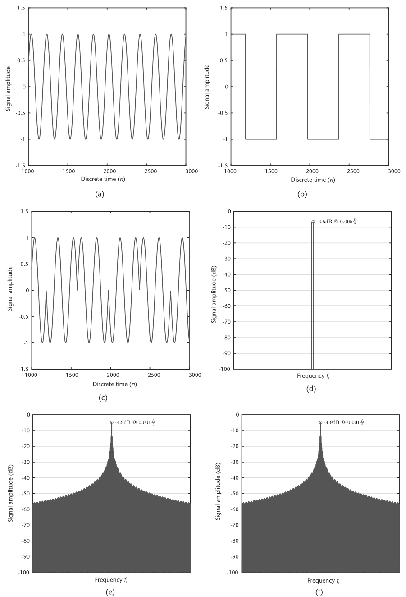

### 2.7.4　奈奎斯特脉冲成形理论

通信系统中通常有两个脉冲成形滤波器，一个在发射端、一个在接收端，如图 2.49 所示，分别用 $h_T(t)$ 与 $h_R(t)$ 表示发射与接收滤波器的冲激响应。为简单起见，讨论奈奎斯特脉冲成形理论时通常用**等效信道**的概念——它不仅包含信道本身，还包含两个脉冲成形滤波器。等效信道的冲激响应为

$$h(t)=h_T(t)\ast h_C(t)\ast h_R(t).$$

现在考虑什么条件下能保证符号之间没有码间串扰。等效信道的输入 $s_a(t)$ 已在 (2.70) 定义。如前所述，每个模拟脉冲被符号值缩放，因此 $s_a(t)$ 可以写成另一种形式：

$$s_a(t)=\sum_k a_k\delta(t-kT),$$

其中 $a_k$ 是第 $k$ 个符号的值。它产生等效信道的输出 $y(t)$：

$$y(t)=s_a(t)\ast h(t)=\sum_k a_k[\delta(t-kT)\ast h(t)]=\sum_k a_k h(t-kT).$$

于是，给定特定时刻如 $t=mT$（$m$ 为常数），输入 $s_a(t)$ 为

$$s_a(mT)=\sum_k a_k\delta(mT-kT)=a_m.$$

输出 $y(t)$ 则为

$$y(mT)=\sum_k a_kh(mT-kT)=a_0h(mT)+a_1h(mT-T)+\cdots+a_mh(mT-mT).$$

由于我们不想受其他符号干扰，希望输出只含 $a_m$ 项：

$$y(mT)=a_mh(mT-mT).$$

进一步地，这意味着在时刻 $t=mT$，需要

$$h(mt-kT)=\begin{cases}C & k=m\\ 0 & k\neq m\end{cases},$$

其中 $C$ 是某个非零常数。

把 (2.77) 推广到任意时刻，就得到奈奎斯特脉冲成形理论：一个脉冲不在后续间隔 $T$ 的采样时刻干扰其他脉冲的条件，形式化为——$h(t)$ 若满足

$$h(t)=h(kT)=\begin{cases}C & k=0\\ 0 & k\neq 0\end{cases}$$

（对所有整数 $k$），则称 $h(t)$ 为**奈奎斯特脉冲**。

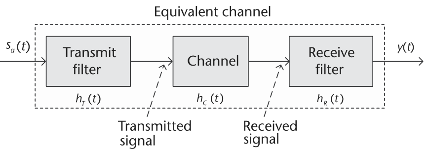

### 2.7.5　两种奈奎斯特脉冲

本节介绍两种重要的奈奎斯特脉冲：sinc 脉冲与升余弦脉冲。考虑 (2.78)，最容易想到的脉冲是时间宽度小于 $T$ 的矩形脉冲，或任何宽度小于 $T$ 的脉冲形状。但矩形脉冲（及其他窄脉冲形状）的带宽可能太宽。窄脉冲形状不能高效利用频谱，而宽脉冲形状又可能引起 ISI——所以需要的是时间上宽（频率上窄）、又满足 (2.78) 奈奎斯特条件的信号 [9]。

数学上，sinc 函数定义为

$$\mathrm{sinc}(x)=\frac{\sin(\pi x)}{\pi x},$$

如图 2.50 所示。当变量 $x$ 取整数 $k$ 时，sinc 函数的值为

$$\mathrm{sinc}(k)=\begin{cases}1 & k=0\\ 0 & k\neq 0\end{cases}.$$

换言之，归一化 sinc 函数的过零点位于非零整数处。

sinc 函数另一个重要性质：sinc 脉冲是矩形信号的傅里叶逆变换，如图 2.51(a) 所示。设矩形信号定义为 [19]：

$$H(\omega)=\begin{cases}T & |\omega|<\frac{1}{2T}\\ 0 & \text{otherwise}\end{cases},$$

对矩形信号取傅里叶逆变换得到 sinc 信号：

$$h(t)=\mathrm{sinc}\frac{t}{T}.$$

在 (2.82) 中换变量 $t=kT$：

$$h(t)=h(kT)=\mathrm{sinc}\frac{kT}{T}=\mathrm{sinc}(k).$$

由于此处 $k$ 是整数，根据 (2.80) 可以把 (2.83) 继续写为

$$h(t)=h(kT)=\mathrm{sinc}\frac{kT}{T}=\mathrm{sinc}(k)=\begin{cases}1 & k=0\\ 0 & k\neq 0\end{cases}.$$

把 (2.84) 与 (2.78) 对照，容易发现：只要取 $t=kT$，sinc 脉冲恰好满足 2.7.4 节的奈奎斯特脉冲成形理论。换句话说，把采样时刻选在 $kT$（采样频率等于 $\frac{1}{T}$），采样点就落在等间隔的过零点上（图 2.51(b)），因此不会有码间串扰。

回忆 2.2.3 节的奈奎斯特采样定理：带限 $B$ Hz 的实信号 $x(t)$ 可以用最低 $F_s=2B$ Hz 的采样频率无误差重建。本例中最低采样频率是 $F_s=\frac{1}{T}$ Hz，因此对应的最低带宽为

$$B=\frac{F_s}{2}=\frac{1}{2T},$$

这恰好是 (2.81) 定义的矩形信号带宽。基于以上讨论，sinc 脉冲 $h(t)$ 的这一选择给出最小带宽 $B=B_{\min}=\frac{1}{2T}$，因此称为**奈奎斯特-I 脉冲** [20]。

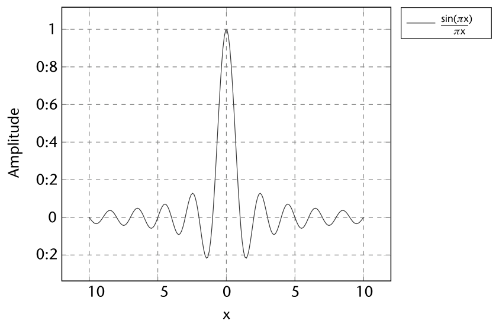

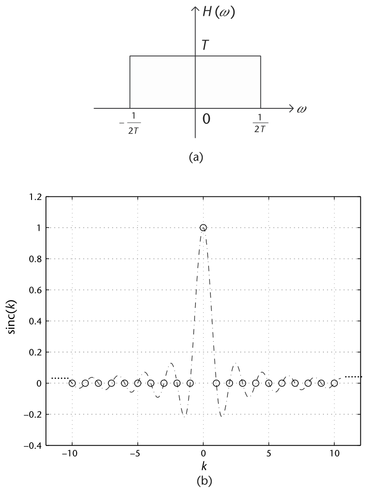

sinc 脉冲非常有吸引力：时间上宽、频率上窄，兼有频谱效率与无 ISI 的优点。但 sinc 脉冲并不实用——它对定时误差引起的 ISI 很敏感。例如，对较大的 $t$，(2.82) 定义的 sinc 脉冲有如下近似：

$$h(t)\sim\frac{1}{t},$$

显然定时误差会造成大的 ISI。还必须注意 sinc 脉冲在时间上无限长，物理上不可实现。

因此需要引入**奈奎斯特-II 脉冲**：带宽更大 $B>B_{\min}$，但对 ISI 敏感度更低。这类脉冲更实用，实践中用得也远为广泛。

**升余弦脉冲**是最重要的奈奎斯特-II 脉冲之一，其频率传递函数定义为

$$H_{RC}(f)=\begin{cases}T & 0\le|f|\le\frac{1-\beta}{2T}\\ \frac{T}{2}\left[1+\cos\frac{\pi T}{\beta}\left(|f|-\frac{1-\beta}{2T}\right)\right] & \frac{1-\beta}{2T}\le|f|\le\frac{1+\beta}{2T}\\ 0 & |f|\ge\frac{1+\beta}{2T}\end{cases},$$

其中 $\beta$ 是滚降因子，取值 0 到 1；$\frac{\beta}{2T}$ 是过剩带宽。

升余弦脉冲的频谱示于图 2.52。一般地，其带宽 $B\ge\frac{1}{2T}$。当 $\beta=0$ 时带宽 $B=\frac{1}{2T}$、没有过剩带宽，实际就是矩形脉冲；另一端，当 $\beta=1$ 时达到最大带宽 $B=\frac{1}{T}$。

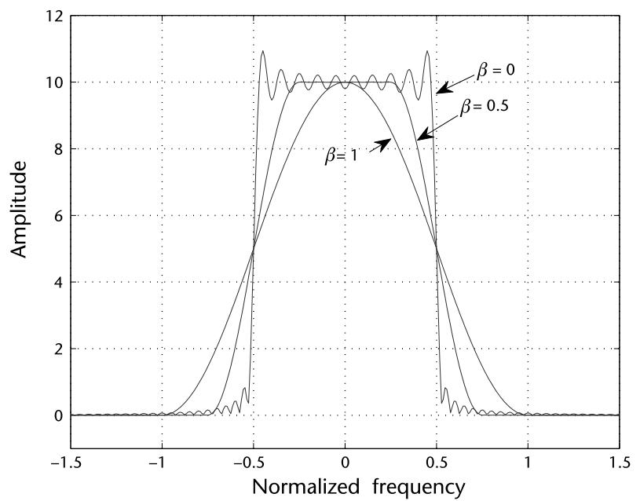

对 $H_{RC}(f)$ 取傅里叶逆变换，得到升余弦脉冲的冲激响应：

$$h_{RC}(t)=\frac{\cos\frac{\pi\beta t}{T}}{1-\left(\frac{2\beta t}{T}\right)^{2}}\;\mathrm{sinc}\frac{\pi t}{T}.$$

奈奎斯特-II 脉冲没有 ISI 敏感性问题，因为其峰值失真（$h_{RC}(t)$ 的拖尾）收敛很快，可表示为

$$D_p=\sum_{n=-\infty}^{\infty}|h_{RC}(\epsilon'+(n-k))|\sim\frac{1}{n^3}.$$

因此当定时误差发生时，失真不会像奈奎斯特-I 脉冲那样以类似方式累积到无穷 [20]。

实际上，许多实用通信系统常用的是**根升余弦滤波器** [21]。若把通信信道视为理想信道，且假设发射滤波器与接收滤波器相同，则两者都可以用根升余弦滤波器，它们的总响应必须等于 (2.87) 定义的 $H_{RC}(f)$。由于等效信道的冲激响应可表示为

$$h(t)=h_T(t)\ast h_C(t)\ast h_R(t),$$

其中 $h_C(t)$ 是通信信道的冲激响应，$h_T(t)$ 与 $h_R(t)$ 是发射与接收滤波器的冲激响应，这意味着频域上有

$$H_{RC}(f)=H_T(f)H_R(f).$$

因此根升余弦滤波器的频率响应必须满足

$$|H_T(f)|=|H_R(f)|=\sqrt{|H_{RC}(f)|}.$$

## 2.8　本章小结

做 SDR 实验既需要过硬的计算机技能，也需要广博的数字信号处理知识。本章列举了若干有用的主题，包括采样、脉冲成形与滤波。本章的目的是帮读者为后续实验章节（特别是 Pluto SDR 硬件）做好准备。例如在 Pluto SDR 发射路径上（图 2.53），有一个可编程 128 抽头 FIR 滤波器、若干插值半带滤波器、一个 DAC，再接两个低通模拟重建滤波器（LPF）。要理解它们如何协同工作并正确配置，就需要理解采样理论。

在 Pluto SDR 接收路径上（图 2.54），信号流经抗混叠滤波器、ADC、若干数字抽取半带滤波器，最终到达 128 抽头可编程 FIR——滤波知识在这里派上用场。这个 128 抽头可编程 FIR 可用来补偿抗混叠滤波器在通带内的损失。

此外，搭建真实通信系统时还需要额外的发射与接收滤波器，这需要脉冲成形方面的专长。

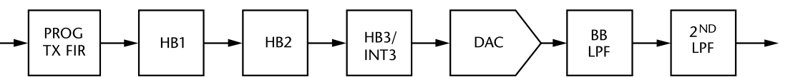

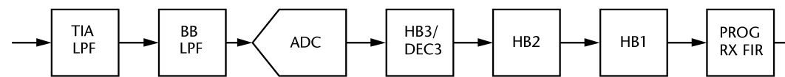

## 参考文献

[1] Proakis, J. G., and Dimitris G. Manolakis, *Digital Signal Processing: Principles, Algorithms, and Applications*, Third Edition, Upper Saddle River, NJ: Prentice Hall, 1996.

[2] Elali, T. S., and M. A. Karim, *Continuous Signals and Systems with MATLAB*, Boca Raton, FL: CRC Press, 2001.

[3] Harris, F. J., "On the Use of Windows for Harmonic Analysis with the Discrete Fourier Transform," *Proceedings of the IEEE*, Vol. 66, No. 1, January 1978.

[4] Smith, S. W., *The Scientist and Engineer's Guide to Digital Signal Processing*, Second Edition, 1999. http://www.analog.com/en/education/education-library/scientist_engineers_guide.html.

[5] Frigo, M., "A Fast Fourier Transform Compiler," *Proceedings of the 1999 ACM SIGPLAN Conference on Programming Language Design and Implementation (PLDI '99)*, Atlanta, GA, May 1999. http://www.fftw.org/.

[6] Kester, W., *Understand SINAD, ENOB, SNR, THD, THD + N, and SFDR so You Don't Get Lost in the Noise Floor*, Analog Devices, 2008. http://www.analog.com/MT-003.

[7] Kester, W., *Mixed Signal and DSP Design Techniques*, Analog Devices, 2002. http://www.analog.com/en/education/education-library/mixed_signal_dsp_design_book.html.

[8] James, J. F., *A Student's Guide to Fourier Transforms: With Applications in Physics and Engineering*, Third Edition, Cambridge, UK: Cambridge University Press, 2011.

[9] Johnson, C. R., Jr., and W. A. Sethares, *Telecommunications Breakdown: Concepts of Communication Transmitted via Software-Defined Radio*, Prentice Hall, 2004.

[10] Cavicchi, T. J., *Digital Signal Processing*, John Wiley and Sons, 2000.

[11] Oppenheim, A. V., and R. W. Schafer, *Digital Signal Processing*, Prentice-Hall, 1975.

[12] Analog Devices AD7177 Product Page, 2016. http://www.analog.com/AD7177-2.

[13] Analog Devices AD9208 Product Page, 2017. http://www.analog.com/AD9208.

[14] Smith, S., *The Scientist and Engineer's Guide to Digital Signal Processing*, San Diego: California Technical Publishing, 1997.

[15] Jeffrey, A., and D. Zwillinger, *Table of Integrals, Series, and Products*, Seventh Edition, San Diego: Academic Press, 2007.

[16] Hogenauer, E. B., "An Economical Class of Digital Filters for Decimation and Interpolation," *IEEE Transactions on Acoustics, Speech and Signal Processing*, Vol. 29, No. 2, 1981, pp. 155–162.

[17] Lyons, R. G., *Streamlining Digital Signal Processing: A Tricks of the Trade Guidebook*, Piscataway, NJ: Wiley-IEEE Press, 2007.

[18] Kester, W., *The Data Conversion Handbook*, 2005. http://www.analog.com/en/education/education-library/data-conversion-handbook.html.

[19] Johnson, C. R., W. A. Sethares, and A. G. Klein, *Software Receiver Design: Build Your Own Digital Communications System in Five Easy Steps*, Cambridge, UK: Cambridge University Press, 2011.

[20] Wyglinski, A. M., M. Nekovee, and Y. T. Hou, *Cognitive Radio Communications and Networks: Principles and Practice*, Burlington, MA: Academic Press, 2009.

[21] Barry, J., E. A. Lee, and D. G. Messerschmitt, *Digital Communication*, Third Edition, Kluwer Academic Press, 2004.
