# 第 3 章　通信中的概率

上一章从纯确定性的视角为我们提供了建模与处理信号和系统的一整套洞察、工具与算法。然而，通信系统环境中存在大量具有随机特性的元素：信息源二进制数据流的取值、传输穿越通信信道时引入的噪声、以及同一环境中多用户运行产生的干扰源。第 2 章给出的是理解与建模确定性信号和系统的工具集，本章则介绍一组建模与研究**概率性**信号与系统的技术与方法。我们从连续与离散随机变量的概念入手，接着解释随时间变化的随机现象——随机过程，最后对各种随机噪声信道进行建模。

## 3.1　通信系统中离散随机事件的建模

离散随机变量表示通信系统中结果并非确切已知的某类行为。例如，二进制信息源产生的下一个值有两种可能输出：二进制 1 或二进制 0。虽然我们知道两个值都有可能，但我们并没有确切知识断定信息源输出端具体会产生哪一个。因此，我们把二进制信息源产生的输出值建模为随机变量。称之为**离散**随机变量，是因为它从有限个选项中产生单个可能的输出值。

为数学地建模这个离散随机变量，设 $X$ 存在一个它可以产生的互异实数集合 $x_i$，每个值都有特定的发生概率：

$$\sum_i P(X=x_i)=1,$$

其中 $P(X=x_i)$ 是随机变量产生输出值 $x_i$ 的概率。利用全概率定律 [1]，我们知道

$$P(X\in B)=\sum_{i:x_i\in B}P(X=x_i),$$

其中集合 $B$ 由一组值 $x_i$ 组成。离散随机变量的一种特定形式是整数值随机变量，其输出值为整数 $x_i=i$，即

$$P(X\in B)=\sum_{i\in B}P(X=i).$$

由于随机变量 $X$ 的每个输出具有不同的发生概率，我们通常把 $X$ 产生特定离散输出 $x_i$ 的概率定义为

$$p_X(x_i)=P(X=x_i),$$

其中 $p_X(x_i)$ 称为**概率质量函数**（PMF）。注意 PMF 的值受约束于

$$0\le p_X(x_i)\le 1\quad\text{且}\quad\sum_i p_X(x_i)=1.$$

表 3.1 列出了几个常用的 PMF，包括均匀、泊松与伯努利随机变量。特别地，伯努利随机变量用于生成二进制信息源的随机输出，而泊松随机变量常用于建模计算机网络中路由分组的时延。


| 随机变量 | PMF 定义 |
|---|---|
| 均匀 | $p_X(k)=\begin{cases}\frac{1}{n}, & k=1,\ldots,n\\ 0, & \text{otherwise}\end{cases}$ |
| 泊松 | $p_X(k)=\frac{\lambda^k e^{-\lambda}}{k!},\quad k=0,1,2,\ldots$ |
| 伯努利 | $p_X(k)=\begin{cases}p, & k=1\\ 1-p, & k=0\\ 0, & \text{otherwise}\end{cases}$ |

: 若干常用的概率质量函数（图形表示从略，见原书）

现在探索如何用这些离散随机变量建模通信系统的一个实际组件——二进制信息源。需要纳入该工具的一个关键特性是随机数发生器（RNG）产生的 1 与 0 的占比。代码 3.1 的 MATLAB 脚本实现了一个二进制 RNG，产生三个向量：向量 `b1` 含等量的 1 与 0，向量 `b2` 与 `b3` 分别按 60/40 与 20/80 的比例生成 1 与 0。注意这里用 MATLAB 的 `rand` 均匀 RNG 函数产生 0 到 1 之间的随机值，再四舍五入到最近的整数（即 1 或 0）。

**代码 3.1　信息源：random_example.m**

```matlab
% Create three binary data streams of length L, each with a different
% percentage of 1 and 0 values
L = 100;
prob1 = 0.5; prob2 = 0.6; prob3 = 0.2; % Probability values for 1 outputs
b1 = round(0.5*rand(1,L)+0.5*prob1); % Even split between 1 and 0 values
b2 = round(0.5*rand(1,L)+0.5*prob2); % Have 60% 1 values and 40% 0 values
b3 = round(0.5*rand(1,L)+0.5*prob3); % Have 20% 1 values and 80% 0 values
```

通过把 `rand` 的输出值偏向 1 或 0 一侧再取整，可以生成 1/0 占比不同的二进制随机值，如图 3.1 所示。用 `stem` 命令可以可视化实际的二进制值（图 3.1(a)、(c)、(e)）。虽然这给了我们这些二进制 RNG 行为的总体观察，但要区分向量中 1 与 0 的实际占比却很困难。因此，用直方图和非常长的随机值序列可以刻画这些占比，如图 3.1(b)、(d)、(f) 所示。注意直方图如何准确显示输出向量中 1 与 0 的百分比。一个重要提醒：由于我们的刻画依赖对随机现象的观察，需要观察非常大量的数据才能准确刻画它。

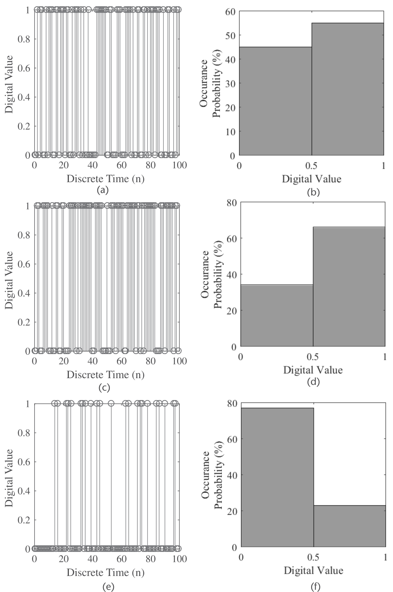

### 3.1.1　期望

由于我们无法确切知道构成通信系统及其环境的这些随机现象的输出值，只能转而数学地刻画这些随机变量的统计行为。刻画随机变量的一种方式是它的**期望值**或**均值**，可用下式定量确定：

$$m_X=E[X]=\sum_i x_iP(X=x_i),$$

即每个值的和以其发生概率加权。于是，利用 PMF 的定义，(3.6) 可以改写为

$$E[X]=\sum_i x_ip_X(x_i).$$

设随机变量 $X$ 与实值函数 $g(x)$，把 $X$ 映射为新的随机变量 $Z$，即 $Z=g(X)$。由于 $X$ 本身就是从样本空间 $\Omega$ 到一组实数的映射，求解随机变量 $Z$ 时我们在做"映射的映射"，即 $Z(\omega)=g(X[\omega])$。于是，计算随机变量 $Z$ 的期望 $E[Z]$ 可用下式：

$$E[Z]=E[g(X)]=\sum_i g(x_i)p_X(x_i),$$

这称为随机变量的函数的期望。(3.8) 最重要的方面之一：$Z$ 的期望可以直接用 $X$ 的 PMF 求解，而不必先确定 $Z$ 的 PMF。表 3.2 给出与期望算子相关的若干有用性质。


| 名称 | 定义 |
|---|---|
| 线性 | 若 $a$、$b$ 为确定性常数，$X$、$Y$ 为随机变量，则 $E[aX+bY]=E[aX]+E[bY]=aE[X]+bE[Y]$ |
| 矩 | 实值随机变量 $X$ 的 $n$ 阶矩（$n\ge1$）定义为 $X$ 的 $n$ 次幂的期望，即 $\mathrm{Moment}_n(X)=E[X^n]$ |
| 均值 | 均值是 $X$ 的一阶矩，即 $\mathrm{Moment}_1(X)=E[X]=\mu$ |
| 方差 | $X$ 减去均值后的二阶矩是它的方差，即 $\mathrm{Moment}_2(X-\mu)=E[(X-\mu)^2]=\mathrm{var}(X)=\sigma^2$ |
| 中心矩 | 方差的推广是 $X$ 的 $n$ 阶中心矩，即 $E[(X-\mu)^n]$。注意 $X$ 的偏度与峰度分别是三阶与四阶中心矩 |
| 相关 | 两个随机变量 $X$ 与 $Y$ 的相关定义为 $E[XY]$ |
| 协方差 | $X$ 与 $Y$ 的协方差定义为 $\mathrm{cov}(X,Y)=E[(X-\mu_X)(Y-\mu_Y)]$ |
| 相关系数 | $X$ 与 $Y$ 的相关系数为 $\rho_{XY}=E\!\left[\frac{X-\mu_X}{\sigma_X}\cdot\frac{Y-\mu_Y}{\sigma_Y}\right]$ |
| 马尔可夫不等式 | 若 $X$ 是非负随机变量，则对任意 $a>0$ 有 $P(X\ge a)\le\frac{E[X]}{a}$ |
| 切比雪夫不等式 | 对任意随机变量 $Y$ 与任意 $a>0$，有 $P(|Y|\ge a)\le\frac{E[Y^2]}{a^2}$ |
| 柯西–施瓦茨不等式 | $|E[XY]|\le\sqrt{E[X^2]E[Y^2]}$，当且仅当 $X$ 与 $Y$ 线性相关时取等 |
| 独立 | 随机变量独立当且仅当对所有函数 $h(x)$、$k(y)$ 有 $E[h(X)k(Y)]=E[h(X)]E[k(Y)]$ |

: 期望的若干有用性质

## 3.2　二元通信信道与条件概率

在数字通信系统中，可以把接收机的操作看作：当观测到一个传输值时，猜测某个特定发射机发送了什么。发送值可建模为随机变量 $X$，接收端观测到的值可建模为随机变量 $Y$。于是我们需要某种**判决规则**来弄清最初发射的是 $X$ 的哪个值。图 3.2 说明了这一点：$X$ 可以输出 0 或 1，而 $Y$ 在接收端被观测。注意观测 $Y$ 可能被误判为与发射值不同的值，即 $X\neq Y$。

为刻画并理解这个随机传输环境，可以使用**条件概率**的定义，其数学表达式为

$$P(X\in B\,|\,Y\in C)=P(\{X\in B\}\,|\,\{Y\in C\})=\frac{P(\{X\in B\}\cap\{Y\in C\})}{P(\{Y\in C\})}=\frac{P(X\in B,\,Y\in C)}{P(Y\in C)}.$$

此外，条件 PMF 也可以用来数学地描述这个随机现象：

$$p_{X|Y}(x_i|y_j)=P(X=x_i\,|\,Y=y_j)=\frac{P(X=x_i,\,Y=y_j)}{P(Y=y_j)}=\frac{p_{XY}(x_i,y_j)}{p_Y(y_j)},$$

$$p_{Y|X}(y_j|x_i)=P(Y=y_j\,|\,X=x_i)=\frac{P(X=x_i,\,Y=y_j)}{P(X=x_i)}=\frac{p_{XY}(x_i,y_j)}{p_X(x_i)},$$

进而可以表达为

$$p_{XY}(x_i,y_j)=p_{X|Y}(x_i|y_j)p_Y(y_j)=p_{Y|X}(y_j|x_i)p_X(x_i).$$

一个能帮助刻画条件概率和/或条件 PMF 所描述现象的有用数学工具是**全概率定律**。例如，设 $Y$ 为任意随机变量，取 $A=\{Y\in C\}$（$C\subset\mathbb{R}$），则全概率定律定义为

$$P(Y\in C)=\sum_i P(Y\in C\,|\,X=x_i)P(X=x_i).$$

类似地，若 $Y$ 是取互异值 $y_i$ 的离散随机变量，取 $C=\{y_j\}$，则得到如下形式的全概率定律：

$$P(Y=y_j)=\sum_i P(Y=y_j\,|\,X=x_i)P(X=x_i)=\sum_i p_{Y|X}(y_j)p_X(x_i).$$

> **思考题**：利用期望的定义，推导马尔可夫不等式 $P(X\ge a)\le\frac{E[X^r]}{a^r}$；并推导连续随机变量情形的全概率与替换定律的相应表达式。

回到图 3.2 描述的二元通信信道模型：假设我们想基于对截获接收信号的观测来判决发射的是什么值。此时我们希望采用**最大后验**（MAP）判决规则：给定观测 $Y=j$，若

$$P(X=1\,|\,Y=j)\ge P(X=0\,|\,Y=j),$$

MAP 规则判 $X=1$，否则判 $X=0$。换言之，给定观测 $Y=j$，若 $X=1$ 的后验概率大于 $X=0$ 的后验概率，MAP 规则就判 $X=1$。进一步，我们观察到

$$P(X=i\,|\,Y=j)=\frac{P(X=i,\,Y=j)}{P(Y=j)}=\frac{P(Y=j\,|\,X=i)P(X=i)}{P(Y=j)},$$

用它把 (3.14) 改写为

$$\begin{aligned}
&\frac{P(Y=j\,|\,X=1)P(X=1)}{P(Y=j)}\ge\frac{P(Y=j\,|\,X=0)P(X=0)}{P(Y=j)}\\
&\quad\Longrightarrow\quad P(Y=j\,|\,X=1)P(X=1)\ge P(Y=j\,|\,X=0)P(X=0).
\end{aligned}$$

若 $X=0$ 与 $X=1$ 等概率发生，可简化得到**最大似然**（ML）规则：

$$P(Y=j\,|\,X=1)\ge P(Y=j\,|\,X=0).$$

而且在一般情形下，可以把 (3.16) 重排得到**似然比**：

$$\frac{P(Y=j\,|\,X=1)}{P(Y=j\,|\,X=0)}\ge\frac{P(X=0)}{P(X=1)},$$

其中右侧称为**门限**，因为它不依赖 $j$。

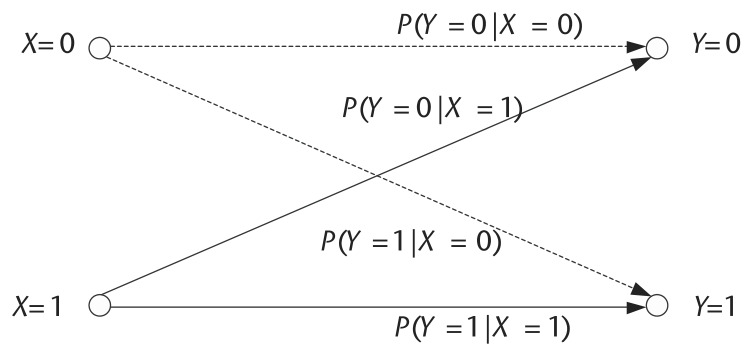

有了这个数学表述，现在用计算机仿真处理同一个例子。用下面的 MATLAB 脚本可以建模一个二元信道：产生 $L$ 个二进制值，1 的概率为 `prob4`，其余为 0。此外，假设所用二元信道**不对称**——1 翻转为 0 的概率不同于 0 翻转为 1 的概率。比特翻转被视为信道产生的错误。于是定义：发射 1 被接收为 1 的概率等于 `prob11`，发射 0 被接收为 0 的概率等于 `prob00`。

**代码 3.2　仿真：random_example.m**

```matlab
% Define simulation parameters
L = 100000;      % Transmission length
prob00 = 0.95;   % Probability zero received given zero transmitted
prob11 = 0.99;   % Probability one received given one transmitted
prob4 = 0.7;     % Have 40% 1 values and 60% 0 values

% Create transmitted binary data stream
b4 = round(0.5*rand(1,L)+0.5*prob4);
                                     % Have 40% 1 values and 60% 0 values
b4hat = b4;   % Initialize receive binary data stream

% Randomly select 1 and 0 values for flipping
ind_zero = find(b4 == 0);  % Find those time instances with zero values
ind_one = find(b4 == 1);   % Find those time instances with one values
ind_flip_zero = find(round(0.5*rand(1,length(ind_zero))
                  +0.5*(1-prob00)) == 1);  % Flip zero bits to one bits
ind_flip_one = find(round(0.5*rand(1,length(ind_one))
                +0.5*(1-prob11)) == 1);    % Flip one bits to zero bits

% Corrupt received binary data stream
b4hat(ind_zero(ind_flip_zero)) = 1;  % Flip 0 to 1
b4hat(ind_one(ind_flip_one)) = 0;    % Flip 1 to 0

% Calculate bit error statistics
b4error_total = sum(abs(b4-b4hat))/L;
b4error_1 = sum(abs(b4(ind_one) - b4hat(ind_one)))/length(ind_one);
b4error_0 = sum(abs(b4(ind_zero) - b4hat(ind_zero)))/length(ind_zero);
```

评估任何数字通信系统性能的基本指标之一是**误比特概率**，即误码率（BER）。BER 刻画接收到的比特错误量相对总发射比特数的比例。对不同应用，不同的 BER 值有的可接受、有的不可容忍。例如，对典型无线数据传输应用，$10^{-5}$ 的 BER 被认为是可以接受的误码水平。

在上述二元信道的 MATLAB 例子中，我们想刻画 BER 值，看它们是否符合我们定义的参数。图 3.3 给出了整体传输的 BER，以及仅发射 1 与仅发射 0 的 BER。注意：仅 1 值的 BER 恰好对应概率 `prob11` 的补，仅 0 值的 BER 对应 `prob00` 的补。记住：要获得准确的 BER 统计评估，需要生成非常大量的二进制值。

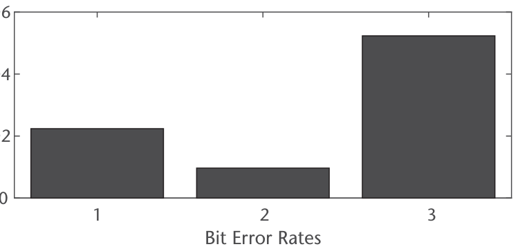

## 3.3　通信系统中连续随机事件的建模

如本章前文所见，可以数学地计算由离散随机变量描述的通信系统中随机事件发生的概率：

$$P(a\le X<b)=\sum_{i=a}^{b-1}p_X(i),$$

其中 $X$ 是离散随机变量，$a$、$b$ 是样本空间 $\Omega$ 中某子集的边界。但现在假设 $X$ 是**连续**随机变量，可以取区间 $(a,b)$ 内的整个连续统的值。要在此情形计算同样的概率，可以把这个场景理解为 $(a,b)$ 中无穷多个点的求和，相邻样本间距为 $\Delta x$。

通信系统中有大量随机元素，每个都能产生连续统的可能输出值。如本章稍后将讨论的，其中一个由连续随机变量表示的元素就是传输信道中引入的噪声。设该噪声可表示为无穷多个样本，使得 $\Delta x$ 最终收敛为 $dx$，(3.19) 的求和变成积分表达式。于是，可以用下式表达建模噪声的连续随机变量产生 $a$ 到 $b$ 之间输出值的概率：

$$P(a\le X<b)=\int_a^b f(t)\,dt,$$

其中 $f(t)$ 称为**概率密度函数**（PDF）。注意 PDF 是本章前面讨论过的 PMF 的连续版本。而且，一般可以用 PDF 通过下式表达连续随机变量的概率：

$$P(X\in B)=\int_B f(t)\,dt=\int_{-\infty}^{+\infty}I_B(t)f(t)\,dt,$$

其中 $I_B(t)$ 是指示函数：当值 $t$ 属于集合 $B$ 时输出 1，否则输出 0。注意 $\int_{-\infty}^{+\infty}f(t)\,dt=1$，$f(t)$ 非负，$f(t)$ 近似给出点 $t$ 处的概率，且

$$P(a\le X\le b)=P(a<X\le b)=P(a\le X<b)=P(a<X<b),$$

即端点不影响最终的概率测度。最后，表 3.3 汇总了几个常用 PDF，包括均匀、高斯与指数随机变量。注意：高斯随机变量常用于建模通信信道引入噪声的随机性；指数随机变量则用于介质访问协议——当两个以上无线系统试图基于竞争框架经同一无线信道通信时，帮助提供随机退避时间。


| 随机变量 | PDF 定义 |
|---|---|
| 均匀 | $f(x)=\begin{cases}\frac{1}{(b-a)}, & a\le x\le b\\ 0, & \text{otherwise}\end{cases}$ |
| 指数 | $f(x)=\begin{cases}\lambda e^{-\lambda x}, & x\ge 0\\ 0, & x<0\end{cases}$ |
| 拉普拉斯 | $f(x)=\frac{\lambda}{2}e^{-\lambda|x|}$ |
| 柯西 | $f(x)=\frac{\lambda/\pi}{\lambda^2+x^2},\quad\lambda>0$ |
| 高斯 | $f(x)=\frac{1}{\sqrt{2\pi}\sigma}e^{-0.5((x-\mu)/\sigma)^2}$ |

: 若干常用的概率密度函数（图形表示从略，见原书）

与单个离散随机变量的期望类似，PDF 为 $f(x)$ 的连续随机变量 $X$ 的期望可用下式计算：

$$E[g(X)]=\int_{-\infty}^{+\infty}g(x)f(x)\,dx,$$

其中 $g(\cdot)$ 是作用于随机变量 $X$ 的某实函数。

许多实际关心的随机变量并不独立：一个事件的结果常依赖或受另一个事件结果的影响。因此有时需要计算条件概率与条件期望，尤其是处理涉及多于一个随机变量的问题时。

与离散随机变量的条件概率不同，连续随机变量的条件概率需要另行定义，因为单个精确点发生的概率为零，即 $P(X=x)=0$。于是，若直接套用 (3.9) 的离散定义

$$P(Y\in C\,|\,X=x)=\frac{P(Y\in C,\,X=x)}{P(X=x)},$$

会出现 $P(X=x)=0$ 导致除零的情形。因此需要确定另一个在连续随机变量框架内可行的条件概率（与条件期望）定义。

可以证明，计算条件概率必须采用**条件密度** [1]，定义为

$$f_{Y|X}(y|x)=\frac{f_{XY}(x,y)}{f_X(x)},$$

其中 $f_X(x)>0$。借助条件密度，现在可以毫无除零之忧地计算条件概率：

$$P(Y\in C\,|\,X=x)=\int_C f_{Y|X}(y|x)\,dy.$$

进而，全概率定律定义为

$$P(Y\in C)=\int_{-\infty}^{+\infty}P(Y\in C\,|\,X=x)f_X(x)\,dx,$$

即先把所有条件概率用 $X$ 的 PDF 加权、再积分到一起，构成事件 $Y\in C$ 的总概率。最后，与离散情形一样，处理条件概率时连续随机变量也有替换律，定义为

$$P((X,Y)\in A\,|\,X=x)=P((x,Y)\in A\,|\,X=x).$$

注意若 $X$ 与 $Y$ 独立，联合密度可分解，条件密度变为

$$f_{Y|X}(y|x)=\frac{f_{XY}(x,y)}{f_X(x)}=\frac{f_X(x)f_Y(y)}{f_X(x)}=f_Y(y),$$

这意味着两个随机变量独立时，不需要用一个事件给另一个事件加条件。

类似地，连续随机变量的条件期望用条件密度定义为

$$E[g(Y)\,|\,X=x]=\int_{-\infty}^{+\infty}g(y)f_{Y|X}(y|x)\,dy.$$

进而，条件期望的全概率定律为

$$E[g(X,Y)]=\int_{-\infty}^{+\infty}E[g(X,Y)\,|\,X=x]f_X(x)\,dx,$$

替换律定义为

$$E[g(X,Y)\,|\,X=x]=E[g(x,Y)\,|\,X=x].$$

### 3.3.1　累积分布函数

对建模通信系统随机元素的随机变量的 PDF 与 PMF，有时可视化**累积分布函数**（CDF）很重要——它提供了随机变量概率行为的另一视角。而且 CDF 有时能用来解一些用其他定义很难下手的问题。

数学上，CDF 定义为

$$F_X(x)=P(X\le x)=\int_{-\infty}^{x}f(t)\,dt,$$

它描述由随机变量 $X$ 刻画的实验结果小于等于哑变量 $x$ 的概率。

举个例子：假设要用图 3.4(a) 所示的 PDF 计算概率 $P(a\le X<b)$。快速求值的一种途径是利用该分布的**尾部概率**：$P(X<a)$（图 3.4(b)）与 $P(X<b)$（图 3.4(c)）。注意尾部概率实际上就是 (3.33) 定义的 $X$ 的 CDF：$F_X(a)=P(X<a)$、$F_X(b)=P(X<b)$。于是，既然我们只关心两个尾部概率不相交的 PDF 区域，可以计算

$$P(a\le X<b)=P(X<b)-P(X<a)=F_X(b)-F_X(a),$$

所需的只是 $X$ 的 CDF 在 $x=a$ 与 $x=b$ 处的值。

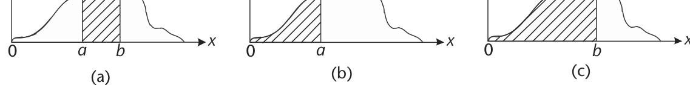

CDF 的几个基本特性包括：$F_X(x)$ 有界于 0 与 1 之间；$F_X(x)$ 是非降函数，即若 $x_1\le x_2$ 则 $F_X(x_1)\le F_X(x_2)$。此外，PDF 是 CDF 对哑变量 $x$ 的导数：

$$f_X(x)=\frac{d}{dx}F_X(x).$$

> **Q 函数**是表达高斯随机变量右尾概率 $P(X>x)$ 的便捷方式。数学上，这等价于求 $X$ 的补 CDF [2]：
> $$Q(x)=1-F_X(x)=1-P(X\le x)=P(X>x)=\int_x^{\infty}\frac{1}{\sqrt{2\pi}}e^{-t^2/2}\,dt,$$
> 其中 $F_X(x)$ 是 $X$ 的 CDF。

CDF 的一个重要用途是精确定义通信系统中随机元素的概率本质。噪声生成、信息源的二元输出、多用户对无线信道的随机接入，都可以用 CDF 精确刻画。因此在计算机仿真中建模这些现象时，我们使用由这些 CDF 之一定义的 RNG。MATLAB 仿真环境中有多种可用于通信系统实验的 RNG，包括基于均匀、高斯（正态）与瑞利随机变量的。这些随机变量在 MATLAB 中可通过 `rand` 与 `randn` 函数生成，也可组合它们创建其他随机变量。例如，代码 3.3 的 MATLAB 代码产生三个随机值向量，其统计特性分别等效于均匀、高斯与瑞利随机变量。而且，用这些 RNG 生成的随机值可以确定概率密度，进而生成累积分布函数，并计算这些随机变量产生 0.7 到 1.0 之间值的概率。

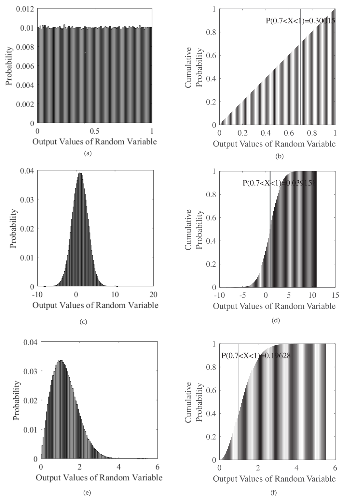

在 MATLAB 中获得均匀与高斯分布的值，直接用 `rand` 与 `randn` 函数即可。生成非常大量的这些随机值，就能观察到均匀与高斯 PDF，如图 3.5(a) 与 (c) 所示。由于 CDF 是 PDF 从 $-\infty$ 到 $+\infty$ 的渐进累积，它们也可以从 PDF 数据直接生成，如图 3.5(b) 与 (d) 所示。至于瑞利随机变量产生的值，快速产生方法是取两个独立同分布（i.i.d.）高斯随机变量，两者平方、相加、再开方。由此操作并生成大量值，即可得到瑞利随机变量的 PDF 与 CDF，如图 3.5(e) 与 (f) 所示。注意若想求这些函数产生的随机值落在 0.7 到 1.0 之间的概率，只需把这个范围内的密度值加起来，或取 CDF 在两端点的值相减。

**代码 3.3　信息源：random_example.m**

```matlab
%%%%%%%%%%%%%%%%%%%%%%%%%%%%%%%%%%%%%%%%%%%%%%%%%%%%%
% Random Variable PDFs and CDFs

% Define simulation parameters
L = 1000000;               % Length of random samples
mean_normal = 1; stddev_normal = 2;
                           % Mean and standard deviation of normal RV values
res_hist = 100;            % Histogram resolution

% Generate random samples for different distributions
b_unif = rand(1,L);        % Uniform random values
b_normal = (stddev_normal*randn(1,L) + mean_normal);
                           % Normal random values
b_rayleigh = (sqrt(randn(1,L).^2 + randn(1,L).^2));
                           % Rayleigh random values

% Obtain cumulative distribution functions
[N_unif, edges_unif] = histcounts(b_unif,res_hist);
N_unif_cum = cumsum(N_unif)./L;
[N_normal, edges_normal] = histcounts(b_normal,res_hist);
N_normal_cum = cumsum(N_normal)./L;
[N_rayl, edges_rayl] = histcounts(b_rayleigh,res_hist);
N_rayl_cum = cumsum(N_rayl)./L;

% Calculate probability of values between 0.7 and 1
x_lower = 0.7;
x_upper = 1.0;
unif_ind_range = find((x_lower <= edges_unif)
                       & (edges_unif < x_upper));
normal_ind_range = find((x_lower <= edges_normal)
                         & (edges_normal < x_upper));
rayl_ind_range = find((x_lower <= edges_rayl)
                       & (edges_rayl < x_upper));
prob_unif = sum(N_unif(unif_ind_range))./L;
prob_normal = sum(N_normal(normal_ind_range))./L;
prob_rayl = sum(N_rayl(rayl_ind_range))./L;
```

## 3.4　通信系统中的时变随机性

到目前为止，我们探讨的都是概率特性不随时间变化的随机现象的建模。虽然这简化了这些模型的数学推导，但未必能准确描述随机现象。例如，信息源的二元输出值可能随时间变化，取决于被编码的真实数据——比如动态城市环境的安防摄像头画面，或计算机上人类用户的互联网流量。因此，有必要为这些同样随时间变化的随机现象发展更全面的数学表示。我们称这些表示为**随机过程**（random process）或**随机过程**（stochastic process）。随机过程是依赖于参数 $t$ 与 $\omega$ 的一族时域函数，即可以用函数

$$X(t)=X(t,\omega)$$

定义随机过程，其中左边是随机过程的简写表示，隐含假设存在从样本空间 $\Omega$ 的结果 $\omega$ 到实数值的映射。注意 $\omega$ 的定义域是 $\Omega$，而 $t$ 的定义域对连续时间随机过程是 $\mathbb{R}$、对离散时间随机过程是 $\mathbb{Z}$。图 3.6 描绘了随机过程如何由一族时域函数构成。

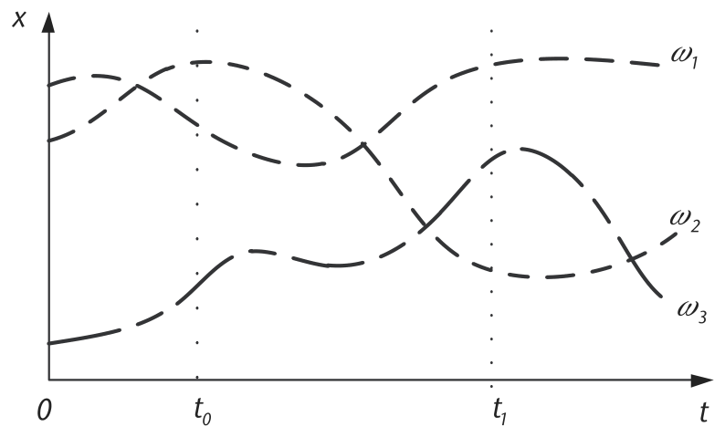

设随机过程在每个时刻 $t$ 都是不可数无穷的。此情形下可以定义它的一阶分布 $F(x,t)$ 与一阶密度 $f(x,t)$：

$$F(x,t)=P(X(t)\le x)$$

与

$$f(x,t)=\frac{\partial F(x,t)}{\partial x}.$$

要确定随机过程的统计性质，需要 $F(x_1,\ldots,x_n;t_1,\ldots,t_n)$ 的知识。不过在大多数通信系统应用中，实际需要的只是某些平均量。例如，随机过程最常用的统计刻画之一是**均值函数**：随机过程 $X(t,\omega)$ 的均值函数 $\mu_X(t)$ 是随机过程在特定时刻 $t$ 的期望，数学表示为

$$\mu_X(t)=E[X(t,\omega)].$$

随机过程 $X(t,\omega)$ 的另一个有用统计刻画工具是**自相关函数** $R_{XX}(t_1,t_2)$：评估随机过程在两个不同时刻 $t_1$ 与 $t_2$ 的相关程度。数学定义为

$$R_{XX}(t_1,t_2)=E[X(t_1,\omega)X^{*}(t_2,\omega)]=\int_{-\infty}^{+\infty}\int_{-\infty}^{+\infty}x_1x_2^{*}f(x_1,x_2;t_1,t_2)\,dx_1dx_2.$$

注意 $R_{XX}(t_1,t_2)$ 对角线上的值是 $X(t,\omega)$ 的平均功率：

$$E[|X(t,\omega)|^2]=R_{XX}(t,t).$$

关于自相关函数的若干其他有用性质与观察包括：

1. 由于 $R_{XX}(t_1,t_2)=E[X(t_1,\omega)X^{*}(t_2,\omega)]$，故 $R_{XX}(t_2,t_1)=E[X(t_2,\omega)X^{*}(t_1,\omega)]=R^{*}_{XX}(t_1,t_2)$。
2. $R_{XX}(t,t)=E[|X(t,\omega)|^2]\ge 0$。
3. 若对所有 $t$ 有 $E[|X(t,\omega)|^2]<\infty$，则称之为二阶过程。
4. 由 $R_{XX}(t,t)=E[|X(t,\omega)|^2]\ge 0$ 及给定时刻 $t_1$、$t_2$，有不等式 $|R_{XX}(t_1,t_2)|\le\sqrt{E[|X(t_1,\omega)|^2]E[|X(t_2,\omega)|^2]}$。
5. 当 $X(t,\omega)/\sqrt{C_{XX}(t,t)}$ 时得到归一化过程。

自相关函数定义的一个推广是 $X(t,\omega)$ 的**自协方差函数** $C_{XX}(t_1,t_2)$，即随机过程在时刻 $t_1$ 与 $t_2$ 的协方差。数学表示为

$$C_{XX}(t_1,t_2)=R_{XX}(t_1,t_2)-\mu_X(t_1)\mu^{*}_X(t_2).$$

注意 $t_1=t_2$ 时自协方差函数给出 $X(t,\omega)$ 的方差。此外，有时可以用归一化度量表示随机过程的自协方差函数，称为**相关系数**：

$$\rho_{XX}(t_1,t_2)=\frac{C_{XX}(t_1,t_2)}{\sqrt{C_{XX}(t_1,t_1)C_{XX}(t_2,t_2)}}.$$

### 3.4.1　平稳性

虽然随机过程可能随时间呈现显著的变化性，但存在一类在任何两个时刻表现相同的随机过程子集——即时不变的随机过程。我们称这类随机过程为**平稳过程**。两种常见形式是严平稳（SSS）与宽平稳（WSS）随机过程。只要随机过程的统计性质对原点平移不变，它就是 SSS 的：即对任意时移 $c$，随机过程 $X(t,\omega)$ 与 $X(t+c,\omega)$ 具有相同的统计量。因此由定义，SSS 随机过程的 $n$ 阶密度满足

$$f(x_1,\ldots,x_n;t_1,\ldots,t_n)=f(x_1,\ldots,x_n;t_1+c,\ldots,t_n+c)$$

对任意时移 $c$ 成立。

由此可得 $f(x;t)=f(x;t+c)$ 对任意 $c$ 成立，即 $X(t,\omega)$ 的一阶密度与时间 $t$ 无关：

$$f(x;t)=f(x).$$

进而，$f(x_1,x_2;t_1,t_2)=f(x_1,x_2;t_1+c,t_2+c)$ 对任意 $c$ 与 $c$ 无关，于是密度变为

$$f(x_1,x_2;t_1,t_2)=f(x_1,x_2;\tau),\quad\text{其中 }\tau=t_1-t_2.$$

于是随机过程在时刻 $t$ 与 $t+\tau$ 的联合密度与 $t$ 无关，等于 $f(x_1,x_2;\tau)$。

虽然 SSS 随机过程凭借其有用的时不变性质可以给出数学上易于处理的解，但实际通信系统中 SSS 的出现并不频繁。相反，WSS 随机过程在通信系统分析中更常见。只要以下两条性质同时成立，随机过程 $X(t,\omega)$ 就是 WSS 的：

- 均值函数 $\mu_X(t)$ 不依赖时间 $t$，即 $\mu_X(t)=E[X(t,\omega)]=\mu_X$；
- 自相关函数 $R_{XX}(t+\tau,t)$ 只依赖 $t$ 与 $t+\tau$ 的相对差，即 $R_{XX}(t+\tau,t)=R_{XX}(\tau)$。

关于 WSS 随机过程的若干观察包括：

- WSS 随机过程的平均功率与时间无关，因为 $E[|X(t,\omega)|^2]=R_{XX}(0)$。
- WSS 随机过程的自协方差函数为 $C_{XX}(\tau)=R_{XX}(\tau)-|\mu_X|^2$。
- WSS 随机过程的相关系数为 $\rho_{XX}(\tau)=C_{XX}(\tau)/C_{XX}(0)$。
- 两个随机过程 $X(t,\omega)$ 与 $Y(t,\omega)$ 联合宽平稳的条件：各自 WSS 且互相关只依赖 $\tau=t_1-t_2$。
- 若随机过程 $X(t,\omega)$ 是 WSS 且不相关的，则 $C_{XX}(\tau)=q\delta(\tau)$，$q$ 为某乘性常数。

无线数据传输中还常出现另一种平稳性特征。**循环平稳**随机过程 $Y(t)$ 定义为：均值函数 $\mu_Y(t)$ 随时间 $t$ 周期，且对固定 $\tau$ 值自相关函数 $R_{YY}(\tau+\theta,\theta)$ 随 $\theta$ 周期。于是周期为 $T_0$ 的循环平稳随机过程可用下式描述：

$$\overline{R}_{YY}(\tau)=\frac{1}{T_0}\int_0^{T_0}R_{XX}(\tau+\theta,\theta)\,d\theta.$$

在通信系统工程领域，循环平稳随机过程常被用于噪声信道环境中的无线信号检测：假设同一时空-频域区域内存在多个信号，目标无线信号会产生独特的特征函数，使识别成为可能。

## 3.5　高斯噪声信道

如前所述，高斯（即正态）随机变量常用于建模通信信道内引入的噪声。事实上，许多通信系统及其性能的分析常常假设噪声信道具有高斯随机行为。因此高斯随机变量是通信系统研究中最常用的随机变量之一。

单变量高斯 PDF 定义为

$$f_X(x)=\frac{1}{\sqrt{2\pi\sigma^2}}e^{-(x-\mu)^2/2\sigma^2},$$

其中 $\mu$ 是高斯随机变量 $X$ 的均值，$\sigma^2$ 是 $X$ 的方差。当 $\mu=0$ 且 $\sigma^2=1$ 时，称 $X$ 为标准正态随机变量。

虽然单变量高斯分布用于众多应用，但有些情形必须采用**二维高斯分布**来刻画涉及两个彼此存在某种相关性的高斯随机变量的应用，例如具有同相与正交信号分量的复基带传输信道。图 3.7 给出了一个二维高斯分布的示例。

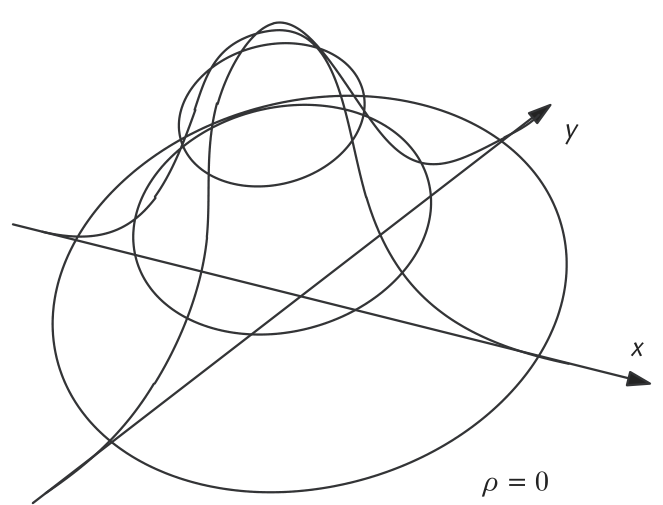

数学上，参数为 $\mu_X$、$\mu_Y$、$\sigma_X^2$、$\sigma_Y^2$ 与相关系数 $\rho$ 的二维高斯密度的一般定义为

$$f_{XY}(x,y)=\frac{\exp\left\{-\frac{1}{2(1-\rho^2)}\left[\left(\frac{x-\mu_X}{\sigma_X}\right)^2-2\rho\left(\frac{x-\mu_X}{\sigma_X}\right)\left(\frac{y-\mu_Y}{\sigma_Y}\right)+\left(\frac{y-\mu_Y}{\sigma_Y}\right)^2\right]\right\}}{2\pi\sigma_X\sigma_Y\sqrt{1-\rho^2}},$$

其中相关系数定义为

$$\rho=E\!\left[\frac{x-\mu_X}{\sigma_X}\cdot\frac{y-\mu_Y}{\sigma_Y}\right].$$

假设要建模一个复基带信道，其中同相与正交噪声分量由二维高斯随机变量表示。有些情形我们希望噪声的同相与正交分量**不相关**，另一些情形则希望它们高度相关。因此必须确保准确建模这些二维高斯随机值。代码 3.4 的 MATLAB 脚本建模了代表信道噪声的这类二维高斯随机变量：用 `randn` 函数生成长度 $L$ 的两个含高斯特性的向量。由于这两个向量是分别生成的，默认情形下它们互不相关。两个向量都是零均值、标准差均为 `std_dev`。由这两个向量可以方便地得到不相关的与相关的二维高斯分布数据。

**代码 3.4　信息源：random_example.m**

```matlab
% Define simulation parameters
L = 1000000;        % Length of data streams
res_hist = 100;     % Histogram resolution
std_dev = 5;        % Standard deviation of input Gaussian variables

% Create uncorrelated 2D Gaussian random variable
x_normal_1 = std_dev.*randn(1,L);
y_normal_1 = std_dev.*randn(1,L);

% Create correlated 2D Gaussian random data stream
x_normal_2 = x_normal_1 + 0.1*y_normal_1;
y_normal_2 = y_normal_1 + 0.9*x_normal_1;
```

从图 3.8 的二维密度函数可以方便地观察不相关与相关二维高斯随机变量的差别。不相关情形下，二维高斯随机变量关于 x/y 平面对称，见图 3.8(a)（三维视角）与图 3.8(b)（俯视视角）。而一旦在二维高斯随机变量的同相与正交分量间引入相关性，密度形状开始扭曲：一个方向被压缩、另一方向被扩张，见图 3.8(c)（三维视角）与图 3.8(d)（俯视视角）。

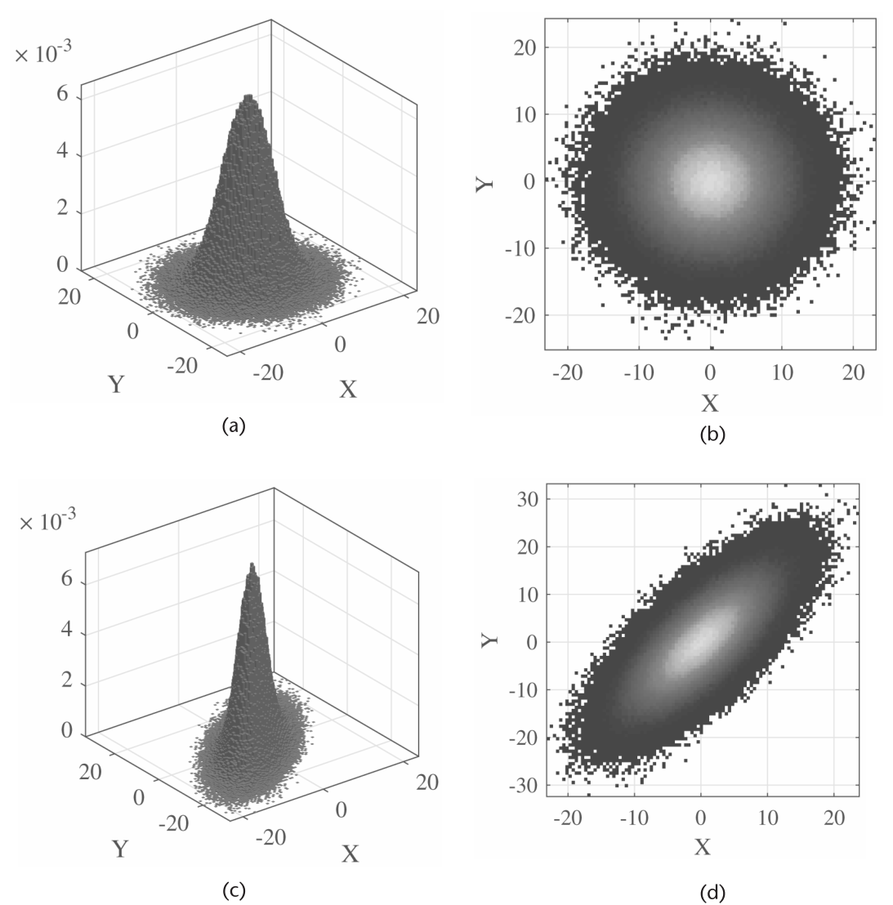

### 3.5.1　高斯过程

如前所述，存在这样的情形：表示通信系统某元素的随机现象，其概率特性随时间变化（例如由高斯随机变量表示的噪声信道特性）。于是需要一种能刻画这些现象时间依赖随机性的数学表示，尤其是对高斯随机变量建模的事件。参照 3.4 节，可以用**高斯过程**建模时变的高斯随机变量：高斯过程是这样的随机过程——它的实现由一系列时间（或空间）范围内每一点关联的随机值组成，且每个这样的随机变量都服从正态分布。此外，这些随机变量的每个有限集合都具有多变量正态分布。

高斯过程在统计建模中很重要，因为它继承了正态分布的性质。例如，若随机过程被建模为高斯过程，各导出量的分布都可以显式获得。这样的量包括过程在一段时间范围内的平均值、以及用少量时刻的样本值估计该平均值的误差。

给定表达式

$$y=\int_0^{T}g(t)X(t)\,dt$$

若满足：

- $E(y^2)$ 有限（即不发散）；
- 对每个 $g(t)$，$Y$ 都是高斯分布的，

则可以说 $X(t)$ 是高斯过程。注意随机变量 $Y$ 服从高斯分布，其 PDF 为

$$f_Y(y)=\frac{1}{\sqrt{2\pi\sigma_Y^2}}e^{-(y-\mu_Y)^2/2\sigma_Y^2},$$

其中 $\mu_Y$ 是均值、$\sigma_Y^2$ 是方差。这类过程很重要，因为它们与大量物理现象的行为高度吻合，例如加性高斯白噪声（AWGN）。

> **思考题**：为什么一个不相关的随机过程被称为"白"的，就像加性高斯白噪声的情形那样？

## 3.6　功率谱密度与 LTI 系统

要在频域分析通信系统，常用**功率谱密度**（PSD）$S_{XX}(f)$ 刻画信号，它由 WSS 随机过程 $X(t)$ 的自相关 $R_{XX}(\tau)$ 取傅里叶变换得到。PSD 与自相关函数通过爱因斯坦–维纳–辛钦（EWK）关系在数学上相联系：

$$S_{XX}(f)=\int_{-\infty}^{\infty}R_{XX}(\tau)e^{-j2\pi f\tau}\,d\tau$$

$$R_{XX}(f)=\int_{-\infty}^{\infty}S_{XX}(\tau)e^{+j2\pi f\tau}\,d\tau$$

EWK 关系的一个威力巨大的推论是：当要确定"输入也是 WSS 随机过程的 LTI 系统的输出"这一 WSS 随机过程的自相关函数或 PSD 时特别有用。具体地，设 $H(f)$ 为 LTI 系统 $h(t)$ 的频率响应，则输入输出随机过程的功率谱密度由下式联系：

$$S_{YY}(f)=|H(f)|^2S_{XX}(f),$$

其中 $S_{XX}(f)$ 是输入随机过程的 PSD，$S_{YY}(f)$ 是输出随机过程的 PSD。这一非常有用的关系示于图 3.9。

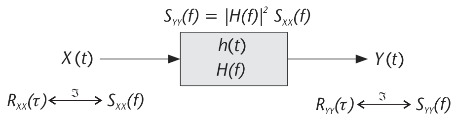

要理解 LTI 系统对随机过程 PSD 的影响，可以用代码 3.5 的 MATLAB 脚本：用二元均匀随机数发生器产生同相与正交值。为突出 LTI 系统对 PSD 的影响，用 `firls` 函数设计了两个滤波器：一个通带相对较大，另一个通带相对较小。二元均匀随机值被两个系统分别滤波，结果 PSD 见图 3.10。

原始二元均匀随机值的三维与俯视视角示于图 3.10(a) 与 (b)。观察到密度几乎呈矩形块状——这正是我们对二元均匀分布的预期。用窄通带滤波器过滤该数据后观察 PSD，可以清楚看到滤波操作的效果：PSD 的大部分在外围被滤除，见图 3.10(c) 与 (d)。而用通带相对较大的滤波器时，PSD 的外围没有被明显滤除，见图 3.10(e) 与 (f)。本例的要点是：LTI 系统的滤波操作会对随机过程的 PSD 产生显著影响。

**代码 3.5　信息源：random_example.m**

```matlab
% Define simulation parameters
L = 1000000;              % Length of data streams
res_hist = 100;           % Histogram resolution
cutoff_freq1 = 0.2;       % Small passband LPF
cutoff_freq2 = 0.7;       % Large passband LPF
filt_coeffs1 = firls(13,[0 cutoff_freq1 cutoff_freq1+0.02 1],[1 1 0 0]);
filt_coeffs2 = firls(13,[0 cutoff_freq2 cutoff_freq2+0.02 1],[1 1 0 0]);

% Create input 2D Gaussian random variable
x_in = rand(1,L);
y_in = rand(1,L);

% Filter input random data stream
filt_output1 = filter(filt_coeffs1,1,(x_in+1j.*y_in));
x_out1 = real(filt_output1);
y_out1 = imag(filt_output1);
filt_output2 = filter(filt_coeffs2,1,(x_in+1j.*y_in));
x_out2 = real(filt_output2);
y_out2 = imag(filt_output2);
```

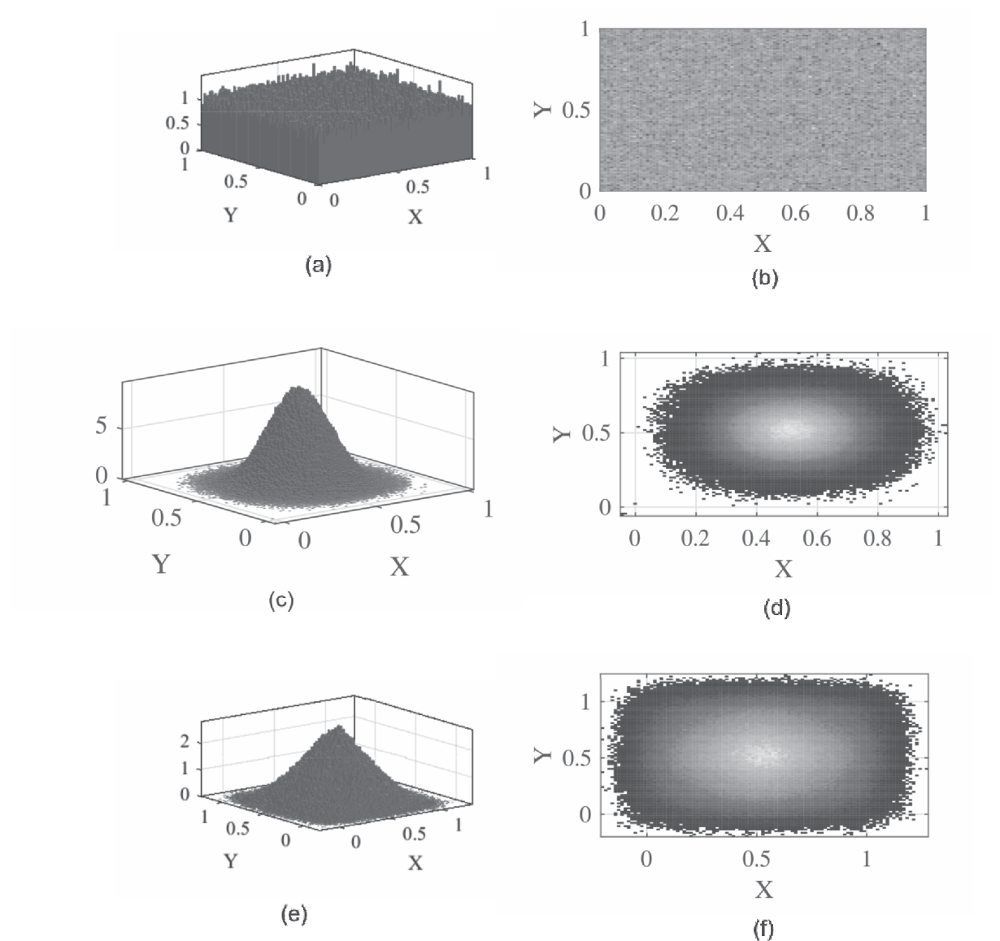

## 3.7　窄带噪声

有了随机变量与随机过程的坚实基础，现在可以把这些知识应用于无线通信系统的窄带传输。一般而言，多数传输都被设计为带限的，因为任何一次传输可用的无线频谱量都有约束。这些约束是必要的：可用无线频谱有限，而寻求用这些频谱传输的无线应用与用户却在不断增长。

窄带通信系统的关键要素之一是收发两端的窄带滤波器，设计为只让已调信号通过。然而这些窄带滤波器也会让接收机截获的一部分噪声通过，因为很难把噪声与已调信号分开。如果噪声恰是白的（即不相关），那么窄带噪声将呈现余弦调制的带通滤波器响应形状。原因在于：滤波前的白噪声 PSD 是平坦的、铺满从 $-\infty$ 到 $+\infty$ 的整个频率范围；经带通滤波器处理后，得到的窄带噪声 PSD 呈现带通滤波器幅度响应平方的形状——因为时域噪声与滤波器的卷积对应为噪声 PSD 与滤波器幅度响应的乘积（见 3.6 节）。

为建立表示窄带噪声的便捷数学框架，有两条途径：**同相/正交表示**与**包络/相位表示**。两者都可以用定义 $x=Ae^{j\varphi}=a+jb$ 描述复数值 $x$（$x\in\mathbb{C}$），其中包络 $A$、相位 $\varphi$、同相分量 $a$ 与正交分量 $b$ 均为实数（$A,\varphi,a,b\in\mathbb{R}$）。两种表示之间的关系为：

$$A=\sqrt{a^2+b^2},\qquad\varphi=\tan^{-1}(b/a)$$

$$a=A\cos(\varphi),\qquad b=A\sin(\varphi)$$

于是，可以通过下式在复基带域描述窄带噪声的同相/正交表示：

$$\tilde{n}(t)=n_I(t)+jn_Q(t),$$

再表达为带通形式的窄带噪声信号：

$$n(t)=\mathrm{Real}\{\tilde{n}(t)e^{j2\pi f_ct}\}.$$

利用欧拉关系 $e^{j\omega}=\cos(\omega)+j\sin(\omega)$，得到

$$n(t)=n_I(t)\cos(2\pi f_ct)-n_Q(t)\sin(2\pi f_ct).$$

同相/正交表示的若干重要性质见表 3.4。


| 性质 |
|---|
| $n_I(t)$ 与 $n_Q(t)$ 都是零均值 |
| 若 $n(t)$ 是高斯的，则 $n_I(t)$ 与 $n_Q(t)$ 也是 |
| 若 $n(t)$ 平稳，则 $n_I(t)$ 与 $n_Q(t)$ 联合平稳 |
| $n_I(t)$ 与 $n_Q(t)$ 的 PSD 相等：$S_{NI}(f)=S_{NQ}(f)=\begin{cases}S_N(f-f_c)+S_N(f+f_c), & -B\le f\le B\\ 0, & \text{otherwise}\end{cases}$ |
| $n_I(t)$ 与 $n_Q(t)$ 的方差都等于 $n(t)$ 的方差 |
| 若 $n(t)$ 是高斯的且其 PSD 对称，则 $n_I(t)$ 与 $n_Q(t)$ 统计独立 |
| $n_I(t)$ 与 $n_Q(t)$ 的互谱密度是纯虚的，且在 $-B\le f\le B$ 内等于 $S_{N_IN_Q}(f)=-S_{N_QN_I}(f)=j(S_N(f+f_c)-S_N(f-f_c))$（其余为零） |

: 同相/正交表示的若干重要性质

类似地，窄带噪声包络/相位表示的复基带版本可写为

$$n(t)=r(t)\cos(2\pi f_ct+\varphi(t))$$

其中 $r(t)=\sqrt{n_I(t)+n_Q(t)}$ 是包络，$\varphi(t)=\tan^{-1}(n_Q(t)/n_I(t))$ 是相位。

关于两种表示的联合分布之间的关系，结果非常精彩。设 $n_I(t)$ 与 $n_Q(t)$ 的联合 PDF 为二维高斯分布：

$$f_{N_IN_Q}(n_I,n_Q)=\frac{1}{2\pi\sigma^2}e^{-(n_I^2+n_Q^2)/2\sigma^2}.$$

结果是：利用关系 $n_I=r\cos(\varphi)$、$n_Q=r\sin(\varphi)$ 以及雅可比行列式，得到如下分布：

$$f_{R\Phi}(r,\varphi)=\begin{cases}\frac{r}{2\pi\sigma^2}e^{-r^2/2\sigma^2}, & r\ge 0\ \text{且}\ 0\le\varphi\le 2\pi\\ 0, & \text{otherwise}\end{cases}$$

它等价于瑞利 PDF 与均匀 PDF 的组合。

## 3.8　随机变量的应用：室内信道模型

随机变量用于建模通信系统设计与实现中随机现象的一个绝佳例子，是 Saleh 与 Valenzuela 提出的室内信道模型 [3]。该信道模型的前提是：室内环境会产生多径分量的**簇**（cluster），这些多径分量来自无线信号在周围环境上的反射。

数学上，他们用下式描述接收机截获的发射信号反射：

$$h(t)=\sum_{l=0}^{\infty}\sum_{k=0}^{\infty}\beta_{kl}e^{j\theta_{kl}}\delta(t-T_l-\tau_{kl})$$

其中 $\beta_{kl}$ 是第 $l$ 个多径簇内第 $k$ 条射线的幅度，$\theta_{kl}$ 是其相位值，$T_l$ 是第 $l$ 个多径簇起始的时延，$\tau_{kl}$ 是第 $l$ 个多径簇内第 $k$ 条射线的时延。在他们的工作中，Saleh 与 Valenzuela 用信道测量把 $\beta_{kl}$ 刻画为瑞利随机变量、$\theta_{kl}$ 刻画为均匀随机变量、$T_l$ 与 $\tau_{kl}$ 刻画为到达率分别为 $\Lambda$ 与 $\lambda$ 的泊松到达过程。图 3.11 直观展示了该模型。

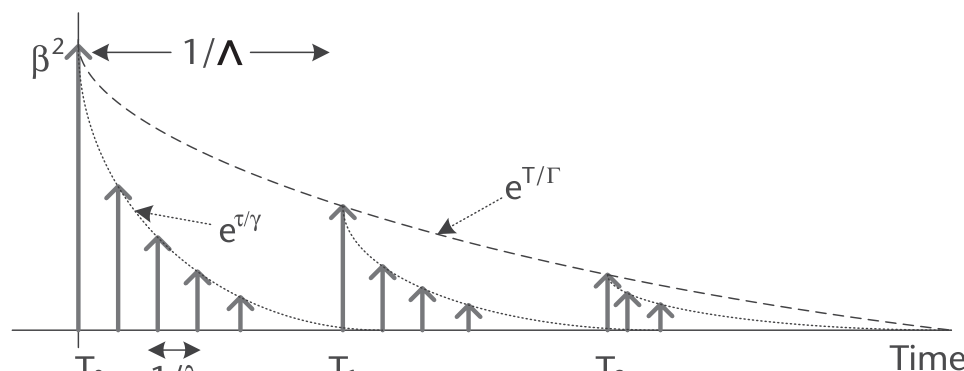

## 3.9　本章小结

本章简要介绍了分析与建模通信系统随机变量和随机过程的若干关键数学工具。特别重要的是：读者应理解如何数学地操作高斯随机变量、高斯随机过程与二维正态分布——它们频繁出现在数字通信与无线数据传输应用中。此外，理解平稳性的机理、以及如何把 EWK 关系应用于"LTI 系统过滤随机过程"的情形，至关重要——尤其在处理通信系统接收机对无线接收信号的加工时。

## 3.10　延伸阅读

本章虽然试图为读者介绍分析与建模众多数字通信系统中常见随机变量和随机过程所需的若干关键数学工具，但对这些数学工具的处理绝非严格或透彻。因此，鼓励有兴趣的读者查阅更详尽论述这一广阔领域的书籍。例如，Papoulis 与 Pillai 的书是概率与随机过程教科书的标准权威 [1]；而希望在通信网络语境下理解概率与随机过程理论的读者，可能会发现 Leon-Garcia 的书高度相关 [4]。

对涉及物理层数字通信系统与数字信号处理（如维纳滤波）感兴趣的人，Gubner 的书是不错的选择——该书中许多例子与习题都与通信系统的经典问题相关 [5]。至于有大量例题解答与讲解的书，Hsu [6] 与 Krishnan [7] 的著作是合适的读物。最后，有兴趣研究随机过程高级主题与处理的读者，可参考 Grimmett 与 Stirzaker 的书 [8]。

## 参考文献

[1] Papoulis, A., and S. Unnikrishna Pillai, *Probability, Random Variables and Stochastic Processes*, Fourth Edition, New York: McGraw Hill Higher Education, 2002.

[2] Abramowitz, M., and I. Stegun, *Handbook of Mathematical Functions: with Formulas, Graphs, and Mathematical Tables*, New York: Dover Publications, 1965.

[3] Saleh, A. A. M., and R. A. Valenzuela, "A Statistical Model for Indoor Multipath Propagation," *IEEE Journal on Selected Areas in Communications*, Vol. 5, No. 2, 1987, pp. 128–137.

[4] Leon-Garcia, A., *Probability, Statistics, and Random Processes for Electrical Engineering*, Third Edition, Upper Saddle River, NJ: Prentice Hall, 2008.

[5] Gubner, J. A., *Probability and Random Processes for Electrical and Computer Engineers*, Cambridge, MA: Cambridge University Press, 2006.

[6] Hsu, H., *Schaum's Outline of Probability, Random Variables, and Random Processes*, New York: McGraw-Hill, 1996.

[7] Krishnan, V., *Probability and Random Processes*, Hoboken, NJ: Wiley-Interscience, 2006.

[8] Grimmett, G., and D. Stirzaker, *Probability and Random Processes*, Third Edition, Oxford, UK: Oxford University Press, 2001.
