# 第 4 章　数字通信基础

本章概述数字数据传输中若干关键的基础概念。我们先理解二进制数据如何用来操纵电磁波形的物理特性，再考察数字通信系统的基本构成，然后集中讨论用二进制数据调制电磁波形的几种不同方法。建立数字传输的工作方式后，我们将探索评估此类系统定量性能的关键分析工具之一——误码率。最后，本章以信号矢量空间的视角介绍数字接收机的设计。

## 4.1　什么是数字传输？

数字收发信机是由一组数字与模拟过程组成的系统，这些过程协同工作，完成二进制信息的处理与操纵。这些过程的目的，是实现某种介质上的数据收发——无论是双绞铜线、光纤电缆还是无线环境。任何数字收发信机系统的核心是二进制数字（比特）：就本书而言，它是数字通信系统所使用的信息基本单位。

因此，数字收发信机本质上负责"比特流"与"唯一表示这些比特的物理特性的电磁波形"之间的转换。由于电磁波形通常用正弦与余弦波描述，每个时间间隔 $T$ 内常用来表示数字数据的电磁波形物理特性包括幅度、相位与载波频率，如图 4.1 所示。注意不同的比特组合表示不同的幅度电平、不同的相位值或不同的载波频率值，每个值唯一地表示特定的二进制图案。还要注意，在某些高级映射体制中，二进制图案可能由两种或更多物理量共同表示。

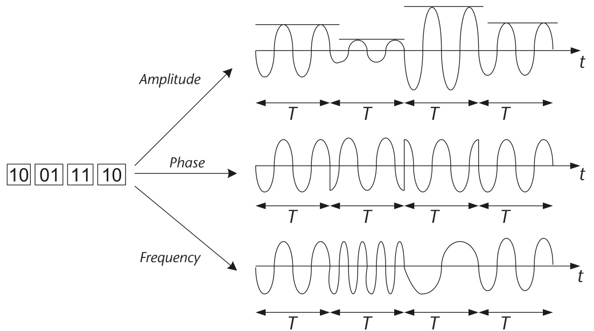

然而，数字收发信机里发生的事情远不止比特与波形之间的映射，如图 4.2 所示。在这幅数字收发信机基本构成的图示中，我们看到构成通信系统的若干功能块：比特与电磁波形特性之间的映射由调制与解调块表示；此外还有负责从二进制数据中移除冗余信息的信源编码与信源译码块；为保护传输免受潜在差错而引入受控冗余的信道编码与信道译码块；以及负责把基带波形搬移到更高载频的射频前端（RFFE）块。

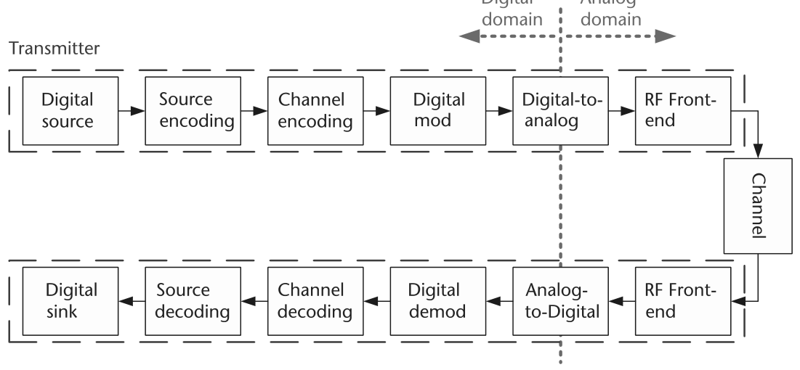

有人会问：为什么数字通信系统需要这么多块？注意图 4.2 中发射机与接收机之间存在一个**信道**。数字通信系统设计之所以困难、实现之所以涉及这么多块，主因就是这个信道。如果信道是理想介质——发射机的电磁波形毫无失真与扰动地送达接收机——那么数字通信系统的设计将不值一提。然而现实中，信道会给数字传输引入各种随机损伤，可能影响接收机对波形的正确接收。例如，信道可能引入某种噪声，遮蔽波形的某些特性。而且许多真实场景中，信道引入的这些非理想效应还是时变的，因而难以对付——尤其当它们随时间快速变化时。

于是在真实条件下，任何数字通信系统的首要目标是：发射二进制消息 $m(t)$，使接收机输出端重建的版本 $\hat{m}(t)$ 与之相等。换言之，我们的目标是让 $P(\hat{m}(t)\neq m(t))$ 小到特定应用所需的程度。定量评估数字通信系统差错性能的指标称为差错概率或误码率（BER），定义为 $P_e=P(\hat{m}(t)\neq m(t))$。注意不同数据传输应用的 $P_e$ 要求不同，部分取决于数据传输速率。例如：数字语音传输认为 $P_e\sim 10^{-3}$ 可接受；一般数据传输应用 $P_e\sim 10^{-5}$–$10^{-6}$ 被认为足够；而光纤电缆这类极高速率应用需要 $P_e\sim 10^{-9}$，否则以极高的数据速率，再多差错都会淹没接收机。

为帮助缓解信道损伤可能导致的差错，在进入调制之前，我们先简要研究信源编码与信道编码的工作方式。

**动手 MATLAB 示例**：通信系统在把电磁信号广播到介质上之前，通过操纵其物理属性来传递信息。幅度、相位和/或频率等信号属性随时间被操纵，使接收机能够解读发射机传达的消息。这些电磁广播常用正弦信号，因而操纵起来相对直接。下面的 MATLAB 脚本生成三个基于正弦波的传输，信息分别通过幅度电平（幅移键控）、相位特性（相移键控）或频率值（频移键控）嵌入其中。脚本用 `rand` 函数生成随机二进制数据、取整到最近整数（0 或 1），再把这些二进制值映射为正弦信号所用的幅度、相位或频率值。由于正弦信号是连续波形，我们用大量离散点逼近连续。

这些随机二进制值到正弦信号物理属性的映射示于图 4.3：可以清楚看到幅度（图 4.3(b)）、相位（图 4.3(c)）与频率（图 4.3(d)）的值如何随时间变化，以表示发往接收机的二进制值（见图 4.3(a)）。三种情形用完全相同的正弦信号作信息载体，只是正弦特性随时间变化。

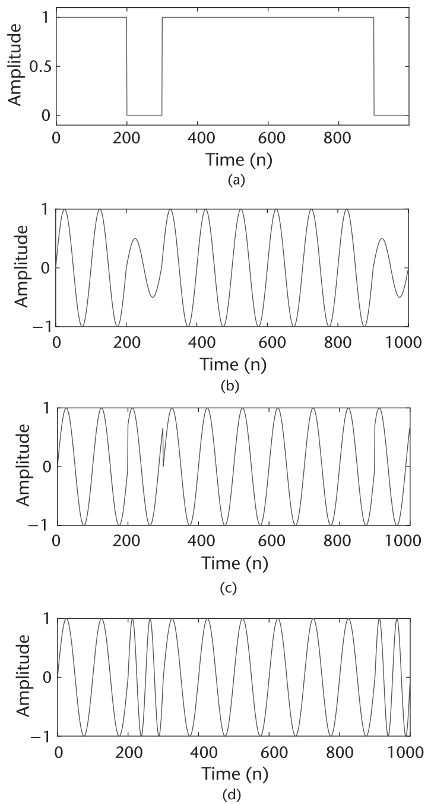

**代码 4.1　用正弦信号操纵发送二进制数据：chapter4.m**

```matlab
%%%%%%%%%%%%%%%%%%%%%%%%%%%%%%%%%%%%%%%%%%%%%%%%%%%%%
% Sending binary data via sinusoidal signal manipulation

% Parameters
sig_len = 1000;       % Signal length (in samples)
sampl_per_bin = 100;  % Samples per binary representation
bin_data_len = sig_len/sampl_per_bin;
                      % Length of binary stream is a multiple of signal length
bin_data = round(rand(1,bin_data_len));

% Create sinusoidal carriers
sig_carrier_base = sin(2*pi*(0:(1/sampl_per_bin):
                      (1-(1/sampl_per_bin))));   % Baseline carrier
sig_carrier_freq = sin(2*2*pi*(0:(1/sampl_per_bin):
                      (1-(1/sampl_per_bin))));   % Double frequency
sig_carrier_phase = sin(2*pi*(0:(1/sampl_per_bin):
                      (1-(1/sampl_per_bin)))+(pi/4)); % Phase shifted 45 degrees

% Modulate sinusoidal carrier via amplitude, phase, and frequency
% manipulations
sig_bin = [];  % Binary waveform
sig_ask = [];  % Amplitude modulated
sig_psk = [];  % Phase modulated
sig_fsk = [];  % Frequency modulated
for ind = 1:1:bin_data_len,
    if (bin_data(ind)==1)
        sig_bin = [sig_bin ones(1,sampl_per_bin)];
        sig_ask = [sig_ask sig_carrier_base];
        sig_psk = [sig_psk sig_carrier_base];
        sig_fsk = [sig_fsk sig_carrier_base];
    else
        sig_bin = [sig_bin zeros(1,sampl_per_bin)];
        sig_ask = [sig_ask 0.5*sig_carrier_base];
        sig_psk = [sig_psk sig_carrier_phase];
        sig_fsk = [sig_fsk sig_carrier_freq];
    end;
end;
```

### 4.1.1　信源编码

任何通信系统的目标之一，是从发射机到接收机跨介质高效且可靠地传递信息。理想情况下，应把传输中所有冗余信息都去除，以最小化需要跨信道发送的信息量，最终减少传输所耗费的时间、计算资源与功率。**信源编码**就是为促成更高效通信而设计的、去除冗余信息的机制。

信源编码的运作方式：取信源符号序列 $\mathbf{u}$，把它们映射为相应的信源编码符号序列 $\mathbf{v}$，使 $v_i\in\mathbf{v}$ 尽可能接近随机、且 $\mathbf{v}$ 的各分量互不相关。于是，通过执行信源编码操作，我们希望在 $v_i\in\mathbf{v}$ 中实现某种程度的冗余最小化，从而限制在传输"本可预测的符号"上浪费的无线电资源。换言之，信源编码器从信源符号中去除冗余信息，以实现高效传输。注意执行信源编码要求信源符号是数字的。

**动手 MATLAB 示例**：信源编码通过去除数据集合中的冗余、用短码字取而代之，从而减少信息总量。下面的 MATLAB 脚本演示把信源编码应用于具有不同冗余度的数据。用 `rand` 与 `round` 函数的组合生成两个二进制数据向量：一个 1/0 数量均等，另一个约 90% 为 1、10% 为 0。压缩这些向量时，我们采用的编码技术是：取向量中所有连续的 1 串，用表示该串长度的十进制值替换。例如某二进制向量中两个 0 之间有 15 个 1，就用一个十进制值（或等价码字）替换这 15 个 1。

按此编码方案，直觉告诉我们：90/10 的向量相对 50/50 的向量会被压缩得更多，因为前者更可能出现长的 1 串。图 4.4 证实了直觉——压缩后的 90/10 二进制数据流尺寸显著缩减；而 50/50 的向量不仅没压缩反而变大了。原因在于：把每段 1 串替换为相应码字的开销，实际占用比原始二进制序列还多。因此做信源编码时，压缩具有明显冗余的数据流才划算，否则可能适得其反。

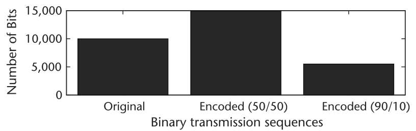

**代码 4.2　用信源编码减少数据传输量：chapter4.m**

```matlab
% Define parameters
len = 10000;  % Length of binary data stream

% Have two binary sources, one 50/50 and the other 90/10 in terms
% of ones and zeros
bin1 = round(rand(1,len));              % 50/50 binary
bin2 = round(0.5*rand(1,len)+0.45);     % 90/10 binary

% Encode strings of ones in terms of the length of these strings
enc_bin1 = [];
enc_bin2 = [];
for ind = 1:1:len,
    if (bin1(ind) == 1)  % Encoding 50/50
        if (ind == 1)
            enc_bin1 = 1;
        else
            enc_bin1(end) = enc_bin1(end)+1;
        end;
    else
        enc_bin1 = [enc_bin1 0];
    end;
    if (bin2(ind) == 1)  % Encoding 90/10
        if (ind == 1)
            enc_bin2 = 1;
        else
            enc_bin2(end) = enc_bin2(end)+1;
        end;
    else
        enc_bin2 = [enc_bin2 0];
    end;
end;

% Find size of encoded binary streams
% (assume all one string length values possess the same number of bits)
ind1 = find(enc_bin1 ~= 0);
ind2 = find(enc_bin2 ~= 0);
[largest_ebin1,ind_largest_ebin1] = max(enc_bin1(ind1));
[largest_ebin2,ind_largest_ebin2] = max(enc_bin2(ind2));
numbits1 = length(dec2bin(largest_ebin1)-'0');
numbits2 = length(dec2bin(largest_ebin2)-'0');
total_size_ebin1 = length(ind1)*numbits1 + length(find(enc_bin1 == 0));
total_size_ebin2 = length(ind2)*numbits2 + length(find(enc_bin2 == 0));
```

### 4.1.2　信道编码

为保护数字传输的信息不被破坏，需要引入某种程度的受控冗余以逆转数据损坏的影响。**信道编码**通过向数据传输引入受控冗余来纠正信道传输差错。与信源编码中去除的"本质随机"的冗余不同，信道编码引入的冗余是专门为对抗传输比特差错而设计的（即冗余具有发射机与接收机双方都已知的特定结构）。

一般而言，信道编码这样运作：长度为 $K$ 的信源编码输出向量（即 $\mathbf{v}_l$，$l=1,2,\ldots,2^K$）被指派唯一的码字，如向量 $\mathbf{v}_l=(101010\ldots)$ 被指派码本 $\mathcal{C}$ 中长度为 $N$ 的唯一码字 $\mathbf{c}_l$。此过程中信道编码器引入 $N-K=r$ 个受控比特。通信系统的**码率**等于信息比特数与码字长度之比（即码率等于 $K/N$）。

为信道编码器设计码本时，需要定量评估码字在数据损坏情形下的表现好坏。**汉明距离**常用来通过评估任意两个码字的相对差异，确定码本中一组码字的有效性。具体地，任意两个码字 $\mathbf{c}_i$ 与 $\mathbf{c}_j$ 之间的汉明距离 $d_H(\mathbf{c}_i,\mathbf{c}_j)$ 等于 $\mathbf{c}_i$ 与 $\mathbf{c}_j$ 不同的分量数。评估码本设计时我们常关注码字间的**最小**汉明距离：

$$d_{H,\min}=\min_{\mathbf{c}_i,\mathbf{c}_j\in\mathcal{C},\,i\neq j}d_H(\mathbf{c}_i,\mathbf{c}_j),$$

因为我们的目标是最大化给定码本的最小汉明距离，确保"意外选中正确码字之外的码字"的概率保持最小。例如码本 $\{101,010\}$，最小汉明距离 $d_{H,\min}=3$，是最好可能的结果；而码本 $\{111,101\}$ 的 $d_{H,\min}=1$，相对就很差。

当码字在传输中损坏时，可用**译码球**（又称汉明球）对接收信息做判决，如图 4.5 所示：传输中损坏的码字被映射到最近的合法码字。注意设计码本时译码球不应重叠，以获得接收机最佳译码性能（即 $\to d_{H,\min}=2t+1$）。

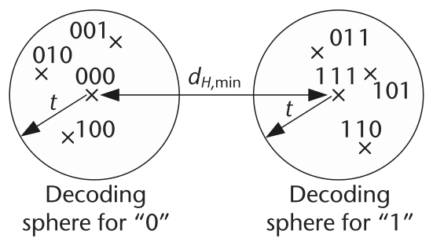

**动手 MATLAB 示例**：把重复编码应用于一个实际向量，用一组重复率，观察二进制向量暴露于随机比特翻转时的影响。下面的 MATLAB 脚本取原始二进制向量 `bin_str`，以"把这些二进制值重复 $N$ 次"的形式引入受控冗余。例如不直接发 010，用重复因子 $N=3$ 的重复编码将输出 000111000。这很重要的原因在于：当某个比特从 1 翻成 0 或从 0 翻成 1（视为一次差错）时，其余重复的比特可以在接收机处抵消这个差错——即若某个 0 翻成了 1，另外两个 0 会告诉接收机该组里有比特出错、译码时丢弃该值。直觉上我们会认为重复越多越保险；例如存在多于一个比特损坏的情形，除非有更多重复比特告知接收机，否则仍会出错。

> **思考题**：一个无信源编码的码率 1/3 重复码如下：
> $$1\to 111=\mathbf{c}_1\ (\text{第 1 个码字}),\quad 0\to 000=\mathbf{c}_2\ (\text{第 2 个码字})$$
> $\therefore\ \mathcal{C}=\{000,111\}$。请计算码字对的汉明距离 $d_H(111,000)$ 与 $d_H(111,101)$。

**代码 4.3　用简单重复信道编码保护数据：chapter4.m**

```matlab
% Define parameters
len = 100000;  % Length of original binary data stream
N1 = 3;        % First repetition factor; should be odd to avoid tie
N2 = 5;        % Second repetition factor; should be odd to avoid tie
N3 = 7;        % Third repetition factor; should be odd to avoid tie

% Generate binary data stream
bin_str = round(rand(1,len));

% Employ repetition code with repetition factors N1, N2, N3
chcode1_bin_str = zeros(1,N1*len);
chcode2_bin_str = zeros(1,N2*len);
chcode3_bin_str = zeros(1,N3*len);
for ind = 1:1:max([N1 N2 N3]),
    if (ind<=N1)
        chcode1_bin_str(ind:N1:(N1*(len-1)+ind))=bin_str;
    end;
    if (ind<=N2)
        chcode2_bin_str(ind:N2:(N2*(len-1)+ind))=bin_str;
    end;
    if (ind<=N3)
        chcode3_bin_str(ind:N3:(N3*(len-1)+ind))=bin_str;
    end;
end;

% Corrupt both binary strings with zero-mean unit variance Gaussian
% noise followed by rounding (creates "bit flipping" errors)
noisy_bin_str = bin_str + randn(1,len);
rx_bin_str0 = zeros(1,len);
ind0 = find(noisy_bin_str >= 0.5);
rx_bin_str0(ind0) = 1;
noisy_chcode1_bin_str = chcode1_bin_str + randn(1,N1*len);
rx_chcode1_bin_str = zeros(1,N1*len);
ind1 = find(noisy_chcode1_bin_str >= 0.5);
rx_chcode1_bin_str(ind1) = 1;
noisy_chcode2_bin_str = chcode2_bin_str + randn(1,N2*len);
rx_chcode2_bin_str = zeros(1,N2*len);
ind2 = find(noisy_chcode2_bin_str >= 0.5);
rx_chcode2_bin_str(ind2) = 1;
noisy_chcode3_bin_str = chcode3_bin_str + randn(1,N3*len);
rx_chcode3_bin_str = zeros(1,N3*len);
ind3 = find(noisy_chcode3_bin_str >= 0.5);
rx_chcode3_bin_str(ind3) = 1;

% Decode three encoded binary sequences
dec1_bin = (vec2mat(rx_chcode1_bin_str,N1)).';
dec2_bin = (vec2mat(rx_chcode2_bin_str,N2)).';
dec3_bin = (vec2mat(rx_chcode3_bin_str,N3)).';
ind11 = find(((sum(dec1_bin,1))/N1) >= 0.5);
ind12 = find(((sum(dec2_bin,1))/N2) >= 0.5);
ind13 = find(((sum(dec3_bin,1))/N3) >= 0.5);
rx_bin_str1 = zeros(1,len);
rx_bin_str1(ind11) = 1;
rx_bin_str2 = zeros(1,len);
rx_bin_str2(ind12) = 1;
rx_bin_str3 = zeros(1,len);
rx_bin_str3(ind13) = 1;

% Calculate bit error rate
ber0 = sum(abs(bin_str - rx_bin_str0))/len;
ber1 = sum(abs(bin_str - rx_bin_str1))/len;
ber2 = sum(abs(bin_str - rx_bin_str2))/len;
ber3 = sum(abs(bin_str - rx_bin_str3))/len;
```

由 MATLAB 脚本可见重复编码对易错环境中被比特翻转破坏的二进制向量的影响（见图 4.6）：随着以更大重复率的形式引入更多受控冗余，传输中的比特差错逐渐减少。这说得通——往传输里投入更多资源使其在易错环境中更可靠，差错发生率就开始下降。但要注意其中存在成本-收益折中：投入的资源与获得的收益未必线性相关。

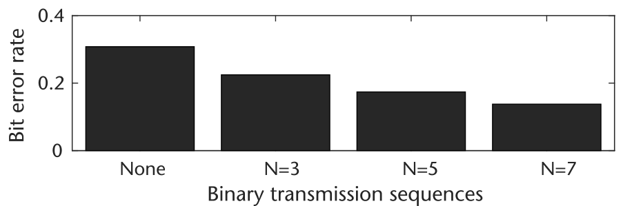

#### 4.1.2.1　香农信道编码定理

数字通信中有时需要确定特定数字收发信机设计的数据速率上限。1949 年，克劳德·香农发表了针对这一主题的开创性论文《通信的数学理论（在噪声中的通信）》[1]。论文中他给出了描述数字收发信机数据速率极限（即容量）的定量表达式，以实现无误传输。

设信道容量为 $C$，以固定码率 $K/N=R_c$（常数）发送数据——于是增大 $N$ 就必须增大 $K$ 以保持 $R_c$ 恒定。香农的结论是：存在这样的码，使得当 $R_c=K/N<C$ 且 $N\to\infty$ 时，差错概率 $P_e\to 0$；反之当 $R_c=K/N\ge C$ 时不存在这样的码。因此 $C$ 是可靠通信的速率极限（即绝对极限——快过它就会出错）。

为什么这个结果如此重要？首先，数字通信的可靠性通常用接收机输出端测得的误比特概率表达。若能用数学工具而非经验测量，由传输带宽 $B$ 与接收 SNR 得出这个容量，将非常便利。香农推导出的信道信息容量等于

$$C=B\log_2(1+\mathrm{SNR})\quad\text{[b/s]},$$

该信息容量告诉我们可达的数据速率。注意香农只给出了可达容量的**理论极限**，并未告诉我们如何建造达到该极限的收发信机。其次，信息容量表达式给出了给定带宽 $B$ 与接收 SNR 下可达数据速率的界，用于比值 $\eta=R/C$（$R$ 为信令速率、$C$ 为信道容量）：$\eta\to 1$ 时系统更高效。因此容量表达式为 $B$ 与 SNR 之间的折中分析提供了基础，也可用于比较不同调制方案的噪声性能。

## 4.2　数字调制

模拟调制中，模拟消息信号在跨介质传输前调制连续波；反过来，**数字调制**是用数字消息信号调制连续波形。如本章前文所见，这可以通过在每个符号周期 $T$ 内按特定比特图案唯一地操纵信号的幅度与相位信息来实现。但多数数字调制技术还有一个中间步骤，本节将聚焦于此：把组成二进制消息 $m_b$ 的 $b$ 个比特的集合映射为一个**符号**，再用该符号定义连续波形在幅度与相位方面的物理特性。具体地，对 $m_b$ 的每个可能的 $2^b$ 个取值，我们需要唯一的信号 $s_i(t)$（$1\le i\le 2^b$）去调制连续波形，如图 4.7 所示。

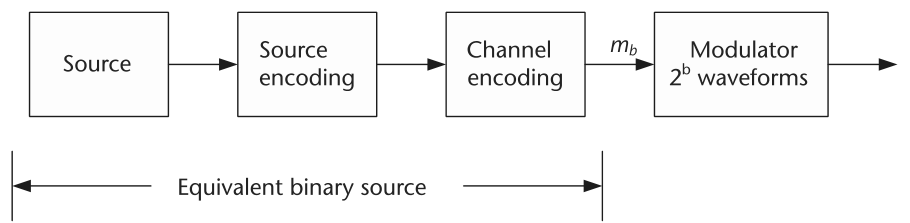

本节将研究把二进制数据映射为符号（再用于调制连续波形）的几大不同方法族。这些调制方案族由映射过程操纵的物理特性或特性组合来定义，以唯一表示特定比特图案。但这些族之间存在各种折中，包括把比特映射为符号在发射功率方面的效率。因此我们先研究如何评估这一折中，再学习三大数字调制方案族并比较它们。

### 4.2.1　功率效率

为评估"比特到符号的映射"在每符号耗费发射功率方面的有效性，可以采用**功率效率**度量。设符号 $s(t)$ 的能量为

$$E_s=\int_0^{T}s^2(t)\,dt,$$

其中 $T$ 是符号周期。对由 $M$ 个符号组成的调制方案，平均符号能量由加权平均定义：

$$\overline{E}_s=P(s_1(t))\cdot\int_0^{T}s_1^2(t)\,dt+\cdots+P(s_M(t))\cdot\int_0^{T}s_M^2(t)\,dt,$$

其中 $P(s_i(t))$ 是符号 $s_i(t)$ 出现的概率。想计算平均每比特能量，可用 $\overline{E}_s$ 除以每符号比特数 $b=\log_2(M)$：

$$\overline{E}_b=\frac{\overline{E}_s}{b}=\frac{\overline{E}_s}{\log_2(M)}.$$

为定量评估两个符号物理特性的相似度，定义**欧氏距离**为

$$d_{ij}^2=\int_0^{T}(s_i(t)-s_j(t))^2dt=E_{s_{ij}},$$

其中 $\Delta s_{ij}(t)=s_i(t)-s_j(t)$。评估调制方案性能时我们常关心最坏情形，通常计算**最小**欧氏距离：

$$d_{\min}^2=\min_{s_i(t),s_j(t),i\neq j}\int_0^{T}(s_i(t)-s_j(t))^2dt.$$

于是，用于调制的信号集的功率效率由下式给出：

$$\varepsilon_p=\frac{d_{\min}^2}{\overline{E}_b}.\tag{4.8}$$

> **思考题**：设如下波形（$u(t)$ 为单位阶跃函数）：$s_1(t)=A\cdot[u(t)-u(t-T)]=s(t)$，$s_2(t)=-A\cdot[u(t)-u(t-T)]=-s(t)$。请计算：最小欧氏距离 $d_{\min}^2$；平均比特能量 $\overline{E}_b$；功率效率 $\varepsilon_P$。

### 4.2.2　脉冲幅度调制

在可用来承载信息的信号波形各物理特性中，最显而易见的选择是信号幅度电平。利用这一特性，**脉冲幅度调制**（PAM）是把消息信息编码进一串信号脉冲幅度中的数字调制方案。PAM 传输的解调通过在每个符号周期检测载波幅度电平完成。

PAM 最基本的形式是二进制 PAM（B-PAM）：单个二进制数字按下述调制规则映射到具有两个幅度电平的波形 $s(t)$：

- "1" $\to s_1(t)$
- "0" $\to s_2(t)$

其中 $s_1(t)$ 是具有某个幅度电平的波形 $s(t)$，$s_2(t)$ 也基于 $s(t)$ 但具有另一个幅度电平。波形 $s(t)$ 定义在周期 $T$ 内、其余时间为零。由于符号持续时间等于比特持续时间，B-PAM 传输的比特率为 $R_b=1/T$ 比特/秒。

波形 $s(t)$ 的能量定义为

$$E_s=\int_0^{T}s^2(t)\,dt\quad(\text{焦耳}).$$

设 $s(t)$ 为矩形波形：

$$s(t)=A\cdot[u(t)-u(t-T)],$$

其中 $u(t)$ 是单位阶跃函数、$A$ 是信号幅度。再设比特"1"由幅度 $A$ 定义、比特"0"由幅度 $-A$ 定义，则调制规则为：

- "1" $\to s(t)$
- "0" $\to -s(t)$

于是符号能量 $E_s=E_{-s}=A^2T=\frac{A^2}{R_b}$。由此，B-PAM 传输的每比特能量为

$$\overline{E}_b=P(1)\cdot\int_0^{T}s_1^2(t)\,dt+P(0)\cdot\int_0^{T}s_2^2(t)\,dt,$$

其中 $P(1)$ 是比特为"1"的概率，$P(0)$ 是比特为"0"的概率。定义 $s_1(t)=s(t)$、$s_2(t)=-s(t)$，则平均每比特能量等于

$$\overline{E}_b=E_s\{P(1)+P(0)\}=E_s=\int_0^{T}s^2(t)\,dt=A^2T.$$

计算最小欧氏距离：

$$d_{\min}^2=\int_0^{T}(s(t)-(-s(t)))^2dt=\int_0^{T}(2s(t))^2dt=4A^2T,$$

代入 (4.8) 得到 B-PAM 传输的功率效率：

$$\varepsilon_p=\frac{d_{\min}^2}{\overline{E}_b}=\frac{4A^2T}{A^2T}=4.$$

正如本节接下来将看到的：当每个可能的二进制序列都映射到唯一符号时，功率效率 4 是任何数字调制方案能取得的最好结果。

现在把 B-PAM 的平均比特能量、最小欧氏距离与功率效率推广到把二进制序列映射到 $M$ 个可能幅度电平的情形——**M 进制脉冲幅度调制**（M-PAM）。先把 M-PAM 波形表示为

$$s_i(t)=A_i\cdot p(t),\quad i=1,2,\ldots,M/2$$

其中 $A_i=A(2i-1)$，$p(t)=u(t)-u(t-T)$，$u(t)$ 是单位阶跃函数。图形上，M-PAM 调制方案如图 4.8 的信号星座所示。

计算 M-PAM 的功率效率 $\varepsilon_{p,M\text{-PAM}}$ 时，选 $d_{\min}^2$ 对应的一对 $s_1(t)=A\cdot p(t)$ 与 $s_2(t)=-A\cdot p(t)$（这对信号波形形状上最接近）。于是两者之差为

$$\Delta s(t)=2A\cdot p(t),$$

得到最小欧氏距离

$$d_{\min}^2=4A^2T.$$

计算平均符号能量 $\overline{E}_s$ 时可利用星座对称性简化数学：

$$\overline{E}_s=\frac{2}{M}A^2T\sum_{i=1}^{M/2}(2i-1)^2=A^2T\frac{(M^2-1)}{3}$$

（级数求和查表可得），进而

$$\overline{E}_b=\frac{\overline{E}_s}{\log_2(M)}=\frac{A^2T(2^{2b}-1)}{3b}.$$

最后解出功率效率：

$$\varepsilon_{p,M\text{-PAM}}=\frac{12b}{2^{2b}-1}.$$

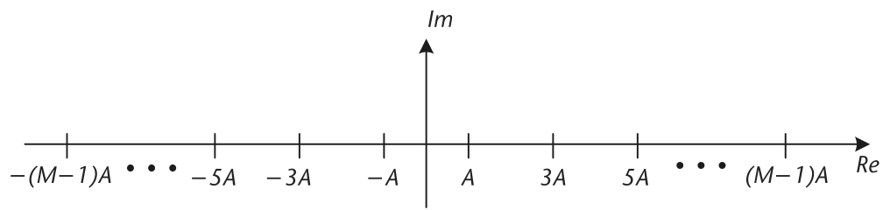

### 4.2.3　正交幅度调制

与 PAM 类似，**正交幅度调制**（QAM）也涉及某种幅度调制。但 QAM 是二维信号调制方案（PAM 是一维的）。QAM 调制的两个维度——同相与正交分量——相互正交，这意味着本质上可以免费把传输数据率翻倍。而且矩形 QAM 可以看作两个正交 PAM 信号同时发射。

数学上，若矩形 QAM 星座由 $M$ 个唯一波形组成，它可以表示为 $\sqrt{M}$-PAM 在正交维度上同时传输。注意 QAM 星座也可以是嵌套圆形式（圆 QAM）或任何涉及正交调制器的几何图案。矩形 QAM 是流行方案，因为接收机结构相对简单，如图 4.9 所示，每个维度采用 $\sqrt{M}$ 进制 PAM 检测器。

为确定 M-QAM 的功率效率，先定义属于该调制形式的信号波形的数学表示：

$$s_{ij}(t)=A_i\cdot\cos(\omega_ct)+B_j\cdot\sin(\omega_ct),$$

其中 $\omega_c$ 是载波频率，$A_i$ 与 $B_j$ 是同相与正交幅度电平。注意余弦与正弦用于在正交维度调制这些幅度电平。把 M-QAM 画成信号星座，信号波形将落在实轴与虚轴两个方向上，如图 4.10 所示。

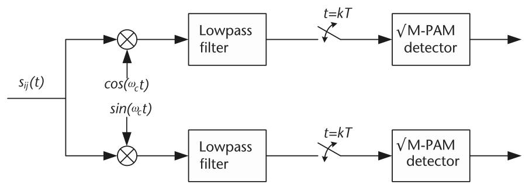

计算 M-QAM 的功率效率 $\varepsilon_{p,M\text{-QAM}}$，先算最小欧氏距离（不失一般性选如下信号波形）：

$$s_1(t)=A\cdot\cos(\omega_ct)+A\cdot\sin(\omega_ct)$$
$$s_2(t)=3A\cdot\cos(\omega_ct)+A\cdot\sin(\omega_ct)$$

得到

$$d_{\min}^2=\int_0^{T}\Delta s^2(t)\,dt=2A^2T.$$

推导平均符号能量 $\overline{E}_s$ 时，可把 M-PAM 表达式中的 $M$ 换成 $\sqrt{M}$：

$$\overline{E}_s=A^2T\frac{\sqrt{M}-1}{3},$$

进而

$$\overline{E}_b=\frac{\overline{E}_s}{\log_2(M)}=A^2T\frac{2^b-1}{3b}.$$

于是功率效率等于

$$\varepsilon_{p,M\text{-QAM}}=\frac{6b}{2^b-1}.$$

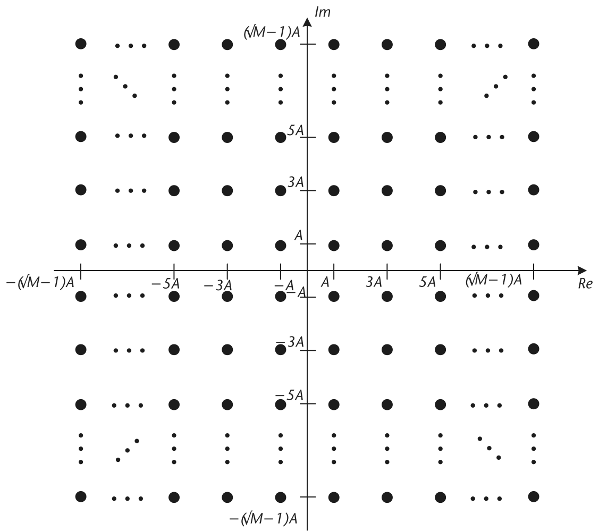

**动手 MATLAB 示例**：QAM 调度是在同一符号周期内高效发送信息的非常有用的技术。如前所述，它同时利用同相与正交两个域，把信息并行正交地沿两条信道传输。下面的 MATLAB 脚本实现一个 QAM 发射机与接收机：取二进制向量 `samp_I` 与 `samp_Q`，调制到 QAM 传输的同相与正交信道，再用 QAM 解调提取这些二进制向量。QAM 调制的核心是正弦与余弦函数——它们数学上正交。如脚本所示，同相与正交数据在发射机调制到余弦与正弦载波上；接收机利用这一正交性与三角性质，把同相与正交信息从接收信号中分离出来。

图 4.11 展示了余弦与正弦波作为信息载体的用法：信息可以同时发送并被完好恢复。通过用两个维度传输信息，我们对每个用于广播数据的符号周期都做了更高效的利用。

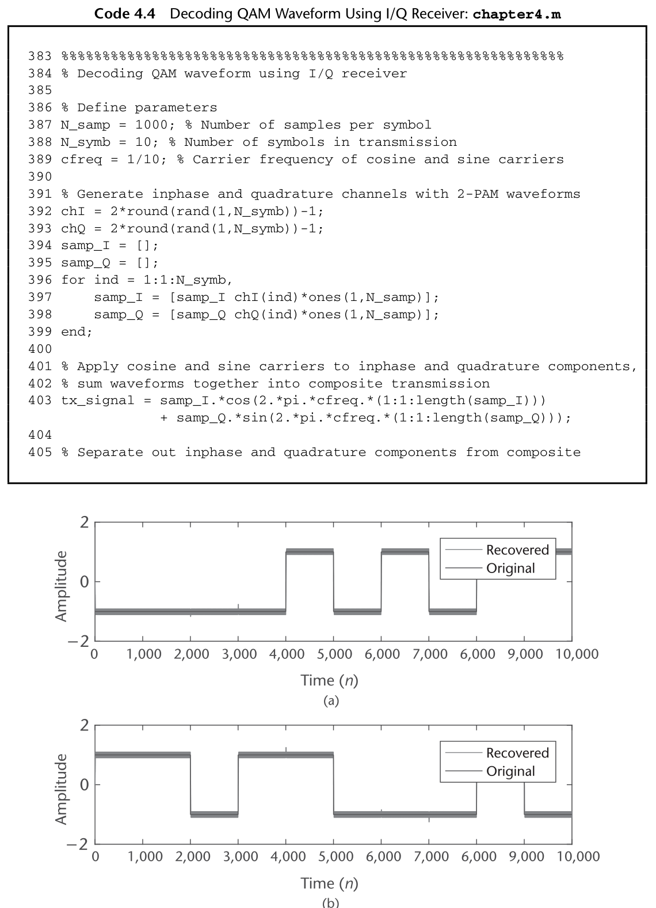

**代码 4.4　用 I/Q 接收机解调 QAM 波形：chapter4.m**

```matlab
%%%%%%%%%%%%%%%%%%%%%%%%%%%%%%%%%%%%%%%%%%%%%%%%%%%%%
% Decoding QAM waveform using I/Q receiver

% Define parameters
N_samp = 1000;  % Number of samples per symbol
N_symb = 10;    % Number of symbols in transmission
cfreq = 1/10;   % Carrier frequency of cosine and sine carriers

% Generate inphase and quadrature channels with 2-PAM waveforms
chI = 2*round(rand(1,N_symb))-1;
chQ = 2*round(rand(1,N_symb))-1;
samp_I = [];
samp_Q = [];
for ind = 1:1:N_symb,
    samp_I = [samp_I chI(ind)*ones(1,N_samp)];
    samp_Q = [samp_Q chQ(ind)*ones(1,N_samp)];
end;

% Apply cosine and sine carriers to inphase and quadrature components,
% sum waveforms together into composite transmission
tx_signal = samp_I.*cos(2.*pi.*cfreq.*(1:1:length(samp_I)))
              + samp_Q.*sin(2.*pi.*cfreq.*(1:1:length(samp_Q)));

% Separate out inphase and quadrature components from composite
```

### 4.2.4　相移键控

**相移键控**（PSK）是通过改变或调制参考信号（载波）相位来传递数据的数字调制方案。任何数字调制方案都用有限个互异信号表示数字数据；PSK 用有限个相位，每个指派唯一的二进制数字图案。通常每个相位编码相同数量的比特，每个比特图案构成由特定相位表示的符号。解调器（专为调制器使用的符号集设计）确定接收信号的相位并映射回它所代表的符号，从而恢复原始数据。这要求接收机能把接收信号相位与参考信号比较——这样的系统称为**相干**的。

PSK 用相位刻画符号。数学上，PSK 信号波形表示为

$$s_i(t)=A\cos\!\left(2\pi f_ct+(2i-1)\frac{\pi}{m}\right),\quad i=1,\ldots,\log_2 m,$$

其中 $A$ 是幅度，$f_c$ 是载波频率，$(2i-1)\frac{\pi}{m}$ 是每个符号的相移。PSK 与 PAM、QAM 呈现一组有趣的折中：幅度调制方案中信道均衡是正确译码符号的重要部分，而 PSK 方案中接收信号的相位远比幅度信息重要。

按可指派给 PSK 波形的 $M$ 个可能相位值，PSK 有几种类型。最流行最稳健之一是二进制 PSK（B-PSK），其信号星座示于图 4.12。B-PSK 的调制规则一般为：

$$\text{"1"}\to s_1(t)=A\cdot\cos(\omega_ct+\theta)$$
$$\text{"0"}\to s_2(t)=-A\cdot\cos(\omega_ct+\theta)=A\cdot\cos(\omega_ct+\theta+\pi)=-s_1(t).$$

换言之，构成 B-PSK 调制方案的两个信号波形相位相差 $\theta+\pi$。

为推导 B-PSK 的功率效率 $\varepsilon_{p,\text{BPSK}}$，先用定义计算最小欧氏距离：

$$d_{\min}^2=\int_0^{T}(s_1(t)-s_2(t))^2dt=4A^2\int_0^{T}\cos^2(\omega_ct+\theta)\,dt$$

$$=\frac{4A^2T}{2}+\frac{4A^2}{2}\int_0^{T}\cos(2\omega_ct+2\theta)\,dt=2A^2T.\tag{4.28}$$

> **注**：注意 (4.28) 最终结果中第二项消失了——因为第二项的载频是原信号的两倍。载波是周期正弦波形，对如此高频率的信号积分，正负部分相互抵消，结果接近于零。因此称该项为**倍频项**。另外注意许多通信系统会对收到的信号滤波，把倍频项滤掉的概率也相当高。

计算 $d_{\min}^2$ 的另一种方式是用**相关**概念——它描述两个信号波形的相似程度。此时最小欧氏距离可表示为

$$d_{\min}^2=\int_0^{T}(s_2(t)-s_1(t))^2dt=E_{s_1}+E_{s_2}-2\rho_{12}$$

其中符号 $i$ 的能量 $E_{s_i}$ 与符号 1、2 之间的相关 $\rho_{12}$ 为

$$E_{s_i}=\int_0^{T}s_i^2(t)\,dt\quad\text{且}\quad\rho_{12}=\int_0^{T}s_1(t)s_2(t)\,dt.$$

用 $\overline{E}_b$ 的定义，先解两个信号波形的符号能量再平均，即得 B-PSK 的平均比特能量：

$$E_{s_1}=\int_0^{T}s_1^2(t)\,dt=A^2\int_0^{T}\cos^2(\omega_ct+\theta)\,dt=\frac{A^2T}{2}+\frac{A^2}{2}\int_0^{T}\cos(2\omega_ct+2\theta)\,dt=\frac{A^2T}{2}$$

$$E_{s_2}=\frac{A^2T}{2},\qquad\overline{E}_b=P(0)\cdot E_{s_2}+P(1)\cdot E_{s_1}=\frac{A^2T}{2}.$$

注意由于单个符号表示的比特数为一，比特能量与符号能量等价。最后应用功率效率定义：

$$\varepsilon_{p,\text{BPSK}}=\frac{d_{\min}^2}{\overline{E}_b}=4.$$

这是使用全部可能信号表示（即 $M=2^b$ 个波形）的调制方案所能取得的最大 $\varepsilon_p$。注意用相关法计算最小欧氏距离时，要得到大的 $\varepsilon_p$ 需最大化 $d_{\min}^2$，即希望 $\rho_{12}<0$。要达到这一结果，需要

$$E_{s_1}=E_{s_2}=E=A^2T/2,$$

这意味着 $d_{\min}^2=2(E-\rho_{12})$，进而 $\rho_{12}=-E$。

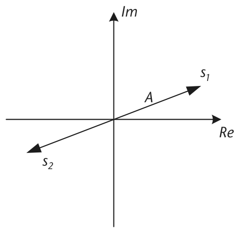

> **思考题**：证明对波形 $s_1(t)=A\cdot\cos(\omega_ct+\theta)$、$s_2(t)=0$，功率效率 $\varepsilon_p=2$。

> **思考题**：证明对波形 $s_1(t)=A\cdot\cos(\omega_ct+\theta)$、$s_2(t)=A\cdot\sin(\omega_ct+\theta)$，功率效率 $\varepsilon_p=2$。

到目前为止我们研究的 PSK 只含两个波形。现在把 PSK 星座扩展到每方案四个互异波形。**正交 PSK**（QPSK）调制中，信号波形表示为

$$s_i(t)=\pm A\cdot\cos(\omega_ct+\theta)\pm A\cdot\sin(\omega_ct+\theta),$$

每个信号波形幅度相同但相位取四个可能值之一。这类相位调制由图 4.13 的星座图说明，每个波形位于不同相位处。

推导 QPSK 的功率效率 $\varepsilon_{p,\text{QPSK}}$，先解最小欧氏距离 $d_{\min}^2$：

$$d_{\min}^2=\int_0^{T}\Delta s^2(t)\,dt=2A^2T.$$

接着求 $\overline{E}_b$，需要对所有信号波形取平均：

$$\overline{E}_b=\frac{(E_{s_1}+E_{s_2}+E_{s_3}+E_{s_4})/4}{\log_2(M)}=\frac{A^2T}{2},$$

其中四个符号的能量都等于 $E_{s_1}=E_{s_2}=E_{s_3}=E_{s_4}=A^2T$。最后用 (4.8) 解功率效率：

$$\varepsilon_{p,\text{QPSK}}=\frac{d_{\min}^2}{\overline{E}_b}=4,$$

与 BPSK 相同但每符号 2 比特——是个极佳的结果！

最后研究一般情形：PSK 调制方案有 $M$ 个可能相位值，星座点到原点的距离恒定，星座由圆上等间隔的 $M$ 个点组成。称为 M-PSK，信号波形数学表示为

$$s_i(t)=A\cdot\cos\!\left(\omega_ct+\frac{2\pi i}{M}\right),\quad i=0,1,2,\ldots,M-1.$$

注意该方案有几个优缺点：如 $M$ 增大时星座点间距缩小，导致抗差错稳健性下降；反过来，信息编码在相位中带来**恒包络**调制，对非线性功率放大器友好，且对幅度失真信道稳健。

关于 M-PSK 功率效率 $\varepsilon_{p,M\text{-PSK}}$ 的推导：设两个相邻 M-PSK 波形 $s_1(t)=A\cdot\cos(\omega_ct)$ 与 $s_2(t)=A\cdot\cos(\omega_ct+2\pi/M)$。用

$$d_{\min}^2=E_{s_1}+E_{s_2}-2\rho_{12}$$

计算最小欧氏距离，其中符号能量为

$$E_{s_i}=\int_0^{T}s_i^2(t)\,dt=\frac{A^2T}{2},\quad i=1,2,$$

两波形的相关为

$$\rho_{12}=\int_0^{T}s_1(t)s_2(t)\,dt=\frac{A^2T}{2}\cos\frac{2\pi}{M},$$

于是

$$d_{\min}^2=A^2T\!\left(1-\cos\frac{2\pi}{M}\right).$$

平均比特能量 $\overline{E}_b=\overline{E}_s/\log_2(M)$，其中 $\overline{E}_s=A^2T/2$。用 (4.8) 的功率效率定义得到

$$\varepsilon_{p,M\text{-PSK}}=2b\!\left(1-\cos\frac{2\pi}{M}\right)=4b\sin^2\!\frac{\pi}{M}.$$

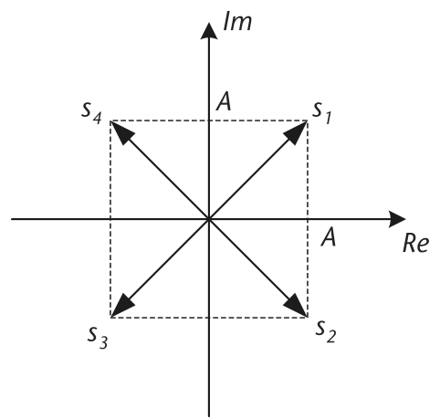

### 4.2.5　功率效率小结

考察过几种调制方案的功率效率性能后，评估不同方案间的折中很重要，以便日后实现数字通信系统时做出恰当的设计决策。为衡量相对最优的 $\varepsilon_{p,\text{QPSK}}$ 损失了多少功率效率，用下式：

$$\delta_{\mathrm{SNR}}=10\cdot\log_{10}\frac{\varepsilon_{p,\text{QPSK}}}{\varepsilon_{p,\text{other}}}.$$

用该式为本章所学的调制方案建立了 $\delta_{\mathrm{SNR}}$ 值表，见表 4.1。从表 4.1 可见二维调制方案优于一维方案；且所学方案都是线性调制方案，接收机复杂度相近。有了这些功率效率的洞察，我们转向调制技术在噪声中的稳健性。

| M | b | M-ASK | M-PSK | M-QAM |
|---|---|---|---|---|
| 2 | 1 | 0 | 0 | 0 |
| 4 | 2 | 4 | 0 | 0 |
| 8 | 3 | 8.45 | 3.5 | — |
| 16 | 4 | 13.27 | 8.17 | 4.0 |
| 32 | 5 | 18.34 | 13.41 | — |
| 64 | 6 | 24.4 | 18.4 | 8.45 |

: 各调制方案的 δSNR 值

**动手 MATLAB 示例**：传输介质引入的噪声可能导致符号被错误译码。下面的 MATLAB 脚本考察噪声的引入如何遮蔽被截获符号的真实身份。具体地，用**信号星座图**这一可视化表示比较原始发射符号与含噪接收符号——星座图把符号的位置画在以同相轴与正交轴为坐标的二维图上。本例考虑三种波形：4-PAM、4-QAM 与 QPSK。对每种波形生成其可产生的符号字母表；把代表同相与正交信息的随机二进制数据流映射为各调制方案的波形符号；再用 `randn` 函数向三个传输加高斯噪声。

4-PAM、4-QAM 与 QPSK 调制传输的前后星座图示于图 4.14：原始符号显示为红色小叉，被噪声污染的接收符号成云团状分布在红叉周围。这是因为每当传输经过含噪信道，符号就被复高斯噪声从其在同相/正交平面上的原始坐标移开。正是这种位移使接收机难以无误译码——噪声可能把符号移得离星座中另一个符号位置更近。图 4.14(a)（4-PAM）、(b)（4-QAM）、(c)（QPSK）三种调制方案都存在不可忽略的概率：符号被移近星座中的另一点，导致译码差错并转化为比特差错。

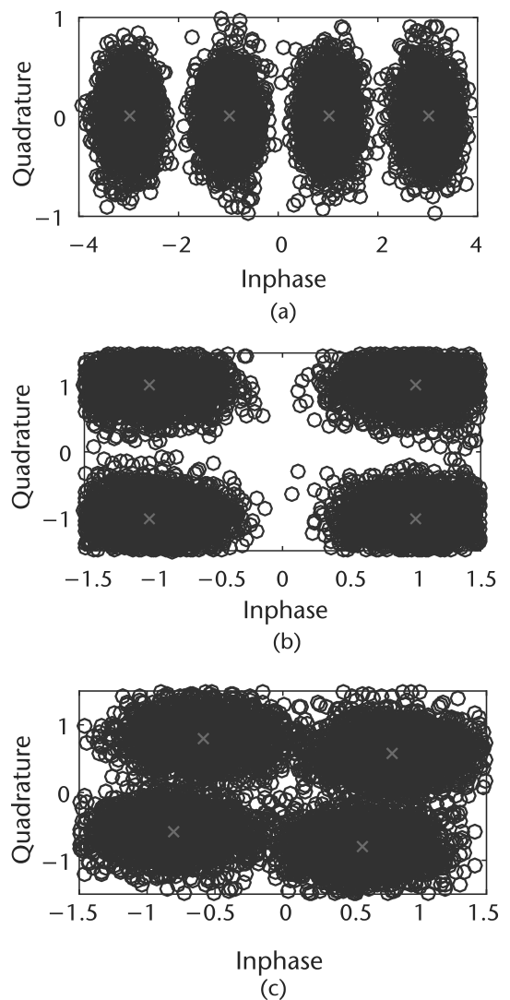

**代码 4.5　生成四电平 PAM、QAM 与 QPSK 波形：chapter4.m**

```matlab
% Define parameters
len = 10000;  % Length of binary string
nvar = 0.15;  % Noise variance

% Generate the random bit streams that have already been demultiplexed
% from a single high speed data stream
bin_str1 = round(rand(1,len));  % Inphase data stream
bin_str2 = round(rand(1,len));  % Quadrature data stream

% Perform mapping of binary streams to symbols
ind_wavefm = 2.*bin_str2 + 1.*bin_str1;  % Create waveform indices
wavefm_4pam = zeros(1,len);  % 4-PAM
wavefm_4qam = zeros(1,len);  % 4-QAM
wavefm_qpsk = zeros(1,len);  % QPSK
symb_4pam = [-3 -1 3 1];
symb_4qam = [-1+i 1+i -1-i 1-i];
symb_qpsk = [exp(i*(pi/5+pi/2)) exp(i*(pi/5+pi)) exp(i*(pi/5+0))
             exp(i*(pi/5+3*pi/2)) ];
for ind = 1:1:4,
    wavefm_4pam(find(ind_wavefm == (ind-1))) = symb_4pam(ind);
    wavefm_4qam(find(ind_wavefm == (ind-1))) = symb_4qam(ind);
    wavefm_qpsk(find(ind_wavefm == (ind-1))) = symb_qpsk(ind);
end;

% Add complex zero-mean white Gaussian noise
noise_signal = (1/sqrt(2))*sqrt(nvar)*randn(1,len)
             + i*(1/sqrt(2))*sqrt(nvar)*randn(1,len);
rx_wavefm_4pam = wavefm_4pam + noise_signal;
rx_wavefm_4qam = wavefm_4qam + noise_signal;
rx_wavefm_qpsk = wavefm_qpsk + noise_signal;
```

## 4.3　误比特概率

衡量数字通信系统性能最常用的定量指标之一是误码率（BER）——发射的比特被错误译码的概率。在评估数字通信系统设计是否满足目标应用（语音、多媒体或数据）的差错稳健性要求时，该指标非常重要；在比较不同数字通信设计时也很有用。本节给出 BER 概念的数学引入。

设信号 $s_i(t)$（$i=1,2$）经噪声为 $n(t)$ 的 AWGN 信道传输，接收机截获信号 $r(t)$。接收机的目标是判断发射机发的是 $s_1(t)$ 还是 $s_2(t)$。鉴于发 $s_1(t)$ 还是 $s_2(t)$ 是纯随机事件，接收机关于"发了什么"的唯一信息就是观测到的截获信号 $r(t)$——它包含其中一个信号加上 AWGN 信道引入的噪声。

在此情形下，我们采用**假设检验**[2] 建立框架，让接收机基于截获信号 $r(t)$ 的观测判断发的是 $s_1(t)$ 还是 $s_2(t)$。采用如下假设检验框架：

$$H_1:\ r(t)=s_1(t)+n(t),\quad 0\le t\le T$$
$$H_0:\ r(t)=s_2(t)+n(t),\quad 0\le t\le T$$

其中 $H_0$ 与 $H_1$ 分别是假设 0 与假设 1。

借助该框架，下一步在接收机建立判决规则，使其能基于截获信号选择发送的是哪个波形。设假设发的是 $s_1(t)$。一般地，两信号 $x(t)$ 与 $y(t)$ 在区间 $0\le t\le T$ 上的相关程度可用下式确定：

$$\int_0^{T}x(t)y(t)\,dt.$$

于是，给定观测 $r(t)$，判断发的是 $s_1(t)$ 还是 $s_2(t)$ 的判决规则定义为（设发的是 $s_1(t)$）：

$$\int_0^{T}r(t)s_1(t)\,dt\ \ge\ \int_0^{T}r(t)s_2(t)\,dt,$$

其中假设 $s_1(t)$ 被发射。回忆相关告诉我们一个波形与另一个波形的相似程度：接收机若知道 $s_1(t)$ 与 $s_2(t)$ 的样子，就能判断哪个与 $r(t)$ 更相关。既然假设发的是 $s_1(t)$，理想情况下 $r(t)$ 应与 $s_1(t)$ 比 $s_2(t)$ 更相关。

另一方面，若信道引入失真、干扰和/或噪声使发射波形损坏会怎样？当发射波形损坏到与另一个可能波形更相关时，接收机可能选错波形，产生一次差错事件。换言之，设发的是 $s_1(t)$，当

$$\int_0^{T}r(t)s_1(t)\,dt\ \le\ \int_0^{T}r(t)s_2(t)\,dt$$

时发生差错事件。把 $r(t)=s_1(t)+n(t)$ 代入，得到判决规则：

$$\int_0^{T}s_1^2(t)\,dt+\int_0^{T}n(t)s_1(t)\,dt\ \le\ \int_0^{T}s_1(t)s_2(t)\,dt+\int_0^{T}n(t)s_2(t)\,dt$$

$$\Longrightarrow\ E_{s_1}-\rho_{12}\ \le\ \int_0^{T}n(t)(s_2(t)-s_1(t))\,dt$$

$$\Longrightarrow\ E_{s_1}-\rho_{12}\ \le\ z.$$

从该式可见 $E_{s_1}$ 与 $\rho_{12}$ 都是确定量；而 $z$ 基于信道引入的噪声，是需要刻画的随机量。由于 $n(t)$ 是高斯随机变量，$z$ 也是高斯随机变量——积分等价于无穷多样本的求和，高斯变量相加还是高斯变量。有了 $z\sim\mathcal{N}(0,\sigma^2)$，接着算 $z$ 的方差 $\sigma^2$：

$$\sigma^2=E\{z^2\}=\frac{N_0}{2}\int_0^{T}(s_1(t)-s_2(t))^2dt=\frac{N_0}{2}(E_{s_1}+E_{s_2}-2\rho_{12})\ \xrightarrow{\ E_{s_1}=E_{s_2}=E\ }\ N_0(E-\rho_{12}),$$

其中 $E=E_i=\int_0^{T}s_i^2(t)\,dt$、$\rho_{12}=\int_0^{T}s_1(t)s_2(t)\,dt$。注意我们假设信道引入零均值噪声，故这些噪声贡献之和 $z$ 也是零均值。

确定量与随机量都刻画完毕，现在推导误比特概率。发"1"时出错的概率 $P(e|1)$ 等于

$$P(z\ge E-\rho_{12})=Q\!\left(\frac{E-\rho_{12}}{\sigma}\right)=Q\!\left(\sqrt{\frac{(E-\rho_{12})^2}{N_0(E-\rho_{12})}}\right)=Q\!\left(\sqrt{\frac{E-\rho_{12}}{N_0}}\right),$$

其中 Q 函数定义为

$$Q(x)=\int_x^{\infty}\frac{1}{\sqrt{2\pi}}e^{-t^2/2}\,dt.$$

下一步通过最小化 $P(e|1)$ 来优化误比特概率，这可以通过优化相关项 $\rho_{12}$ 达成。直觉上最佳选择是 $s_2(t)=-s_1(t)$，给出 $\rho_{12}=-E$。于是

$$P(e|1)=Q\!\left(\sqrt{\frac{2\overline{E}_b}{N_0}}\right).$$

注意当 $E_{s_1}\neq E_{s_2}$ 时可用 $d_{\min}^2=E_{s_1}+E_{s_2}-2\rho_{12}$，得到误比特概率表达式：

$$P_e=Q\!\left(\sqrt{\frac{d_{\min}^2}{2N_0}}\right).$$

> **思考题**：证明总误比特概率 $P_e=P(e|1)P(1)+P(e|0)P(0)=Q\!\left(\sqrt{\frac{E-\rho_{12}}{N_0}}\right)$。

处理组成调制方案的大量信号波形时，差错概率 $P_e$ 表示为**成对差错概率**之和——即一个接收符号被判成另一个特定符号的概率。发 $s_j(t)$ 而被译码为 $s_i(t)$ 的成对差错概率为

$$Q\!\left(\sqrt{\frac{d_{ij}^2}{2N_0}}\right),$$

其中 $N_0$ 是噪声方差。重要提示：这里假设噪声是 AWGN，因为 Q 函数专门适用于高斯随机变量。于是 $P_e$ 的完整表达式可表示为

$$Q\!\left(\sqrt{\frac{d_{\min}^2}{2N_0}}\right)\ \le\ P_e\ \le\ Q\!\left(\sqrt{\frac{d_{1j}^2}{2N_0}}\right)+\ldots+Q\!\left(\sqrt{\frac{d_{Mj}^2}{2N_0}}\right),\quad i\neq j,$$

其中右半部分是每个成对差错概率的求和。

**动手 MATLAB 示例**：我们已观察过含噪信道对接收星座的影响——对应特定符号的星座点可能被移到邻近星座点附近、面临被错误译码的风险。下面的 MATLAB 脚本把这些星座点的位移转化为实际 BER 值，以量化信道引入噪声的实际严重程度。代码采用**最近邻**方法在接收机译码：被噪声污染的接收星座点被映射到最近的原始发射星座点。用欧氏距离计算接收星座点到所有可能星座选项的距离、映射到最短者、再把符号译码为相应二进制字。

用该 MATLAB 脚本与欧氏距离最近邻判决，可以译码经含噪信道发来的消息。但既然存在噪声大到把符号移得离另一个星座点更近的情形，应预期会有若干符号被错误译码。图 4.15 给出 4-PAM、4-QAM 与 QPSK 最近邻译码方案的 BER 结果：前两种方案的差错量不大，QPSK 却有大量错误判决——原因在于星座点的间距：QPSK 星座点相对另两种方案更近。于是同样的噪声量下，QPSK 的表现明显更差。

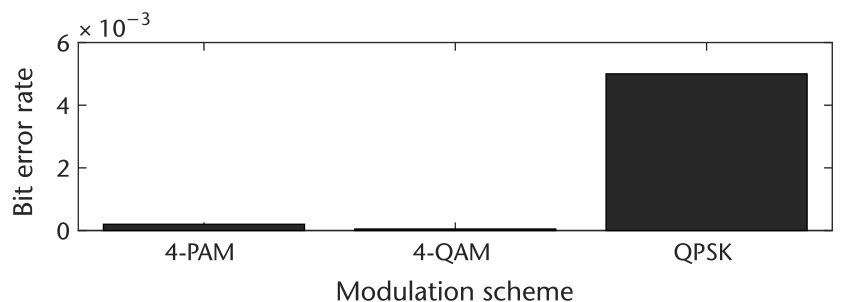

**代码 4.6　用欧氏距离译码上一示例的消息：chapter4.m**

```matlab
% Go through every received waveform and determine Euclidean distance
% between received waveform and the available waveforms
eucl_dist_4pam = zeros(4,len);
eucl_dist_4qam = zeros(4,len);
eucl_dist_qpsk = zeros(4,len);
for ind = 1:1:4,
    eucl_dist_4pam(ind,1:1:len) = abs(symb_4pam(ind).*ones(1,len)
                                          - rx_wavefm_4pam);
    eucl_dist_4qam(ind,1:1:len) = abs(symb_4qam(ind).*ones(1,len)
                                          - rx_wavefm_4qam);
    eucl_dist_qpsk(ind,1:1:len) = abs(symb_qpsk(ind).*ones(1,len)
                                          - rx_wavefm_qpsk);
end;

% Select shortest Euclidean distances
[mdist_4pam,min_ind_4pam] = min(eucl_dist_4pam);
[mdist_4qam,min_ind_4qam] = min(eucl_dist_4qam);
[mdist_qpsk,min_ind_qpsk] = min(eucl_dist_qpsk);

% Decode into estimated binary streams
bin_str_est_4pam = dec2bin(min_ind_4pam-ones(1,len)).';
bin_str_est_4qam = dec2bin(min_ind_4qam-ones(1,len)).';
bin_str_est_qpsk = dec2bin(min_ind_qpsk-ones(1,len)).';

% Calculate bit error rate
ber_4pam = sum([abs((bin_str_est_4pam(1,:)-'0') - bin_str2) ...
    abs((bin_str_est_4pam(2,:)-'0') - bin_str1)])/(2*len);
ber_4qam = sum([abs((bin_str_est_4qam(1,:)-'0') - bin_str2) ...
    abs((bin_str_est_4qam(2,:)-'0') - bin_str1)])/(2*len);
ber_qpsk = sum([abs((bin_str_est_qpsk(1,:)-'0') - bin_str2) ...
    abs((bin_str_est_qpsk(2,:)-'0') - bin_str1)])/(2*len);
```

### 4.3.1　差错界

逐个计算成对差错概率并不总是可行。可以只计算与关注点一度相邻的点的成对差错，从而建立 $P_e$ 的上下界。考察 Q 函数 $Q(\cdot)$ 的行为：输入增大时输出趋近于零。计算更远点的成对差错概率对总 $P_e$ 的贡献可忽略，却能节省大量时间与运算周期。于是 $P(e)$ 的准确估计可由下述界算得：

$$Q\!\left(\sqrt{\frac{d_{\min}^2}{2N_0}}\right)\ \le\ P(e)\ \le\ \sum_{i\in I}Q\!\left(\sqrt{\frac{d_{ij}^2}{2N_0}}\right),$$

其中 $I$ 是星座中紧邻波形 $j$ 的所有信号波形集合。要准确评估通信系统性能，必须仿真到确认一定数量的符号差错为止 [3]。多数情况下 100 个差错可给出 95% 置信区间——本书后面将用这一准则刻画被评估数字通信系统的误码率。

**动手 MATLAB 示例**：我们已观察过三种不同调制方案的简单通信系统在含噪环境下的性能。图 4.15 的结果虽有启发，但我们常想观察通信系统在大范围条件下的表现——尤其当噪声强度变化时。下面的 MATLAB 脚本考察简单二进制通信系统在一系列不同噪声程度的信道环境下的性能。

**代码 4.7　用蒙特卡洛生成通信系统误码率瀑布曲线：chapter4.m**

```matlab
% Define parameters
len = 1000;    % Length of individual data transmission
N_snr = 9;     % Number of SNR values to evaluation
N_tx = 100;    % Number of transmissions per SNR
nvar = [(10.^((1:1:N_snr)/10)).^(-1)];  % Noise variance values

ber_data = zeros(N_snr,N_tx);
for ind = 1:1:N_snr,        % Different SNR values
  for ind1 = 1:1:N_tx,      % Different transmissions for same SNR value

     % Generate BPSK waveform (we will keep this the same for each
     % SNR value for now)
     tx_sig = 2*round(rand(1,len))-1;

     % Create additive noise
     noise_sig = sqrt(nvar(ind))*randn(1,len);

     % Create received (noisy) signal
     rx_sig = tx_sig + noise_sig;

     % Decode received signal back to binary
     decode_bin_str = zeros(1,len);
     decode_bin_str(find(rx_sig >= 0)) = 1;

     % Determine and store bit error rate
     ber_data(ind,ind1) = sum(abs(decode_bin_str - (tx_sig+1)/2))/len;
  end;
end;

% Calculate mean bit error rate and its standard deviation
mean_ber = mean(ber_data,2).';
std_ber = std(ber_data,'',2).';
```

这一分析（考察 AWGN 信道下的传输可靠性）的最终结果称为**瀑布曲线**，如图 4.16 所示。瀑布曲线被数字通信界的研究者与设计者广泛用于刻画含噪环境下通信系统的差错稳健性。之所以叫瀑布曲线，是因为无论用理论分析还是实验（计算机仿真或硬件测试）生成，曲线都呈瀑布形状。x 轴表示工作环境的 SNR（信道噪声量的度量）；y 轴表示误比特概率（损坏比特数与总发射比特数之比）。图 4.16 不仅给出平均 BER 曲线，还给出均值上下各一个标准差，以确立对曲线生成方法的置信度。由于用蒙特卡洛方法生成传输并以加性噪声损坏比特，必须确保实验做得足够长，得到的性能结果才可靠（例如跑一次实验只得到一个比特差错，对该系统 BER 的准确评估在统计上是不够的）。标准差曲线贴近平均 BER 曲线说明实验用了足够多的比特、获得了足够多的差错。注意不同 SNR 值下，同样的总比特数获得的差错数可能不同；因此常常要在高 SNR 值下发射更多比特以获得足够的误比特数。

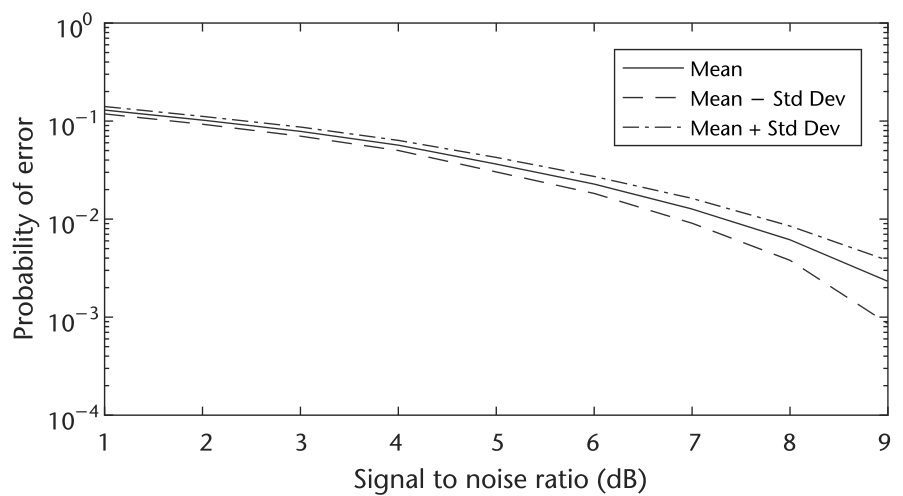

## 4.4　信号空间概念

到目前为止，我们是从信号波形视角研究数字通信系统的，并由此发展了分析各调制方案功率效率与 BER 的数学工具。但有些场合波形框架会显得繁琐笨重。本节引入刻画与分析调制方案的另一种数学表示：**信号矢量**。

设 $\varphi_j(t)$ 是时间区间 $[0,T]$ 上的标准正交函数集，满足

$$\int_0^{T}\varphi_i(t)\varphi_j(t)\,dt=\begin{cases}1 & i=j\\ 0 & \text{otherwise}\end{cases}$$

设 $s_i(t)$ 是第 $i$ 个信号波形，希望把它表示为若干正交函数之和：

$$s_i(t)=\sum_{k=1}^{N}s_{ik}\varphi_k(t),$$

等价地表示为矢量

$$\mathbf{s}_i=(s_{i1},s_{i2},s_{i3},\ldots s_{iN}),$$

其中矢量 $\mathbf{s}_i$ 的元素定义了用于表示波形的各正交函数的幅度缩放。图 4.17 给出了由三个正交函数表示的信号波形示例。既然信号波形可表示为正交函数的加权和，我们就能把信号波形描述为简单的矢量——接下来会看到，这带来"可以用基于线性代数的直接数学运算"的优势。

为求矢量元素 $s_{il}$，解表达式

$$\int_0^{T}s_i(t)\varphi_l(t)\,dt=\sum_{k=1}^{N}s_{ik}\int_0^{T}\varphi_k(t)\varphi_l(t)\,dt=s_{il},$$

这本质上是信号波形 $s_i(t)$ 在正交函数 $\varphi_l(t)$ 上的点积或投影。同时，对信号波形 $s_i(t)$ 与 $s_j(t)$ 做矢量点积得到相关运算：

$$\int_0^{T}s_i(t)s_j(t)\,dt=\mathbf{s}_i\cdot\mathbf{s}_j=\rho_{ij},$$

而信号 $s_i(t)$ 的能量等于

$$E_{s_i}=\int_0^{T}s_i^2(t)\,dt=\mathbf{s}_i\cdot\mathbf{s}_i=\|\mathbf{s}_i\|^2.$$

这些数学运算都将用于确定调制方案的功率效率或推导接收机的最优判决规则。

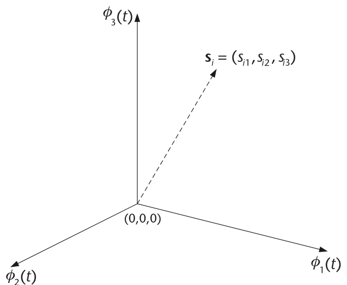

假设想用信号矢量方法（而非信号波形方法）计算调制方案的功率效率：第一步算最小欧氏距离，可用下式求解：

$$d_{\min}^2=\int_0^{T}\Delta s_{ij}^2(t)\,dt=\int_0^{T}(s_i(t)-s_j(t))^2dt=\|\mathbf{s}_i-\mathbf{s}_j\|^2=(\mathbf{s}_i-\mathbf{s}_j)\cdot(\mathbf{s}_i-\mathbf{s}_j)=E_{s_i}+E_{s_j}-2\rho_{ij},$$

其中信号波形 $s_i(t)$ 与 $s_j(t)$ 之间的相关项为

$$\rho_{ij}=\int_0^{T}s_i(t)s_j(t)\,dt=\mathbf{s}_i\cdot\mathbf{s}_j.$$

为解功率效率，选一组正交基函数 $\varphi_i(t)$（$i=1,2,\ldots,k$，$k$ 为信号矢量空间维度）。有了这组函数即可表示矢量 $\mathbf{s}_i$（$i=1,2,\ldots,M$，$\mathbf{s}_i=(s_{i1},s_{i2},\ldots s_{ik})$），其中

$$s_{ij}=\int_0^{T}s_i(t)\varphi_j(t)\,dt.$$

于是，用信号与正交函数的矢量表示可计算：最小欧氏距离

$$d_{\min}^2=\min_{i\neq j}\|\mathbf{s}_i-\mathbf{s}_j\|^2,$$

平均符号与比特能量

$$\overline{E}_s=\frac{1}{M}\sum_{i=1}^{M}\|\mathbf{s}_i\|^2,\qquad\overline{E}_b=\overline{E}_s/\log_2(M),$$

以及功率效率

$$\varepsilon_p=d_{\min}^2/\overline{E}_b.$$

## 4.5　Gram-Schmidt 正交化

在数学（尤其线性代数与数值分析）中，**Gram-Schmidt 正交化**是在内积空间（如欧氏空间 $\mathbb{R}^n$）中构造标准正交函数集的方法。Gram-Schmidt 过程取有限个信号波形 $\{s_1(t),\ldots,s_M(t)\}$，由它生成张成空间 $\mathbb{R}^n$ 的正交函数集 $\{\varphi_1(t),\ldots,\varphi_i(t)\}$。注意标准正交函数具有以下性质：

$$\int_0^{T}\varphi_i(t)\varphi_j(t)\,dt=\begin{cases}1 & i=j\\ 0 & \text{otherwise}\end{cases}$$

而且信号波形 $s_i(t)$ 可以表示为这些正交基函数的加权和：

$$s_i(t)=\sum_{k=1}^{N}s_{ik}\varphi_k(t).$$

现在需要的是**生成**正交基函数集 $\{\varphi_j(t)\}$ 的方法。

为从信号波形集 $\{s_1(t),\ldots,s_M(t)\}$ 导出正交基函数集 $\{\varphi_1(t),\ldots,\varphi_i(t)\}$，先从 $s_1(t)$ 开始并归一化：

$$\varphi_1(t)=\frac{s_1(t)}{\sqrt{E_{s_1}}}$$

其中 $E_{s_1}$ 是信号 $s_1(t)$ 的能量。$s_1(t)$ 的这个归一化版本将充当第一个正交基函数，其余的将在此基础上构造。换言之，我们是在用调制方案已有的信号波形"自举"出一组正交基。注意 $s_1(t)$ 可表示为

$$s_1(t)=\sqrt{E_{s_1}}\varphi_1(t)=s_{11}\varphi_1(t)$$

其中系数 $s_{11}=\sqrt{E_{s_1}}$，且 $\varphi_1(t)$ 满足单位能量约束。

接着构造第二个正交函数 $\varphi_2(t)$：以 $s_2(t)$ 为起点。但 $s_2(t)$ 可能含有 $\varphi_1(t)$ 的成分，须在归一化前先移除该分量。为此先取两函数点积确定 $s_2(t)$ 在 $\varphi_1(t)$ 上的投影有多大：

$$s_{21}=\int_0^{T}s_2(t)\varphi_1(t)\,dt.$$

为得到基函数 $\varphi_2(t)$，定义中间函数：

$$g_2(t)=s_2(t)-s_{21}\varphi_1(t),$$

它由于除去了 $\varphi_1(t)$ 分量，在 $0\le t\le T$ 上与 $\varphi_1(t)$ 正交。最后归一化 $g_2(t)$ 得到基函数：

$$\varphi_2(t)=\frac{g_2(t)}{\sqrt{\int_0^{T}g_2^2(t)\,dt}}=\frac{s_2(t)-s_{21}\varphi_1(t)}{\sqrt{E_{s_2}-s_{21}^2}}$$

其中 $E_{s_2}$ 是信号 $s_2(t)$ 的能量。快速检验可知 $\varphi_2(t)$ 满足约束

$$\int_0^{T}\varphi_2^2(t)\,dt=1\quad\text{且}\quad\int_0^{T}\varphi_1(t)\varphi_2(t)\,dt=0.$$

一般地，可以用如下函数做迭代，生成一组正交基函数：

$$g_i(t)=s_i(t)-\sum_{j=1}^{i-1}s_{ij}\varphi_j(t),\qquad s_{ij}=\int_0^{T}s_i(t)\varphi_j(t)\,dt,\ j=1,2,\ldots,i-1$$

$$\varphi_i(t)=\frac{g_i(t)}{\sqrt{\int_0^{T}g_i^2(t)\,dt}},\quad i=1,2,\ldots,N.$$

现在做一个 Gram-Schmidt 正交化的完整例子。

**例**：设要对图 4.18 中的信号按 $s_3(t),s_1(t),s_4(t),s_2(t)$ 的顺序执行 Gram-Schmidt 正交化，得到正交函数集 $\{\varphi_m(t)\}$。注意采用波形生成正交基的**顺序**非常重要，因为不同的顺序可能得到不同的正交基。

从 $s_3(t)$ 开始：

$$\varphi_1(t)=\frac{s_3(t)}{\sqrt{E_{s_3}}}=\frac{s_3(t)}{\sqrt{3}}.$$

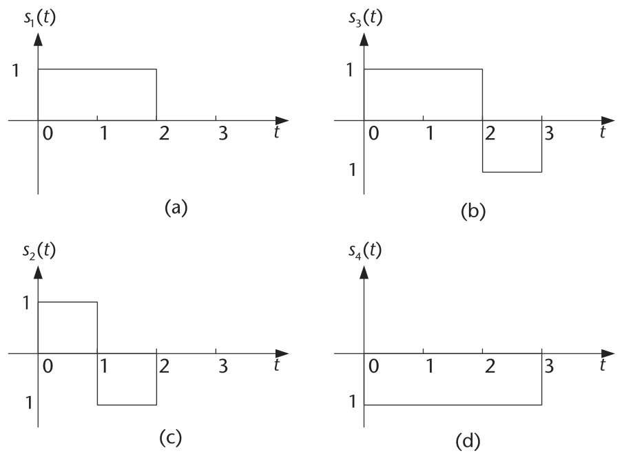

再利用 $\varphi_1(t)$ 的结果，用 $s_1(t)$ 导出 $\varphi_2(t)$：

$$g_2(t)=s_1(t)-s_{12}\varphi_1(t)=s_1(t)-\frac{2}{3}s_3(t)=\begin{cases}1/3, & 0\le t<2\\ 2/3, & 2\le t<3\\ 0, & t\ge 3\end{cases}$$

$$\therefore\ \varphi_2(t)=\frac{g_2(t)}{\sqrt{\int_0^{T}g_2^2(t)\,dt}}=\begin{cases}1/\sqrt{6}, & 0\le t<2\\ 2/\sqrt{6}, & 2\le t<3\\ 0, & t\ge 3\end{cases}$$

随后对 $s_4(t)$ 重复该操作：

$$g_3(t)=s_4(t)-\sum_{j=1}^{2}s_{4j}\varphi_j(t)=0,\qquad\therefore\ \varphi_3(t)=0,$$

结果 $\varphi_3(t)$ 等于零——这意味着 $s_4(t)$ 完全可以由 $\varphi_1(t)$ 与 $\varphi_2(t)$ 刻画。最后对 $s_2(t)$：

$$g_4(t)=s_2(t)-\sum_{j=1}^{3}s_{2j}\varphi_j(t)=0,\qquad\therefore\ \varphi_4(t)=\frac{g_4(t)}{\sqrt{\int_0^{T}g_4^2(t)\,dt}}=\frac{s_2(t)}{\sqrt{2}}.$$

于是，有了正交基函数 $\{\varphi_1(t),\varphi_2(t),\varphi_4(t)\}$，四个信号波形可表示为：

- $\mathbf{s}_1=(2/\sqrt{3},\sqrt{6}/3,0)$，
- $\mathbf{s}_2=(0,0,\sqrt{2})$，
- $\mathbf{s}_3=(\sqrt{3},0,0)$，
- $\mathbf{s}_4=(-1/\sqrt{3},-4/\sqrt{6},0)$。

现在用下面的 MATLAB 脚本以正交基实现这些波形。脚本假设每单位时间有 `N_samp` 个采样时刻；由于每个波形持续 3 秒，MATLAB 模型中每个波形表示长 `3*N_samp`。

**代码 4.8　Gram-Schmidt 正交化与矢量化：chapter4.m**

```matlab
% Define parameters
N_samp = 1000;  % Number of samples per time unit

% Create orthonormal basis functions
phi1 = [( 1/sqrt(3))*ones(1,N_samp) ...
    ( 1/sqrt(3))*ones(1,N_samp) ...
    (-1/sqrt(3))*ones(1,N_samp)];
phi2 = [( 1/sqrt(6))*ones(1,N_samp) ...
    ( 1/sqrt(6))*ones(1,N_samp) ...
    ( 2/sqrt(6))*ones(1,N_samp)];
phi3 = [0*ones(1,N_samp) 0*ones(1,N_samp) 0*ones(1,N_samp)];
phi4 = [( 1/sqrt(2))*ones(1,N_samp) ...
    (-1/sqrt(2))*ones(1,N_samp) ...
      0*ones(1,N_samp)];

% Based on these orthonormal basis functions, create the four symbol
% waveforms
sig_s1 = (2/sqrt(3))*phi1 + (sqrt(6)/3)*phi2 + 0*phi3 + 0*phi4;
sig_s2 = 0*phi1 + 0*phi2 + 0*phi3 + sqrt(2)*phi4;
sig_s3 = (sqrt(3))*phi1 + 0*phi2 + 0*phi3 + 0*phi4;
sig_s4 = (-1/sqrt(3))*phi1 + (-4/sqrt(6))*phi2 + 0*phi3 + 0*phi4;
```

用这些正交基函数与 Gram-Schmidt 正交化的结果，该 MATLAB 脚本复现了图 4.18 所示的同样波形，如图 4.19 所示。

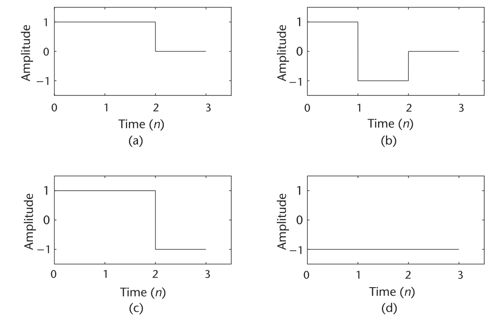

## 4.6　最优检测

**检测理论**（信号检测理论）用来分辨信号与噪声 [2]。用该理论可以解释改变判决门限如何影响分辨两种或多种情形的能力，常能揭示系统对其目标任务的适应程度。

### 4.6.1　信号矢量框架

设一个简单的数字收发信机模型如图 4.20 所示。如前所述，接收机只能观测到 $s_i(t)$ 被噪声信号 $n(t)$ 损坏后的版本 $r(t)$；$n(t)$ 通常代表所有噪声源汇聚成的单一变量。于是此时的检测问题可概括为：给定 $0\le t\le T$ 的 $r(t)$，判断截获信号中出现的是哪个 $s_i(t)$（$i=1,2,\ldots,M$）。

设把波形 $s_i(t)$、$n(t)$、$r(t)$ 分解为一组施加于正交基函数上的权重：

$$s_i(t)=\sum_{k=1}^{N}s_{ik}\varphi_k(t),\qquad r(t)=\sum_{k=1}^{N}r_k\varphi_k(t),\qquad n(t)=\sum_{k=1}^{N}n_k\varphi_k(t).$$

既然这些信号波形用同一组正交基函数，可把波形模型 $r(t)=s_i(t)+n(t)$ 改写为

$$\sum_{k=1}^{N}r_k\varphi_k(t)=\sum_{k=1}^{N}s_{ik}\varphi_k(t)+\sum_{k=1}^{N}n_k\varphi_k(t)\ \Longrightarrow\ \mathbf{r}=\mathbf{s}_i+\mathbf{n}.$$

由于 $\mathbf{r}$ 由确定性波形 $\mathbf{s}_i$ 与概率性信号 $\mathbf{n}$ 组合而成，注意力转向数学刻画 $\mathbf{n}$。噪声信号 $n(t)$ 假设为高斯随机变量，需要确定该随机变量的特性如何转化为信号矢量表示。噪声矢量元素 $n_k$ 等于

$$n_k=\int_0^{T}n(t)\varphi_k(t)\,dt,$$

即噪声信号波形在正交基函数 $\varphi_k(t)$ 上的投影。由于 $n(t)$ 是高斯随机变量且积分是线性运算，$n_k$ 也是高斯随机变量。于是噪声矢量 $\mathbf{n}$ 是高斯矢量。接着确定 $\mathbf{n}$ 的统计特性，用于信号波形检测。

先求矢量元素的均值。用期望的定义：

$$E\{n_k\}=E\left\{\int_0^{T}n(t)\varphi_k(t)\,dt\right\}=\int_0^{T}E\{n(t)\}\varphi_k(t)\,dt=0,$$

因为 $E\{n(t)\}=0$，最终意味着噪声矢量的均值 $E\{\mathbf{n}\}=\mathbf{0}$。

下一步求矢量元素的方差。设 $(\mathbf{n}\mathbf{n}^T)_{kl}=n_kn_l$ 为 $\mathbf{n}\mathbf{n}^T$ 的第 $(k,l)$ 元。为确定 $E\{n_kn_l\}$（其中 $n_k=\int_0^{T}n(t)\varphi_k(t)dt$、$n_l=\int_0^{T}n(\rho)\varphi_l(\rho)d\rho$），应用期望定义：

$$E\{n_kn_l\}=E\left\{\int_0^{T}n(t)\varphi_k(t)dt\int_0^{T}n(\rho)\varphi_l(\rho)d\rho\right\}=\int_0^{T}\!\!\int_0^{T}E\{n(t)n(\rho)\}\varphi_k(t)\varphi_l(t)dtd\rho$$

求解得

$$E\{n_kn_l\}=\frac{N_0}{2}\int_0^{T}\!\!\int_0^{T}\delta(t-\rho)\varphi_k(t)\varphi_l(t)dtd\rho=\frac{N_0}{2}\int_0^{T}\varphi_k(t)\varphi_l(t)\,dt=\frac{N_0}{2}\delta(k-l),$$

其中两个正交函数乘积的积分给出 $\delta$ 函数——因为只有 $k=l$ 时两函数才相互投影。该结果的矩阵形式为

$$E\{\mathbf{n}\mathbf{n}^T\}=\frac{N_0}{2}\mathbf{I}_{N\times N}.\tag{4.74}$$

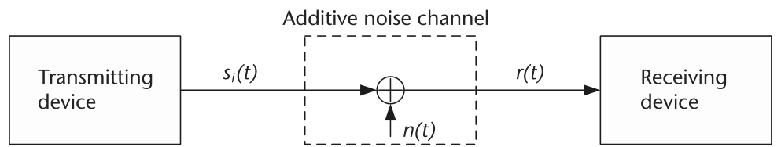

有了 (4.74) 得到的高斯随机变量矢量表示，需要定义该表示的联合概率密度函数以刻画矢量的各元素。利用噪声元素相互独立的假设，联合 PDF 可表示为各元素 PDF 之积：

$$p(\mathbf{n})=p(n_1,n_2,\ldots,n_N)=\frac{1}{(2\pi\sigma^2)^{N/2}}\prod_{i=1}^{N}e^{-n_i^2/2\sigma^2}=p(n_1)p(n_2)\ldots p(n_N),$$

其中 $p(n_i)=\frac{1}{\sigma\sqrt{2\pi}}e^{-n_i^2/2\sigma^2}$ 是矢量元素 $n_i$ 的 PDF。由 $E\{n_kn_l\}=\frac{N_0}{2}\delta(k-l)$ 可解得 $E\{n_k^2\}=\frac{N_0}{2}=\sigma^2$。此外，矢量的点积可写成元素平方和：

$$\sum_{i=1}^{N}n_i^2=\|\mathbf{n}\|^2,$$

于是联合概率密度函数可写成：

$$p(\mathbf{n})=p(n_1,n_2,\ldots,n_N)=\frac{1}{(2\pi\sigma^2)^{N/2}}e^{-\|\mathbf{n}\|^2/2\sigma^2}.\tag{4.76}$$

### 4.6.2　判决规则

有了 (4.76) 的联合概率密度函数，可以定义接收机的规则，用于在信道引入噪声的情况下判断截获的是哪个信号波形。设接收机的准则为

$$\text{最小化 }P(\text{error})\to P(\hat{m}_i\neq m_i)\ \Longleftrightarrow\ \text{最大化 }P(\text{correct})\to P(\hat{m}_i=m_i),$$

其中差错概率 $P(e)=P(\text{error})$、正确接收概率 $P(c)=P(\text{correct})$，且 $P(e)=1-P(c)$。用全概率定律，总正确检测概率等于

$$P(c)=\int_VP(c|\mathbf{r}=\boldsymbol{\rho})p(\boldsymbol{\rho})\,d\boldsymbol{\rho},$$

其中 $P(c|\mathbf{r}=\boldsymbol{\rho})\ge 0$ 且 $p(\boldsymbol{\rho})\ge 0$。因此当 $P(c)$ 取最大值时，$P(c|\mathbf{r}=\boldsymbol{\rho})$ 也取最大值。为最大化 $P(c|\mathbf{r}=\boldsymbol{\rho})$，接收机采用如下判决规则：

$$P(\mathbf{s}_k|\boldsymbol{\rho})\ \ge\ P(\mathbf{s}_i|\boldsymbol{\rho}),\quad i=1,2,\ldots,M\ \text{且}\ i\neq k,$$

该判决规则假设 $\boldsymbol{\rho}$ 中存在 $\mathbf{s}_k$，即

$$\boldsymbol{\rho}=\mathbf{s}_k+\mathbf{n}\ \to\ \hat{m}=m_k.$$

采用由概率密度函数与概率组成的混合形式贝叶斯规则：

$$P(\mathbf{s}_i|\mathbf{r}=\boldsymbol{\rho})=\frac{p(\boldsymbol{\rho}|\mathbf{s}_i)P(\mathbf{s}_i)}{p(\boldsymbol{\rho})},$$

希望把判决规则改写成接收机可用的形式。回忆本节前面要最大化 $P(c|\mathbf{r}=\boldsymbol{\rho})$：用混合贝叶斯规则，最优检测器可改写为

$$\max_{\mathbf{s}_i}P(\mathbf{s}_i|\mathbf{r}=\boldsymbol{\rho})=\max_{\mathbf{s}_i}\frac{p(\boldsymbol{\rho}|\mathbf{s}_i)P(\mathbf{s}_i)}{p(\boldsymbol{\rho})},\quad i=1,2,\ldots,M.$$

由于 $p(\boldsymbol{\rho})$ 不依赖 $\mathbf{s}_i$，可简化最优检测器表达式为

$$\max_{\mathbf{s}_i}p(\boldsymbol{\rho}|\mathbf{s}_i)P(\mathbf{s}_i),\quad i=1,2,\ldots,M.$$

基于该结果可导出两类检测器。第一类是 **MAP 检测器**：

$$P(\mathbf{s}_i|\mathbf{r}=\boldsymbol{\rho})=\max_{\mathbf{s}_i}p(\boldsymbol{\rho}|\mathbf{s}_i)P(\mathbf{s}_i),\quad i=1,2,\ldots,M.$$

而当 $P(\mathbf{s}_i)=\frac{1}{M}$（即 $P(\mathbf{s}_i)$ 不依赖 $\mathbf{s}_i$）时，可从最优检测器表达式中省略 $P(\mathbf{s}_i)$ 项，得到第二类——**最大似然（ML）检测器**：

$$P(\mathbf{s}_i|\mathbf{r}=\boldsymbol{\rho})=\max_{\mathbf{s}_i}p(\boldsymbol{\rho}|\mathbf{s}_i),\quad i=1,2,\ldots,M.$$

下一节将针对 AWGN 信道数据传输的最优判决规则，数学推导最大似然检测器。

### 4.6.3　AWGN 信道中的最大似然检测

最大似然检测是流行的统计方法，用于把统计模型拟合到数据、辨识模型参数。一般地，对固定数据与底层概率模型，最大似然方法选择"最有可能产生观测数据"的模型参数取值（即最大化似然函数的参数）。

设数据传输经 AWGN 信道到达接收机。回忆该场景的传输模型：

$$\mathbf{r}=\mathbf{s}_i+\mathbf{n},$$

其中 $\mathbf{s}_i$ 是发射机发的第 $i$ 个信号波形，$\mathbf{n}$ 是 AWGN 信道引入的噪声，$\mathbf{r}$ 是接收机截获的信号波形。$\mathbf{s}_i$ 是确定量，$\mathbf{n}$ 是刚用联合 PDF 刻画过的随机实体，剩下的是刻画 $\mathbf{r}$——它可由 $\mathbf{n}$ 的刻画加上 $\mathbf{s}_i$ 的确定性导出。

设考虑接收矢量 $\mathbf{r}=\boldsymbol{\rho}$ 的单个元素（如第 $k$ 个）在"假设发的是 $\mathbf{s}_i$"条件下的条件概率：

$$p(\rho_k|s_{ik})=\frac{1}{\sqrt{2\pi\sigma^2}}e^{-(\rho_k-s_{ik})^2/2\sigma^2},$$

其中噪声矢量的第 $k$ 元等于 $n_k=\rho_k-s_{ik}$。由于假设 AWGN 矢量元素不相关（即独立），条件概率可改写为

$$p(\boldsymbol{\rho}|\mathbf{s}_i)=\prod_{k=1}^{N}p(\rho_k|s_{ik}),\quad i=1,2,\ldots,M.$$

这一多元概率密度函数之积最终给出：

$$p(\boldsymbol{\rho}|\mathbf{s}_i)=\frac{1}{(2\pi\sigma^2)^{N/2}}e^{-\|\boldsymbol{\rho}-\mathbf{s}_i\|^2/2\sigma^2}.$$

注意现在有了完全由 $\mathbf{s}_i$、$\boldsymbol{\rho}$ 及其元素表示的条件概率公式。借助该表达式即可数学地推导最大似然检测器。

为求 $\max_{\mathbf{s}_i}p(\boldsymbol{\rho}|\mathbf{s}_i)$，取 $p(\boldsymbol{\rho}|\mathbf{s}_i)$ 表达式应用于检测器，并取自然对数：

$$\ln\!\left(p(\boldsymbol{\rho}|\mathbf{s}_i)\right)=\ln\!\left(\frac{1}{(2\pi\sigma^2)^{N/2}}\right)-\frac{\|\boldsymbol{\rho}-\mathbf{s}_i\|^2}{2\sigma^2}.$$

采用自然对数是为了去掉表达式中的指数底，从而得到最优判决规则的线性表达式。而且自然对数是单调函数（若 $x_2\ge x_1$ 则 $\ln(x_2)\ge\ln(x_1)$），使用不等式时判决规则依然有效。

解这一线性判决规则、利用自然对数的单调性，可推导：

$$\begin{aligned}
\max_{\mathbf{s}_i}\ln\!\left(p(\boldsymbol{\rho}|\mathbf{s}_i)\right)&=\max_{\mathbf{s}_i}\left(\ln\frac{1}{(2\pi\sigma^2)^{N/2}}-\frac{\|\boldsymbol{\rho}-\mathbf{s}_i\|^2}{2\sigma^2}\right)\\
&=\max_{\mathbf{s}_i}\left(-\frac{\|\boldsymbol{\rho}-\mathbf{s}_i\|^2}{2\sigma^2}\right)=\max_{\mathbf{s}_i}\left(-\|\boldsymbol{\rho}-\mathbf{s}_i\|^2\right)\\
&=\min_{\mathbf{s}_i}\|\boldsymbol{\rho}-\mathbf{s}_i\|.
\end{aligned}$$

由于我们关心的是使判决规则取最大值的 $\mathbf{s}_i$，可把判决规则改写为

$$\mathbf{s}_k=\arg\min_{\mathbf{s}_i}\|\boldsymbol{\rho}-\mathbf{s}_i\|\ \to\ \hat{m}=m.$$

注意采用矢量表示的优势之一：整个场景可以解读为**距离**。具体地，$\|\boldsymbol{\rho}-\mathbf{s}_i\|$ 实际代表两条矢量 $\boldsymbol{\rho}$ 与 $\mathbf{s}_i$（尾部都在原点）矢端之间的距离。于是，最大似然检测器等价于**最小距离检测器**。

## 4.7　基本接收机实现

数字通信的根本挑战是恢复"经信道并被噪声损坏后"的发射内容。我们将考察的第一种接收机结构基于：用使信道 SNR 最大化的静态滤波器滤波接收信号，从而最小化误码率。但匹配滤波方法的一个缺点是：需要发射机所有可能信号波形的先验知识。

> **思考题**：参照图 4.21 的星座图，实现一个工作在 AWGN 信道的简单 QPSK 收发信机并实现最大似然检测器。该判决规则与图 4.21 的判决区域是否一致——即基于 ρ 落在哪个象限来充分地宣布 si 为发射信号？给定零均值噪声，不同方差值下 AWGN 信道的影响是什么？

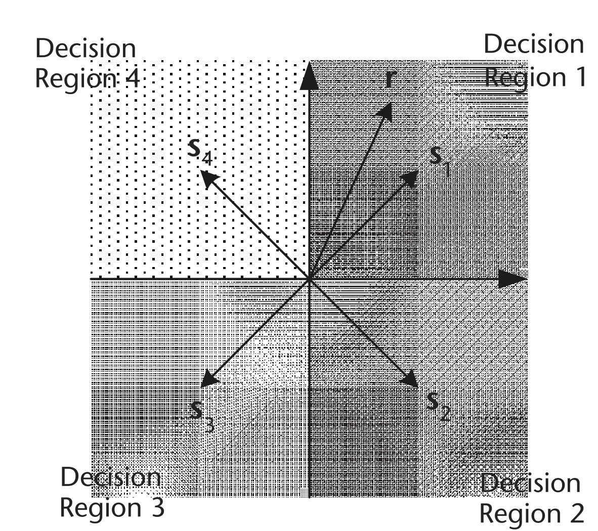

### 4.7.1　匹配滤波器实现

设计接收机时，我们关心的判决规则是：接收机比任何其他可用规则更经常地给出正确结果。换言之，我们感兴趣的是检测经含噪信道传输的脉冲。

设采用如下传输模型：

$$x(t)=g(t)+w(t),\quad 0\le t\le T,$$

其中 $g(t)$ 是脉冲信号，$w(t)$ 是均值为 $\mu=0$、功率谱密度为 $\frac{N_0}{2}$ 的白噪声过程，$x(t)$ 是观测到的接收信号。假设接收机知道发射机所能产生的全部 $g(t)$ 波形，接收机的目标是基于观测 $x(t)$ 最优地检测脉冲信号 $g(t)$。注意 $g(t)$ 可以代表数字通信系统中的"1"或"0"。

为使接收机能在观测 $x(t)$ 下最优检测 $g(t)$，对 $x(t)$ 滤波，使噪声的影响在统计意义上最小化、正确检测概率增强。设用 $h(t)$ 滤波 $x(t)$，输出为

$$y(t)=g_0(t)+n(t),$$

其中 $n(t)$ 是 $w(t)$ 经 $h(t)$ 滤波的结果，$g_0(t)$ 是 $g(t)$ 经 $h(t)$ 滤波的版本。传输模型与 $h(t)$ 滤波操作示于图 4.22。

把该滤波操作改写到频域（时域卷积变频域乘积）。取 $H(f)G(f)$ 的傅里叶逆变换（等价于 $h(t)$ 与 $g(t)$ 的卷积），得到滤波后的 $g(t)$：

$$g_0(t)=\int_{-\infty}^{\infty}H(f)G(f)e^{j2\pi ft}\,df.$$

现在计算滤波信号的瞬时功率：

$$|g_0(t)|^2=\left|\int_{-\infty}^{\infty}H(f)G(f)e^{j2\pi ft}df\right|^2.$$

为确定"何时实现了 $g_0(t)$ 相对 $n(t)$ 最大化"的定量指标，采用**峰值脉冲 SNR**：

$$\eta=\frac{|g_0(T)|^2}{E\{n^2(t)\}},$$

其中 $|g_0(T)|^2$ 是采样时刻 $T$ 输出信号的瞬时功率，$E\{n^2(t)\}$ 是输出噪声的平均功率。于是匹配滤波器实现的目标是用峰值脉冲 SNR 指标最大化 $g_0(t)$ 相对 $n(t)$——通过设计能给出最大 $\eta$ 的滤波器 $h(t)$ 实现。

为设计 $h(t)$，需要数学求解 $h(t)$，即计算表达式

$$|g_0(t)|^2=\left|\int_{-\infty}^{\infty}H(f)G(f)e^{j2\pi ft}df\right|^2,$$

它是 $H(f)G(f)=\mathcal{F}\{h(t)\ast g(t)\}$ 傅里叶逆变换的幅度平方。由于 $w(t)$ 是功率谱密度 $\frac{N_0}{2}$ 的白高斯过程，由 EWK 定理知滤波噪声的 PSD 为 $S_N(f)=\frac{N_0}{2}|H(f)|^2$。于是应用 $\eta$ 的定义并代入这些表达式得

$$\eta=\frac{\left|\int_{-\infty}^{\infty}H(f)G(f)e^{j2\pi fT}df\right|^2}{\frac{N_0}{2}\int_{-\infty}^{\infty}|H(f)|^2df}.\tag{4.99}$$

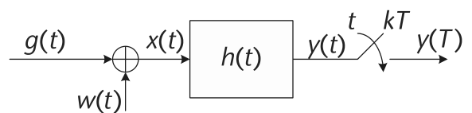

从该式可见需要求解使峰值脉冲 SNR $\eta$ 最大的频率响应 $H(f)$。为得闭式解，采用施瓦茨不等式。设有两个复函数 $\varphi_1(x)$ 与 $\varphi_2(x)$ 满足：

$$\int_{-\infty}^{\infty}|\varphi_1(x)|^2dx<\infty\quad\text{且}\quad\int_{-\infty}^{\infty}|\varphi_2(x)|^2dx<\infty.$$

则由施瓦茨不等式，积分表达式可改写为不等式：

$$\left|\int_{-\infty}^{\infty}\varphi_1(x)\varphi_2(x)dx\right|^2\le\left(\int_{-\infty}^{\infty}|\varphi_1(x)|^2dx\right)\cdot\left(\int_{-\infty}^{\infty}|\varphi_2(x)|^2dx\right),$$

当 $\varphi_1(x)=K\cdot\varphi_2^*(x)$ 时取等。于是，在峰值脉冲 SNR 表达式中利用施瓦茨不等式，(4.99) 的分子可改写为

$$\left|\int_{-\infty}^{\infty}H(f)G(f)e^{j2\pi ft}df\right|^2\le\left(\int_{-\infty}^{\infty}|H(f)|^2df\right)\cdot\left(\int_{-\infty}^{\infty}|G(f)|^2df\right),$$

进而得到 $\eta$ 的不等式：

$$\eta\le\frac{2}{N_0}\int_{-\infty}^{\infty}|G(f)|^2df.$$

于是，为使该式取等，$H(f)$ 的最优值应为

$$H_{\text{opt}}(f)=K\cdot G^*(f)e^{-j2\pi fT},$$

其时域表示可用傅里叶逆变换确定：

$$h_{\text{opt}}(t)=K\cdot\int_{-\infty}^{\infty}G^*(f)e^{-j2\pi fT}e^{-j2\pi ft}df=K\cdot g(T-t).$$

注意：执行匹配滤波时，我们把发射脉冲的"时间翻转加时移"版本与发射脉冲本身卷积，以最大化 SNR。

> **注**：之所以称为**匹配**滤波器，是因为把发射脉冲信号的时间翻转加时移版本与其自身卷积的过程是 SNR 最大化的。于是，接收机截获到某个未知的含噪信号时，可以用图 4.23 所示的实现，把截获信号与接收机已知的所有可用信号波形逐一"匹配"，方便地识别出发的是哪一个。

> **思考题**：参照图 4.24，设信号 g(t) 给定。证明 h(t) 与 g0(t) 是相应的匹配滤波器与滤波输出信号。

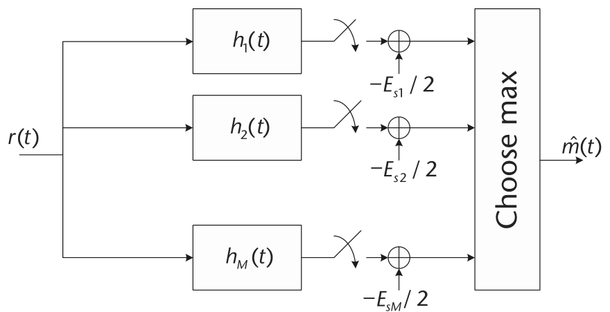

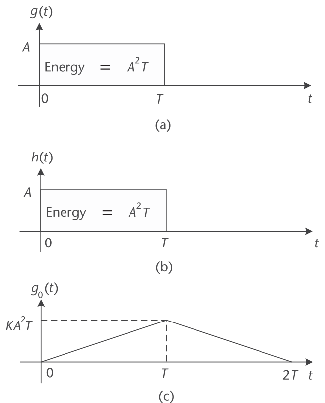

### 4.7.2　相关器实现

回忆匹配滤波器实现假设对发射数据有某种先验知识。但若接收机掌握发射机及其信号特性的信息，即使存在引入损坏的含噪信道，也可以用更统计化的方法确定发送了哪些信号波形。具体地，可以采用**相关**的概念——这样只需假设对波形本身的知识（对匹配滤波器实现而言，接收机需要同时知道传输信号波形与信道引入噪声的统计特性）。

从本节开头导出的判决规则出发并展开：

$$\min_{\mathbf{s}_i}\|\boldsymbol{\rho}-\mathbf{s}_i\|^2=\min_{\mathbf{s}_i}(\boldsymbol{\rho}-\mathbf{s}_i)\cdot(\boldsymbol{\rho}-\mathbf{s}_i)=\boldsymbol{\rho}\cdot\boldsymbol{\rho}-2\boldsymbol{\rho}\cdot\mathbf{s}_i+\mathbf{s}_i\cdot\mathbf{s}_i.$$

由于 $\boldsymbol{\rho}\cdot\boldsymbol{\rho}$ 对不同信号波形 $\mathbf{s}_i$ 的判决度量是公共项，可方便地从表达式中略去，得

$$\min_{\mathbf{s}_i}\left(-2\boldsymbol{\rho}\cdot\mathbf{s}_i+\mathbf{s}_i\cdot\mathbf{s}_i\right)=\max_{\mathbf{s}_i}\left(2\boldsymbol{\rho}\cdot\mathbf{s}_i-\mathbf{s}_i\cdot\mathbf{s}_i\right),$$

其中 $\boldsymbol{\rho}\cdot\mathbf{s}_i$ 与 $\mathbf{s}_i\cdot\mathbf{s}_i$ 定义为

$$\boldsymbol{\rho}\cdot\mathbf{s}_i=\int_0^{T}\rho(t)s_i(t)dt\qquad\mathbf{s}_i\cdot\mathbf{s}_i=\int_0^{T}s_i^2(t)dt=E_{s_i}.$$

可以看到 $\boldsymbol{\rho}\cdot\mathbf{s}_i$ 的波形表示等于 $r(t)=\rho(t)$ 相对 $s_i(t)$ 的相关。于是当 $r(t)$ 中存在 $s_k(t)$ 时，最优检测器等于

$$\mathbf{s}_k=\arg\max_{\mathbf{s}_i}\left(\int_0^{T}\rho(t)s_i(t)dt-\frac{E_{s_i}}{2}\right).$$

基于该结果，可以设计利用相关的接收机结构，基于接收机的观测截获信号判断发射机发的是哪个信号波形。基于相关的实现示意图见图 4.25。给定 $r(t)=s_i(t)+n(t)$ 且接收机输入端只观测到 $r(t)=\rho(t)$：先把 $r(t)$ 与所有 $s_i(t)$ 相关；再用相应信号能量 $E_{s_i}$ 归一化相关结果以促成公平比较（注意若每个可能信号波形的能量都相同，可省去能量归一化——它不影响判决）；最后比较各支路得到的判决值、选择值最大的支路。

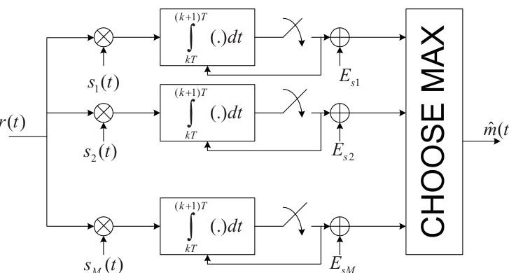

**动手 MATLAB 示例**：为突出相关器接收机结构如何译码截获波形并转换为相应二进制输出，可用下面的 MATLAB 脚本：先生成由符号 $s_1(n),s_2(n),s_3(n),s_4(n)$ 组成的随机波形流（这些波形来自 4.5 节的 MATLAB 脚本）。生成后，下一步把波形矢量化到三维信号星座空间。矢量化后用相关接收机方法求接收矢量化波形与可用信号矢量之间的欧氏距离。算出每个接收波形的距离后，执行判决过程找出接收符号矢量与可用符号矢量的最接近匹配。

该波形矢量化与基于相关器的接收机设计的结果示于图 4.26：原始发射波形与译码波形完美匹配。但本模型没有包含噪声等任何形式的失真。因此，把加性高斯白噪声引入接收信号、观察相关器接收机的表现，是一个很好的练习。

## 4.8　本章小结

设计与评估软件定义无线电实现时，深入透彻地掌握数字通信理论至关重要。本章概述了若干有用的主题，包括几种调制方案、差错概率推导、Gram-Schmidt 正交化、最优判决规则的建立以及两种接收机结构的呈现，为读者掌握这些既通用又复杂的系统打下基础。后续章节将大量运用本章与前两章获得的基础知识，实现基于软件定义无线电技术的数字通信系统与网络。

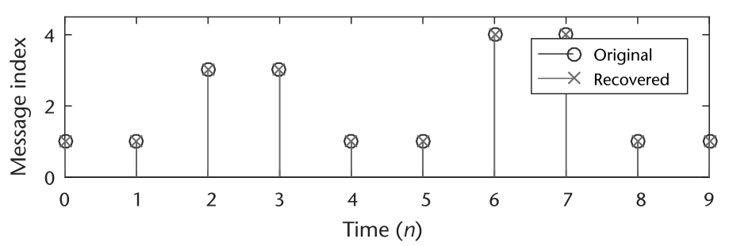

**代码 4.9　用 Gram-Schmidt 实现基于相关器的接收机：chapter4.m**

```matlab
% Define parameters
N_symb = 10;  % Number of symbols contained within intercepted signal

% Randomly generate intercepted waveform consisting of s1(n), s2(n),
% s3(n), and s4(n)
rx_sig = [];
orig_msg = [];
for ind = 1:1:N_symb,
    rnd_val = rand(1,1);
    if (rnd_val < 0.25)  % Add s1(n) waveform
        rx_sig = [rx_sig sig_s1];
        orig_msg = [orig_msg 1];
    elseif ((rnd_val >= 0.25)&&(rnd_val < 0.5))  % Add s2(n) waveform
        rx_sig = [rx_sig sig_s2];
        orig_msg = [orig_msg 2];
    elseif ((rnd_val >= 0.5)&&(rnd_val < 0.75))  % Add s3(n) waveform
        rx_sig = [rx_sig sig_s3];
        orig_msg = [orig_msg 3];
    else  % Add s4(n) waveform
        rx_sig = [rx_sig sig_s4];
        orig_msg = [orig_msg 4];
    end;
end;

% Vectorize the intercepted signal
dim1_comp = [];
dim2_comp = [];
dim4_comp = [];
for ind = 1:1:N_symb,
    dim1_comp = [dim1_comp sum(rx_sig(((ind-1)*3*N_samp+1):1:
                            (ind*3*N_samp)).*phi1)];
    dim2_comp = [dim2_comp sum(rx_sig(((ind-1)*3*N_samp+1):1:
                            (ind*3*N_samp)).*phi2)];
    dim4_comp = [dim4_comp sum(rx_sig(((ind-1)*3*N_samp+1):1:
                            (ind*3*N_samp)).*phi4)];
end;
dim1_comp = dim1_comp/N_samp;
dim2_comp = dim2_comp/N_samp;
dim4_comp = dim4_comp/N_samp;

% Using the correlator receiver approach, we determine the closest
% symbol vector to each vectorized waveform based on Euclidean distance
s1vec = [(2/sqrt(3)) (sqrt(6)/3) 0 0];
s2vec = [0 0 0 sqrt(2)];
s3vec = [(sqrt(3)) 0 0 0];
s4vec = [(-1/sqrt(3)) (-4/sqrt(6)) 0 0];
est_msg = [];
for ind = 1:1:N_symb,
  [val,symb_ind] = min([ ...
  sum((s1vec - [dim1_comp(ind) dim2_comp(ind) 0 dim4_comp(ind)]).^2) ...
  sum((s2vec - [dim1_comp(ind) dim2_comp(ind) 0 dim4_comp(ind)]).^2) ...
  sum((s3vec - [dim1_comp(ind) dim2_comp(ind) 0 dim4_comp(ind)]).^2) ...
  sum((s4vec - [dim1_comp(ind) dim2_comp(ind) 0 dim4_comp(ind)]).^2) ...
    ]);
  est_msg = [est_msg symb_ind];
end;
```

## 4.9　延伸阅读

鉴于本章对数字通信主题的入门性质，非常鼓励有兴趣的读者探索对该主题有更详尽、更深入论述的大量书籍。例如 Proakis 与 Salehi 的权威数字通信书最新版 [4] 对本章许多概念给出了严格的数学处理，还有扩频技术、均衡、RAKE 接收机实现等许多未涉及的主题。为配合这本数学上简练的著作，作者还出版了从更应用的角度论述数字通信的配套书，含 MATLAB 与 Simulink 例程 [5]。

数字通信入门教材方面，Sklar 写了一本平衡数学严谨性、详细讲解与精心制作例子的优秀著作 [6]。Couch 的书与 Sklar 同类，但兼顾模拟与数字通信 [7]，适合没有通信背景的读者。Rice 的数字通信入门书从离散时间视角撰写 [8]，适合具有离散时间信号与系统背景的读者；该书还提供大量章末习题与在线 MATLAB 示例，给读者许多实践书中理论概念的机会。Barry、Messerschmitt 与 Lee 的经典数字通信书 [9] 对已有一定理解、需要便捷查阅详细信息的读者是优秀参考。类似地，Madhow [10] 与 Pursley [11] 的书都提供了更深入的数字通信理论。最后，Hsu 的书 [12] 是一本以大量已解习题为主的优秀参考。

## 参考文献

[1] Shannon, C. E., "Communication in the Presence of Noise," in *Proceedings of the Institute of Radio Engineers*, Vol. 37, No. 1, January 1949, p. 1021.

[2] Poor, H. V., *An Introduction to Signal Detection and Estimation*, New York: Springer, 2010.

[3] Wyglinski, A. M., *Physical Layer Loading Algorithms for Indoor Wireless Multicarrier Systems*, Ph.D. thesis, McGill University, Montreal, 2004.

[4] Proakis, J., and M. Salehi, *Digital Communications*, Fifth Edition, Boston: McGraw-Hill, 2007.

[5] Proakis, J. G., M. Salehi, and G. Bauch, *Contemporary Communication Systems Using MATLAB*, Second Edition, Brooks/Cole, 2003.

[6] Sklar, B., *Digital Communications: Fundamentals and Applications*, Second Edition, Prentice Hall PTR, 2001.

[7] Couch, L. W., *Digital and Analog Communication Systems*, Seventh Edition, Upper Saddle River: Prentice Hall, 2006.

[8] Rice, M., *Digital Communications: A Discrete-Time Approach*, Third Edition, Pearson/Prentice Hall, 2009.

[9] Barry, J. R., D. G. Messerschmitt, and E. A. Lee, *Digital Communication*, Third Edition, Norwell, MA: Kluwer Academic Publishers, 2003.

[10] Madhow, U., *Fundamentals of Digital Communication*, Cambridge, UK: Cambridge University Press, 2008.

[11] Pursley, M. B., *Introduction to Digital Communications*, Prentice Hall, 2004.

[12] Hsu, H. P., *Schaum's Outline of Theory and Problems of Analog and Digital Communications*, Second Edition, New York: McGraw-Hill, 2002.
