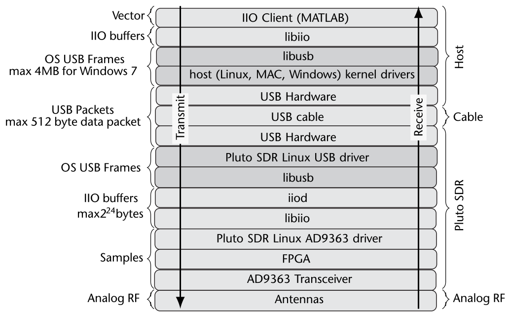
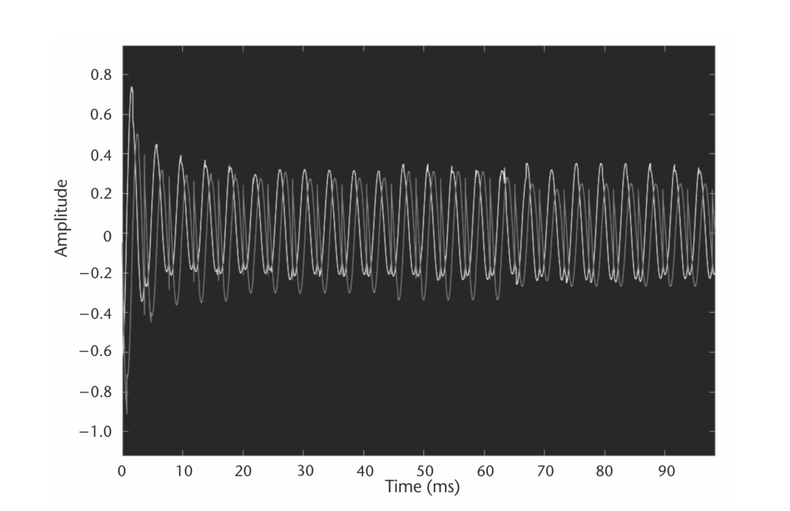
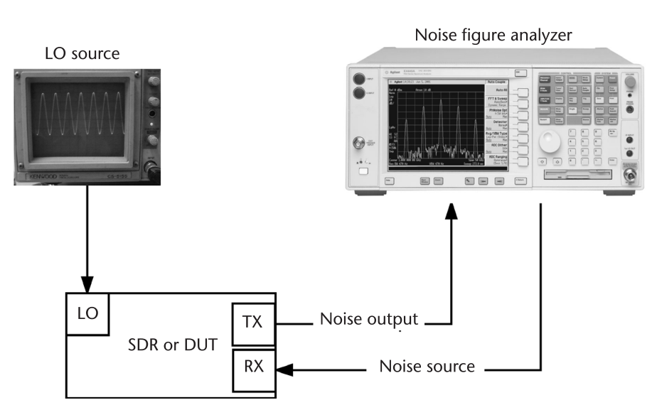

# 第 5 章　理解 SDR 硬件

本章讨论使用 SDR 硬件的现实问题，以及从 MATLAB 与 Pluto SDR 交互的基础。以 Pluto SDR 为模板，我们将介绍接收与发射链路，讨论模拟波形如何在 MATLAB 中变成数字采样。掌握这一过程后，将介绍一套通用代码模板——本书余下章节在 MATLAB 中操作电台时都会用到。这套模板提供简化的工作流，能帮助缓解使用 SDR（尤其是 Pluto SDR）时的常见问题。最后以一个小示例收尾，确认 Pluto SDR 已与 MATLAB 正确配置。

## 5.1　通信系统的组成

5.1.1 节描述的软件定义无线电，既可充当点对点链路中的一个无线电节点，也可以是大型自组织无线电网中的一个单元。它既可以作为 MATLAB 脚本或 Simulink 模型的 RFFE，也可以被编程为一台完整的独立电台。射频前端——此处即 Pluto SDR——只是更大通信系统中的一个组件，系统通常还包括外部滤波器与频段专用天线。通信系统的描述与框图示于图 5.1(c)。其主要方面为：

- 模拟射频部分（天线、射频滤波器、输入复用器、LNA、增益、衰减、混频器）；
- 模拟基带部分（模拟滤波器、ADC 或 DAC）；
- 若干信号处理单元（收发信机内部的固定滤波器，或 FPGA/DSP 内的用户自定义处理，或通用处理器）。

虽然 Pluto SDR 为 STEM 教育与 SDR 实验提供了一个出色的低成本平台，它也代表了通信系统中使用的许多 SDR。尽管小巧廉价，Pluto SDR 的能力足以应对广泛的 SDR 应用，例如 GPS 或气象卫星接收机、自组织个人区域网。Pluto SDR 按如下方式扮演上述通信系统的角色：

- 模拟射频部分（天线、射频滤波器、输入复用器、LNA、增益、衰减、混频器）
  - 天线与射频滤波器应在 Pluto SDR 之外完成，由最终用户负责；
  - 第一条所列的其余部分（输入复用器、LNA、增益、衰减、混频器）都实现在 AD9363 集成射频敏捷收发信机中；
- 模拟基带部分（模拟滤波器、ADC/DAC）实现在 AD9363 中；
- 信号处理：分三处——
  - 部分信号处理实现在 AD9363 中，包括固定的半带抽取/插值滤波器与可编程 128 抽头 FIR 滤波器；
  - 可选的滤波与抽取可在 Xilinx Zynq 的 FPGA 逻辑中完成；
  - I/Q 数据随后经 USB 上传到主机，由 MATLAB 继续信号处理。

要理解这些部件的细节，需要"剥开" Pluto SDR 的塑料外壳、看看组成设备的芯片。作为专门面向学生的 SDR 平台，Pluto SDR 不仅原理图随手可得，整个软件与 HDL 栈也是公开的——从硬件到软件的任何层面我们都可以细看设备的构成。

![ADALM-PLUTO SDR 的各个视图：(a) 简化框图；(b) 实物照片 [1]；(c) I/O 接口](images/fig_0501.png)

### 5.1.1　SDR 的组成

多数现代 SDR 器件共享相似的结构设计，构成接收和/或发射链路，把数据从模拟射频域搬到模拟基带域、变成 I/Q 采样，最终进入 MATLAB 这样的软件包。最简单地说，Pluto SDR（见图 5.1(b)）由两个组件构成，如图 5.1(a) 所示：

- 模拟射频部分（决定接收与发射能力）；
- 把 I/Q 数据送回主机处理的通信机制（以太网、USB）。

参照图 5.1(c)，ADALM-PLUTO 的接收、发射与通信规格包括：

- 发射（标注 Tx 的 SMA 连接器）
  - 300 MHz–3.8 GHz，200 kHz–20 MHz 信道带宽，65.1–61,440 kSPS
  - 2.4 Hz 本振步进、5 Hz 采样率步进
  - 调制精度（EVM）：40 dB（典型值，非逐台测量）
  - 12 位 DAC
- 接收（标注 Rx 的 SMA 连接器）
  - 300 MHz–3.8 GHz，200 kHz–20 MHz 信道带宽，65.1–61,440 kSPS
  - 2.4 Hz 本振步进、5 Hz 采样率步进
  - 调制精度（EVM）：40 dB（典型值，非逐台测量）
  - 12 位 ADC
- USB 2 OTG（480 Mbit/s），设备模式
  - libiio USB 类，用于在射频器件与主机间传输 I/Q 数据
  - 网络设备，提供对 Pluto 上 Linux 的访问
  - USB 串行设备，提供对 Pluto 上 Linux 控制台的访问
  - 大容量存储设备
- USB 2 OTG（480 Mbit/s），主机模式
  - 大容量存储设备：插上 U 盘即可采集或回放波形
  - WiFi 适配器：经 WiFi 访问 Pluto SDR
  - 有线局域网：经有线 LAN 访问 Pluto SDR
- 外部供电口：Pluto SDR 工作在主机模式时使用。

可以让 Pluto SDR 超规格运行、把频率范围扩展到 70–6,000 MHz：低端可以接收收听 FM 广播（多数地区 87.5–108.0 MHz，日本 76–95 MHz，部分东欧国家还有老的 65.8–74.0 MHz），高端覆盖全球 5.8 GHz ISM 频段的各种有趣信号。

正因为 70–6,000 MHz 的宽调谐范围跨越三个数量级以上，Pluto SDR 内没有频段专用的接收或发射滤波器。这意味着从接收侧看，70–6,000 MHz 之间一切在广播的信号都会被拾取、都可能影响你的信号。通常只有在试图接收极低幅度信号时这才构成问题。更多见 5.2.6 节。

### 5.1.2　AD9363 细节

Pluto SDR 的前端是 Analog Devices 的 AD9363 射频收发信机，负责射频数据的捕获与数字化。该收发信机提供放大、频率搬移（混频）、数字转换以及对发射与接收信号的滤波。图 5.2 给出了 AD9363 的详细框图。虽然对初学者看起来复杂，它无非是我们前面提到的三部分：模拟射频部分、模拟基带部分、以及收发两用的信号处理。理解物理上模拟与数字硬件的边界很重要——这是从 MATLAB 配置器件、理解收发数据中非理想现象的必要知识。不过，有效使用 SDR 并不需要对器件钻到极致，掌握一些基础就弥足珍贵。

我们从接收机的视角讨论 AD9363；对发射机，同样的操作只是逻辑上反序。AD9363 的最前端是低噪声放大器（LNA），提供模拟增益——它是接收机自动增益控制（AGC）流水线的一环。LNA 之后是混频器，负责直接频率搬移。与许多传统超外差收发信机不同，AD9363 是直接变频（零中频，ZeroIF）设计，不使用中频（IF）级。关于超外差与直接变频接收机折中的更多细节，可阅读 Razavi [2]。

AD9363 的混频器按数据手册规格工作在 325 MHz 至 3.8 GHz [2]，但可以通过软件修改扩展该范围（见 5.2.6 节）。混频之前，信号被分成两路完全相同但独立的路径。这一过程通过简单地旋转混频器的时钟相位，产生信号的同相与正交分量。由于同相与正交信号正交（带宽从 $-\frac{f_s}{2}$ 到 $\frac{f_s}{2}$），这实际上把接收机的有效带宽翻了一倍。

![AD9363 框图 [3]](images/fig_0502.png)

混频之后，信号被滤波，以去除下混频后信号的混叠效应、降低带外干扰与噪声。跨阻放大器（TIA）与模拟滤波器组合配置以维持期望的模拟带宽（200 kHz 至 20 MHz）。TIA 充当单极点滤波器，模拟可编程滤波器是三阶巴特沃斯。

AD9363 的最后一级是数字转换与抽取级。这里 ADC 的运行速率通常远高于期望的接收带宽，但 ADC 本身并不提供规格定义的全部 12 位。额外的位数在半带滤波器（HBF）级中获得——半带级允许位增长。ADC 本身只提供约 4.5 位分辨率。这是 sigma-delta（$\Sigma$-$\Delta$）转换器的典型设计：固有低噪声、比逐次逼近（SAR）ADC 跑得快（$\Sigma$-$\Delta$ ADC 详见 2.5.4 节）。而通过使用极高速的 ADC 加配套 HBF，接收信号可以按配置的采样率以 12 位数字化。因此，最佳信号分辨率来自对输入信号的大倍率过采样，再接若干级抽取。

### 5.1.3　Zynq 细节

数据数字化后交给 Xilinx Zynq 片上系统（SoC），如图 5.3 所示。Zynq-7000 家族既提供 FPGA 的灵活性与可扩展性，又具备通常与 ASIC/ASSP 相当的性能、功耗与易用性。Zynq 单芯片集成了基于 ARM Cortex-A9 的处理系统（PS）与可编程逻辑（PL），在 Pluto SDR 中充当主控制器。

"可编程逻辑 + 可编程处理子系统"的组合带来一些独特优势。AD9363 ADC 的最低数据转换率是 25 MHz，最大抽取为 48 倍，于是最低采样率为 520.833 kSPS。FPGA 内又加了一个 8 分频抽取滤波器，把最低采样率进一步降到 65.1042 kSPS。在 Pluto SDR 内的 ARM-A9 上跑 Linux 也有独特优势：能用 Linux 的 IIO 基础设施复用 AD9363 的现成设备驱动——从采样率到 FIR 设置、LO 设置再到附加抽取滤波器，这些久经考验的软件在打造 Pluto SDR 时一行都不用改。

当 5.1.2 节所述的 AD9363 数字接收 I/Q 数据传到 FPGA 逻辑后，AXI DMAC 核把它写入 Pluto 的外部内存。这一步把"连续唯一的采样流"变成了"每 n 个采样一个的缓冲区"。

![Zynq 框图 [4]](images/fig_0503.png)

### 5.1.4　Linux 工业输入/输出（IIO）细节

Linux 内核中的工业输入/输出（IIO）子系统，旨在为"某种意义上的 ADC 或 DAC"、而又没有现成子系统（如音频、视频）可归的器件提供支持。这不是 Pluto 专属、也不绑定任何 SDR 实现——它是一个被众多厂商采用的开源标准，为种类繁多的器件提供统一 API，包括但不限于：ADC、加速度计、陀螺仪、IMU、电容数字转换器（CDC）、压力传感器、颜色/光/接近传感器、温度传感器、磁力计、DAC、直接数字合成（DDS）、锁相环（PLL）、可变/可编程增益放大器（VGA/PGA）、以及像 AD9363 这样的集成射频收发信机。

三个主要方面：

- Linux 内核 IIO 驱动，运行在 Linux 内核内（此处即 Pluto SDR 的 ARM 上）；
- libiio——访问本地与远程 IIO 器件的用户空间库（此处既在 ARM 上也在主机上）；
- iiod——IIO 守护进程，负责允许 IIO 客户端远程连接（此处运行在 Pluto SDR 的 ARM 上）。

![libiio 与 iiod 框图 [5]](images/fig_0504.png)

libiio 用来对接 Linux 的工业输入/输出（IIO）子系统。libiio 既可以在嵌入式 Linux 目标机上原生使用（本地模式），也可以从 Linux/Windows/macOS 主机经 USB、以太网或串口远程连接同一目标机。libiio 虽主要由 Analog Devices 开发，却是一个许多人为之贡献的活跃开源库。它以 GNU 宽通用公共许可证（LGPL 2.1 或更高版本）发布——这一开源许可证允许任何人在任何厂商的处理器/FPGA/SoC 上、控制任何厂商的外设（ADC、DAC 等）本地或远程使用该库，包括闭源或开源、商业或非商业应用（须遵守 LGPL 的自由、义务与限制）。

接收数据的缓冲区进入外部内存后，被交给 iiod（IIO 守护进程）。iiod 负责管理多个 iio 客户端（通常在网络或 USB 远端），并把它们的请求翻译为本地设备操作。它通过 libiio 库完成这一切——libiio 经一系列接口访问 AD9363。便利的是，无论在 ARM 上还是装了 libiio 的主机上，访问收发信机的 libiio API 完全相同。因此代码可以先在与 Pluto SDR 相连的主机上实现，再原样部署到 ARM 上。

### 5.1.5　MATLAB 作为 IIO 客户端

MATLAB 可以作为跨平台的 IIO 客户端与 Pluto SDR 对接。它提供 Pluto SDR 系统对象接口（MATLAB 系统对象的基础见附录 B.3）。Pluto SDR 硬件支持包（HSP）提供的两个系统对象是：

- `comm.SDRRxPluto`：Pluto SDR 接收机系统对象
- `comm.SDRTxPluto`：Pluto SDR 发射机系统对象

这些对象通常通过代码 5.1 那样的 `sdrrx` 或 `sdrtx` 函数调用构造。

**代码 5.1　实例化 Pluto SDR 系统对象：pluto1.m**

```matlab
rx = sdrrx('Pluto')

tx = sdrtx('Pluto')
```

不过这些对象也可以直接实例化。无论哪种方式，`sdrrx` 得到的对象都具有以下基本属性——不用分号时它们会直接打印到终端，见代码 5.2。

**代码 5.2　实例化 Pluto SDR 系统对象：pluto1.m**

```matlab
rx = sdrrx('Pluto')
rx =
  comm.SDRRxPluto with properties:
  DeviceName: 'Pluto'
  RadioID: 'usb:0'
  CenterFrequency: 2.4000e+09
  GainSource: 'AGC Slow Attack'
  ChannelMapping: 1
  BasebandSampleRate: 1000000
  OutputDataType: 'int16'
  SamplesPerFrame: 3660
  ShowAdvancedProperties: false
```

由于 Pluto SDR 是一个更大 SDR 器件家族的成员，它共享 `DeviceName` 属性——对 Pluto SDR 而言取值为 `Pluto`。从代码 5.2 的用法可见系统对象的各项属性：

- `RadioID` 与电台使用的枚举接口相关：要么是 `usb:#`（# 是从零开始、连接到 MATLAB 的 USB 电台编号），要么是 `ip:<ipaddress>`（经以太网使用 Pluto SDR）。
- `CenterFrequency` 定义射频中心频率（Hz）。注意 Pluto SDR 的接收与发射 LO 是分开的，分别在 Rx 与 Tx 对象中管理。
- `BasebandSampleRate` 定义同相/正交接收链的采样率。注意 AD9363 的 ADC 与 DAC 只有一个时钟发生器，因此在同一器件上管理 Rx 与 Tx 时二者必须设成相同值。
- `GainSource` 有三个选项：Manual、AGC Slow Attack、AGC Fast Attack。选择 Manual 时会出现另一个选项 `Gain`。该 `Gain` 值关联 AD9363 内部的一张增益表——`Gain` 值变化时，图 5.2 接收路径中的多级增益按内部表联动更新。必要时可使用自定义增益表，但这属于高级实现选项，本书不涉及。另两个 `GainSource` 设置启用 AD9363 内基于状态机的增益控制，依据接收信号强度（RSSI）在运行中自适应。
- Pluto SDR 的 `ChannelMapping` 属性只能设为 1。在 Analog Devices 家族的其他 SDR 上，它用于多通道（多输入多输出，MIMO）接收。
- `OutputDataType` 决定对象输出数据的格式。技术上，从 AD9363 和 libiio 来看 MATLAB 只能收到 16 位复整数，但可以让 MATLAB 默认把它们转换为其他类型。通常转成 double——精度最高，而且三角函数运算需要 double 或 single。如前所述，收发路径只提供 12 位分辨率，但若干软硬件层只能处理 8 位基类型，因此这 12 位以 16 位整数交付。参考：接收侧 16 位采样是符号位扩展的，发射侧则直接丢弃最低四个有效位。
- `SamplesPerFrame` 决定每次调用对象时 iiod 传给 MATLAB 的缓冲区/帧的采样数——即每次调用对象返回的向量长度。只要不发生溢出，这些数据总是从电台连续接收的；但对同一对象的 successive 调用不保证缓冲区之间的连续性。因此，一次采集大量数据再处理往往更有用。

发射机系统对象 `comm.SDRTxPluto` 的属性几乎相同，除了 `GainSource`、`SamplesPerFrame`、`OutputDataType`——它们在发射语境下没有意义。

### 5.1.6　不只是用来学习

Pluto SDR 上的"AD936x 射频收发信机 + Zynq SoC + 外部内存"架构组合不应只被当作学习平台。许多商业系统构建在相似架构上，可以用同样的软件（HDL、Linux 内核与 IIO）与 IIO 客户端（如 MATLAB）通信。例如位于伊利诺伊州绍姆堡的 Epiq Solutions 公司就打造了图 5.5 所示的工业级商用方案 Sidekiq Z2。

Sidekiq Z2 虽然采用与 Pluto SDR 相似的架构，但做成了标准 Mini PCIe 卡外形，尺寸约 51 × 30 mm。此外，Sidekiq Z2 加入了射频滤波、高精度基准时钟、更强的双核 Zynq，并用 AD9364 把射频调谐范围扩展到 70–6,000 MHz，全部采用工业温度范围（−40 °C 至 +70 °C）额定器件。这使 Sidekiq Z2 可以作为现实世界灵活射频方案的基础——即使在恶劣工业环境中。

![Epiq 的 Sidekiq Z2 [6]。非等比例](images/fig_0505.png)

由于构建在同一架构、使用同一软件基础设施，算法开发者可以用 Pluto SDR 这样的器件做原型；当需要工业外形或可嵌入式时，可以轻松迁移到 Sidekiq Z2。这同样让 Sidekiq Z2 的开发者能直接与 MATLAB 或其他任何 IIO 客户端软件通信，在其最终产品中做测试。射频领域有许多事情是仿真不了的，除非你的最终产品能保存/回放波形或远程连到设备，否则发布量产可能非常困难甚至不可能。对工程师来说，没什么比"在实验台上好好的东西到现场就坏、还必须赶去现场排查"更沮丧的了。使用这些开源的工业标准框架可以降低这种风险。

## 5.2　MATLAB 开发策略

如 5.1.5 节所述，控制数据如何进入 MATLAB 对稳定运行非常重要。本节讨论组织 MATLAB 代码、高效开发算法的若干策略。为引导开发过程，我们提供了展示如何在电台 API 周围恰当组织源码的模板。这些模板能帮助设计向"实时"或"无电台离线运行"演进。

### 5.2.1　电台 I/O 基础

这些模板都假设电台已实例化为对象 `rx`（如运行代码 5.1），并假设对象的 `SamplesPerFrame` 参数设为某变量 `frameSize`。代码 5.3 给出的第一个模板先采集 `framesToCollect` 帧数据（每帧 `frameSize` 个采样）。代码的目标是保证从电台连续无缺口地采集 `framesToCollect` × `frameSize` 个采样。当需要采集超过 $2^{20}$ 个采样时——这是 Pluto SDR 系统对象 `SamplesPerFrame` 参数的最大值——这是个好技术。采集完成后做些处理，此例是用 `dsp.SpectrumAnalyzer` 做可视化。

**代码 5.3　模板示例：template1.m**

```matlab
%% Template 1
% Perform data collection then offline processing
data = zeros(frameSize, framesToCollect);
% Collect all frames in continuity
for frame = 1:framesToCollect
    [d,valid,of] = rx();
    % Collect data without overflow and is valid
    if ~valid
        warning('Data invalid')
    elseif of
        warning('Overflow occurred')
    else
        data(:,frame) = d;
    end
end

% Process new live data
sa1 = dsp.SpectrumAnalyzer;
for frame = 1:framesToCollect
    sa1(data(:,frame)); % Algorithm processing
end
```

另一种做法：如果每次运行并不需要新采样，把数据存文件会很实用，免去清理工作区的烦恼。这方面一个好工具是 `comm.BasebandFileWriter`——它把复数接收数据连同采样率等元数据存入文件供离线处理。代码 5.4 展示了用 `comm.BasebandFileWriter` 保存代码 5.3 采集的数据。

**代码 5.4　保存数据的模板示例：template1.m**

```matlab
% Save data for processing
bfw = comm.BasebandFileWriter('PlutoData.bb',...
    rx.BasebandSampleRate,rx.CenterFrequency);
% Save data as a column
bfw(data(:));
bfw.release();
```

调试算法时，用文件源做测试可复现性好得多；而且访问文件通常比去电台拉新数据快——尤其当还需要搭发射机时。代码 5.5 展示 `comm.BasebandFileWriter` 的孪生对象 `comm.BasebandFileReader` 的用法。`comm.BasebandFileReader` 可以通过 `SamplesPerFrame` 参数配置成每次调用返回指定数量的采样，以模拟使用 Pluto SDR 的情形——电台不在手边时这是个实用策略。

**代码 5.5　读取数据的模板示例：template2.m**

```matlab
%% Template 2
% Load data and perform processing
bfr = comm.BasebandFileReader(bfw.Filename,'SamplesPerFrame',frameSize);
sa2 = dsp.SpectrumAnalyzer;
% Process each frame from the saved file
for frame = 1:framesToCollect
    sa2(bfr()); % Algorithm processing
end
```

算法调好之后，可以把处理环节放进与 Pluto SDR 系统对象交互的主循环，如代码 5.6。这类处理在 MATLAB 中称为**流处理**（stream processing）[7]——立即处理新到的数据。它限制了需要采集的数据量，而且当需要施加逻辑动作（如换信道）时很有用。只要循环内的算法跟得上电台流入的数据，就不会出现溢出告警——这就是所谓的**实时**运行。不过，由于往返电台的缓冲区有一定弹性，溢出不会总是立刻发生：例如算法只比电台数据率慢一点点时，内部缓冲区与操作系统缓冲区可能要很多次循环迭代才会填满到溢出。因此测试实时性时，应让算法连续运行数分钟，观察是否发生溢出。

**代码 5.6　流处理模板示例：template3.m**

```matlab
%% Template 3
% Perform stream processing
sa3 = dsp.SpectrumAnalyzer;
% Process each frame immediately
for frame = 1:framesToCollect
    [d,valid,of] = rx();
    % Process data without overflow and is valid
    if ~valid
        warning('Data invalid')
    else
        if of
            warning('Overflow occurred')
        end
        sa3(d); % Algorithm processing
    end
end
```

### 5.2.2　连续发射

只要 Pluto SDR 通电，收发信机就会被激活并开始工作——哪怕用户并无此意。上电后 Pluto SDR 就会发射数据，收发信机就是这么设计的。因此，哪怕只使用接收机系统对象（`comm.SDRRxPluto`），器件实际上也在发射。通常收发信机会把 DMA 中可用的最后一个缓冲区连续发射直到断电。若 Tx LO 恰好被调到与 Rx LO 相同的值（多电台通信或纯接收时），这种连续发射会造成显著干扰。

有两种办法减小甚至消除这种干扰。第一种是实例化发射机系统对象（`comm.SDRTxPluto`）并写入全零向量，如代码 5.8。这会把器件的发射能量压到最低。不过由于 Tx LO 泄漏，接收数据中仍会有少量泄漏进入。

**代码 5.7　重复发射模板示例：transmitRepeat.m**

```matlab
% Transmit all zeros
tx = sdrtx('Pluto');
fs = 1e6; fc = 1e4; s = 2*pi*fs*fc*(1:2^14).';
wave = complex(cos(s),sin(s));
tx.transmitRepeat(wave);
```

**代码 5.8　发射全零模板示例：transmitzeros.m**

```matlab
% Transmit all zeros
tx = sdrtx('Pluto');
tx(zeros(1024,1));
```

另一种更干净的办法：直接把发射机的 LO 挪到接收带宽之外。代码 5.9 演示了这一配置——把发射机系统对象的 `CenterFrequency` 偏移开。这是更好的选择，因为发射机的 LO 泄漏不会再出现在接收数据里。

**代码 5.9　偏移发射模板示例：transmitoffset.m**

```matlab
% Move transmitter out of receive spectrum
tx = sdrtx('Pluto');
rx = sdrrx('Pluto');
tx.CenterFrequency = rx.CenterFrequency + 100e6;
```

### 5.2.3　时延与数据延迟

从主机使用 Pluto SDR，很快就会发现收发数据存在延迟——尤其是做发射到接收的自环操作时。这些延迟是主机 PC 与 Pluto SDR 各自内部缓冲区和 FIFO 的函数。而如图 5.6 所示，各层中既有确定性延迟、也有弹性/随机延迟。传输栈里之所以有非确定性延迟，是因为 ARM 与主机 PC 内核中的资源竞争。最坏情况下往返时延约为几十毫秒量级。要保证确定的或最小的延迟，就得直接在 ARM 或 FPGA 上跑。不过，在这些处理区域开发要耗时得多。任何把数据送进 MATLAB 的电台平台都必须应对这类延迟，只是来源随电台架构而异。

看图 5.6 的一个麻烦之处：许多地方传输以字节定义，另一些地方用采样更方便。此情形下（单电台信道）一个 I/Q 采样（复数）是两个 16 位采样、即 4 字节。

具体过一遍图 5.6 的接收侧：当 MATLAB 这样的 IIO 客户端请求一个 32,768 采样的缓冲区、采样率 1 MSPS 时：

- iiod 将经 libiio 捕获 32,768 个连续采样，耗时 32.768 毫秒、消耗 131,072 字节。iiod 通过"收齐之前不发送"确保数据包连续，但这带来"采样率 × 采样数"的固定时延。iiod 的设计保证数据捕获后零内存拷贝——从 AD9363 驱动到 libiio 到 iiod 再到 USB 栈，全程只传指针。
- 数据随后交给 Pluto 上的 Linux 内核，按 USB 2.0 规范切成 512 字节的 USB 包，在主机侧重组为 131,072 字节的缓冲区。USB 栈会引入一个未知且无界的时延，取决于主机操作系统及其可用内存。
- 整个缓冲区组装完毕后交给 libiio，libiio 原封不动传给 IIO 客户端（此例即 MATLAB），后者可能做进一步处理。
- 此例中 MATLAB 可能把数据从定点转换为浮点或 ±1.0 的 double——这也需要时间。

由于这些延迟，我们必须在理解这些条件的前提下设计算法与整个系统。例如，想用同一台 Pluto SDR 发射并接收单帧数据时，会观察到帧在接收输出向量中出现之前有一大段采样空隙——正是这些延迟所致。

正因如此，许多系统希望把尽可能多的处理放到尽量靠近电台的地方——本架构中就是 FPGA 或 ARM 处理器。不过 Pluto SDR 的 FPGA 较小、ARM 又只有单核，限制了其承载能力。



### 5.2.4　接收频谱

我们观察到的接收信号永远包含来自环境与电台自身的噪声。为给这些噪声一个直观感受，用代码 5.10 的脚本做个简单示例。

**代码 5.10　查看频谱模板示例：template_rt.m**

```matlab
% View some spectrum
rx = sdrrx('Pluto');
rx.SamplesPerFrame = 2^15;
sa = dsp.SpectrumAnalyzer;
sa.SampleRate = rx.BasebandSampleRate;
for k=1:1e3
  sa(rx());
end
```

运行代码 5.10 会注意到频谱并不完全平坦——频谱中有峰或杂散。这些其实是电台自身的伪影，源于复杂的接收链以及 AGC 各级提供的信号增益增强。依据接收链中我们选择的带宽与 AGC 配置本身，这些杂散可以改变。不过 AD9363 收发信机非常复杂——仅 AGC 就有数千个配置寄存器——调整它并不轻松。既然这些杂散相对感兴趣的信号通常较小，我们可以直接忽略，或在软件中滤波以削弱其影响。但使用 Pluto SDR 时，应始终对硬件的这些非理想性心中有数。

幸好，Pluto SDR 内置了大量校准来减少自扰问题，包括射频 DC 跟踪、正交跟踪与基带 DC 跟踪。要访问这些功能，可启用 `ShowAdvancedProperties` 参数，之后这些功能就会显示出来。由于 AD9363 是直接变频接收机，这类器件的常见问题是 DC 或零频附近出现单音或能量——它来自电台本身。两个 DC 跟踪组件（射频与基带）都在削弱这些效应。

最后一个高级功能是正交跟踪。正交跟踪削弱可能出现的同相/正交（IQ）失衡——这种失衡在频域图上不易察觉，典型表现为频域中的镜像杂散。启用正交跟踪后，镜像杂散应显著降低。而在星座图上 IQ 失衡更明显。总会残留一些失衡，但校正在初始化时完成，不一定会随时间改善。

### 5.2.5　自动增益控制

AD9363 中最复杂的部件之一就是 AGC。AGC 实际上遍布接收链：在不同级施加增益、感知接收信号幅度。从 MATLAB 的简化 API 看有三个选项：Manual、AGC Slow Attack、AGC Fast Attack。**Manual** 下接收机按内部增益表把输入增益固定在特定值——手动增益本质上就是内部增益表的一个索引。当使用线缆直连、或发射机在固定已知距离时，Manual 很合适；而且 AD9363 状态保持不变，接收机算法更容易调试。

实践中接收信号幅度未知、甚至随多次传输而变化。因此可以直接用 AGC Slow Attack 与 AGC Fast Attack 模式。若接收传输很短或幅度快速变化，AGC Fast Attack 最佳；接收幅度相对平稳时 AGC Slow Attack 更合适。一个自然的问题是：为什么不总用 AGC Fast Attack？它的主要缺点是会在幅度上造成大的不连续，可能扭曲接收信号。作为示例，我们对比单台 Pluto SDR 自环发射 QPSK 信号的设置，给出接收信号的时域图，展示不同增益模式下的接收时延与幅度变化。可以看到 AGC Fast Attack 模式增益变化剧烈，AGC Slow Attack 模式增益随时间更平缓。正确模式的选择并不总是一目了然，因此算法开发期间做时序测试与观察很有用。

### 5.2.6　常见问题

各种信号的混频方式也可能成为问题。如 2.3.1 节所述，混频器接受单端本振（LO）。

## 5.3　示例：真实数据自环

掌握了控制 Pluto SDR 的系统对象与若干代码结构后，来做一个简单的自环（loopback）示例。自环指波形由同一台 Pluto SDR 既发射又接收——这是算法调试与硬件调试的常用策略。

从发射机（`tx`）看，本例首先会注意到增益设为 −30——比默认值低 20 dB。降低增益是为了防止接收端削波或饱和：收发天线相距只有约 12 mm，接收信号会相当"响"。正弦波由 `dsp.SineWave` 系统对象生成（方便起见），它为 Pluto SDR 提供复数输出。用了一个特殊方法 `transmitRepeat`：连续不断地发射传入的向量，避免传输中出现空隙。

在图 5.7 的接收波形中可以观察信号的复数分量与实部分量随时间的变化——如预期那样二者相差 $\frac{\pi}{2}$ 弧度。信号起始处幅度比后续采样大，这是 AGC 收敛的直接结果——配置/建立时刻 AGC 默认从高增益起步。在 MATLAB 中，这个建立时刻只发生在首次调用接收对象（`rx`）时（不是构造时），也就是首次调用 Step 方法时——它会调用系统对象内部的 `setupImpl` 方法。

**代码 5.11　自环示例：loopback.m**

```matlab
% Setup Receiver
rx=sdrrx('Pluto','OutputDataType','double','SamplesPerFrame',2^15);
% Setup Transmitter
tx = sdrtx('Pluto','Gain',-30);
% Transmit sinewave
sine = dsp.SineWave('Frequency',300,...
                   'SampleRate',rx.BasebandSampleRate,...
                   'SamplesPerFrame', 2^12,...
                   'ComplexOutput', true);
tx.transmitRepeat(sine()); % Transmit continuously
% Setup Scope
samplesPerStep = rx.SamplesPerFrame/rx.BasebandSampleRate;
steps = 3;
ts = dsp.TimeScope('SampleRate', rx.BasebandSampleRate,...
                   'TimeSpan', samplesPerStep*steps,...
                   'BufferLength', rx.SamplesPerFrame*steps);
% Receive and view sine
for k=1:steps
  ts(rx());
end
```



凑近看正弦波，可以观察到由接收帧之间小空隙导致的不连续。这其实是发射机反复重发同一波形的结果：传给发射机的数据在起点与终点之间不是循环衔接的，于是出现这些不连续。要避免它们，需要保证一个周期恰好在传入帧的末尾结束、并恰好在下一帧的开头开始。

## 5.4　噪声系数

借助前节讨论的接收流水线，AD9363 在 800 MHz 处能做到仅 2 dB 的噪声系数（NF）。NF 是比较接收机的常用指标，度量器件内部电学元件的热噪声。NF 基于输出与输入 SNR 之比（dB）计算：

$$\mathrm{NF}=10\log_{10}\frac{\mathrm{SNR}_{\mathrm{INPUT}}}{\mathrm{SNR}_{\mathrm{OUTPUT}}},\tag{5.1}$$

其中 NF 以 dB 计，$\mathrm{SNR}_{\mathrm{INPUT}}$ 与 $\mathrm{SNR}_{\mathrm{OUTPUT}}$ 均为线性刻度 [8]。作为对比，另一款流行 SDR RTL-SDR 的 NF 为 4.5 dB，几乎是 Pluto SDR 的两倍。NF 之所以重要，是因为它决定接收机的最终灵敏度——越低越好。测量 NF 最简单的方法是用噪声系数分析仪：向系统接收路径注入噪声再反馈回来，测输出噪声并与输入噪声比较得出 NF。图 5.8 演示了用噪声系数分析仪评估 NF 的示例设置——被测器件（DUT）以自环模式把接收到的噪声发射出去。测 NF 时用非常稳定的 LO 驱动器件会有帮助，以限制内部噪声——毕竟要测的是 DUT 的噪声而不是驱动它的源振荡器。此外，NF 总是与频率相关，SDR 这类 DUT 的实测 NF 通常取决于器件噪声最大的部分。NF 是硬件厂商的常用指标，但与通信问题联系起来并不容易——通信工程师往往在接收链更下游、滤波级之后再测量；NF 的测量也需要专用且通常昂贵的仪器。不过，理解数据手册上 NF 的含义很重要——它给出误差矢量幅度测量下限的粗略估计。



## 参考文献

[1] Analog Devices, "ADALM-PLUTO Software-Defined Radio Active Learning Module." http://www.analog.com/plutosdr, 2017.

[2] Razavi, B., "Design Considerations for Direct-Conversion Receivers," *IEEE Transactions on Circuits and Systems II: Analog and Digital Signal Processing*, Vol. 44, No. 6, June 1997, pp. 428–435.

[3] Analog Devices, "AD9363 Datasheet." http://www.analog.com/AD9363, 2015.

[4] Xilinx, "Zynq-7000 All Programmable SoC Overview," [Online], 2017. https://www.xilinx.com/support/documentation/data_sheets/ds190-Zynq-7000-Overview.pdf.

[5] Analog Devices, "What is libiio?" [Online], 2018. https://wiki.analog.com/resources/tools-software/linux-software/libiio.

[6] Epiq Solutions, "Sidekiq Embeddable Software Defined Radio 70MHz–6GHz," [Online]. https://epiqsolutions.com/sidekiq/.

[7] The MathWorks, Inc., "Stream Processing in MATLAB: Process Streaming Signals and Large Data with System Objects." https://www.mathworks.com/discovery/stream-processing.html.

[8] Friis, H. T., "Noise Figures of Radio Receivers," *Proceedings of the IRE*, Vol. 32, No. 7, July 1944.
