# 第 6 章　定时同步

在接下来的一系列章节中，我们将介绍接收机同步与信号恢复的概念——多设备间无线通信的必要基础。本章介绍定时恢复的概念，并把它放在最前面有两个主要原因。第一，本书用于相干调制的下游恢复方法对定时偏移敏感，必须最先补偿。第二是为了用 Pluto SDR 做原型：我们将大量依赖电台的自环功能，在一定程度上控制非理想性。然而，信号从发射 DAC 到接收 ADC 之间总要走过一段距离，两条链路之间会存在一个固定但随机的时延偏移——定时恢复正是用来校正这一偏移的。话说回来，接收机可以用很多方式设计，本书各章的特定顺序对应算法的逐次应用：先定时恢复，再载波相位校正，最后帧同步。这三件大事处理完，我们将进入均衡与编码等更高级的主题。图 6.1 中的功能块会在每个相关章节的开头被高亮，以勾勒整个接收机设计的进程、展示它们如何互相配合。本章高亮的是匹配滤波与定时恢复。

本章把定时恢复拆成五个主要部分：先概述发射滤波器——这是理解"如何用算法执行定时恢复"的必要基础；然后给出一个演示定时误差的简单模型，其中也包括用 Pluto SDR 做的真实数据；最后讨论若干自适应校正定时问题的恢复技术，并提供调试方法，帮助你把这些技术调校到自己的数据上。对于所讨论的算法，本书不显式给出解析分析或推导，而是把它们当作逐组件搭建接收机的工具——只需顶层理解即可。更深入的分析可参考所引文献；本书聚焦实现，尤其是 SDR 上的实现。我们的目标是先从现有成果出发 motivate 接收机的构建，希望从实现中榨取更多性能的读者可以自行探索更多文献。

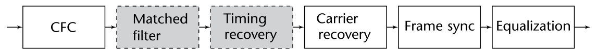

## 6.1　匹配滤波

数字通信理论中讨论匹配滤波时，通常把发射端的叫**脉冲成形**、接收端的叫**匹配滤波**。这些技术的目标有三：一、通过限制有效带宽使信号适合在通信信道中传输；二、提高接收波形的 SNR；三、减少多径信道与非线性引起的码间串扰（ISI）。脉冲成形在 2.7.5 节讨论过，这里换个视角重新审视，聚焦这些滤波器更实用的方面。

对符号滤波后，尖锐的相位与频率跳变减少，信号更紧凑、频谱效率更高。图 6.2 给出了 DBPSK 信号经发射滤波器滤波前后频谱表示的简单示例。可见信号的有效带宽减小了——主要来自发射机施加的上采样/插值。由于时域与频域成反比关系，带宽随之缩减。这些滤波级的实现通常会对信号上/下采样，从而降低有效带宽。但上采样固有地增大了符号的"表面积"，使其更易被判决——因为接收端会得到它的多份副本。因此我们是在用带宽换可恢复性：发射机仍以相同速率产出数据，却不占用全部可用带宽。速率转换（上/下采样）操作在匹配滤波级完成——用单个滤波器同时做两件事是高效的。

生成该图所用的是平方根升余弦（SRRC）滤波器——通信系统的常用滤波器。升余弦（RC）滤波器已在 2.7.5 节给出，而更常用的 SRRC 的冲激响应为：

$$h(t)=\begin{cases}\frac{1}{\sqrt{T_s}}\left(1-\beta+\frac{4\beta}{\pi}\right), & t=0\\ \frac{\beta}{\sqrt{2T_s}}\left[\left(1+\frac{2}{\pi}\right)\sin\frac{\pi}{4\beta}+\left(1-\frac{2}{\pi}\right)\cos\frac{\pi}{4\beta}\right], & t=\pm\frac{T_s}{4\beta}\\ \frac{1}{\sqrt{T_s}}\frac{\sin\left[\frac{\pi(1-\beta)t}{T_s}\right]+4\beta\frac{t}{T_s}\cos\left[\frac{\pi(1+\beta)t}{T_s}\right]}{\frac{\pi t}{T_s}\left[1-\left(\frac{4\beta t}{T_s}\right)^{2}\right]}, & \text{otherwise}\end{cases}$$

其中 $T_s$ 是符号周期，$\beta\in(0,1]$ 是滚降因子。实践中这些滤波器按图 6.3 的两种方式布置：要么在发射机放一个 RC 滤波器，要么在发射机与接收机各放一个 SRRC。两种方案都产生奈奎斯特滤波布置，可减少或消除 ISI。如何选择 $\beta$ 与 $T_s$ 的细节将在 8.2 节讨论。这里我们通过图 6.4 的眼图考察 $\beta$，可以清楚看到 $\beta=[0.3, 0.99]$ 两个差异很大的滚降在时域的效果。这些结果中，信号先经发射机 SRRC 滤波、再经 SNR 27 dB 的 AWGN 信道、最后经接收机 SRRC 滤波。用高 SNR 是为了让眼保持张开、把噪声从最终判决的限制因素中排除。在判决时刻 200 与 400 处，两种情形符号都清晰，但 $\beta=0.99$ 的过渡更平滑。不过 $\beta=0.99$ 时频域外带含有更多能量（见图 2.52），这可能并不理想。

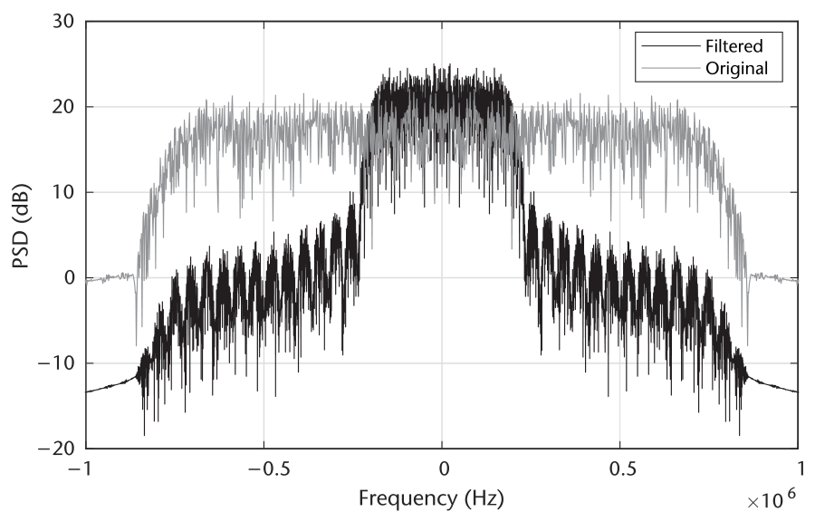

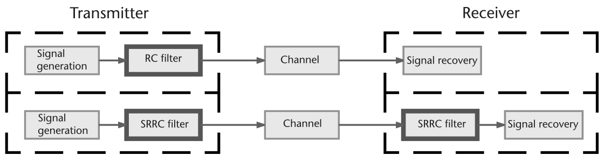

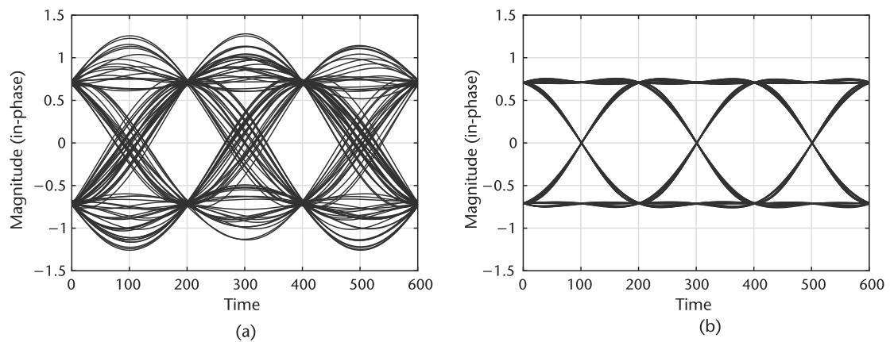

也可以考察冲激响应随 $\beta$ 的变化，如图 6.5 对比了 RC 与 SRRC 响应。注意与 RC 滤波器不同，SRRC 的冲激响应在 $T_s$ 整数倍处不为零；但发射与接收两个 SRRC 的复合响应会像 RC 一样在 $T_s$ 整数倍处过零。之所以用 SRRC，是因为它是奈奎斯特型滤波器——如第 2 章所述，正确采样时产生零 ISI [1]。

我们可以通过向信道引入一个简单非线性来演示 ISI 的效果，并查看 2.4.1 节介绍的眼图。非线性造成幅度与相位失真——当我们削波或使发射放大器工作在极限时就会发生。所用模型的更多细节见 [2]，其他模型如 [3] 也存在。图 6.6 中我们观察到 ISI 的影响：眼被压缩，正确采样时刻变得难以确定。第 9 章讨论均衡时我们将再次回到 ISI 效应。

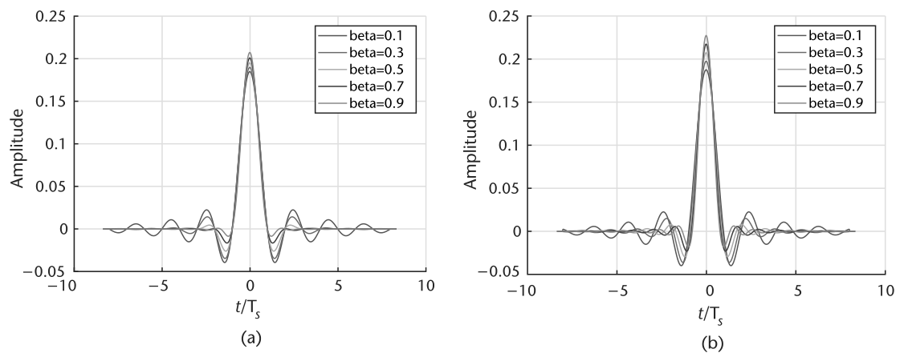

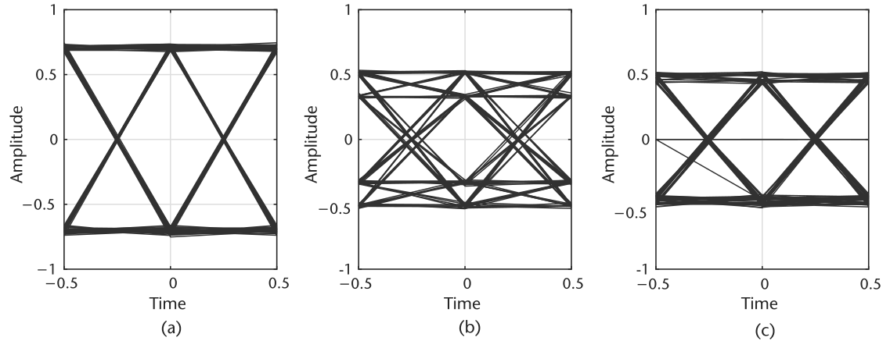

如前所述，速率转换通常发生在这些发射或接收滤波器中。因此可以用**多相滤波器**——SRRC 的抽头分布在多相滤波器的各支路中。这是非常高效的实现：抽头在多相设计中插值之前或抽取之后以较低速率施加，减少了所需乘法数。

我们要讨论的匹配滤波器的最后一个方面是 **SNR 最大化**。这个论断从相关概念自然得出：脉冲成形/滤波后的信号与脉冲成形滤波器相关，而噪声不相关，于是匹配滤波起到对信号 SNR 最大化的作用，在接收脉冲的中心位置产生峰。图 6.7 演示了这一效果：展示 AWGN 下有/无脉冲成形的传输数据。图 6.7(b) 的中间图里，即使在高噪声下也能观察到与原始发送序列密切相关的信号；而无脉冲成形时（图 6.7(c) 第三图），即便没有引入任何定时偏移，仅凭视觉判断发射脉冲就已困难，甚至能观察到解调差错。

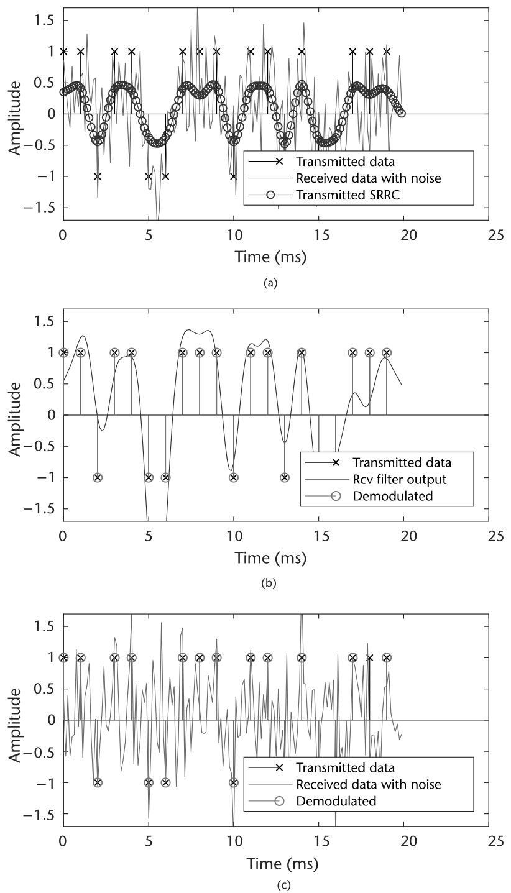

## 6.2　定时误差

发射机与接收机之间的定时误差概念上简单，但在通信系统中可能难以可视化与调试。最基本地说，符号定时同步的目的是对齐两台独立通信设备的时钟信号或采样时刻。图 6.8(a) 考虑一个简单示例：把发射与接收节点的时钟信号及待采样输入信号重叠起来。采样发生在时钟上升沿，最优定时是发射机的时钟。接收端引入了一个小于单个时钟周期的小时延 $\tau$。由于不足一个采样，这称为**分数时延**。由于该时延，信号在错误位置被采样，最终解调的信号不正确。图 6.8(b) 比较了正确符号与接收端解调符号，在第二次跳变处出现明显差错。

数学上，可以把带偏移的接收信号 $r$ 建模为

$$r(t)=\sum_n x(n)h(t-\tau(t)-nT_s)+v(t),$$

其中 $x$ 是发送符号，$h$ 是发射滤波器的脉冲形状，$\tau$ 是分数偏移，$T_s$ 是采样周期，$n$ 是采样索引，$v$ 是加性信道噪声。接收后，$r$ 经过接收匹配滤波器，源符号的关系为

$$y(t)=\sum_n x(n)h_A(t-\tau(t)-nT_s)+v_h(t),$$

其中 $h_A=h(t)\ast\overline{h}(-t)$ 是发射滤波器与其共轭的自相关（作用于源数据 $x$），$v_h$ 是成形后的噪声，$y$ 是输出符号。这印证了我们对匹配滤波与相关的理解。注意时延 $\tau$ 也带索引——因为收发两端的振荡器频率不会完全相同，该时延会随时间漂移。不过在实际射频通信系统中，$\tau$ 逐符号的变化相对器件采样率应当很小。

如 6.1 节所述，我们会在发送前于发射滤波级对信号插值。虽然这降低了系统吞吐量，但给接收端提供了更多数据做判决，而无需自己再过采样。MATLAB 中我们用 `comm.RaisedCosineTransmitFilter`——它先用多相插值器上采样信号，再施加所需的 RC 或 SRRC 抽头。

上采样因子 $N$（也称每符号采样数）将依据所用恢复算法与系统期望数据率选择。一般地，增大 $N$ 能在一定程度上改善接收端的恢复过程，但这同样会压缩有效带宽，迫使硬件以更高速率运行来维持吞吐量。

接下来从星座图的视角看定时误差，会观察到符号的聚簇或散布。图 6.9(a) 给出仿真定时偏移 $\tau$ 为 0.2N 与 0.5N 的情形（$N$ 为每符号采样数）。0.5N 偏移是最坏情形——恰好落在两个符号正中间。图 6.9(b) 给出经单台 Pluto SDR 自环的 QPSK 信号：可以清楚看到类似的聚簇，以及收发链路缺少相位同步带来的旋转。聚簇的发生是因为接收端实际采样在采样之间的过渡区上。例如符号 $y(n)$ 与 $y(n+1)$ 分别为 $[1+i]$ 与 $[-1-i]$，若在时刻 $n+0.5$ 采样，结果点将接近零。

> **思考题**：图 6.10(b) 的 Pluto SDR 星座图为什么出现了旋转？提示：可参考第 5 章。

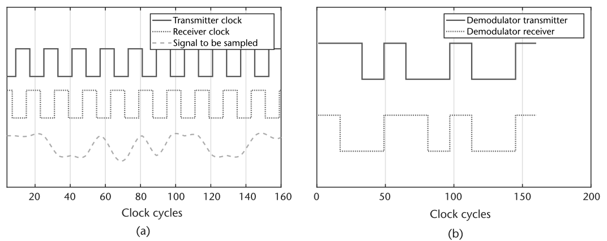

接收端必须估计未知时延 $\tau$ 才能为下游提供正确解调。演示偏移校正的一种粗糙但简单的方法：用多相滤波器对信号做分数重采样。下面的脚本用 `dsp.VariableFractionalDelay`——它对给定延迟实现多相滤波器。我们可以配合 Pluto SDR 演示应提供怎样的延迟来校正偏移。当取到正确值 $\hat{\tau}$（满足 $\hat{\tau}+\tau=kT_s$、$k\in\mathbb{Z}_{\ge 0}$）时，星座将呈现四个清晰的点。

图 6.10 用四个示例延迟作为估计，校正单台 Pluto SDR 自环中的定时失配——它们是上述 MATLAB 脚本的四个运行实例。

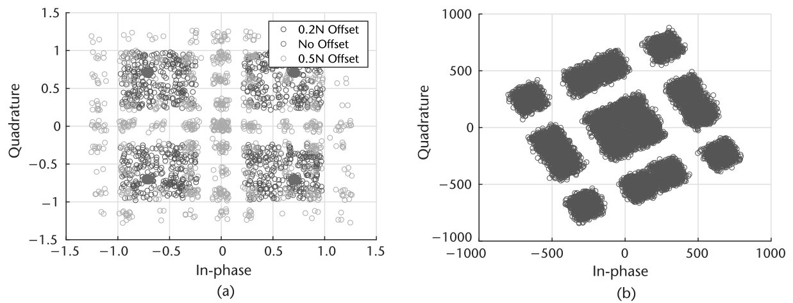

**代码 6.1　Pluto 自环示例：plutoLoopback.m**

```matlab
% User tunable (samplesPerSymbol>=decimation)
samplesPerSymbol = 12; decimation = 4;
% Set up radio
tx = sdrtx('Pluto','Gain',-20);
rx = sdrrx('Pluto','SamplesPerFrame',1e6,'OutputDataType','double');
% Create binary data
data = randi([0 1],2^15,1);
% Create a QPSK modulator System object and modulate data
qpskMod = comm.QPSKModulator('BitInput',true); modData = qpskMod(data);
% Set up filters
rctFilt = comm.RaisedCosineTransmitFilter( ...
    'OutputSamplesPerSymbol', samplesPerSymbol);
rcrFilt = comm.RaisedCosineReceiveFilter( ...
    'InputSamplesPerSymbol',  samplesPerSymbol, ...
    'DecimationFactor',       decimation);
% Pass data through radio
tx.transmitRepeat(rctFilt(modData)); data = rcrFilt(rx());
% Set up visualization and delay objects
VFD = dsp.VariableFractionalDelay; cd = comm.ConstellationDiagram;
% Process received data for timing offset
remainingSPS = samplesPerSymbol/decimation;
% Grab end of data where AGC has converged
data = data(end-remainingSPS*1000+1:end);
for index = 0:300
    % Delay signal
    tau_hat = index/50;delayedsig = VFD(data, tau_hat);
    % Linear interpolation
    o = sum(reshape(delayedsig,remainingSPS,...
      length(delayedsig)/remainingSPS).',2)./remainingSPS;
    % Visualize constellation
    cd(o); pause(0.1);
end
```

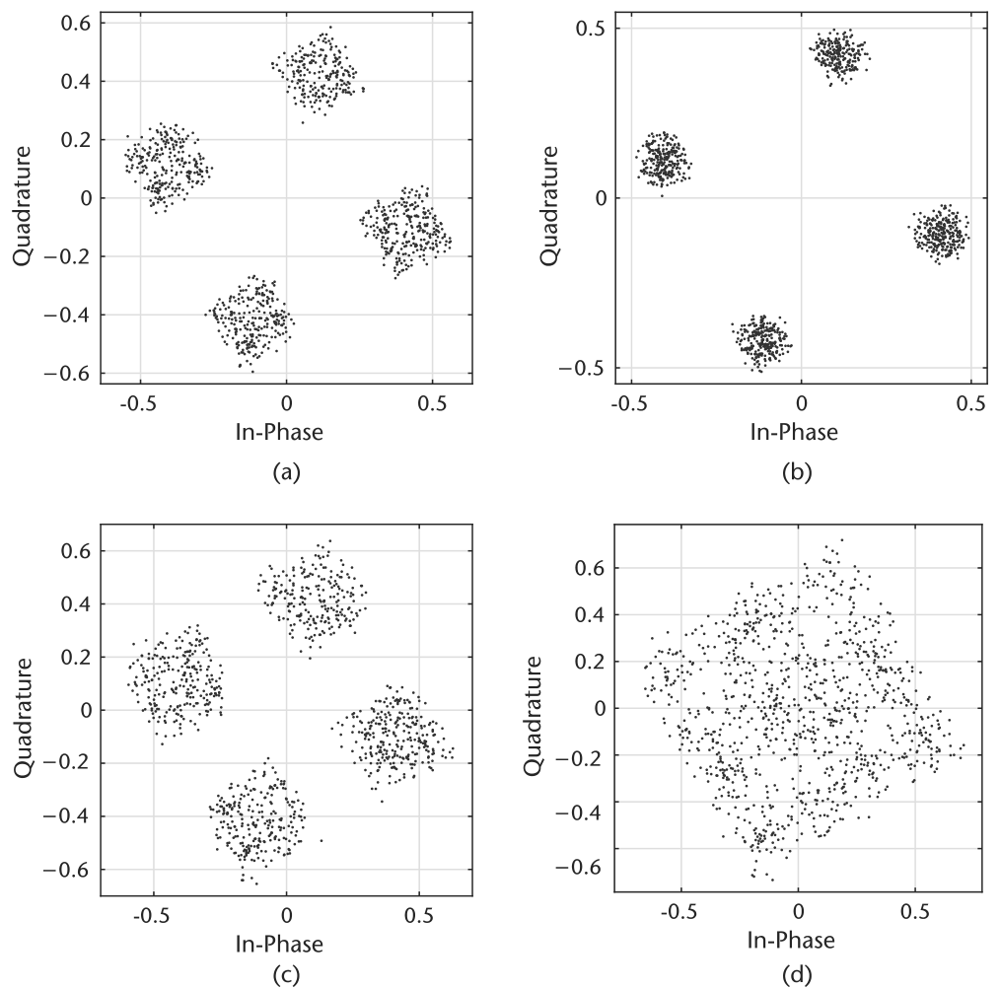

> **思考题**：用上述 MATLAB 代码验证观测到的定时偏移。它是固定偏移吗？把发射与接收频率都改为 900 MHz，解释观察结果。再把收发采样率都改为 2 MHz，解释你的观察。

## 6.3　符号定时补偿

校正收发定时失配有很多方法。本章考察三种数字 PLL 策略，它们与第 7 章载波恢复实现共享同一套方法论。选择这类定时恢复，是因为它能与后续恢复方案集成、稳健、且算法上不过于复杂。先介绍基本 PLL 结构，用于推导反馈定时校正设计。讨论将围绕图 6.11 展开——我们会逐块替换，最终得到图 6.12 的设计。过程中先概念性地概述定时如何同步，再逐个模块讲解设计。所讨论的检测器有：过零（Zero-Crossing）、Müller/Mueller 与 Gardner。更多方法可参考文献中 Mengali [4]、Oerder [5] 等。Rice [6] 对这些技术提供了更深入的分析，覆盖纯模拟设计以及模数混合设计。这里我们聚焦 MATLAB 实现与算法结构特征。

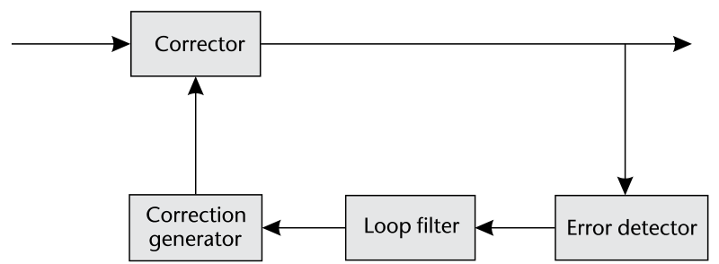

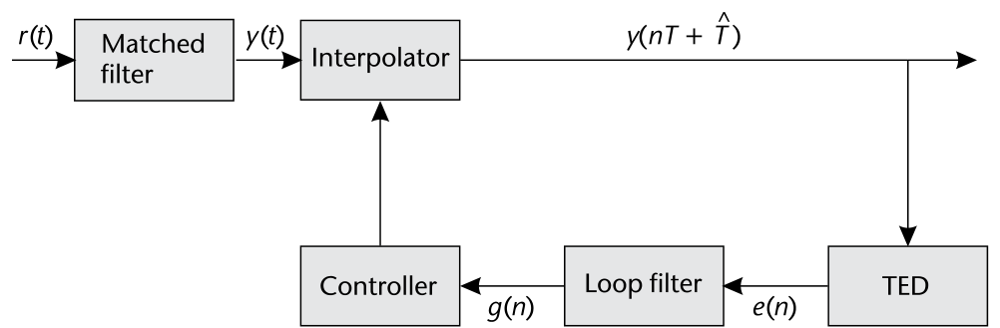

### 6.3.1　锁相环

我们将使用的定时校正是基于 PLL 理论的反馈（闭环）方法。算法结构见图 6.11（取自 [6] 第 7 章），本质上当误差信号被压到零时环即锁定。PLL 有许多设计与实现策略，这里勾勒四个基本组件——它们既用于本章的定时校正，也用于下一章的载波恢复，可互相替换。图示的全数字 PLL 算法的工作方式：先在误差检测器（ED）中测量接收采样的某个偏移（如定时误差或相位误差），称为误差信号 $e$。ED 依据期望接收星座/符号的结构或序列本身的性质设计。接着，环滤波器掌管整个 PLL 的动态——它可以决定工作范围、锁定时间与 PLL 的阻尼/响应速度。再往下是校正生成器，负责为输入生成校正信号并反馈回系统。最后是校正器本身，依据校正生成器的输入修改输入信号。这些块协同工作，最终应使 $e$ 随时间最小化，并持续适应环境或系统自身的后续变化。

校正生成器、误差检测器与校正器随 PLL 的用途（定时恢复或载波恢复）而不同；但环滤波器只需调整数值配置即可在各设计间共享。环滤波器是所有 PLL 设计中最具挑战的部分，却也是对系统自适应控制力最强的部分。这里用比例-积分（PI）滤波器作环滤波器，其传递函数很简单：

$$F(s)=g_1+\frac{g_2}{s},\tag{6.4}$$

其中 $g_1$、$g_2$ 是可选增益。PI 滤波器构成二阶 PLL，传递函数只含一个极点，因此分析起来相对容易。既然处理的是离散时间信号，z 域表示更合适：

$$F(z)=G_1+\frac{G_2}{1-z^{-1}},\tag{6.5}$$

其中 $G_1\neq g_1$、$G_2\neq g_2$。¹ (6.5) 的分数部分可以用双二阶（biquad）滤波器优雅地实现。² 增益值 $(G_1, G_2)$ 的计算基于期望的阻尼因子 $\zeta$ 与环路带宽 $B_{\mathrm{Loop}}$：

$$\theta=\frac{B_{\mathrm{Loop}}}{M(\zeta+0.25/\zeta)},\qquad\Delta=1+2\zeta\theta+\theta^2$$

$$G_1=\frac{4\zeta\theta}{\Delta M}\qquad G_2=\frac{4\theta^2}{\Delta M}$$

其中 $M$ 是输入信号的每符号采样数。注意 $B_{\mathrm{Loop}}$ 是归一化频率，取值范围 $B_{\mathrm{Loop}}\in[0,1]$。对推导感兴趣的读者见 [6] 附录 C。$\zeta$ 的选择：

$$\zeta=\begin{cases}<1, & \text{欠阻尼}\\ =1, & \text{临界阻尼}\\ >1, & \text{过阻尼}\end{cases}$$

它决定 PLL 的响应速度与稳定性。

> ¹ 在 (6.4) 与 (6.5) 之间转换的一个简单办法是使用双线性变换。
> ² 双二阶滤波器的简单实现见 `dsp.BiquadFilter`。

### 6.3.2　反馈定时校正

三种算法共用的定时同步 PLL 由四个主块组成：插值器、定时误差检测器（TED）、环滤波器与插值控制器。它们的交互与数据流见图 6.14。这些操作先估计未知偏移误差、按比例缩放误差，再施加更新供后续符号校正。为了给定时误差一个直观视角，看图 6.13 的眼图。该眼图上采样了二十倍，以便细看过渡——注意它们不像图 6.6 那样粗糙。最优情形下，我们选择在眼最张开处的深灰时刻采样输入信号；但会存在未知分数时延 $\tau$ 使采样周期移位——浅灰标记即移位后的采样位置。为绕开这个问题，接收信号通常不做完全抽取（并不总是如此），给接收端留每符号多个采样。于是，若像黑色标记那样"跨坐"在最优采样位置两侧，只需在这些点之间插值即可得到期望周期。该插值对采样产生分数时延的效果，本质上是移到眼图中的新位置。既然 $\tau$ 未知，必须正确加权这次插值，才不会过冲或欠冲期望的校正量——这与 6.2 节结尾的思路一致。最后，控制"何时从输入数据产出/采样输出"的时刻是插值控制块的功能，它工作在符号率。这个校正环实现得当时，能让带时钟失配的输入信号的眼图张开；而星座图（如图 6.4 与 6.9）也可作为评估定时校正的工具。

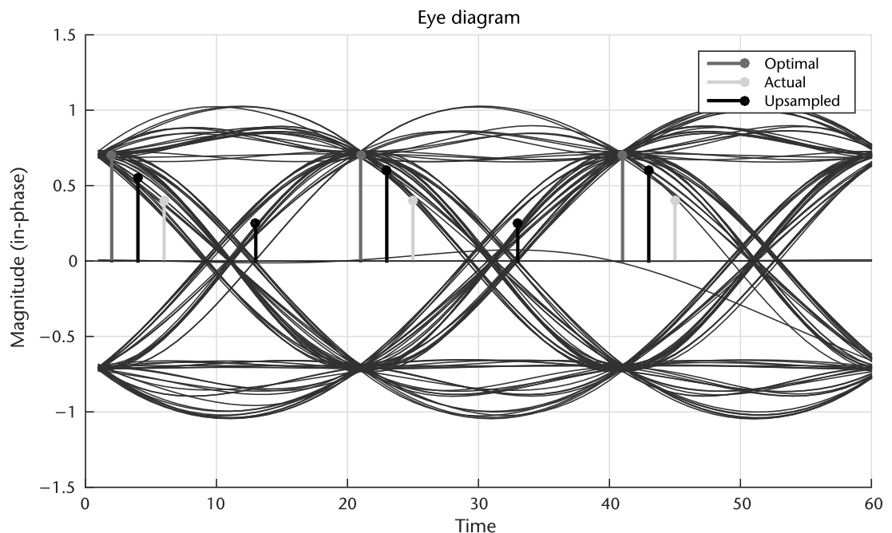

我们先从**过零**（ZC）方法的视角讨论图 6.12 中各块的细节（它最易理解），再推广到其他方法。顾名思义，ZC 在某个采样位置恰好位于过零点时产生零误差信号 $e(n)$。ZC 要求每符号两个或更多采样，使另一采样位置落在或接近最优位置。ZC 的 TED [4] 计算为

$$e(n)=\mathrm{Re}\left(y\left((n-\tfrac{1}{2})T_s+\tau\right)\right)\left[\mathrm{sgn}\{\mathrm{Re}(y((n-1)T_s+\tau))\}-\mathrm{sgn}\{\mathrm{Re}(y(nT_s+\tau))\}\right]$$
$$+\ \mathrm{Im}\left(y\left((n-\tfrac{1}{2})T_s+\tau\right)\right)\left[\mathrm{sgn}\{\mathrm{Im}(y((n-1)T_s+\tau))\}-\mathrm{sgn}\{\mathrm{Im}(y(nT_s+\tau))\}\right],\tag{6.9}$$

其中 Re 与 Im 提取采样的实部与虚部，sgn 取采样的符号（−1 或 1）。注意 (6.9) 中的索引是按**采样**而非符号；具体地说，$y(nT_s+\tau)$ 就是插值器滤波器的最新输出。看 (6.9)：sgn 操作先给出误差的方向，而补偿所需的位移由中点确定。同相与正交部分独立运作——这很理想。

算出误差后交给环滤波器——完全可以照搬 6.3.1 节的。原则相同，公式形式几乎一致，只是写得更紧凑：

$$G_1=\frac{-4\zeta\theta}{G_D N}\qquad G_2=\frac{-4\theta^2}{G_D N}$$

这里 $B_{\mathrm{Loop}}$ 是归一化环路带宽，$\zeta$ 是阻尼因子，$N$ 是每符号采样数，$G_D$ 是检测器增益。新变量 $G_D$ 为校正提供额外的步长缩放。环滤波器的目的同样是维持校正速率的稳定。该滤波器可用简单线性方程实现：

$$y(t)=G_1x(t)+G_2\sum_{n=0}y(n),$$

或用 biquad 滤波器。

下一个要考虑的块是**插值控制器**，负责向插值器提供必要的信令。相对图 6.11 的原始 PLL 结构，插值控制器取代了校正生成器的位置。既然插值器负责对信号做分数延迟，控制器必须提供该信息以及通常的起始插值样本。所谓起始插值样本，指"跨坐"左侧的那个采样——如图 6.13 中左起第二个黑色采样位置。这里实现的插值控制器利用基于计数器的机制，在恰当的符号位置有效触发。在这些触发位置，插值器收到信令并更新，同时系统产出一个输出符号。

计数器控制器的核心思想：维持插值器更新之间特定的触发间隔，其平均更新周期等于输入流的符号率 $N$。图 6.14 给出了插值控制器的逻辑流程图，便于理解这个复杂的流程。考虑定时最优、环滤波器输出 $g(n)$ 为零的情形：我们希望每 $N$ 个采样产生一次触发。因此计数器的加权/递减量取

$$d(n)=g(n)+\frac{1}{N}$$

在对计数器 $c(n)$ 做"模 1 减法"下最大值为 1，每 $N$ 次减法发生一次模回绕。该模计数器更新定义为

$$c(n+1)=(c(n)-d(n))\bmod 1.$$

我们在更新计数器之前判定触发条件，依据模回绕是否将发生：

$$\mathrm{Trigger}=\begin{cases}\mathrm{True}, & c(n)<d(n)\\ \mathrm{False}, & \text{Otherwise}\end{cases}$$

该触发信号定义了新符号的起点，因此也可用来确保我们在正确的采样上估计误差。触发发生时更新 $\mu(n)$——插值点与最优采样位置之间的估计间隔。该更新是新计数器步长 $d(n)$ 与当前计数 $c(n)$ 的函数：

$$\mu(k)=c(n)/d(n).$$

这个 $\mu$ 将传给插值器以更新其施加的延迟。

我们要避免跨越多个符号做定时估计——那会产生错误误差信号与错误更新。可以在 TED 块中加入条件来避免。图 6.15 给出了 TED 块的附加结构及辅助逻辑，说明如何有效利用触发信号。基于该 TED 结构，只有触发发生时输出误差 $e$ 才可能非零。

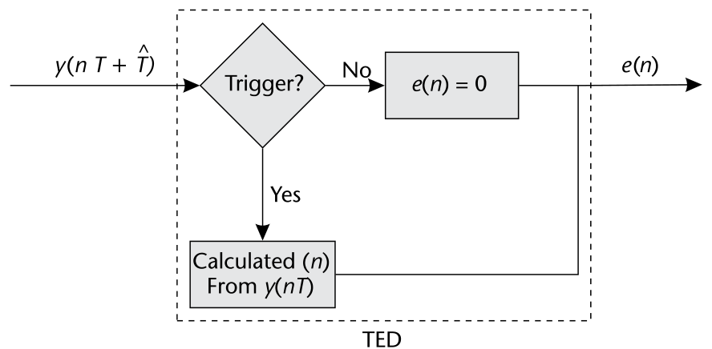

往图 6.14 的 TED 下游看：由于我们只用 PI 环滤波器，只有非零输入才能更新输出、进而修改与 $d$ 关联的触发周期。系统进入稳态（PLL 锁定）后，TED 输出可每 $N$ 个采样非零一次。

定时恢复还没讨论的最后一块是插值器本身。相对图 6.11 的原始 PLL 结构，插值器取代了校正器的位置。这里的插值只是当前与历史输入 $y$ 的线性组合——本质上可看作一个滤波器。然而，要用 FIR 滤波器实现任意延迟 $\tau\in[0,\ldots,T_s]$ 是做不到的 [7]。理想插值 IIR 滤波器的实现确实存在，但其抽头的计算在实际系统中不可行 [8]。因此我们采用 FIR 低通滤波器的自适应实现——**分段多项式滤波器**（PPF）[6]。PPF 只能提供多项式阶数以内的偏移估计。替代实现有多相滤波器组设计，但依所需分辨率相位数可能变得很大；不过它们实现起来可以很直接 [9]。

PPF 的实用之处：可以通过选择滤波器阶数轻松控制插值形式——最高等效于用于估计底层接收信号的多项式阶数。这里用二阶（二次）插值，需要四抽头滤波器。插值器输出的一般形式为

$$y(kT_s+\mu(k)T_s)=\sum_{n=1}^{2}h(n)y((k-n)T_s),$$

其中 $h_k$ 是时刻 $k$ 的滤波器系数，由 [10] 给出：

$$\mathbf{h}=[\alpha\mu(k)(\mu(k)-1),\ -\alpha\mu(k)^2-(1-\alpha)\mu(k)+1,\ -\alpha\mu(k)^2+(1+\alpha)\mu(k),\ \alpha\mu(k)(\mu(k)-1)],$$

其中 $\alpha=0.5$。$\mu(k)$ 与分数延迟相关，由插值控制块提供——它把符号周期 $T_s$ 与估计偏移关联起来。于是可以把真实延迟估计为

$$\hat{\tau}\approx\mu(k)T_s.$$

无偏移（$\mu=0$）时，插值器表现为两采样延迟——即 ZC 实现下的单符号延迟。可以把 PPF 扩展到更多采样实现三次及更高次插值，但实现随之更复杂。确定插值器实现与所需自由度时，应考虑底层波形能否被准确刻画。

这个用二次形式、四个采样的设计可认为是不规则的——抽头数达不到三。但奇数长度实现（用奇数个采样）并不可取，因为我们要找的是所给采样**之间**的值；我们也不想要两采样实现——考虑到图 6.13 中眼的曲率。

MATLAB 中几行代码即可实现该插值器，依赖输入数据 `y` 与插值控制器的最近输出 `mu`，见代码 6.2。

**代码 6.2　插值器：interpFilter.m**

```matlab
% Define interpolator coefficients
alpha = 0.5;
InterpFilterCoeff = ...
    [ 0,       0,         1,       0;    % Constant
     -alpha, 1+alpha, -(1-alpha), -alpha; % Linear
      alpha,  -alpha,    -alpha,   alpha]; % Quadratic
% Filter input data
ySeq = [y(i); InterpFilterState]; % Update delay line
 % Produce filter output
filtOut = sum((InterpFilterCoeff * ySeq) .* [1; mu; mu^2]);
InterpFilterState = ySeq(1:3); % Save filter input data
```

由输出 `filtOut` 可以用 ZC 方程 (6.9) 驱动 TED，为环滤波器与插值控制器生成误差信号。依据图 6.14，该 TED 计算基于插值控制器来的触发信号。还会检查历史触发，防止定时环的输出驱动快于符号率。这段逻辑与 TED 测量见代码 6.3。

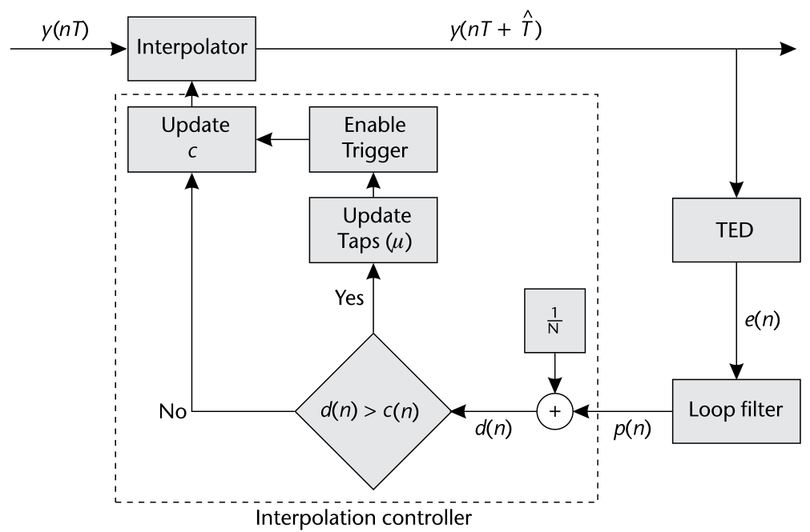

**代码 6.3　ZC TED：zcTED.m**

```matlab
% ZC-TED calculation occurs on a strobe
if Trigger && all(~TriggerHistory(2:end))
    % Calculate the midsample point for odd or even samples per symbol
    t1 = TEDBuffer(end/2 + 1 - rem(N,2));
    t2 = TEDBuffer(end/2 + 1);
    midSample = (t1+t2)/2;
    e = real(midSample)*(sign(real(TEDBuffer(1)))-sign(real(filtOut))) ...
        imag(midSample)*(sign(imag(TEDBuffer(1)))-sign(imag(filtOut)));
else
    e = 0;
end
% Update TED buffer to manage symbol stuffs
switch sum([TriggerHistory(2:end), Trigger])
    case 0
      % No update required
    case 1
      % Shift TED buffer regularly if ONE trigger across N samples
      TEDBuffer = [TEDBuffer(2:end), filtOut];
    otherwise % > 1
      % Stuff a missing sample if TWO triggers across N samples
      TEDBuffer = [TEDBuffer(3:end), 0, filtOut];
end
```

TED 的第 13–22 行加入了管理**符号填充**（symbol stuffing）的附加逻辑。符号填充基本上是强制同步例程产生一个额外触发。当时钟偏差迫使插值器最小程度地"跨坐"在目标符号上时就需要它；作为补偿必须插入一个额外的输出符号。注意系统输出端的采样率将等于符号率——本质上在 $N>1$ 时对信号做了下采样。

TED 之后是环滤波器，6.3.1 节已讨论过。该滤波器很简单，不用滤波对象也能直接实现；不过用 biquad 滤波器对象代码更紧凑，见代码 6.4。

**代码 6.4　环滤波器：loopFilter.m**

```matlab
% Loop filter
loopFiltOut = LoopPreviousInput + LoopFilterState;
g = e*ProportionalGain + loopFiltOut; % Filter error signal
LoopFilterState = loopFiltOut;
LoopPreviousInput = e*IntegratorGain;
% Loop filter (alternative with filter objects)
lf = dsp.BiquadFilter('SOSMatrix',tf2sos([1 0],[1 -1])); % Create filter
g = lf(IntegratorGain*e) + ProportionalGain*e; % Filter error signal
```

最后，在插值控制块处评估滤波后的误差。稳态时该块应每 $N$ 个输入采样产生一次触发。该触发信号可视为有效的输出信号，与整个算法的输出数据一致。在本文的代码语境下：时刻 $n$ 的 Trigger 为真时，输入 $n+1$ 处插值滤波器的输出应被下游处理。插值控制器自身利用滤波后误差信号 `g`，随数据处理更新内部计数器，见代码 6.5。

**代码 6.5　插值控制逻辑：interpControl.m**

```matlab
% Interpolation Controller with modulo-1 counter
d = g + 1/N;
TriggerHistory = [TriggerHistory(2:end), Trigger];
Trigger = (Counter < d); % Check if a trigger condition
if Trigger % Update mu if a trigger
    mu = Counter / d;
end
Counter = mod(Counter - d, 1); % Update counter
```

定时同步器的整体设计可能复杂，各实现工作在不同的相对速率上。因此提供表 6.1 作为推荐实现的指引。这些速率与图 6.14 概述的触发实现一致。当插值器的输出采样与触发对齐时，系统将输出每符号一个采样（$N$）。

| 模块 | 工作速率 |
|---|---|
| 插值器 | 采样率 |
| TED | 符号率 |
| 环滤波器 | 符号率 |
| 插值控制器 | 采样率 |

: 定时恢复各模块的工作速率

> **思考题**：从建模定时偏移的脚本 `timingError.m` 出发，用 ZC 实现定时校正。

## 6.4　替代误差检测器与系统要求

在上述 PLL 框架内，若应用或系统配置不同，可使用替代 TED。例如，前面讨论的 ZC 方法无法在载波相位或频偏下工作——这样的非理想性必须先补偿才能用 ZC，其他方法则不然。除载波偏移外，ZC 还要求上采样因子 $N$ 至少为 2，受带宽与数据率约束的某些系统可能做不到。

### 6.4.1　Gardner

第二种 TED 叫 Gardner [11]，与 ZC 非常相似。误差信号由下式确定：

$$e(n)=\mathrm{Re}\left(y\left((n-\tfrac{1}{2})T_s+\tau\right)\right)\left[\mathrm{Re}(y((n-1)T_s+\tau))-\mathrm{Re}(y(nT_s+\tau))\right]$$
$$+\ \mathrm{Im}\left(y\left((n-\tfrac{1}{2})T_s+\tau\right)\right)\left[\mathrm{Im}(y((n-1)T_s+\tau))-\mathrm{Im}(y(nT_s+\tau))\right].$$

该方法同样要求每符号两个采样，与 ZC 的差别仅在对误差方向的量化上。Gardner 的一个有用特性是不需要载波相位校正，对 BPSK 与 QPSK 信号尤其有效。但由于 Gardner 不是判决引导方法，为获得最佳性能，发射滤波器的过剩带宽应取 $\beta\in(0.4, 1]$。

> **思考题**：在你现有的定时误差检测器中实现 Gardner TED。向接收信号引入 π/4 的小相移，比较 ZC 与 Gardner 在这些情形下的表现。

### 6.4.2　Müller 与 Mueller

接下来是以 Kurt Müller 与 Markus Müller 命名的 Müller-Mueller（MM）方法 [12]。它可以视为最高效的方法——不需要对源数据上采样，工作在每符号一个采样。误差信号由 [6] 给出：

$$e(k)=\mathrm{Re}(y(kT_s+\tau))\times\mathrm{sgn}\{\mathrm{Re}(y((k-1)T_s+\tau))\}-\mathrm{Re}(y((k-1)T_s+\tau))\times\mathrm{sgn}\{\mathrm{Re}(y(kT_s+\tau))\}$$
$$+\ \mathrm{Im}(y(kT_s+\tau))\times\mathrm{sgn}\{\mathrm{Im}(y((k-1)T_s+\tau))\}-\mathrm{Im}(y((k-1)T_s+\tau))\times\mathrm{sgn}\{\mathrm{Im}(y(kT_s+\tau))\}.$$

MM 同样在匹配滤波尽量减小过剩带宽（即 $\beta$ 小）时工作最佳。注意当收/发滤波器的过剩带宽高时，sgn 操作产生的判决可能无效——实现时必须考虑这个折中。不过，尽管 MM 技术上最高效，$N=1$ 时由于每符号可用信息少，性能可能存疑。

> **思考题**：向输入信号加相位与频偏，比较 ZC、Gardner 与 MM 估计方法的性能。对固定的分数延迟 $\frac{T_s}{2}$、$\frac{T_s}{4}$、$\frac{T_s}{5}$ 做此事，并画出 Gardner 与 ZC 的 TED 误差输出。

## 6.5　组装成整体

本章我们勾勒了基于 PLL 的定时恢复算法的结构与逻辑及配套 MATLAB 代码。本节讨论把算法组件组装起来，并对评估期间发生的事情给出直觉，同时讨论参数化及其与系统动态的关系。

系统级脚本贯穿着一个不变的主题：数据调制 → 发射滤波 → 经带定时偏移的信道 → 再次滤波 → 定时恢复。这一串步骤中可能发生多次速率变化。为帮助理解这些关系，可以像图 6.16 那样把它们画出来。调制器产出的符号等于采样率；经过发射滤波器获得上采样因子 $N$，每符号采样数升到 $N$；接收端可在接收滤波器中按因子 $N_F\le N$ 抽取；最后跨剩余采样执行定时恢复、移除分数偏移 $\tau$，回到每符号一采样的原始速率。图 6.16 概述的速率模式与代码 6.1 的第一个 MATLAB 脚本一致。该脚本可修改为产生略微动态的定时偏移，如下：

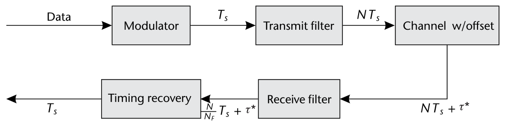

**代码 6.6　发射滤波数据：srrcFilterData.m**

```matlab
% User tunable (samplesPerSymbol>=decimation)
samplesPerSymbol = 4; decimation = 2;
% Create a QPSK modulator System object and modulate data
qpskMod = comm.QPSKModulator('BitInput',true);
% Set up filters
rctFilt = comm.RaisedCosineTransmitFilter( ...
    'OutputSamplesPerSymbol', samplesPerSymbol);
rcrFilt = comm.RaisedCosineReceiveFilter( ...
    'InputSamplesPerSymbol',  samplesPerSymbol, ...
    'DecimationFactor',       decimation);
% Set up delay object
VFD = dsp.VariableFractionalDelay;
% Delay data with slowly changing delay
rxFilt = [];
for index = 1:1e3
    % Generate, modulate, and tx filter data
    data = randi([0 1],100,1);
    modFiltData = rctFilt(qpskMod(data));
    % Delay signal
    tau_hat = index/30;
    delayedsig = VFD(modFiltData, tau_hat);
    rxSig = awgn(delayedsig,25); % Add noise
    rxFilt = [rxFilt;rcrFilt(rxSig)]; % Rx filter
end
```

由代码 6.6 可以评估带时变偏移的接收滤波信号。图 6.17(a) 给出 `samplesPerSymbol` 等于 `decimation` 时 `rxFilt` 的直接输出：观察到信号星座随时间塌缩成多个环——类似图 6.9，本质上就是没有做定时恢复。接下来，运用本章的方法与所提定时恢复实现，可以适应这个变化的分数延迟。图 6.17(b) 演示 $N=2$ 时 ZC 技术的恢复：信号实部分量之间出现清晰的分层，说明输出星座正在收敛为正确的 QPSK 信号。图 6.17(c) 把 $B_{\mathrm{Loop}}$ 从 0.001 提到 0.01，系统反应更快；但收敛后，$B_{\mathrm{Loop}}=0.001$ 的残余符号噪声比 0.01 时更小。

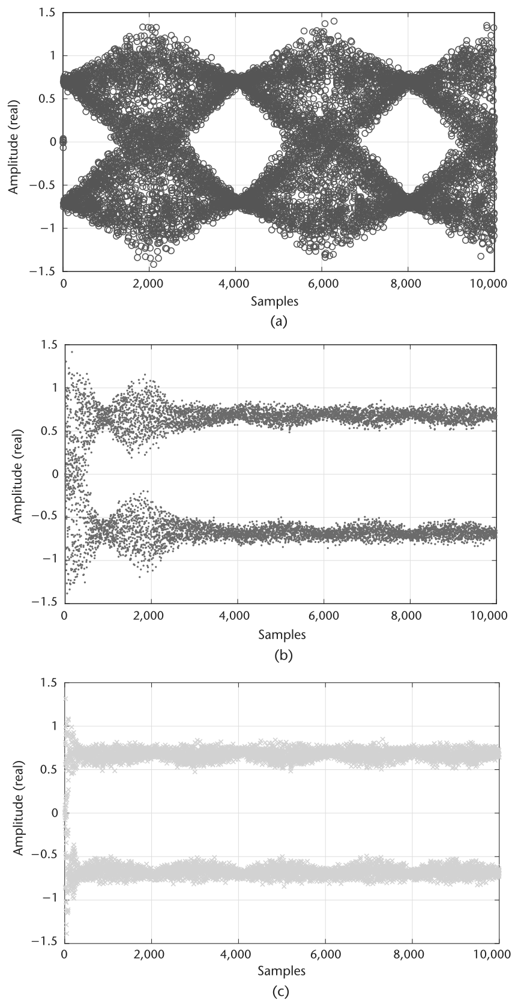

> **思考题**：重新生成图 6.17 并使用替代恢复算法 ζ = {0.5, √2, 2}。评论恢复算法的动态特性。
>
> 用 Pluto SDR 自环作为信道重新生成图 6.17。调校恢复算法（N, ζ, $B_{\mathrm{Loop}}$, $G_D$），测出你能达到的最好收敛。

## 6.6　本章小结

定时恢复是振荡器各自独立的节点间成功传输的基础工具。本章从数学、仿真与 Pluto SDR 演示三个层面引入了定时偏移模型。为对抗该偏移，介绍了基于 PLL 的定时恢复方法论，包含多种定时误差检测器，并对第 2 章引入的匹配滤波做了回顾与延伸。给出了定时恢复算法各组件的 MATLAB 代码，并花了相当篇幅考察它们的配置与交互。最后，在全部组件研究完毕后，探索了设计参数化的部分内容。后续章节将利用这里开发的实现，构建能够恢复两台 Pluto SDR 设备间传输信号的完整接收机。

## 参考文献

[1] Proakis, J., and M. Salehi, *Digital Communications*, Fifth Edition, Boston: McGraw-Hill, 2007.

[2] Saleh, A. A. M., "Frequency-Independent and Frequency-Dependent Nonlinear Models of TWT Amplifiers," *IEEE Transactions on Communications*, Vol. 29, No. 11, November 1981, pp. 1715–1720.

[3] Boumaiza, S., T. Liu, and F. M. Ghannouchi, "On the Wireless Transmitters Linear and Nonlinear Distortions Detection and Pre-correction," in *2006 Canadian Conference on Electrical and Computer Engineering*, May 2006, pp. 1510–1513.

[4] Mengali, U., *Synchronization Techniques for Digital Receivers, Applications of Communications Theory*, New York: Springer, 2013.

[5] Oerder, M., and H. Meyr, "Digital Filter and Square Timing Recovery," *IEEE Transactions on Communications*, Vol. 36, No. 5, May 1988, pp. 605–612.

[6] Rice, M., *Digital Communications: A Discrete-Time Approach*, Third Edition, Pearson/Prentice Hall, 2009.

[7] Laakso, T. I., V. Valimaki, M. Karjalainen, and U. K. Laine, "Splitting the Unit Delay [FIR/All Pass Filters Design]," *IEEE Signal Processing Magazine*, Vol. 13, No. 1, January 1996, pp. 30–60.

[8] Thiran, J. P., "Recursive Digital Filters with Maximally Flat Group Delay," *IEEE Transactions on Circuit Theory*, Vol. 18, No. 6, November 1971, pp. 659–664.

[9] Rice, M., and F. Harris, "Polyphase Filterbanks for Symbol Timing Synchronization in Sampled Data Receivers," in *MILCOM 2002, Proceedings*, Vol. 2, October 2002, pp. 982–986.

[10] Erup, L., F. M. Gardner, and R. A. Harris, "Interpolation in Digital Modems. II. Implementation and Performance," *IEEE Transactions on Communications*, Vol. 41, No. 6, June 1993, pp. 998–1008.

[11] Gardner, F., "A BPSK/QPSK Timing-Error Detector for Sampled Receivers," *IEEE Transactions on Communications*, Vol. 34, No. 5, May 1986, pp. 423–429.

[12] Mueller, K., and M. Muller, "Timing Recovery in Digital Synchronous Data Receivers," *IEEE Transactions on Communications*, Vol. 24, No. 5, May 1976, pp. 516–531.
