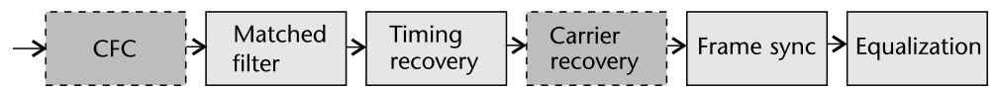
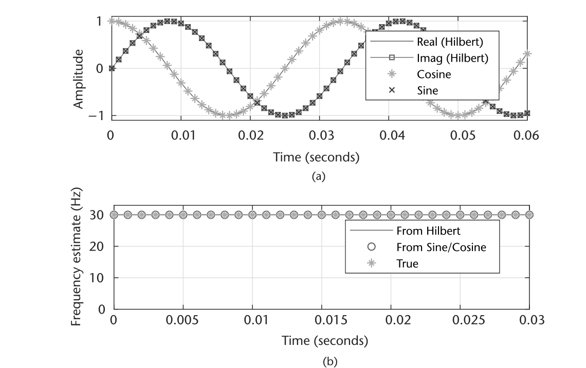
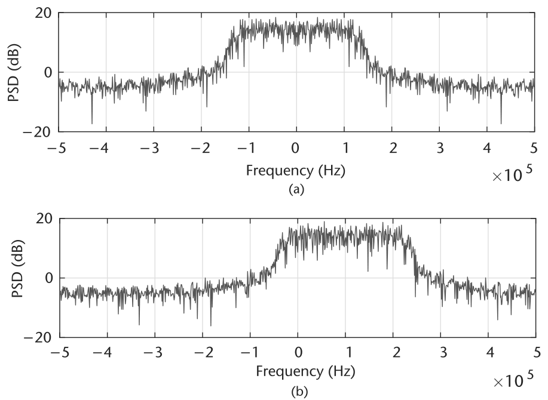
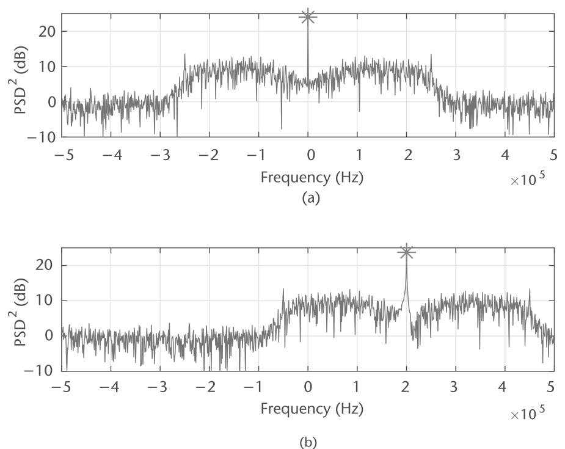
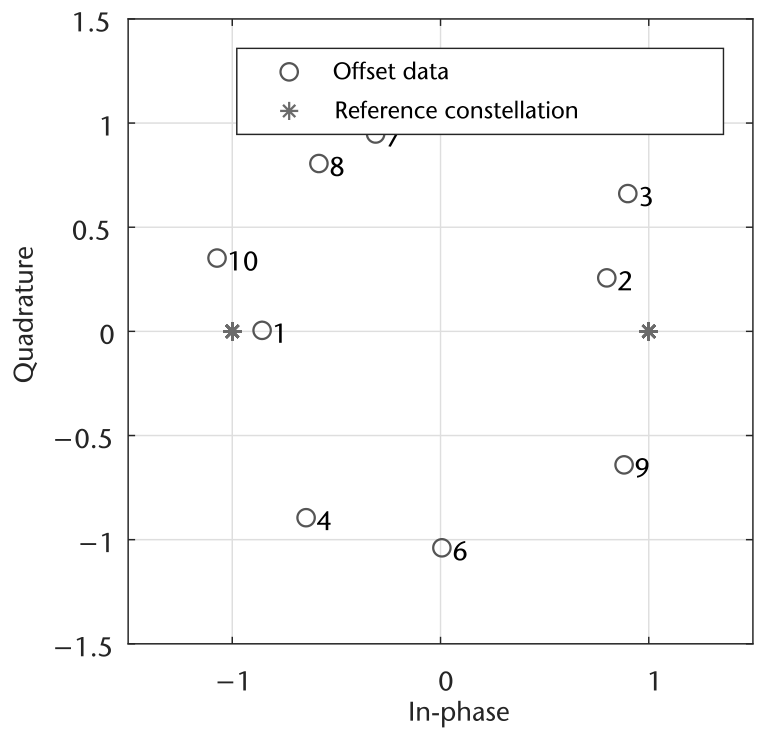
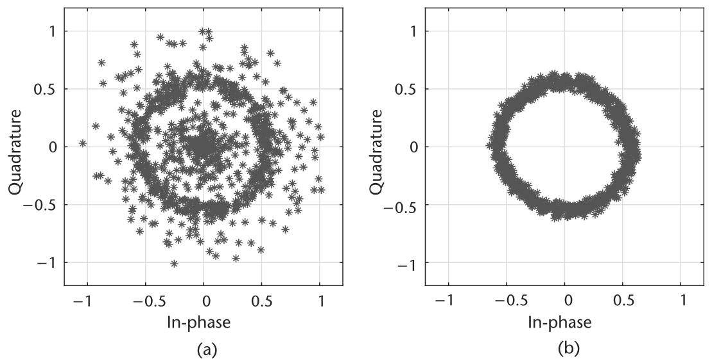
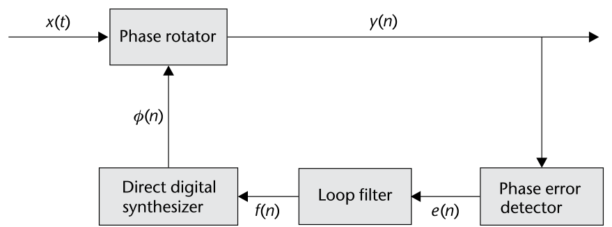
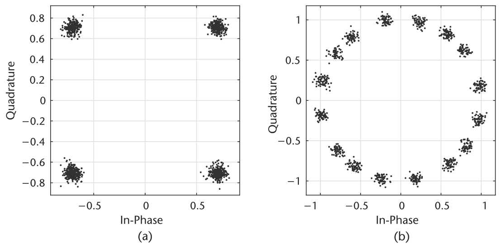
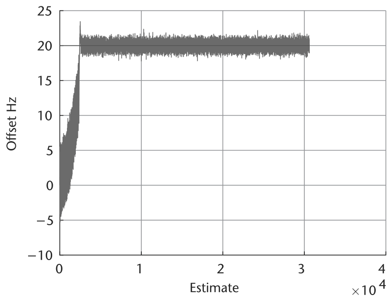
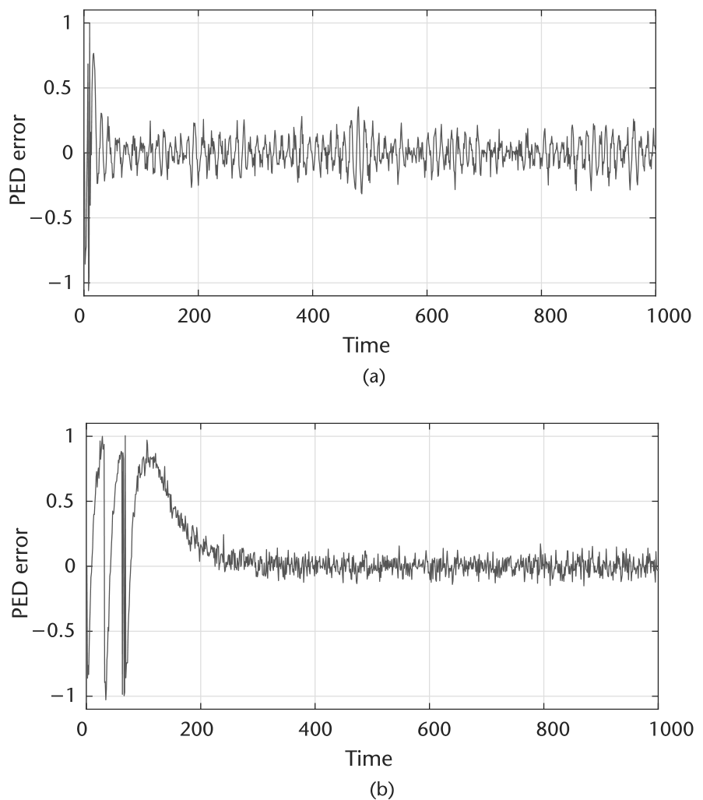

# 第 7 章　载波同步

本章介绍发射与接收节点之间的**载波频偏**概念。具体地，先讨论一个简化的误差模型，再给出两种恢复方法——依据实现方式它们可以联合或独立工作。载波恢复与上一章（第 6 章）实现的定时恢复互为补充，是维持振荡器各自独立的电台间无线链路所必需的。

本章通篇假设收发电台之间的定时失配已经校正。不过这并非所有情形下的必要条件——尤其本章最初提供的实现中并不是——但对最终实现的最佳性能而言是必要条件。为简单起见，除讨论 Pluto SDR 本身外，我们的仿真将忽略定时效应（那种情形下定时校正显然不可忽视）。对照图 7.1 的完整接收机框图，本章考虑的是载波恢复与 CFO 功能块。



## 7.1　载波偏移

接收与发射节点通常是两个物理上分离的独立单元。因此，由于杂质、电噪声、温度差异等天然效应，它们的 LO 之间会存在相对频偏。这些差异还可能相对动态，两个 LO 会彼此漂移。这些偏移可包含随机相位噪声、频偏、频率漂移与初始相位失配。但为简单起见，我们只把该偏移建模为固定值——在射频通信的时间尺度上，这是个合理的假设。

考察商用振荡器时，频偏以百万分率（PPM）给出，可以换算成给定频率下的最大载波偏移。Pluto SDR 的内部 LO 额定 25 PPM [1]（校准后 2 PPM），可用 (7.1) 把最大载波偏移 $f_o$ 与工作载频 $f_c$ 联系起来：

$$f_{o,\max}=\frac{f_c\times \mathrm{PPM}}{10^6}.\tag{7.1}$$

确定 $f_{o,\max}$ 很重要，因为它给出载波恢复的设计准则：把资源浪费在"校正超出工作范围的频率"上毫无意义。当然这类情形可以用扫描技术，但超出本书范围。

数学上，可以把基带处带载波频偏 $f_o$（或 $\omega_o$）的受损源信号 $s(k)$ 建模为

$$r(k)=s(k)e^{j(2\pi f_okT+\theta)}+n(k)=s(k)e^{j(\omega_okT+\theta)}+n(k),\tag{7.2}$$

其中 $n(k)$ 是零均值高斯随机过程，$T$ 是符号周期，$\theta$ 是载波相位，$\omega_o$ 是角频率。

文献中，载波恢复有时被定义为载波**相位**恢复或载波**频率**恢复。它们的目标大体一致：在同步器输出端提供稳定的星座。但理解频率与相位的关系很重要——这能让这些命名惯例清晰起来。角频率 $\omega$（或等效的频率 $2\pi f$）纯粹是相位 $\theta$ 随时间变化率的度量：

$$\omega=\frac{d\theta}{dt}=2\pi f.\tag{7.3}$$

因此，恢复信号的相位本质上就是恢复该信号的频率。通过这一关系得到了估计信号频率的通用方法——频率不像相位那样可以直接测量。代码 7.1 的简单 MATLAB 脚本演示了该技术：先生成给定频率的连续波（CW）单音，测量信号的瞬时相位，再取相位差作为频率估计。任意复信号 $x(k)$ 的瞬时相位 $\theta$ 可测得为

$$\theta=\tan^{-1}\frac{\mathrm{Im}(x(k))}{\mathrm{Re}(x(k))},$$

其中 Re 与 Im 分别取信号的实部与虚部。代码 7.1 还用 `hilbert` 函数经希尔伯特变换从实信号生成复正弦。希尔伯特变换非常适合生成实信号的解析（复）表示。想深入了解希尔伯特变换，推荐阅读基于信号处理理论的 Oppenheim [2]。

图 7.2 给出了代码 7.1 的输出。图 7.2(a) 首先可见希尔伯特变换的输出与由正弦（虚部）/余弦（实部）生成的 CW 单音相等。图 7.2(b) 清楚可见基于相位差的估计技术正确估出了信号的频率。脚本还用了 `unwrap` 函数防止相位估计被限制在 $\pm\pi$ 之间。该估计是 (7.3) 关系的直接应用。另外，考察频偏（通常只是较大偏移）时直接看频域也有用——因为仅凭时域信号（尤其含已调数据与噪声时）很难解读这类偏移。图 7.3 给出了原始信号与偏移信号的 PSD，清楚展示了这一视角。信号相对原始信号保持 10 kHz 偏移——完全在 200 MHz 以上通信的 Pluto SDR 的 25-PPM 规格之内。

在频率上搬移复信号是 (7.2) 的简单应用，图 7.3(b) 正是这样生成的。代码 7.2 的 MATLAB 示例脚本演示了如何用指数函数搬移复信号；愿意的话也可以直接用正弦。所给脚本中，先用 SRRC 滤波器（代码 7.2）对信号上采样/过采样很重要——这让频移一目了然，因为主要信号能量只占带宽的一小部分。



**代码 7.1　freqEstimate.m**

```matlab
% Sinusoid parameters
fs = 1e3; fc = 30; N = 1e3;
t = 0:1/fs:(N-1)/fs;
% Create CW Tone
r = cos(2*pi*fc*t); i = sin(2*pi*fc*t);
% Alternatively we can use a hilbert transform from our real signal
y = hilbert(r);
% Estimate frequency from phase
phaseEstHib = unwrap(angle(y))*fs/(2*pi); freqEstHib = diff(phaseEstHib);
phaseEstCW = unwrap(atan2(i,r))*fs/(2*pi); freqEstCW = diff(phaseEstCW);
tDiff = t(1:end-1);
```

> **思考题**：从 MATLAB 代码 7.1 出发，考察该估计技术相对采样率 fs 与单音频率 fc 的频率范围。（忽略希尔伯特变换的输出。）大致能被正确估计的最大频率是多少？当频率偏移超过这个点会发生什么？



**代码 7.2　freqShiftFFT.m**

```matlab
% General system details
fs = 1e6; samplesPerSymbol = 1; frameSize = 2^8;
modulationOrder = 2; filterOversample = 4; filterSymbolSpan = 8;
% Impairments
frequencyOffsetHz = 1e5;
% Generate symbols
data = randi([0 samplesPerSymbol], frameSize, 1);
mod = comm.BPSKModulator(); modulatedData = mod(data);
% Add TX Filter
TxFlt = comm.RaisedCosineTransmitFilter('OutputSamplesPerSymbol',...
    filterOversample, 'FilterSpanInSymbols', filterSymbolSpan);
filteredData = TxFlt(modulatedData);
% Shift signal in frequency
t = 0:1/fs:(frameSize*filterOversample-1)/fs;
freqShift = exp(1i.*2*pi*frequencyOffsetHz*t.');
offsetData = filteredData.*freqShift;
```

> **思考题**：修改代码 7.2 中的 filterOversample 并观察频谱，解释你的观察。接着用原始脚本把频率偏移以 0.1Fs 为步长从 0.1Fs 增加到 1.0Fs（Fs 为采样率），解释观察到的效应。

## 7.2　频偏补偿

设计无线接收机有很多方式：恢复技术与算法编排各异。本节采用"先频偏、后其余同步任务"的思路。如 10.3 节所述，Pluto SDR 的振荡器额定 25 PPM。在 2.4 GHz 这样的免许可频段发射信号，两台电台之间可能产生最大 120 kHz 的偏移。这个范围相当大，因此我们将发展**两级**频率补偿技术：粗频偏校正与细频偏校正。这一设计有利——它能缩短相对载波估计的收敛（锁定）时间。

### 7.2.1　粗频偏校正

文献中粗频偏校正有两大类：**数据辅助**（DA）与**盲校正**。DA 技术利用相关型结构，借助对接收信号的知识（通常是前导码形式）估计载波偏移 $f_o$。DA 方法虽能给出精确估计，其性能通常受前导码长度限制 [3]——前导码越长，系统吞吐量越低。

另一条路是**盲**或非数据辅助（NDA）方法，可以在信号的整个持续时间上工作。因此可以论证：在现实系统中 NDA 能胜过 DA 算法。这些粗校正技术通常以开环方式实现，便于使用。这里我们概述并实现一种**基于 FFT 的 NDA 技术**做粗校正。思路很直接：基于图 7.3 的初步观察，可以对符号偏移给出粗略估计。但直接取 FFT 的峰值不会很准——尤其当信号在频率上不对称时。为补偿这一点，我们把信号自乘其调制阶数 $M$ 次以去除信号自身的调制分量。由 (7.2) 的模型（忽略噪声）可观察：

$$r^M(k)=s^M(k)e^{j(2\pi f_okT+\theta)M}.$$

这会把偏移搬到原位置的 $M$ 倍处，并使 $s(t)$ 变为纯实或纯复。于是 $s^M(t)$ 项可以忽略，只剩下指数（单音）。为估计该单音的位置，对 $r^M(t)$ 取 FFT，把能量最大的 bin 对应到单音位置。图 7.4 是 MATLAB 代码 7.2 生成的 BPSK 信号（偏移 10 kHz）的 $r^M(t)$ 频谱示例——峰值清晰地出现在两倍频偏处，符合预期。该频率估计可以形式化地写成一条方程 [4]：

$$\hat{f}_o=\frac{1}{MTK}\ \underset{k}{\arg\max}\left|\sum_{i=0}^{K-1}r^M(i)e^{-j2\pi ik/K}\right|\tag{7.6}$$

其中 $K$ 是 FFT 长度。(7.6) 的估计之所以称为"粗"，是因为 $\hat{f}_o$ 只能取 FFT 产生的 $K$ 个值之一。若有需要，可以通过对多组估计的固定 FFT bin 集合做插值来扩展精度。信号每个 FFT bin 的频率分辨率就是

$$f_r=\frac{1}{MTK}.$$

因此，增大 FFT 尺寸或降低系统采样率都能提高估计器性能。但不要把采样率降到低于感兴趣信号的带宽。



> **思考题**：该方法的局限是什么？（M 变大时会怎样？）最后向接收信号加不同 SNR 的 AWGN，考察峰值何时变得难以辨别。给出峰值估计 MSE 对 SNR 的曲线用于分析。

在 MATLAB 中实现该方法很直接；为效率起见，$K$ 应始终取 2 的幂以发挥 FFT 的效率。代码 7.3 中我们对每 $K$ 个采样产生一个估计，并补偿 `fft` 函数的频率排布。使用该技术时还应考虑系统的其他方面或该操作的影响：从下游算法的视角看，它们每 $K$ 个采样会观察到一个频率校正。理想情况 $\hat{f}_o$ 保持不变，但若偏移恰好靠近 FFT bin 边界则不太可能——结果是信号相对先前出现 $\pm f_r$ 的频率跳变。不幸的是，这类突变会扰乱下游的反馈算法——它们不擅长应对所估计/校正信号频率或相位的突然漂移。对策有两条主线：其一，随时间用滤波器对估计取平均，平滑变化；其二，只在帧首施加校正——只要帧尺寸合理，偏移在其间应相对平稳，一次测量在该时段内就够准。该校正也被认为是"粗"的——精度只能到 $f_r$ 以内，这本身就限定了这类校正的施加节奏。话虽如此，FFT 技术的弱点是需要相当多的数据才能给出像样的估计；且当发射机用发射滤波器过采样时，产生的也非纯单音。其他技术（如 Luise [5]）专为突发型应用设计、所需数据少于上述 FFT 方法，但遗憾的是 Luise 方法是有偏估计（FFT 方法无偏）。

**代码 7.3　fftFreqEst.m**

```matlab
%% Estimation of error
fftOrder = 2^10; k = 1;
frequencyRange = linspace(-sampleRateHz/2,sampleRateHz/2,fftOrder);
% Precalculate constants
offsetEstimates = zeros(floor(length(noisyData)/fftOrder),1);
indexToHz = sampleRateHz/(modulationOrder*fftOrder);
for est=1:length(offsetEstimates)
    % Increment indexes
    timeIndex = (k:k+fftOrder-1).';
    k = k + fftOrder;
    % Remove modulation effects
    sigNoMod = offsetData(timeIndex).^modulationOrder;
    % Take FFT and ABS
    freqHist = abs(fft(sigNoMod));
    % Determine most likely offset
    [~,maxInd] = max(freqHist);
    offsetInd = maxInd - 1;
    if maxInd>=fftOrder/2 % Compensate for spectrum shift
       offsetInd = offsetInd - fftOrder;
    end
    % Convert to Hz from normalized frequency index
    offsetEstimates(est) = offsetInd * indexToHz;
end
```

> **思考题**：用 Pluto SDR 自环与代码 7.3，测量频率估计的均方误差随收发中心频率差（fo,max）变化的曲线。用 BPSK 信号，在 1 MHz 基带采样率下考察 Δf 从 0 到 100 kHz。再固定发射机增益为 −30，接收机手动增益模式取 10、30、50 重复实验。

### 7.2.2　细频偏校正

粗频偏校正（CFC）之后，基于所选分辨率 $f_r$ 仍会残留偏移。细频偏校正（FFC）——也称载波相位校正——应为最终解调产生稳定的星座：本质上是把接收信号的残余频偏压到零。之所以说"产生稳定星座"，是因为细频偏的影响通常就用星座图考察。数字已调信号若有频偏，星座图上会表现为随时间旋转。图 7.5 演示了这一效果：每个数字代表采样的相对时间次序，给出旋转的视角。信号是 BPSK——随源符号不同跳过原点两侧。若施加正频偏，旋转为逆时针；负频偏则顺时针。旋转速率等于频偏——这正是 $\omega$（角频率）概念的来源，如 (7.3) 所定义。

用 Pluto SDR 也能以类似方式观察该偏移。图 7.6 中我们以自环方式发射 BPSK 信号，收发 LO 相差 1 kHz。图 7.6(b) 中观察到与图 7.5 类似的旋转。为了正确可视化该效果，需要先做定时校正（借自第 6 章）——没有定时校正时星座图难以解读，如图 7.6(a) 所示。由于此情形下定时校正在频率校正之前进行，必须用 6.4.1 节详述的 Gardner 技术。

与采用前馈技术的 CFC 不同，FFC 我们将使用基于 PLL 理论的反馈（闭环）方法（如第 4 章所考察）。算法结构见图 7.7（取自 [6] 第 7 章），并可回溯到图 6.11 的原始轮廓。





该全数字 PLL 算法的工作方式：先在**相位误差检测器**（PED）中测量接收采样的相位偏移，称为误差信号 $e(n)$。PED 依据期望接收星座/符号的结构设计。接着，环滤波器掌管整个 PLL 的动态——它决定工作频率范围（有时称捕获带）、锁定时间与响应速度，并把误差信号变平滑。最后是**直接数字合成器**（DDS）——这个名字是模拟 PLL 压控振荡器（VCO）设计的遗迹。DDS 负责为输入生成校正信号并反馈回系统。就 FFC 设计而言，该 PLL 最终应产出偏移为零的期望输出信号。

从 PED 开始。该块的目标很简单：测量输入复数据相对期望参考星座的相位（径向）偏移。所谓参考（以及 $e(n)$），实际指到星座基的距离。对 QAM、PSK、PAM 而言，基就是实轴与虚轴；但面对 FSK 等其他调制可能需要扩展该视角。这一思路的根本理由是：它去除了特定维度的缩放因素，转而考察特定基下能量或幅度之比。为更好理解，考虑 QPSK，其 PED 方程为

$$e(n)=\mathrm{sign}(\mathrm{Re}(y(n)))\times\mathrm{Im}(y(n))-\mathrm{sign}(\mathrm{Im}(y(n)))\times\mathrm{Re}(y(n)).\tag{7.8}$$

(7.8) 中 $e(n)$ 本质上测量 $y(n)$ 实部与虚部之差，仅当 $\mathrm{Re}(y(n))=\mathrm{Im}(y(n))$ 时为零。注意这只会把输出星座拉到**特定取向**，而非特定范数值。若 $y(n)$ 需要别的取向，可在同步器之后乘以期望相移 $\varphi_{\mathrm{POST}}$ 完成：

$$y_{\mathrm{SHIFT}}(n)=y(n)e^{j\varphi_{\mathrm{POST}}}.$$

注意 $y_{\mathrm{SHIFT}}(n)$ 不应送入 PED。

其他调制方案的 PED 误差估计随期望信号排布而变。例如 BPSK 或 PAM 的误差估计为

$$e(n)=\mathrm{sign}(\mathrm{Re}(y(n)))\times\mathrm{Im}(y(n)).\tag{7.10}$$

该 PED 误差函数的目标同样只是提供 $y(n)$ 的取向误差：(7.10) 中仅当 $y(n)$ 纯实时 $e(n)$ 为零。

(7.8) 与 (7.10) 的道理很直接。另一方面，环滤波器仍是所有 PLL 设计中最难的部分，但也是对系统自适应控制力最强的部分。这里同样用 6.3.1 节详述的 PI 滤波器作环滤波器。FFC 同步器的最后一块是 DDS——它就是个积分器。环滤波器产出控制信号（等效于输入信号的频率），因此需要改为提取该信号的相位。这里积分器所用传递函数为

$$D(s)=\frac{G_3}{s}\ \to\ D(z)=G_3\frac{z^{-1}}{1-z^{-1}}.$$

注意我们在离散域多加了单采样延迟；由于产出的是校正信号，取 $G_3=-1$。该积分器同样可用 biquad 滤波器实现。

图 7.7 所示的 PLL 布置中，系统应产出相位与频偏都最小的输出 $y(n)$。沿图 7.7 再绕环走一圈：PED 先产出等于观测到的已校正符号¹ $y(n)$ 相位偏移的误差；环滤波器把该观测误差与全部历史误差加权关联；最后 DDS 把加权后的误差/控制信号 $f(n)$ 转换为相位 $\varphi(n)$，用于校正下一个输入采样 $x(n+1)$。对频偏而言，$\varphi$ 会持续变化——因为它是相位值而非频率值。但如果输入信号太动态、或滤波器增益设置不当，PLL 将跟不上 $x$ 变化的相位（频率）。

> ¹ 我们称之为"已校正符号"，因为它已经过旋转器、且不会再对其施加额外相移。它也是 PLL 的输出。

环滤波器增益值 $(G_1, G_2)$ 的计算基于期望的阻尼因子 $\zeta$ 与环路带宽 $B_{\mathrm{Loop}}$：

$$\theta=\frac{B_{\mathrm{Loop}}}{M(\zeta+0.25/\zeta)},\qquad\Delta_1=1+2\zeta\theta+\theta^2$$

$$G_1=\frac{4\zeta\theta}{\Delta_1 MK}\qquad G_2=\frac{(4/M)\theta^2}{\Delta_1 MK}$$

其中 $M$ 是每符号采样数，$K$ 是检测器增益。QPSK 与矩形 QAM 的 $K=2$，PAM 与 PSK 的 $K=1$。注意 $B_{\mathrm{Loop}}$ 是归一化频率。推导细节可查 [6] 附录 C 的完整分析。$\zeta$ 的选择回看 6.3.1 节（定义相同）。$B_{\mathrm{Loop}}$ 的选择应联系期望的最大归一化频率锁定范围 $\Delta f_{\mathrm{lock}}$：

$$\Delta f_{\mathrm{pull}}\approx 2\pi\sqrt{2\zeta B_{\mathrm{Loop}}}.\tag{7.14}$$

注意该值基于 PLL 线性化模型的估计，仿真版本中可能存在出入。但配置得当时，该 PLL 设计即使强噪声下也应表现良好。与 CFC 不同，FFC 一般没有同样大的工作范围。设计中不妨从阻尼因子 $\zeta=1$、环路带宽 $B_{\mathrm{Loop}}=0.01$ 起步。经验上此处更倾向过阻尼系统——它直接增大捕获带，代价是环收敛更慢。



> **思考题**：从代码 7.4 出发，为 BPSK 实现载波恢复算法。针对归一化频偏 0.001 与 0.004 调校该实现。在一组 SNR 范围上评估两种实现的频率估计 MSE。

现在万事俱备，可以实现 FFC 同步器了——代码 7.4 给出完整参考实现。但有必要讨论几个设计考量。首先我们说过，FFC 同步器的输出可以以星座的特定取向为目标——这完全由 PED 决定。但同步器未必总能达到该目标取向：星座可能略带旋转，或出现在期望位置的倍数角度处。这源于载波偏移超出 FFC 配置的处理能力，或最典型地——系统被配置成欠阻尼。另外，接收信号 SNR 差时也会削弱同步器的有效捕获带、造成不希望的锁定位置。代码 7.4 演示了这些：用了两组不同的 $\zeta$ 配置，并把系统驱动到接近该配置估计的最大偏移。一般而言这些估计偏保守，需要针对具体调制方案、SNR 与环滤波器配置做经验测试。本例中考察图 7.8 的收敛信号会注意到一组有趣的结果：图 7.8(b) 的星座实际收敛到了**假极小值**——这是 PLL 处于欠阻尼状态的动力学结果。让系统更"刚"一些就会得到图 7.8(a) 的正确结果；但 $\zeta$ 太大时同步器不收敛或收敛极慢。

> **思考题**：向代码 7.4 的模型引入定时偏移。把你在第 6 章的定时恢复实现接入系统完成恢复。在一组 SNR 范围上评估这些实现的频率估计 MSE。

实现与测试自己的系统时，实际测量同步器自身的频率估计很有用。既然 DDS 的输出 $\varphi$ 是下一符号所需的瞬时相位校正，直接套用 (7.3)（类似代码 7.1 的计算）即可。由角频率估计可换算成以赫兹计的频率估计（同 (7.3)）。检查代码 7.4 中 Phase($\varphi$) 的导数：对 $f_s=1000$ Hz 下 20 Hz 的偏移考察估计的收敛。图 7.9 画出了 $f_{\mathrm{est}}$——明显收敛到正确值附近。但由于信号含噪声、PLL 也有固有噪声，估计不会静止。这对真实系统反而有用：收发 LO 之间的偏移永远彼此动态变化。





> **思考题**：基于你现有的"定时+载波偏移"双恢复仿真方案，引入 Pluto SDR 作为信道机制（从代码 6.1 与 7.4 出发可能有帮助）。自环下逐渐增大收发 LO 频差，评估你的实现。

### 7.2.3　性能分析

评估同步性能可以考虑多个变量：锁定时间、有效捕获带、收敛后的误差矢量幅度（EVM）等等。这些指标应按特定设计的需求做平衡——它们彼此冲突。例如设计一个锁定快的系统不难，但捕获带多半有限。这与 (7.14) 直接相关；另一个度量来自 [6] 附录 C，定义了归一化频率锁定时延：

$$t_{\mathrm{lock,Max}}\approx\frac{32\zeta^2}{B_{\mathrm{Loop}}}.$$

聚焦 PED 的误差信号可以直接演示 $\zeta$ 与 $B_{\mathrm{Loop}}$ 的折中。把代码 7.4 改为固定归一化载波偏移 0.01、$\zeta=1.3$、取两个不同的 $B_{\mathrm{Loop}}$，可观察图 7.10 中的 $e(n)$。两种配置下归一化偏移都小于 $\Delta f_{\mathrm{pull}}$：$B_{\mathrm{Loop}}=0.24$ 时系统几十个采样内收敛；$B_{\mathrm{Loop}}=0.03$ 时慢一个数量级——但 $B_{\mathrm{Loop}}=0.03$ 情形收敛后误差信号方差 $\sigma_e^2$ 却只有前者（0.24 情形）的三分之一。该误差会表现为 $y(n)$ 上的相位噪声，影响信号的解调正确性。



### 7.2.4　误差矢量幅度测量

评估 $y(n)$ 的 EVM 可以度量恢复信号中该相位噪声的大小。EVM 是理解系统算法性能的极有用的测量：它度量星座相对参考位置的残余误差。按百分比 RMS 计算的 EVM 可用下式：

$$\mathrm{EVM}_{\mathrm{RMS}}=100\times\sqrt{\frac{\sum_{k=0}^{N-1}e_{\mathrm{const}}(k)}{\sum_{k=0}^{N-1}\left(\mathrm{Re}(\bar{y}(k))^2+\mathrm{Im}(\bar{y}(k))^2\right)}},\tag{7.16}$$

其中

$$e_{\mathrm{const}}(k)=\left(\mathrm{Re}(y(k))-\mathrm{Re}(\bar{y}(k))\right)^2+\left(\mathrm{Im}(y(k))-\mathrm{Im}(\bar{y}(k))\right)^2$$

$\bar{y}(k)$ 是 $y(k)$ 的参考符号。EVM 度量接收信号的散布程度，因此越低越好。有些场合用分贝计算 EVM 更方便，可从 (7.16) 换算：

$$\mathrm{EVM}_{\mathrm{dB}}=20\log_{10}\frac{\mathrm{EVM}_{\mathrm{RMS}}}{100}.$$

分贝 EVM 在 OFDM 标准中很常见——高阶星座的发送需要显著的 EVM 裕量才能恢复。为方便起见，Communications System Toolbox 提供了 `comm.EVM` 系统对象代劳这些计算。

> **思考题**：从代码 7.4 出发，评估收敛信号相对 $\zeta$ 与 $B_{\mathrm{Loop}}$ 的 EVM。ζ 分别取欠阻尼、过阻尼与临界阻尼配置。

**代码 7.4　badlock.m**

```matlab
%% General system details
sampleRateHz = 1e6; samplesPerSymbol = 1; frameSize = 2^10;
numFrames = 10; nSamples = numFrames*frameSize;
DampingFactors = [0.9,1.3]; NormalizedLoopBandwidth = 0.09;
%% Generate symbols
order = 4; data = pskmod(randi([0 order-1], nSamples, 1),order,0); % QPSK
%% Configure LF and PI
LoopFilter = dsp.IIRFilter('Structure', 'Direct form II transposed', ...
    'Numerator', [1 0], 'Denominator', [1 -1]);
Integrator = dsp.IIRFilter('Structure', 'Direct form II transposed', ...
    'Numerator', [0 1], 'Denominator', [1 -1]);
for DampingFactor = DampingFactors
    %% Calculate range estimates
    NormalizedPullInRange = min(1, 2*pi*sqrt(2)*DampingFactor*...
        NormalizedLoopBandwidth);
    MaxFrequencyLockDelay = (4*NormalizedPullInRange^2)/...
        (NormalizedLoopBandwidth)^3;
    MaxPhaseLockDelay = 1.3/(NormalizedLoopBandwidth);
    %% Impairments
    frequencyOffsetHz = sampleRateHz*(NormalizedPullInRange);
    snr = 25; noisyData = awgn(data,snr);% Add noise
    % Add frequency offset to baseband signal
    freqShift=exp(1i.*2*pi*frequencyOffsetHz./sampleRateHz*(1:nSamples)).';
    offsetData = noisyData.*freqShift;
    %% Calculate coefficients for FFC
    PhaseRecoveryLoopBandwidth = NormalizedLoopBandwidth*samplesPerSymbol;
    PhaseRecoveryGain = samplesPerSymbol;
    PhaseErrorDetectorGain = log2(order); DigitalSynthesizerGain = -1;
    theta = PhaseRecoveryLoopBandwidth/...
        ((DampingFactor + 0.25/DampingFactor)*samplesPerSymbol);
    delta = 1 + 2*DampingFactor*theta + theta*theta;
    % G1
    ProportionalGain = (4*DampingFactor*theta/delta)/...
        (PhaseErrorDetectorGain*PhaseRecoveryGain);
    % G3
    IntegratorGain = (4/samplesPerSymbol*theta*theta/delta)/...
        (PhaseErrorDetectorGain*PhaseRecoveryGain);
    %% Correct carrier offset
    output = zeros(size(offsetData));
    Phase = 0; previousSample = complex(0);
    LoopFilter.release();Integrator.release();
    for k = 1:length(offsetData)-1
        % Complex phase shift
        output(k) = offsetData(k+1)*exp(1i*Phase);
        % PED
        phErr = sign(real(previousSample)).*imag(previousSample)...
            - sign(imag(previousSample)).*real(previousSample);
        % Loop Filter
        loopFiltOut = step(LoopFilter,phErr*IntegratorGain);
        % Direct Digital Synthesizer
        DDSOut = step(Integrator,phErr*ProportionalGain + loopFiltOut);
        Phase =  DigitalSynthesizerGain * DDSOut;
        previousSample = output(k);
    end
    scatterplot(output(end-1024:end-10));title('');
end
```

## 7.3　相位模糊

载波同步要考虑的最后一个主题是**相位模糊**。相位模糊源于：这里的 FFC 同步器对发射信号的真实取向是"盲"的。对给定的对称调制方案，可能存在多个收敛取向——数量与调制阶数相关。例如 PAM 有两种可能取向，QPSK 与矩形 QAM 有四种，MPSK 有 $M$ 种。不过该问题有多种对策：码字、带训练数据的均衡器、差分编码。各有各的适用场景。

### 7.3.1　码字

用**码字**消解相位模糊是常见做法，它依赖接收数据中的一段已知序列——通常就是前导码本身（存在于每帧、接收端已知）。该策略可在解调前或解调后使用。若在解调后进行，输出比特必须重映射回真实位置。这个过程用例子说明最好。考虑源字 $\mathbf{w}$ 与相应 QPSK 符号 $\mathbf{s}$：

$$\mathbf{w}=[1,0,3]\qquad\mathbf{s}=[(-1,\ 1i)\ (1,\ 1i)\ (-1,\ -1i)].$$

可能收到的符号为

$$\mathbf{s}_1=[(-1,\ 1i)\ (1,\ 1i)\ (-1,\ -1i)]$$
$$\mathbf{s}_2=[(-1,\ -1i)\ (-1,\ 1i)\ (1,\ -1i)]$$
$$\mathbf{s}_3=[(1,\ -1i)\ (-1,\ -1i)\ (1,\ 1i)]$$
$$\mathbf{s}_4=[(1,\ 1i)\ (1,\ -1i)\ (-1,\ 1i)].$$

对每个码字符号解调并与期望结果比较，即可得到正确解调其余数据符号所需的映射。实现时，最好对全部前导码符号解调并取最常见的取向映射——依赖单个符号容易出错。

另一种做法：直接测量相对正确取向的相位偏移 $\theta_p$——设接收前导码符号为 $p$、参考（真实）前导码符号为 $p_r$，所需校正就是

$$\theta_p=\tan^{-1}\frac{\mathrm{Im}(p(n)^{*}\times p_r(n))}{\mathrm{Re}(p(n)^{*}\times p_r(n))},$$

假设 $p(n)$ 具有合适取向。于是其余信号 $y$ 校正为

$$y_c=y\,e^{-j\theta_p}.$$

### 7.3.2　差分编码

对付相位模糊的第二种选择是对源比特本身做**差分编码**。目标是让真实数据依赖于相继比特之差，而非接收比特本身。编码源数据时，发射机施加：

$$b_t(n)=b_t(n-1)\oplus b(n),\tag{7.23}$$

其中 $b_t$ 是发射的已编码比特，$b$ 是未编码比特，$\oplus$ 是模二加。解码基本上是 (7.23) 的逆操作：

$$b(n)=b_t(n)\oplus b_t(n-1).$$

该方案中第一个比特通常被忽略——它只基于自身而非相邻两比特之差。工程师可能觉得这浪费，但它免去了"用符号测偏移"的复数运算，只需要比特级操作；还能因比特差错的传播特性降低接收信号的误码率。

### 7.3.3　均衡器

第三种流行选择是依靠**均衡器**为系统校正该模糊。利用训练数据，均衡器可以学习并校正该相移——本质上只是一次复数乘法。均衡器将在第 9 章详细讨论；不过，如果信道校正或同步不也要由均衡器承担的话，这对均衡器实现来说只是个小任务。

## 7.4　本章小结

本章讨论并给出了载波偏移的模型及其与接收机操作的关系。由该模型提供了两种载波偏移补偿方案：粗校正与细校正算法。当然也存在可联合执行定时与载波恢复的其他实现 [6]。我们考察了这些算法在系统级的用法以及单项性能的评估方法，包括其参数化的刻画与恢复数据上的度量。总之，在两个拥有独立 LO 的分离节点间传输数据时，载波偏移补偿是必需的同步技术。

## 参考文献

[1] Analog Devices, Inc., "ADALM-PLUTO SDR Active Learning Module." http://www.analog.com/media/en/news-marketing-collateral/product-highlight/ADALM-PLUTO-Product-Highlight.pdf.

[2] Oppenheim, A. V., and R. W. Schafer, *Discrete-Time Signal Processing*, Prentice Hall, 1989.

[3] Morelli, M., and U. Mengali, "Feedforward Frequency Estimation for PSK: A Tutorial Review," *European Transactions on Telecommunications*, Vol. 9, No. 2, 1998, pp. 103–116.

[4] Wang, Y., K. Shi, and E. Serpedin, "Non-Data-Aided Feedforward Carrier Frequency Offset Estimators for QAM Constellations: A Nonlinear Least-Squares Approach," *EURASIP Journal on Advances in Signal Processing*, (2004) 2004: 856139. https://doi.org/10.1155/S1110865704403175.

[5] Luise, M., and R. Reggiannini, "Carrier Frequency Recovery in All-Digital Modems for Burst-Mode Transmissions," *IEEE Transactions on Communications*, Vol. 43, No. 2, 1995, pp. 1169–1178.

[6] Rice, M., *Digital Communications: A Discrete-Time Approach*, Third Edition, Pearson/Prentice Hall, 2009.
