# 第 8 章　帧同步与信道编码

本章覆盖帧同步与信道编码两个主题。先讨论帧同步，完成从发射机完整接收数据的最后一块拼图。与第 7 章（需要先做定时恢复才能实现）类似，帧同步要求信号已经过定时与频率校正。帧同步完成之后，我们就能在无线链路上完整译码数据。随后进入信道编码，从系统集成者的视角讨论流行的编码技术与部分实现细节。

对照图 8.1 的接收机框图，本章处理倒数第二个功能块——帧同步（已高亮）。

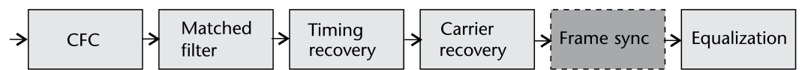

## 8.1　帧，你在哪里？

前几章讨论了频率校正、定时补偿与匹配滤波。同步的最后一方面就是帧同步。此时假设可用采样已表示单个符号、并已完成定时/频率/相位偏移校正。但现实系统中帧的起点仍然未知，需要做一次额外的校正或估计。图 8.2 直观展示了这个问题：一个已同步的示例帧带有未知偏移 $p$ 个采样。数学上，这就是信号 $y$ 中的未知时延：

$$u[n]=y[n-p],$$

其中 $p\in\mathbb{Z}$。有了估计 $\hat{p}$，就能从期望帧中提取数据、解调成比特，并执行最初施加于信号的任何信道译码或信源译码。估计方法多种多样，本章实现的思路围绕**互相关**展开。

依据接收机结构与波形，帧同步有可能放到解调之后进行——用一个特定比特序列标记帧首。但若下游均衡器需要符号，或前导码携带下游调制的配置参数，就不行。IEEE 802.11 [1] 就是后者的例子：前导码可以采用与载荷不同的调制。另外，若系统是分组制、不连续发射数据，仅凭比特很难把噪声与实际信号区分开——只看比特会丢掉信号的相对增益信息，而判断"信号是否存在"时这些信息很有用。

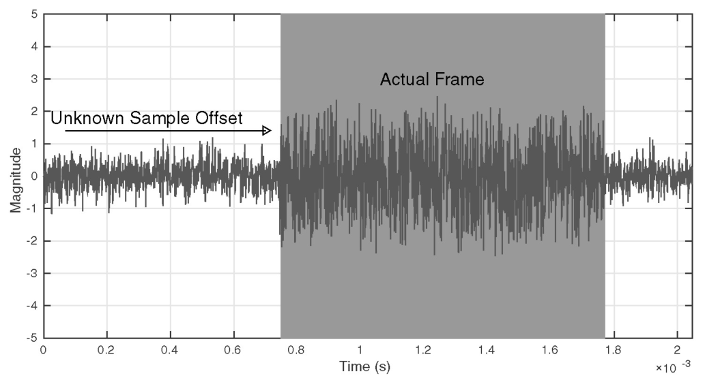

## 8.2　帧同步

确定给定帧起点的通用方法是使用**标记**（marker）——即使有线网络也是如此。但无线信号让这个问题变得更难，图 8.2 可见一斑（它其实用了标记）。由于信号噪声含量高，需要在调制前给帧附加专门设计的**前导码**序列。这类序列在接收端通常精确已知，并具有让帧估计准确的若干特性。图 8.3 概述了典型的帧排布：前导码、帧头与载荷数据。帧头与载荷在接收端未知，但会保持某种结构以便正确译码。


在讨论常用序列之前，先介绍一种"在未知采样时刻估计已知序列起点"的技术。设 $N$ 条不同的二进制序列 $b_n$（$n\in\{1,\ldots,N\}$），每条长 $L$。给定另一条二进制序列 $d$，我们想知道 $d$ 与这 $N$ 条序列各自的相似程度。互相关可以给出恰当的估计：

$$C_{d,b}(k)=\sum_m d^{\ast}(m)b_n(m+k),\tag{8.2}$$

它与卷积的差别只在第二项不做时间反转。当 $d=b_n$（某个 $n$）时，$C_{d,b}$ 相对其余 $n-1$ 条序列达到最大，且至少在第 $L$ 个索引处产生峰。利用这一概念即可构建帧起点估计器——如前所述，其中会包含称为前导码的已知序列。

窄带通信前导码的常用序列是 **Barker 码** [2]。Barker 码之所以被采用，是因为其自相关特性独特：非峰值相关极小乃至理想。具体地，这类码/序列 $a(i)$ 的自相关函数定义为

$$c(k)=\sum_{i=1}^{N-k}a(i)a(i+k),$$

满足

$$|c(v)|\le 1,\quad 1\le v<N.$$

但已知的 Barker 码只有 $N\in\{1,2,3,4,5,7,11,13\}$ 的九条序列，见表 8.1。图 8.5 给出了其中若干长度的自相关可视化：序列越长，中心峰越突出。通信系统中通常把多条这样的码拼接起来产生更长的序列以获得更好性能，也用于其他识别用途。

| N | 码 |
|---|---|
| 2 | −1, +1 |
| 3 | −1, −1, +1 |
| 4 | −1, −1, +1, −1 |
| 5 | −1, −1, −1, +1, −1 |
| 7 | −1, −1, −1, +1, +1, −1, +1 |
| 11 | −1, −1, −1, +1, +1, +1, −1, +1, +1, −1, +1 |
| 13 | −1, −1, −1, −1, −1, +1, +1, −1, −1, +1, −1, +1, −1 |

: comm.BarkerCode 的 Barker 码

用这些码我们实现了一个小例子（代码 8.1），展示 Barker 序列 $a(k)$ 如何在大数据集 $r(k)$ 中定位序列：把 Barker 码嵌入更大的随机序列中的未知位置 $p$（类似 8.1 节的误差模型），如图 8.4(a) 所示；再用 MATLAB 的 `xcorr` 函数做互相关，如图 8.4(b) 所示。互相关长度为 $2L_r-1$（$L_r$ 为 $r$ 的长度）。由于 `xcorr` 会给 $a$ 补零使其长度等于 $L_r$ [3]，相关结果中会出现至少 $L_r-L_a$ 个零（$L_a$ 为 $a$ 原长）。由图 8.5 可知峰出现在序列起点后 $L_a$ 个采样处。据此可直接确定期望序列的偏移位置：

$$\hat{p}=\underset{k}{\arg\max}\ C_{ra}(k)-L_r,$$

这正是图 8.4(a) 中估计所观察到的。`xcorr` 是 MATLAB 的有用工具，大序列时实际会用 `fft` 提速。既然第 2 章已知卷积是频域相乘、上面又有相关与卷积的关系，`xcorr` 采用该策略显而易见。但该过程实际会膨胀数据量——因为相关要求两序列等长。从图 8.4(b) 里的零就能看出这种膨胀。更高效的实现是用**滤波器**。抽头为 $b_i$ 的 FIR 滤波器输出 $y$ 可写为

$$y[n]=\sum_{i=0}^{N}b_i u[n-i],\tag{8.6}$$

其中 $u$ 是含感兴趣序列的接收信号。(8.6) 与 (8.2) 除时间反转外几乎相同。因此，要把 FIR 滤波器当互相关器用，只需把 $b_i$ 换成感兴趣序列的**倒序**。该实现不需要给感兴趣序列 $d$ 补零，且可在硬件中高效实现。

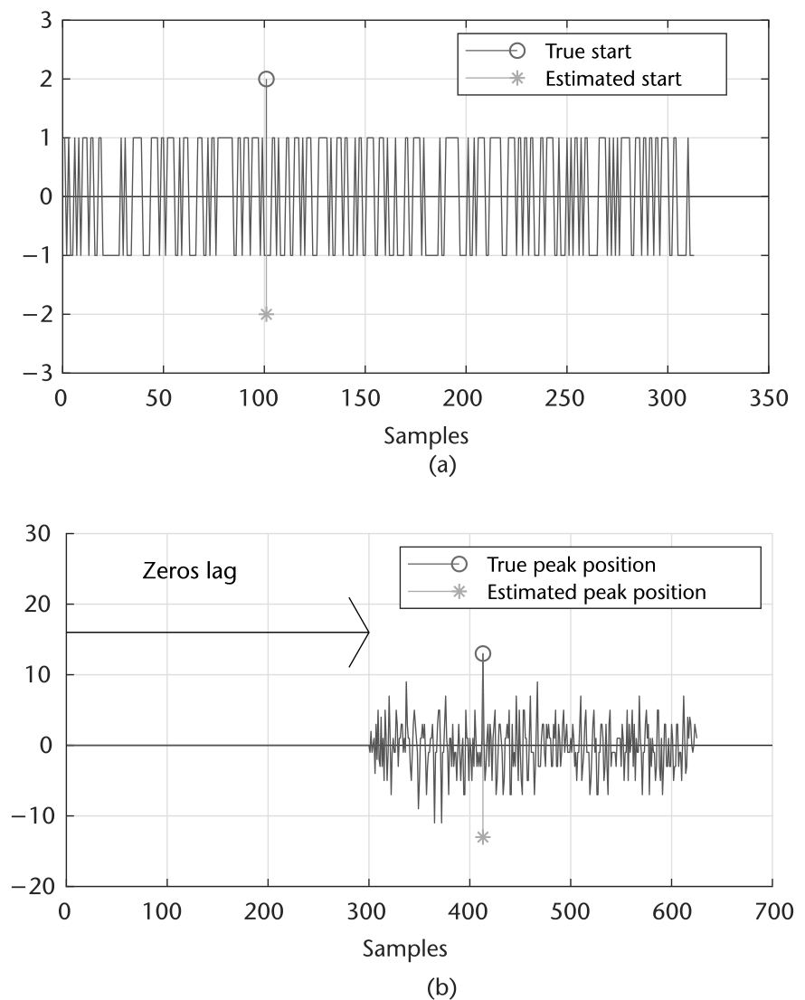

**代码 8.1　Barker 序列示例：barkerBits13.m**

```matlab
% Show Barker Autocorrelations search example
sequenceLength = 13;
hBCode = comm.BarkerCode('Length',7,'SamplesPerFrame', sequenceLength);
seq = hBCode(); gapLen = 100; gapLenEnd = 200;
gen = @(Len) 2*randi([0 1],Len,1)-1;
y = [gen(gapLen); seq; gen(gapLenEnd)];
corr = xcorr(y,seq);
L = length(corr);
[v,i] = max(corr);
% Estimation of peak position
% The correlation sequence should be 2*L-1, where L is the length of the
% longest of the two sequences
%
% The first N-M will be zeros, where N is the length of the long sequence
% and N is the length of the shorter sequence
%
% The peak itself will occur at zero lag, or when they are directly
% aligned. (Truncated in the original book.)
```

> **思考题**：基于代码 8.1，用 FIR 滤波器重新实现序列搜索。

### 8.2.1　信号检测

有了估计帧起点的方法，再考虑一个稍简单的问题：能否从相关结果判断"帧存在"？当希望按小块处理数据而非整帧工作时、或需要判断信道是否被占用时，这很有用。谈信号检测时，通常把它定义为**功率灵敏度**——接收机可检测的最小接收功率。但该灵敏度基于某个源波形，多数情况下无法泛化。因此这个值绝不应单独给出，除非相对某个标准传输。即使是奈曼–皮尔逊或贝叶斯这类正式检测理论方法，也必须对源信号有所了解或参照 [4]。IEEE 802.11ac 的接收机灵敏度要求具体定义为：在给定调制与编码方案下维持 10% 分组差错率的最小接收信号功率 [1]。

正式数学语境下，该过程退化为简单的二元假设检验：

$$H_0:\ \text{无信号},\qquad H_1:\ \text{有信号},$$

其中 $H_0$ 通常称为原假设，$H_1$ 称为备择假设。

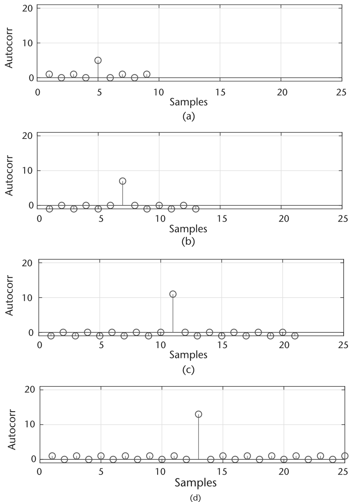

对原假设而言，由于没有主信号存在，接收信号只是射频环境中的噪声；对备择假设，接收信号是噪声与主信号的叠加。于是两个假设可表示为

$$H_0:\ r[n]=n[n],\qquad H_1:\ r[n]=x[n]+n[n],\tag{8.8}$$

其中 $r[n]$ 是接收信号，$n[k]$ 是射频环境噪声，$x[n]$ 是我们要检测的信号。基于观测 $r$，需要在描述该观测的两种统计情形之间做决断，可表达为

$$\delta(x)=\begin{cases}1, & x\in\aleph_1\\ 0, & x\in\aleph_1^{c}\end{cases}$$

当观测 $x$ 落在区域 $\aleph_1$ 内时选 $H_1$，落在区域外时选 $H_0$。因此上式称为**判决规则**——把观测映射到相应假设的函数 [5]。在分组检测的语境下，**门限化**其实就是判决规则的实现。

无论信号模型或检测器多么精确，由于加性噪声、有限观测与观测数据固有的随机性，感知差错不可避免 [6]。在检验 $H_0$ 对 $H_1$ 时可能犯两类错误：$H_0$ 被误拒或 $H_1$ 被误拒 [5]。前者：信道中实际无信号，检测却报信道占用——称**虚警**（Type I 错误）。后者：信道中实际有信号，检测却只报信道空闲——称**漏检**（Type II 错误）。虚警可能导致糟糕的数据恢复，而漏检会丢掉整帧数据、需要重传 [6]。

给定这两类错误，检测器的性能可由两个参数刻画：虚警概率 $P_F$ 与漏检概率 $P_M$ [7]，分别对应 Type I 与 Type II 错误，定义为

$$P_F=P\{\text{判}H_1\,|\,H_0\},$$

与

$$P_M=P\{\text{判}H_0\,|\,H_1\}.$$

注意由 $P_M$ 可导出常用参数——检测概率：

$$P_D=1-P_M=P\{\text{判}H_1\,|\,H_1\},$$

它刻画检测器识别信道中主信号的能力，故 $P_D$ 常称为检测器的**功效**。我们希望检测器虚警概率尽量低、同时检测概率尽量高。但现实中做不到——两参数相互制约。展示它们关系常用的图是**接收机工作特性**（ROC）[8]，如图 8.6 所示：x 轴为虚警概率、y 轴为检测概率。从图中可见 $P_D$ 增大时 $P_F$ 也增大，"最高 $P_D$ 且最低 $P_F$"的最优点不存在。因此检测问题也是一个折中——取决于如何平衡 Type I 与 Type II 错误。

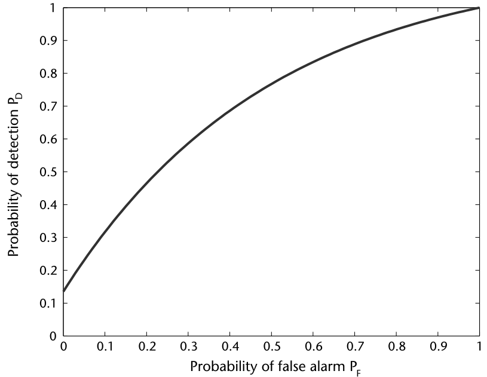

考虑检测信号在实现上的影响后，设计比代码 8.1 复杂得多。最基本的，检测成为相关器的门限化问题。目标变为确定验证峰值的参考或判据——它随信道噪声与 Pluto SDR 的自动增益控制可能剧烈变化。而且即使在仿真里，恰当的门限化也不好做，图 8.7(a) 与 (b) 可证：**无帧**时峰相对相关其余部分反而更大，**有帧**时更小。因此表现良好的实现应能处理这些情形、不依赖输入缩放。辅助门限化的常用技术是对接收信号做**自归一化**：回看图 8.7，幅度可能差异很大，使门限化难上加难；自归一化可把信号压到接近 $[0,1]$ 的范围。实现它的简单办法是用输入信号 $x$ 的平均能量缩放互相关度量 $C_{y,x}$。高效做法又是滤波——实现一个滑动平均滤波器。数学上该滑动平均建模为另一个求和：

$$u_{ma}[n]=\sum_{i=0}^{N}u[n-i],\tag{8.13}$$

其中 $N$ 是前导码（感兴趣序列）的长度。(8.6) 与 (8.13) 的好处在于都是简单 FIR 滤波器实现、便于硬件化。实际上 (8.13) 与 2.6.4 节讨论的 CIC 滤波器一样不需要乘法。这很重要：许多系统中帧同步器还兼任接收机最前端的分组检测机制，要求它以输入数据最快的速率运行、不能抽取。把 (8.6) 的相关器与 (8.13) 的缩放器组合，检测器可写为

$$H_0:\ \frac{y[n]}{u_{ma}[n]}<T\ \text{无信号},\qquad H_1:\ \frac{y[n]}{u_{ma}[n]}\ge T\ \text{有信号},\tag{8.14}$$

其中 $T$ 是门限值。

MATLAB 代码 `findSignalStartTemplate` 提供了一个模板，它漂亮地补偿了系统中的发射滤波器时延，给出给定分组在接收机的真实时延。

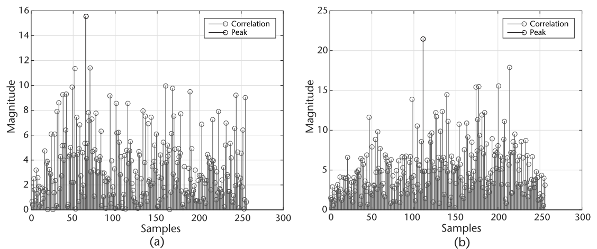

> **思考题**：从代码 8.2 出发，用 `xcorr` 与 `filter` 函数实现前导码起点估计器。在 SNR $\in$ [0, 12] dB（步长 1 dB）上评估估计精度。

**代码 8.2　Pluto 自环示例：findSignalStartTemplate.m**

```matlab
%% General system details
sampleRateHz = 1e6; samplesPerSymbol = 8; numFrames = 1e2;
modulationOrder = 2;  filterSymbolSpan = 4;
barkerLength = 26; % Must be even
%% Impairments
snr = 15;
%% Generate symbols and Preamble
bits = randi([0 3], modulationOrder*1e3,1);
hBCode = comm.BarkerCode('Length',7,'SamplesPerFrame', barkerLength/2);
barker = hBCode()>0; frame=[barker;barker;bits];frameSize = length(frame);
% Modulate
modD = comm.DBPSKModulator(); bMod = clone(modD);
modulatedData = modD(frame);
%% Add TX/RX Filters
TxFlt = comm.RaisedCosineTransmitFilter(...
    'OutputSamplesPerSymbol', samplesPerSymbol,...
    'FilterSpanInSymbols', filterSymbolSpan);
RxFlt = comm.RaisedCosineReceiveFilter(...
    'InputSamplesPerSymbol', samplesPerSymbol,...
    'FilterSpanInSymbols', filterSymbolSpan,...
    'DecimationFactor', samplesPerSymbol);
RxFltRef = clone(RxFlt);
%% Setup visualization object(s)
hts1 = dsp.TimeScope('SampleRate', sampleRateHz,'TimeSpan', ...
    frameSize*2/sampleRateHz);
hAP = dsp.ArrayPlot;hAP.YLimits = [-3 35];
%% Demodulator
demod = comm.DBPSKDemodulator;
%% Model of error
BER = zeros(numFrames,1);PER = zeros(numFrames,1);
for k=1:numFrames
    % Insert random delay and append zeros
    delay = randi([0 frameSize-1-TxFlt.FilterSpanInSymbols]);
    delayedSignal = [zeros(delay,1); modulatedData;...
        zeros(frameSize-delay,1)];
    % Filter signal
    filteredTXDataDelayed = TxFlt(delayedSignal);
    % Pass through channel
    noisyData = awgn(filteredTXDataDelayed,snr,'measured')
    % Filter signal
    filteredData = RxFlt(noisyData);
    % Visualize Correlation
    hts1(filteredData);pause(0.1);
    % Remove offset and filter delay
    frameStart = delay + RxFlt.FilterSpanInSymbols + 1;
    frameHatNoPreamble = filteredData(frameStart:frameStart+frameSize-1);
    % Demodulate and check
    dataHat = demod(frameHatNoPreamble);
    demod.release(); % Reset reference
    BER(k) = mean(dataHat-frame);PER(k) = BER(k)>0;
end
% Result
fprintf('PER %2.2fn',mean(PER));
```

### 8.2.2　替代序列

除 Barker 序列外，还有其他"除特定时刻外互相关极小"的序列。两个流行选择是 **Zadoff-Chu 序列**与 **Golay 互补序列**——它们都已是现行无线标准的组成部分。

Zadoff-Chu 序列以作者 Solomon Zadoff 与 David Chu 命名 [9]，用于 LTE 的同步与信道探测。它们的用处在于：幅度恒定、循环自相关为零、不同序列间相关极低。"序列间相关有限"这一性质在多用户同时发射的多址环境特别有用。数学上，序列号生成为

$$s_n=\exp\!\left[-j\pi\frac{kn(n+1+2q)}{L}\right],$$

其中 $L$ 是序列长度、$n$ 是序列索引、$q$ 是整数、$k$ 与 $L$ 互素。与纯整数 ±1 的 Barker 序列不同，Zadoff-Chu 序列是复数值的。

第二个感兴趣的序列是 **Golay 互补序列**，目前用于 IEEE 802.11ad，同样用于 802.11ad 分组前导码内的信道估计与同步。Golay 互补序列是具有极小自相关特性的双极性符号序列，概念上与 Barker 码非常相似。但顾名思义，这些序列以**互补对**的形式出现，通常记为 $G_a^n$ 与 $G_b^n$（$n$ 为序列长度）。IEEE 802.11ad 使用 $G_{a32},G_{a64},G_{b64}$ 等对。这些序列配 BPSK 非常出色——即使在严重相位旋转下自相关性能依然很高。Golay（确切说 Ga/Gb 对）的另一个重要方面是自相关可以在硬件中**并行**执行——这对瞄准 7 Gbit/s 传输速率的 802.11ad 这类标准非常有用 [10]。基于"极小自相关对 + 并行处理"的概念，802.11ad 的前导码可以仅凭自相关特性就向接收机传递信令信息：依据分组类型，可用一组相关器库识别特定结构，把接收机的处理引导到该类分组的特定译码路径。

## 8.3　组装成整体

至此我们已集齐构建无线接收机的全部要件——它能应对载波偏移、定时失配与随机分组时延。趁工具齐备，正好把系统当作整体来谈，依据系统需求确定组件的排布。关于算法排布的讨论将基于前几章所学。

从接收机前端开始，要先完成两个目标：载波偏移去除与接收信号的定时同步。在目前已提出的系统中，我们先在接收链实现定时恢复，但这要求使用对相位旋转不敏感的 TED。按第 6 章的选项，这需要 Gardner 这类技术或 Harris 的多相类实现 [11]。也可以在第 7 章所述 FFC 之后再做定时恢复，但系统中可能残留相位噪声。接收机排布类似图 8.8。不过，把 CFO 放在所有处理之前（甚至匹配滤波之前）确实有用——可减轻接收链中其他恢复算法的负担。话又说回来，把 CFO 放在匹配滤波**之后**会让 CFO 估计更准——因为那时接收信号已 SNR 最大化。这些情形都得权衡。

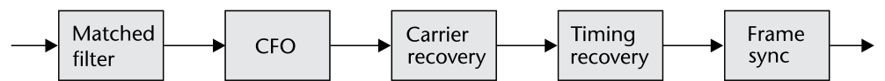

图 8.9 概述了一种可行的接收机流程，标注了各恢复级之间的相对采样率 $R_n$。虚线框的块（匹配滤波与 CFO）是可选的——发射机用了 RRC 滤波或载波偏移不严重时可省。我们把 CFO 特意放在匹配滤波之前，因为匹配滤波会压缩 CFO 可利用的带宽。关于速率：$R_m\ge R_k$（$m<k$），即系统绝不会在下游上采样或以更快速率运行。总的说，下采样只可能发生在两个阶段：匹配滤波与定时恢复。两处都不是必须的，但各有好处。例如在匹配滤波级抽取能提供有用的平均，使符号更易分辨；从硬件角度，抽取降低采样率与下游处理的约束，降低下游环路中密集运算的时钟率下界。考虑定时恢复算法时，第 6 章已知所用 TED 对 $R_n$ 有特定要求；给定时恢复环更多每符号采样通常性能也更好。

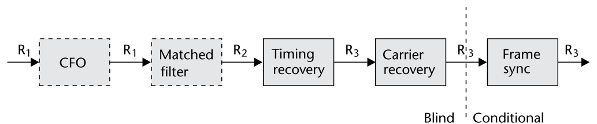

图 8.9 中，我们在载波恢复与帧同步块之间把系统划分为两个域：**盲**与**有条件**。这是为了区分哪些处理块依赖实际发送的数据、哪些块对此基本"失明"。可以利用这一设计特点向系统引入**训练数据**——在实际数据需要恢复之前，帮助系统中的恢复环收敛到锁定状态。这类配置中，可以在每帧前附加（或连续地在数据帧之间发送）按实际数据同样方式调制滤波的随机比特，使接收机保持锁定，消除系统中的收敛时延。硬件上可以直接把线性反馈移位寄存器（LFSR）接到调制器——这是生成随机比特的便利机制；MATLAB 中对应 `comm.PNSequence` 系统对象。收敛之后或许不必连续发训练数据，系统吞吐量随之提高。

用 Pluto SDR 实现系统（或仿真）时，向系统引入训练信息很有帮助。该配置中，图 8.9 的帧同步块充当下游处理的网关——只有检测到前导码或标记才放行数据。

### 8.3.1　Pluto SDR 完整恢复

过去三章我们介绍了代码模板并指导了 Pluto SDR 场景的实现。但涉及完整帧恢复与数据实际解调时，需要再强调一些实现细节。接收机是需要大量处理组件的复杂系统，实时运行不应作为最初目标；等接收算法跑通后再扩展到实时（若有需要）。因此实现时应聚焦代码模板 5.3、5.4 与 5.5。在两次调用 Pluto SDR 之间做处理（类似代码 5.6）很可能导致溢出与丢数据，完整帧恢复会很困难。

第二个重要工具是 Pluto SDR 的 `transmitRepeat` 方法（如示例代码 5.7）——它确定性地连续发送数据。接收端由于发射机来的时延是随机的，应始终至少采集 $2L$ 个采样（$L$ 为期望帧长）。把 Pluto SDR 的 `SamplesPerFrame` 属性设为 $2L$ 即可保证发射机处于 `transmitRepeat` 模式时至少收到一个完整分组。第 4、7 章不需要这样做——溢出丢点对测试影响甚微；但检查完整帧时这是头等大事。代码 8.3 是个简单的范例：例中我们实际多次 step 接收机，清空其 IIO 缓冲中可能的陈旧数据。

**代码 8.3　捕获重复帧：captureExample.m**

```matlab
% Transmit frame repeatedly
tx = sdrtx('Pluto');
tx = sdrtx('Pluto','SamplesPerFrame',length(frame)*2);
tx.transmitRepeat(frame);
for k=1:4,rx();end; % Remove stale data from buffers
rxBuffer = rx();
```

> **思考题**：用代码 8.3 的模板与第 6、7 章及本章开发的同步功能块，开始估计分组的起点。先用 transmitRepeat 采集 L×N 个采样（N = 1, 2, 3, 4, 5）。你的分组检测器应能对每个 N 至少定位 L×(N−1) 的数据。评估系统随分组数增长的表现。采集 1,000 个分组并确定你的检测概率（试着每次采 10 个分组并重复该过程）。

评估完整恢复帧的一个有用工具是**循环冗余校验**（CRC）——它给出分组是否含错的二元判定。MATLAB 的 Communication Systems Toolbox 方便地提供了 `comm.CRCGenerator` 与镜像检测器 `comm.CRCDetector` 两个系统对象。代码 8.4 展示了调用方式，两个对象都用多项式 $z^3+1$。CRC 的工作方式是在数据末尾附加长度 $L_c$ 的序列（校验和）。$L_c$ 等于多项式的阶数——代码 8.4 中是 3。该多项式决定比特如何组合（异或）生成校验和。$L_c$ 越大，8.2.1 节所述 Type I/II 错误的概率越低——但也依赖于校验和所覆盖的数据长度。实践中，一个校验和覆盖的数据量比 $L_c$ 大若干数量级。对我们的帧同步测试，可在发射帧里用 CRC 轻松检查是否恢复了全部发射比特。

**代码 8.4　Pluto 自环示例：crcExample.m**

```matlab
x = logical([1 0 1 1 0 1 0 1 1 1 0 1]');
crcGen = comm.CRCGenerator('z^3 + 1');
crcDet = comm.CRCDetector('z^3 + 1');
codeword = crcGen(x);
codewordWithError = codeword; codewordWithError(1) = ~codewordWithError(1);
[tx, err]   = crcDet(codeword);
[tx1, err1] = crcDet(codewordWithError);
```

> **思考题**：再用代码 8.3 的模板与第 6、7 章及本章的同步功能块估计分组起点。这次发射前往每帧附加 CRC。接收端解调恢复的符号，对 1,000 个分组检查 CRC 值。重复该过程，但改为计算每个恢复帧的误码率，跳过丢失的帧。

## 8.4　信道编码

现在我们已能跨无线链路成功恢复数据，可以讨论让这一过程更稳健的技术了。信道编码是显然的选项，在任何数字通信标准中无处不在。

### 8.4.1　重复编码

任何通信系统的关键构件之一是**前向纠错**（FEC）：向发射流添加冗余数据，使其对信道差错更稳健。FEC 技术有很多种，例如重复编码——每个发射比特重复多次。本节我们一起实现一个简单重复编码器（重复因子 $R=4$），探索对抗数据传输差错的一种技术。重复因子 $R=4$ 的重复编码器是什么意思？简单定义：若要发射符号"0"，该"0"会被重复编码器重复四次，输出"0000"。

先从双击重复编码器块开始——会打开 MATLAB 函数块编辑器，可以在其中编写自定义 MATLAB 代码。如前所述，设断点是理解与调试 M 文件的好办法。断点及其调试用法详见附录 B。

> **注**：MATLAB 的 `repmat` 函数可用于实现简单的重复编码方案。例如要把向量 u 重复 4 次，可用表达式 `y=repmat(u,4,1);`。

> **思考题**：选择高重复因子与低重复因子时要考虑哪些折中？

### 8.4.2　交织

重复编码是通信系统工程师增强数据传输稳健性的若干有用工具之一，但有时并不够——它没有解决"大块连续数据被损坏"的问题。例如发射机发送数据流"101101"，重复因子 4 的重复编码器输出

$$111100001111111100001111,$$

每个输入比特重复四次。该编码看似稳健，但传输中仍可能发生跨多个连续比特的显著噪声突发，损坏大量二进制数字，得到如下结果：

$$1111\,00\,------\,1100001111,$$

其中部分原始数据彻底无法恢复。

> **思考题**：为什么即使有重复编码，数据传输仍可能受严重影响？还能做什么让它更稳健？

**交织**（interleaving）是把二进制数据重新排序、显著降低序列内各比特间相关性的方法。由于差错通常发生在连续的一串比特上，发射前交织比特序列、接收端解交织截获序列，可把比特差错分散到整个序列上，从而最小化其对传输消息的影响。简单交织器会把重复的比特打乱，使数据中的冗余对差错更稳健：它把重复的比特彼此穿插重排，确保即使连续丢一串比特、每个比特至少有一份冗余副本到达。例如用交织步长 4，即按索引 $[1,5,9,\ldots,2,6,10,\ldots]$ 重排向量。于是"111100001111111100001111"经此交织器输出：

$$101101101101101101101101.$$

交织步长可取数据长度的任何因子。不同的混合算法会改变交织器的有效性。

> **注**：MATLAB 的 `reshape` 函数可用于实现交织。

实现交织器后，把重复编码器与交织器组合成单个 FEC 子系统。上文介绍的简单交织技术对我们的实现已足够，但交织还有其他多种形式，接下来两节考察。

#### 8.4.2.1　块交织

第一种交织方法是**块交织器**，如图 8.10 所示。块交织是重排比特序列的一种方法：$N\times M$ 个比特按列填入 $N$ 列 $M$ 行的矩阵，再把得到的各行串行拼接从交织块输出。发射端，块交织器逐列装入 $N$ 个码字（每个长 $M$ 比特），然后逐行发出直至交织器排空，再重新装入、循环往复。块交织器的主要缺点是逐列填充带来的时延 [12]。

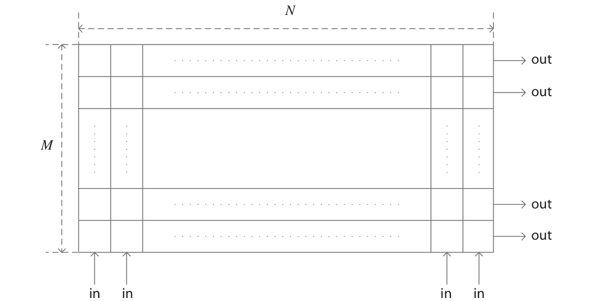

#### 8.4.2.2　卷积交织

另一种方法是**卷积交织器** [13]，如图 8.11 所示。发射端，比特序列移入一组 $N$ 个寄存器，每个的缓冲存储量递增；寄存器组中的比特经换向器重新合并并发送过信道。接收端执行逆过程恢复原序列。与块交织器相比，卷积交织器把存储需求降低约一半 [14]；但初始填充相关的时延问题依然存在。

![卷积交织器示意图（据 [13]）](images/fig_0812.png)

### 8.4.3　编码

除了交织多份数据，还可以把数据**编码**成引入冗余的替代表示。许多编码方案的独特性质是：引入冗余而数据量不按整数倍增长。例如重复因子 $R=2$ 的重复编码（FEC 讨论中通常取倒数称为码率 $\frac{1}{2}$），而卷积编码的码率可以更接近 1——效率更高、有效吞吐量更大。本节讨论几种常见信道编码方案的基本工作原理。总体而言，信道编码是信息论中数学上复杂的领域；我们不深入这些方案的理论设计，而是比较其相对性能与部分实现细节及缺点。

与交织器类似，编码器通常分两类：**块编码器**与**卷积类编码器**。块编码器处理特定预定义的比特组/块；卷积编码器处理大小不定的数据流，必要时也可按块处理。

第一种要讨论的是 **Reed-Solomon（RS）码**——20 世纪 60 年代发展的线性块码。RS 码通过向给定帧/数据块中插入符号来纠正发生的符号差错。定义 $M$ 为给定帧的长度（有时称消息长度）、$E$ 为编码后的帧长，则可纠正最多 $\lfloor\frac{E-M}{2}\rfloor$ 个符号。RS 的有趣之处还在于它甚至能告知实现中发现并纠正了多少错误。不过 RS 编码器对可处理的输入比较挑剔——这就是我们到目前为止只谈符号不谈比特的原因。RS 能编码的符号是 $[0,2^N-1]$ 之间的整数，$N$ 是有限伽罗瓦域 $GF(2^N)$ 的指数。伽罗瓦域是定义了某些数学运算、含有限个对象的域（集合）。由该定义，$E$ 与 $N$ 会有一些限制，但超出本书范围。译码时 RS 正是利用这个集合——依据接收数据与 $M,E,N$ 的选择收缩解空间。

实现角度可以论证：RS 码适合**突发**差错场景——相邻一片符号被损坏的情形。考虑发射比特时，每个符号代表 $B$ 个比特；RS 按符号操作，可一次纠正一组内 $B$ 个比特。因此一组内损坏 $B+1$ 个比特的突发差错最多损坏 2 个符号。

与 RS 类似的是 **Bose-Chaudhuri-Hocquenghem（BCH）码**，同样依赖伽罗瓦域概念。与 RS 不同，BCH 码更擅长纠正**不成群**的差错。为了降低数据成群的概率，可以在收发前后对比特做打乱/扰码以降低差错局部性——这对差错稀疏时的 BCH 更有利，但对 RS 则在一定程度上是坏事。相同校验比特数下 BCH 能纠正更多错误，但一般而言 BCH 译码比 RS 更耗算力。

最后一种要考虑的主流块码是**低密度奇偶校验（LDPC）码**——它甚至已经开始取代长期占主导的 Turbo 码（马上讨论）。LDPC 码早在 1960 年代就存在，但因其复杂度近十年才被硬件实现考虑。由 Robert Gallager 发展的 LDPC 码在特定冗余率下可逼近理论上的香农极限 [15]——RS 与 BCH 做不到。但使用 LDPC 所需的计算量高得多。它仍存在于 802.11n 与 DVB-S2 标准的某些模式中。使用 LDPC 时，实现者必须选定编码器与译码器使用的**奇偶校验矩阵**，矩阵特性决定码的性能。性能强的码通常块长很大，如 IEEE 802.11n/ac 的 648、1296、1944——这意味着许多场合下需要比其他码编码多得多的比特才能高效使用 LDPC。

除块码外，替代的**流式**编码实现是**卷积码**。这类码对数据做卷积式编码——冗余经由"信息接连通过编码器/译码器"引入，本质上是让相继的符号或比特相互依赖。卷积编码器用例子最好理解。考虑 $R=2$、带三个寄存器的递归编码方案。图 8.12 给出了这种编码器的可能结构：每推入一个比特输出两个。注意当前输出至少依赖最近三个输入——类似 FIR/IIR 滤波器的记忆。图 8.12 可以解读为两条方程，见 (8.16)：

$$y_{n,1}=(x_n+x_{n-2}+x_{n-3})+x_{n-1}+x_{n-3}$$
$$y_{n,2}=x_{n-2}+x_{n-3}\tag{8.16}$$

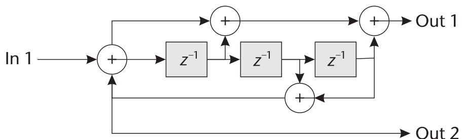

译码器正是利用数据中的这种依赖来去除可能发生的差错。完成该任务最流行的算法是 **Viterbi 算法** [15]，有时称网格（trellis）算法或译码器。Viterbi/网格译码器的思想是回溯先前做过的判决、利用它们最好地确定当前最可能的比特或采样。这自然引出图 8.13，也正是"网格"之名的由来。图 8.13 中最左侧的位置代表最近收到的符号或比特；连接圆点的线代表可能的先前符号，其中粗灰线代表依据先前判决更可能的符号。该网格的深度称为**回溯长度**——回溯越深、比特恢复越好。但该过程在回溯约 34 个符号附近趋于平台，且回溯越深、译码单个符号耗时越多。回溯限制可见图 8.14：对 16-QAM 信号考察了多种回溯长度随 $E_b/N_0$ 的表现。

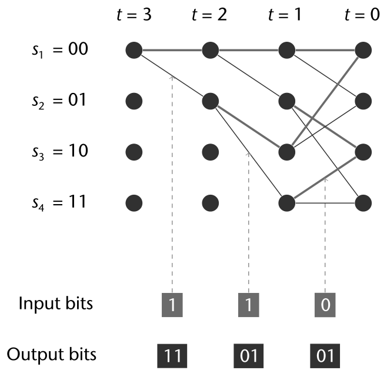

1990 年代早期引入的 **Turbo 码**属于卷积码家族 [16]，曾被第三、四代蜂窝标准大量用作主 FEC 方案。与 LDPC 一样，Turbo 码可工作在香农极限附近，但计算量比 LDPC 低、纠错性能也差一些。Turbo 内部本质上使用 Viterbi 算法译码，外加交织、以及一组译码器并在其间做似然估计。这是对 Turbo 译码器实际工作方式的极度简化——分析其操作是非常困难的领域。但只要硬件资源能在必要速度上实现译码器，它就是非常强大的编码技术。

使用 FEC 时应始终权衡：计算复杂度、所需性能、链路允许的编码开销。这很重要——清晰的传输信道可能不需要重编码，更接近 1 的码率能换来额外吞吐量。因此 LTE 与 IEEE 802.11 等现代标准采用**自适应调制与编码方案**（MCS）：降低编码冗余、提高调制阶数，使链路吞吐量大增。IEEE 802.11 本身有 32 个 MCS 状态/索引，表 8.2 给出前四项，供体会码率与调制如何折中冗余与数据率。

| MCS 索引 | 流数 | 调制 | R | 数据率 (Mbits/s) |
|---|---|---|---|---|
| 0 | 1 | BPSK | 1/2 | 6.5 |
| 1 | 1 | QPSK | 1/2 | 13 |
| 2 | 1 | 16-QAM | 3/4 | 19.5 |
| 3 | 1 | 16-QAM | 1/2 | 26 |

: IEEE 802.11 的调制编码方案简表（据 [1]）

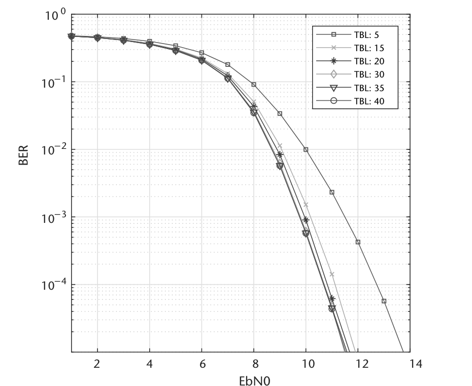

MATLAB 提供了到目前为止讲过的全部编码技术。但某些高级码用起来更复杂，尤其在不同模式下。例如 Turbo 译码器因其工作方式需要信道估计来正确确定信道噪声方差——接收机设计中必须提供该信息才能有效译码。LDPC 如前所述需要奇偶校验矩阵：MATLAB 默认提供 DVB 的矩阵，每块要求 32,000 比特——对许多应用相当不合理；设计更小的矩阵可能很复杂，超出 MATLAB 所提供工具的范围。尽管如此，RS、BCH 与通用 Viterbi 译码开箱即用极其方便、参数化简单。

### 8.4.4　BER 计算器

考察过若干保护数据传输免受干扰与噪声的技术后，现在需要定量测量这些技术表现的方法。回顾第 4 章：BER 是评估与比较数字通信系统的常用指标。计算 BER 最直接的办法是数一数收到的信息比特、再确定其中哪些错了——即误比特数与总接收比特数之比给出近似的 BER。注意接收比特越多，该链路级指标越准。

## 8.5　本章小结

本章通过相关技术考察了帧同步的概念，并通过冗余插入覆盖了一些常见信道编码技术。随着同步的最后一块拼图就位，可以实现完整帧恢复的完整接收机。本书至此讨论过的接收机算法的各种可行排布也已考察，聚焦设计层面的要求。完整同步讲完之后，我们转向通过编码实现让链路更稳健的技术，包括它们在实现与使用上的优缺点讨论。

## 参考文献

[1] IEEE, *Standard for Information Technology–Telecommunications and Information Exchange between Systems Local and Metropolitan Area Networks–Specific Requirements–Part 11: Wireless LAN Medium Access Control (MAC) and Physical Layer (PHY) Specifications–Amendment 4: Enhancements for Very High Throughput for Operation in Bands below 6 GHz*, IEEE Std 802.11ac-2013, December 2013, pp. 1–425.

[2] Barker, R. H., "Group Synchronizing of Binary Digital Sequences," in *Communication Theory*, London: Butterworth, 1953, pp. 273–287.

[3] The MathWorks Inc., "xcorr" [online], 2017. https://www.mathworks.com/help/signal/ref/xcorr.html.

[4] Kay, S. M., *Fundamentals of Statistical Signal Processing, Volume II: Detection Theory*, Upper Saddle River, NJ: Prentice Hall, 1998.

[5] Poor, H. V., *An Introduction to Signal Detection and Estimation*, New York: Springer, 2010.

[6] Zhao, Q., and A. Swami, "Spectrum Sensing and Identification," in *Cognitive Radio Communications and Networks: Principles and Practice*, Burlington, MA: Academic Press, 2009.

[7] Kay, S. M., "Statistical Decision Theory I," in *Fundamentals of Statistical Signal Processing, Volume II: Detection Theory*, Upper Saddle River, NJ: Prentice Hall, 1998.

[8] Shanmugan, K. S., and A. M. Breipohl, "Signal Detection," in *Random Signals: Detection, Estimation and Data Analysis*, Wiley, 1988.

[9] Finger, A., *Pseudo Random Signal Processing: Theory and Application*, Hoboken, NJ: Wiley, 2013.

[10] IEEE, *Standard for Information Technology–Telecommunications and Information Exchange between Systems–Local and Metropolitan Area Networks–Specific Requirements–Part 11: Wireless LAN Medium Access Control (MAC) and Physical Layer (PHY) Specifications Amendment 3: Enhancements for Very High Throughput in the 60 GHz Band*, IEEE Std 802.11ad-2012, December 2012, pp. 1–628.

[11] Harris, F. J., and M. Rice, "Multirate Digital Filters for Symbol Timing Synchronization in Software Defined Radios," *IEEE Journal on Select Areas in Communications*, Vol. 19, October 2001, pp. 2346–2357.

[12] Jacobsmeyer, J. M., *Introduction to Error-Control Coding*. http://www.pericle.com/papers/Error_Control_Tutorial.pdf.

[13] Forney, G. D., "Burst-Correcting Codes for the Classic Bursty Channel," *IEEE Transactions on Communications*, COM-19, 1971, pp. 772–781.

[14] Sklar, B., *Digital Communications Fundamentals and Applications*, Upper Saddle River, NJ: Prentice Hall, 1988.

[15] Anderson, J., and S. Mohan, *Source and Channel Coding: An Algorithmic Approach*, New York: Springer, 1991.

[16] Berrou, C., *Error-Correction Coding Method with at Least Two Systematic Convolutional Codings in Parallel, Corresponding Iterative Decoding Method, Decoding Module and Decoder*, US Patent No. 5,446,747, 1995.
