# 第 9 章　信道估计与均衡

本章介绍信道估计与信道均衡的概念。先讨论一个简化的误差模型，再给出向通信系统添加均衡器的若干实用策略，具体涵盖判决引导与基于训练两种均衡设计。均衡器是件趁手的工具——环境中的众多失真源以及节点自身之间的失配，都可以交给它处理。

对照图 9.1 的接收机框图，本章处理最后一个功能块——均衡（已高亮）。

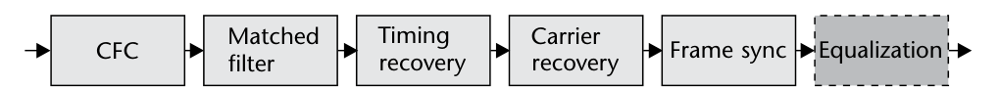

## 9.1　多径，休想！

前几章聚焦发射与接收节点间的同步。把前几章组合起来，帧恢复已经可能，我们已站在成功译码帧的门槛上。但某些场景下这些实现还不够。假设接收信号 SNR 充足，环境中剩下的挑战就是**多径**与其他加性干扰。多径由信道的色散特性引入：发射信号沿不同路径到达接收机的、经过缩放的反射。由于这些反射走过不同路径，从接收机的视角看它们会经历不同的衰减与时延。这些损伤自然可看作发射信号的"回波"，用 FIR 滤波器即可轻松建模。

首个接收信号与最后一个回波之间的时间差定义为信道的**时延扩展** [1]。图 9.2 与图 9.3 给出了多径的物理表示，以及视距（LOS）信号加两个散射体产生的时域表示。这是多径的射线追踪表示；现实中多径是信号辐射特性造成的连续反射，射线追踪是该连续统的离散化——因为远比连续模型容易理解与数学建模，所以常用。

当时延扩展相对信号带宽很长时，多径效应会对接收信号造成显著失真，产生第 6 章讨论过的码间串扰（ISI）。时延扩展是环境的函数，设计系统时必须考虑。例如室外环境多径距离大，会产生大的时延扩展。数学上，散射体多走的距离 $D$ 与对应的采样时延 $t_s$ 的关系为

$$t_s=\frac{B\times D}{c},$$

其中 $c$ 是光速。20 MHz 的 Wi-Fi 信号要多走约 15 米才产生一个采样的时延。因此常用于室内的 Wi-Fi 时延扩展小；不过信道距离短，反而可能存在大量高功率散射体。由于路径损耗，干扰信号的功率与时延扩展通常成反比。

数学上，接收多径信号 $r$ 可建模为：发射信号 $x$ 在随机时延偏移 $\Delta_n$ 上、带相关增益 $\alpha_n$ 的冲激串：

$$r(t)=\mu(t)+\sum_{n=1}^{N}\alpha_nx(t-\Delta_n),\tag{9.2}$$

其中有 $N-1$ 个散射体、$\mu$ 是附加干扰或噪声。只要 $\mu$ 与 $x$ 不相关且是周期或自回归的，就能把它从信号空间有效滤除 [2]。存在多径时，接收端会经历 ISI。图 9.4 演示了这一情形——观察 QPSK 信号 $r$：符号随时间拖尾（smearing），在星座图上表现为符号漂移。基于 (9.2)，用 FIR 滤波器即可简单建模多径效应。

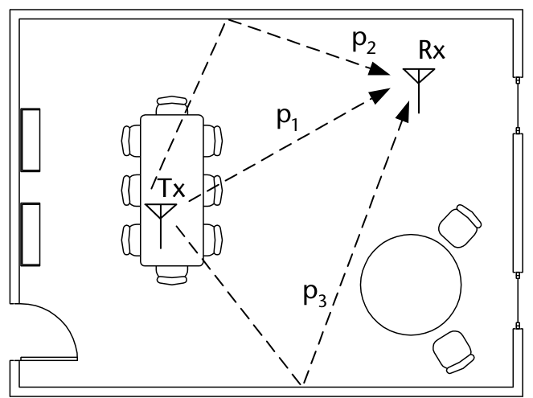

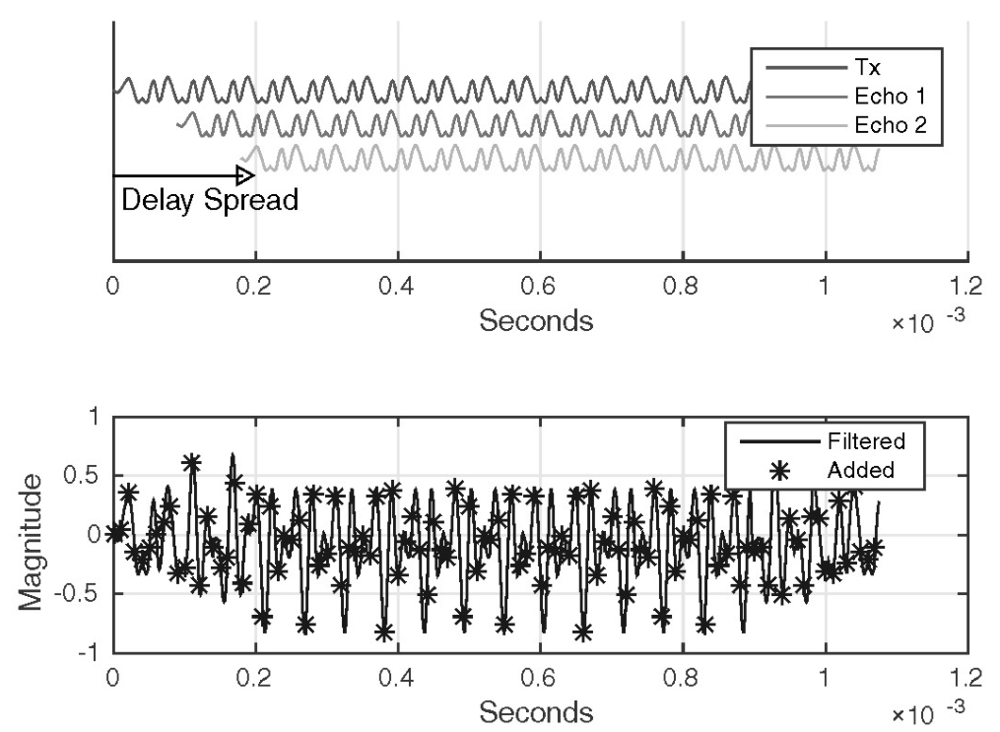

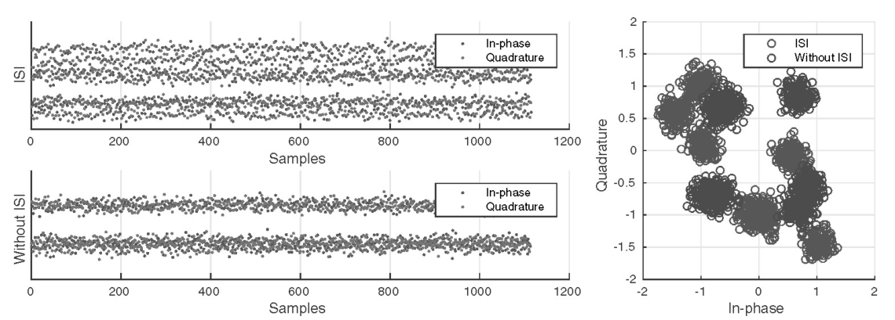

## 9.2　信道估计

在考虑校正给定信道的效应之前，可以先换个角度：估计这个未知信道。信道估计（相对信道均衡）是个理想的起点——仿真中有已知解可供比对；而均衡依据信道与噪声条件未必给出唯一解。做信道估计，我们将使用 Widrow 与 Hoff 提出的**最小均方**（LMS）算法 [3]。LMS 是梯度下降/牛顿法类算法，可视为信号处理的标准自适应滤波算法。LMS 利用发射序列中已知的信息或符号来估计接收数据的损坏——这里把损坏建模为 FIR 滤波器。图 9.5 给出了信道估计的常用框图，用于辅助推导系统实现。替代的自适应滤波算法确实存在，如递归最小二乘（RLS）——许多情形下优于 LMS。但 RLS 设计不当时有稳定性隐患，且因需要矩阵求逆而计算更复杂。RLS 超出本章范围，Haykin [4] 是不错的参考。

图 9.5 展示了信道估计系统的各部件：未知静态信道 $h$ 作用于训练数据 $x(t)$。系统的目标是让 $h$ 与 $\hat{h}$ 匹配、把误差压到零。为此，自适应算法需要误差信号 $e(n)$ 与原始信号 $x(t)$。我们用 LMS 估计未知信道滤波器 $h\in\{L\times 1\}$，其估计定义为 $\hat{h}\in\{M\times 1\}$（$M\ge L$）。对经过信道滤波器 $h$ 的发射信号 $x(t)$，$h$ 可用如下递归算法估计：

$$y(n)=\hat{h}^{H}(n)x(n)\tag{9.3}$$

$$e(n)=r(n)-y(n)\tag{9.4}$$

$$\hat{h}(n+1)=\hat{h}(n)+\mu x(n)e^{\ast}(n)\tag{9.5}$$

其中

$$x(n)=[x(n),x(n-1),...,x(n-M-1)]^{T}.\tag{9.6}$$

$\mu$ 是控制收敛速率与稳定性的步长。步长的选择与实现相关，但应落在 $0<\mu<\frac{2}{\lambda_{\max}}$ 范围内，其中 $\lambda_{\max}$ 是真实信道自相关 $\mathbf{R}=E[\mathbf{h}\mathbf{h}^{H}]$ 的最大特征值。由于 $h$ 未知，一个更宽松也更安全的界是 $M\sigma^2$（$\sigma^2$ 为 $r(n)$ 的方差）。LMS 稳定性分析的更多信息可查 Haykin [4] 第 9 章。

信道长度 $L$ 对具体环境是未知量，但通过测量与信道环境的物理特性，可以为合理长度做出估计。这关联到前面关于时延扩展的讨论——时延扩展就是信道长度的另一种描述。标准委员会常做研究为接收机设计者提供指引。

(9.3)–(9.6) 可以用一个简单递归实现（代码 9.1 第 8–17 行），需要 $2L+1$ 次乘法与 $L+1$ 次加法。对 $L=M=2$，考察 $\hat{h}$ 的均方误差（MSE）随时间在解空间等高线图（图 9.6）上的轨迹，可观察 LMS 下降到真解的路径。图 9.6 演示了估计 $\hat{h}$ 从四个随机起始位置的下降。等高线图是自适应滤波理论中刻画估计演化的常用分析工具。但当 $M>2$ 时无法在等高线上轻松可视化所有误差维度，就改用类似图 9.7 的 MSE 图。

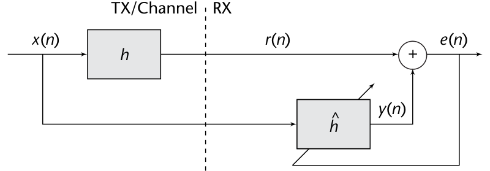

**代码 9.1　LMS 信道估计：chanEst.m**

```matlab
h = [0.5; 1; -0.6]; % Channel to estimate
mu = 0.01; % Stepsize
trainingSamples = 1000;
x = sign(randn(trainingSamples,1)); % Generate BPSK data
r = filter(h,1,x); % Apply channel
L = length(h); h_hat = zeros(L,1);
%% Estimate channel
for n = L:trainingSamples
    % Select part of training input
    in = x(n:-1:n-L+1);
    % Apply channel estimate to training data
    y = h_hat'*in;
    % Compute error
    e = r(n)-y;
    % Update taps
    h_hat = h_hat + mu*conj(e)*in;
end
```

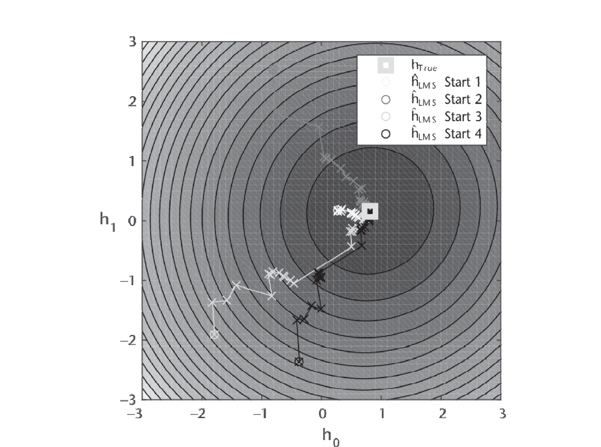

还可以进一步扩展代码 9.1，把信道估计的形状也可视化，更好地理解设计的精度。考察响应（尤其对相当恶劣的信道）对确定均衡器设计的参数化非常有用。代码 9.2 给出了可视化信道响应与估计的示例，用了 `freqz` 函数——它用 `fft` 计算数字滤波器响应。

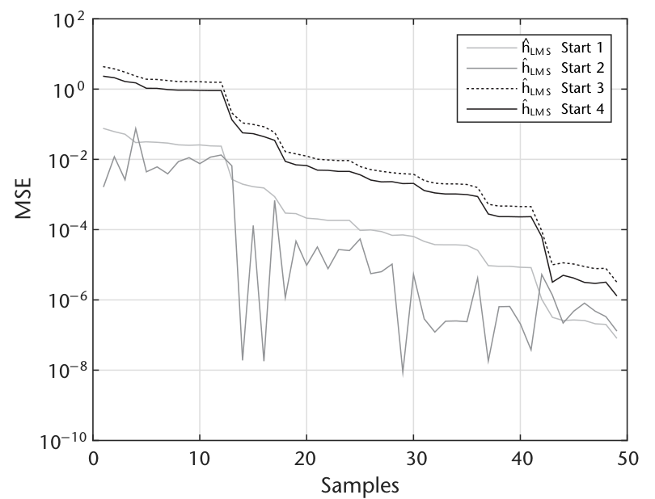

**代码 9.2　绘制响应：chanEst.m**

```matlab
%% Plot responses
Fs = 1e6; N = 64;
htrue=freqz(h,1,N,Fs,'whole');
[hb,we]=freqz(h_hat,1,N,Fs,'whole');
semilogy(we,abs(hb),'b')
hold on;semilogy(we,abs(htrue),'bo');hold off
grid on;xlabel('Frequency (Hz)');ylabel('Magnitude');
legend('Channel Est','Channel Actual','Location','Best');
```

图 9.8 给出的响应与估计非常准确。但随着系统引入噪声、信道变得更复杂，估计会变差。不过，只要 LMS 算法已收敛，误差应只受所选步长 $\mu$ 与信道噪声的限制。

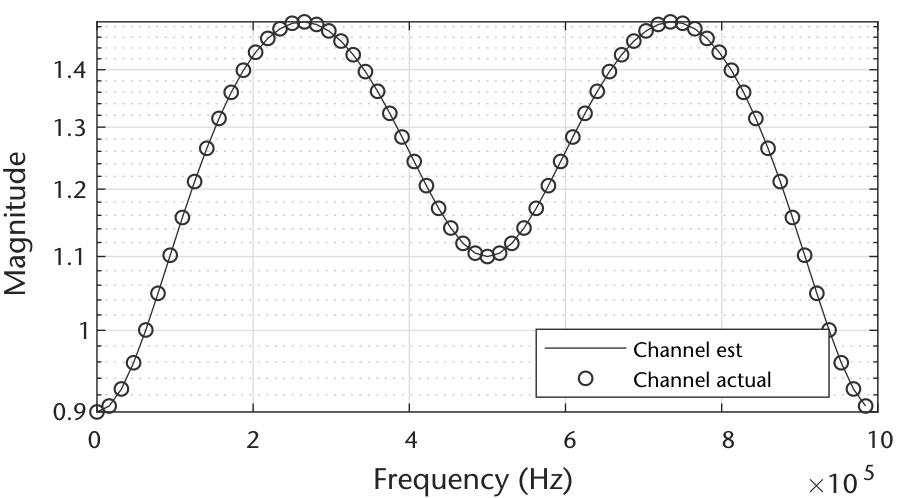

## 9.3　均衡器

与信道估计不同，**均衡器**试图撤销信道的效应、并在可能时去除干扰。与信道估计类似，接收端训练均衡器需要一些关于源数据的知识以削弱信道效应。这些信息通常在帧的前导码或帧头里——逻辑上我们总要发些未知数据（称为载荷）。本节讨论几种自适应均衡器实现，文献中还有大量变体与替代 [5]。

均衡器从不同于 9.2 节的视角处理滤波器演化问题：不是把滤波器演化成匹配信道 $h$，而是演化出一个滤波器 $f$ 来**补偿**信道、在滤波器输出端准确重现训练数据。该布置见图 9.9——均衡器滤波器（前向滤波器）放在接收数据路径上，再用已知发射数据自适应该滤波器。为用 LMS 求解均衡给定信道 $h$ 的滤波器 $f\in\{K\times 1\}$，需要把 (9.3)–(9.6) 的递归修改为

$$\hat{x}(n)=f^{H}(n)r(n)$$

$$e(n)=x(n)-\hat{x}(n)$$

$$f(n+1)=f(n)+\mu e^{\ast}(n)r(n)$$

其中：

$$r(n)=[r(n),r(n-1),...,r(n-K-1)]^{T}.$$

此情形中，我们驱动接收采样 $r(n)$ 去匹配发射数据 $x(n)$。若算法收敛，组合滤波器的输出应只是把信号延迟：

$$x(n)\ast h\ast f=\hat{x}(n-\delta),$$

其中 $\ast$ 表示卷积、$\delta$ 是级联信道滤波器与均衡器的群时延。因此均衡器与信道的组合响应应当平坦。更新后的代码见代码 9.3。

时延 $\delta$ 把训练序列进一步推入滤波器内部——当最早的滤波器抽头并不产生最大增益时这很有用；可以论证这更高效地利用了均衡器相对信道长度的额外抽头优势。由于均衡器必须因果，$\delta>0$，否则就需要未来采样（非因果）。该时延还会影响输出时延，也必须补偿。要正确评估信号中的误比特，用代码 9.4。

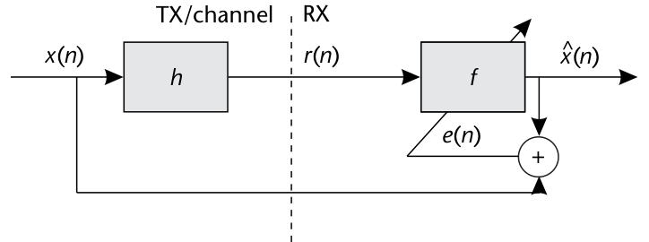

**代码 9.3　信道均衡：chanEQ.m**

```matlab
h = [0.2; 1; 0.1; 0.02]; % Channel taps
mu = 0.001; % Stepsize
trainingSamples = 1e4;
x = sign(randn(trainingSamples,1)); % Generate BPSK data
r = filter(h,1,x); % Apply channel
K = length(h)+1; f = zeros(K,1);
delta = 3; % Reference tap
%% Equalize channel
index = 1;
[e,x_hat]=deal(zeros(trainingSamples-K+1,1));
for n = K:trainingSamples
    % Select part of training input
    in = r(n:-1:n-K+1);
    % Apply channel estimate to training data
    x_hat(index) = f'*in;
    % Compute error
    e = x(n-delta)-x_hat(index);
    % Update taps
    f = f + mu*conj(e)*in;
    index = index + 1;
end
```

**代码 9.4　确定误比特：chanEQ.m**

```matlab
% Slice
x_bar = sign(x_hat);
% Calculate bit errors
eqDelay = K-delta;
fprintf('BER %2.4f n',mean(x(eqDelay:end-eqDelay-1) ~= x_bar));
```

当我们确切知道源符号时，LMS 是到达给定信道维纳解的有效算法 [4]。但许多场合用不了训练信息，需要**盲均衡**技术。当接收信号不含已知前导码、或想在帧的载荷部分也更新均衡器时，盲均衡是必需的。信道滤波器长度长、或所需数据多于前导码所能提供的场合就需要这种实现。另外，对高度动态的信道——信道相干时间短于一帧——可能需要持续更新均衡器以维持期望的 BER。这里我们考虑**判决引导**（DD）LMS 均衡器，其他实现还有恒模（CM）均衡器（有时称色散最小化 DM 算法）[6] 等。

DD 均衡器对收到的数据做**硬判决**以估计最可能的符号，再基于该估计更新均衡器。更新后的均衡器结构见图 9.10——在均衡器输出后插入判决块。于是除调制方案外，该设计的接收机对 $x(n)$ 一无所知。这使 DD 情形的误差项更新为

$$e(n)=\hat{x}(n)-\bar{x}(n)\tag{9.12}$$

其中 $\bar{x}(n)$ 是均衡后接收信号 $x(n)$ 的最大似然估计。BPSK 与 QPSK 的估计器为：

$$\bar{x}(n)=\begin{cases}\mathrm{sign}(y(n)), & \text{BPSK}\\ \mathrm{sign}(\mathrm{real}(x(n)))+i\times\mathrm{sign}(\mathrm{imag}(x(n))), & \text{QPSK}\end{cases}$$

当 $x(n)$ 与 $\hat{x}(n)$ 相对接近时 DD 均衡很有效；差异大时 DD 表现会很差。换个视角（借第 6 章的说法）：眼图的眼必须初始就有一定程度的张开，DD 均衡才能有效、或在合理符号数内反转信道。图 9.11(a) 给出含 ISI 的接收信号，图 9.11(b) 是 LMS 均衡后的结果，图 9.11(c) 是 DD 均衡后的结果。LMS 实现在几百个采样内收敛，而 DD 均衡器要约 2,000 个采样才睁开眼、且仍有可观噪声。LMS 优势明显，但需要确知源符号（DD 不用）。注意两个均衡器用同一 $\mu$，初始化均为

$$f_{\mathrm{LMS}}=f_{\mathrm{DD}}=[1,0,\ldots,0]\in\{K\times 1\},$$

$f_{\mathrm{DD}}$ 不能全零初始化。

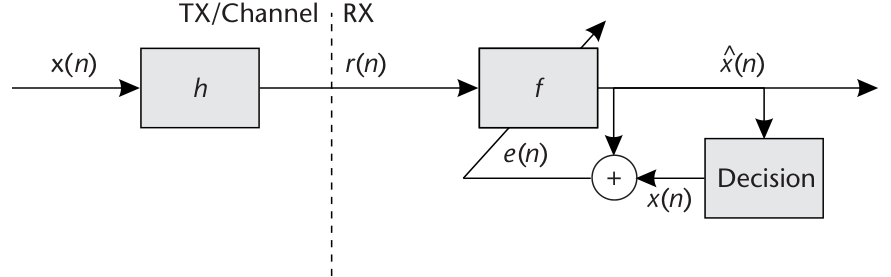

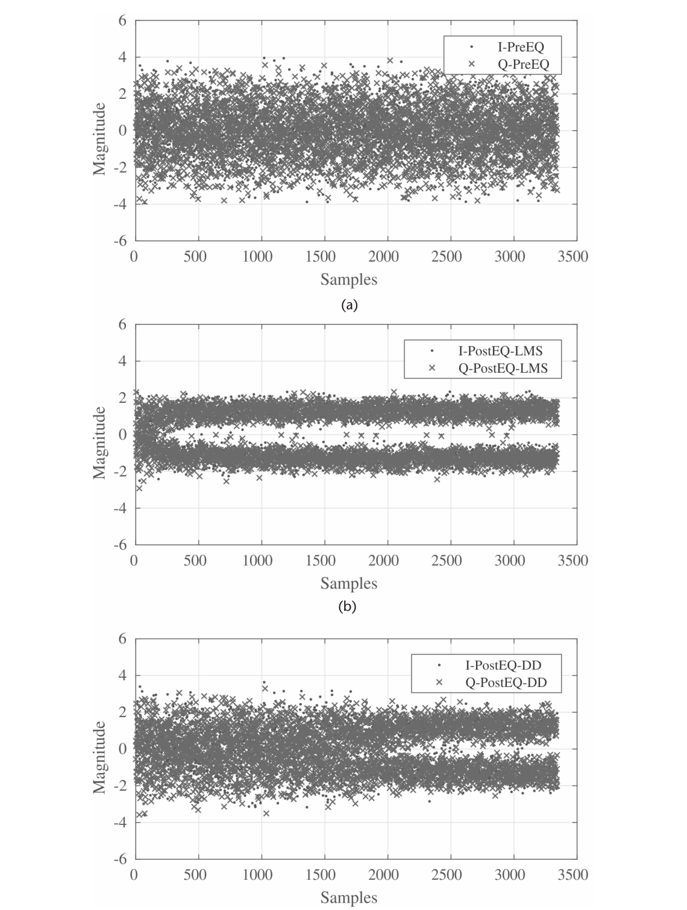

### 9.3.1　非线性均衡器

到目前为止只考虑了带前向滤波器的均衡器（线性均衡器）。也可以实现前向+反馈双滤波器——称为**判决反馈均衡器**（DFE）。DFE 的反馈滤波器产出从前向滤波器输出中减去。见图 9.12（展示两个滤波器及各自更新路径）。由于反馈滤波器只能估计后标符号，必须与前向滤波器配合使用。收敛后，反馈滤波器包含"信道与前向滤波器卷积"的冲激响应估计。由于反馈滤波器利用该复合输出，DFE 可以补偿严重的幅度失真而不在高度失真的信道中放大噪声。

加入新滤波器 $d\in\{P\times 1\}$，更新先前的均衡器方程。为用 LMS 求解均衡给定信道 $h$ 的滤波器 $d$，把 (9.3)–(9.6) 的递归修改为

$$\hat{x}(n)=f^{H}(n)r(n)-d^{H}(n)\bar{x}(n)$$

$$e(n)=\bar{x}(n)-\hat{x}(n)$$

$$f(n+1)=f(n)+\mu e^{\ast}(n)r(n)$$

$$d(n+1)=d(n)+\mu e^{\ast}(n)\bar{x}(n)$$

其中

$$r(n)=[r(n),r(n-1),...,r(n-K-1)]^{T},$$

与

$$\bar{x}(n)=[\bar{x}(n),\bar{x}(n-1),...,\bar{x}(n-P-1)]^{T}.$$

这里 $\bar{x}(n)$ 在用训练数据时取 $x(t)$ 本身，否则取 DD 版本。同样可更新 MATLAB 代码使用新的反馈滤波器，见代码 9.5。注意 DFE 实现因含两个滤波器更难调校；DFE 还可以对每个滤波器更新用不同步长，使调校更可控。

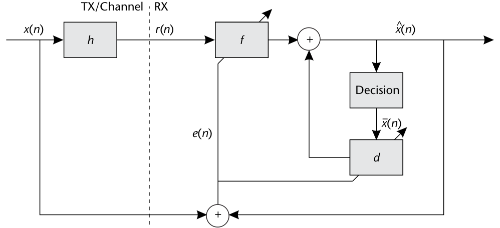

**代码 9.5　确定误比特：chanEQDFE.m**

```matlab
h = [0.2; 1; 0.1; 0.02]; % Channel taps
mu = 0.001; % Stepsize
trainingSamples = 1e4;
x = sign(randn(trainingSamples,1)); % Generate BPSK data
r = filter(h,1,x); % Apply channel
K = length(h)+2; f = zeros(K,1);
P = length(h)-1; d = zeros(P,1); x_bar_vec = zeros(P,1);
delta = 4; % Reference tap
%% Equalize channel
index = 1;
[e,x_hat]=deal(zeros(trainingSamples-K+1,1));
for n = K:trainingSamples
    % Select part of training input
    in = r(n:-1:n-K+1);
    % Apply channel estimate to training data
    x_hat(index) = f'*in - d'*x_bar_vec;
    % Compute error
    e = x(n-delta)-x_hat(index);
    % Update taps
    f = f + mu*conj(e)*in;
    d = d - mu*conj(e)*x_bar_vec;
    % Update feedback filter
    x_bar_vec = [x(n-delta);x_bar_vec(1:end-1)];
    index = index + 1;
end
```

## 9.4　接收机实现

要把均衡器真正实现进接收机结构，有若干依系统需求而定的设计策略。一个值得考虑的合理设计视角：均衡给定信道环境所需的训练数据量。这里有三个方面：信道长度、均衡器的收敛、信道的动态性。训练数据通常限于前导码序列，所选长度按 $L$ 的最大值选取——它也决定 $M$ 的取值。

信道动态时（相对帧长在短时间内就会变化），需要使用多个均衡器。例如：用 LMS 均衡器以前导码序列初始睁开眼，再在数据段用 DD 均衡器保持眼睛张开（见图 9.13）。若不用第二个均衡器，就得缩短帧长才能满足同样的 BER 要求。但前导码必须足够长以允许均衡器恰当自适应——这取决于 $M$ 与 $L$：均衡器越大、收敛所需数据越多、前导码越长。把代码 9.3 更新为 BPSK 下 LMS+DD 并用的版本只需几处简单修改：代码 9.6 里简单地加一个条件，在不同模式间切换。

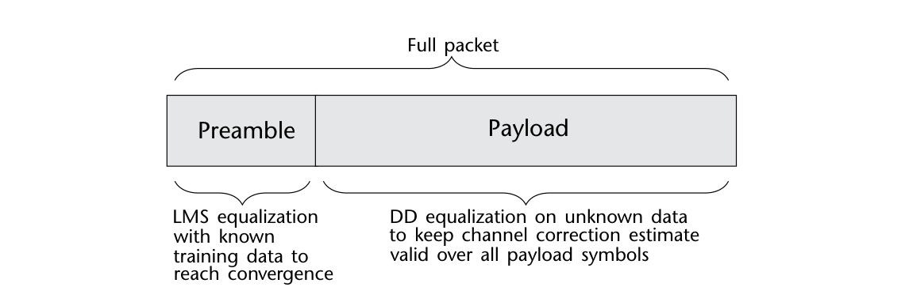

**代码 9.6　带 DD 与 LMS 模式的均衡器：chanEQLMSDD.m**

```matlab
for n = K+1:FrameLength
    % Apply equalizer to received data
    x_hat = f'*r(n:-1:n-K+1);
    % Estimate error
    if n<(PreambleLength-delta)
      e = x(i-delta) - x_hat;
    else
      e = sign(y) - x_hat;
    end
    % Update equalizer
    f = f + mu*conj(e)*r(n:-1:n-K+1);
end
```

均衡器在系统中的用处远不止补偿多径：还能补偿频偏、定时失配、甚至帧同步错误——前提是均衡器配置得当。例如应对载波偏移时（相对第 7 章的情形只能是比较小的偏移），应增大 $\mu$。均衡器本身就是滤波器，补偿频偏只是让抽头形成等效于载波瞬时相位的复增益；但必须持续更新才能补偿该状况，迫使采用 DD+训练数据的双重实现。

考虑定时补偿时，实现**分数均衡器**很有用——前端前向滤波器消费多个采样。这使均衡器成为多速率的，也类似第 6 章的定时补偿设计。该配置下均衡器能跨符号加权/插值，准确校正接收信号的延迟。除分数定时偏移外，利用时延变量 $\delta$ 还能补偿帧同步期间的采样错误：只要期望采样（帧起始采样）落在前向滤波器范围内，就能补偿错误的初始估计。对长度 $L$ 的前向滤波器与 $\delta=\lfloor\frac{L}{2}\rfloor$，应能补偿 $\pm\delta$ 的采样偏移。

## 9.5　本章小结

本章介绍了信道估计与均衡的概念。我们围绕梯度下降算法 LMS（该领域的主导代价函数）构建了几种均衡器设计；给出了训练数据可用与需要盲操作两种情形下的均衡器实现策略。最后讨论了组合多种均衡器设计的接收机实现策略，以及应对环境非理想性的不同用例。有兴趣的读者可在附录 C 找到基本线性均衡器、迫零均衡器与判决反馈均衡器的简要数学推导。

## 参考文献

[1] Goldsmith, A., *Wireless Communications*, Cambridge, UK: Cambridge University Press, 2005.

[2] Johnson, C. R., Jr., W. A. Sethares, and A. G. Klein, *Software Receiver Design: Build Your Own Digital Communications System in Five Easy Steps*, Cambridge, UK: Cambridge University Press, 2011.

[3] Widrow, B., and M. E. Hoff, *Neurocomputing: Foundations of Research, Adaptive Switching Circuits*, Cambridge, MA: MIT Press, 1988, pp. 123–134.

[4] Haykin, S., and S. S. Haykin, *Adaptive Filter Theory*, Pearson Education, 2014.

[5] Farhang-Boroujeny, B., *Adaptive Filters: Theory and Applications*, Wiley, 1999.

[6] Johnson, R., P. Schniter, T. J. Endres, J. D. Behm, D. R. Brown, and R. A. Casas, "Blind Equalization Using the Constant Modulus Criterion: A Review," *Proceedings of the IEEE*, Vol. 86, No. 10, 1998, pp. 1927–1950.
