# 第 10 章　正交频分复用

到目前为止，我们学习的都是单载波调制方案：输入二进制比特由中心频率为 $f_c$ 的载波信号调制。但还有其他跨信道传递数据的方法，包括称为**多载波调制**的技术。多载波调制（MCM）不只用一个中心频率，而是把串行输入数据复用成若干并行流、在相互独立的**子载波**上传输。这些子载波可以单独调制与操纵，从而针对信道进行优化。MCM 依据信道调整各子载波传输参数的能力，在对抗**频率选择性衰落**信道环境时尤其有用。因此，大多数高速率通信系统——包括所有数字用户线（xDSL）调制解调器 [1–3]——以及大多数商用通信标准——包括 Wi-Fi [4, 5]、WiMAX [6, 7] 与 LTE [8, 9]——都在其实现核心使用某种形式的 MCM。本章将探索最流行的 MCM 形式之一：正交频分复用（OFDM）。

## 10.1　MCM 的动机：色散信道环境

高中物理课上我们学过波的传播基础与相长/相消叠加（如涟漪槽实验）。完全相同的原理适用于高速数据传输。例如无线通信系统中，发射机向所有方向辐射能量（除非天线有方向性、能量聚焦在某方位角）。在开阔环境（如空旷的农田），能量会持续传播，其中一部分到达接收天线；其余能量则继续传播直到耗散。

在室内环境（如图 10.1(c)），情形不同。视距分量（若存在）$p_1$ 最先到达接收天线——与开阔田野一样。但其余能量不会简单耗散：能量被墙壁与室内物体反射。其中一些反射（如 $p_2$ 与 $p_3$）会到达接收天线，只是相位与幅度不同。这些接收分量是若干参数的函数，包括收发天线的总距离以及反射次数。

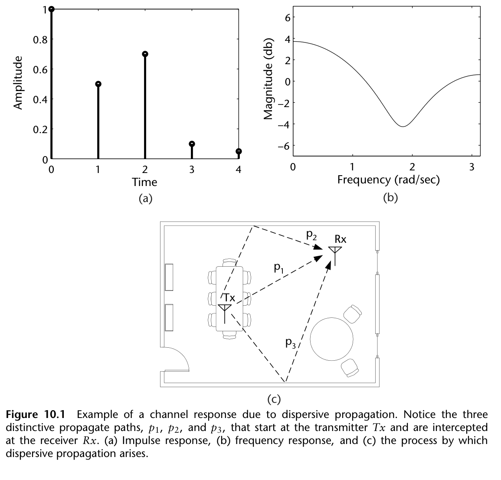

在接收端，这些分量只是同一发射信号的副本——到达时间、幅度与相位不同。因此可把信道视为一个冲激响应与发射信号卷积。开阔田野情形下，信道冲激响应（CIR）就是冲激——接收天线不会收到其他副本。而室内环境会在接收天线截获多个副本，其 CIR 类似图 10.1(a) 的示例；对应频率响应示于图 10.1(b)。

对具有显著多径特性的工作环境细看图 10.1(b)：CIR 的频谱在频域上起伏变化。这对任何经此类信道传输的信号都很麻烦——信号会经历随频率变化的非均匀衰减，在单载波通信系统的语境下相对难以缓解（需要设计与实现复杂的均衡滤波器）。而 MCM 通信系统恰好擅长处理这类失真：多个子载波被设计成对信道"分而治之"、逐个处理频率相关的衰减，从而实现相对低复杂度的方案。

## 10.2　OFDM 一般模型

OFDM 是 MCM 的高效形式：用 DFT 与逆 DFT（IDFT）调制解调多个并行数据流。如图 10.2 所示，OFDM 通信系统的一般结构由发射端的 $2N$ 点 IDFT 与接收端的 $2N$ 点 DFT 组成。图 10.2 的 OFDM 收发信机这样工作：高速数字输入 $d[m]$ 经换向器分用到 $N$ 个子载波；每个子载波上的数据被调制成 M-QAM 符号（一次映射一组 $\log_2(M)$ 比特）。对子载波 $k$，把 $a_k[\ell]$ 与 $b_k[\ell]$ 排列成实部与虚部，使调制器块输出 $p_k[\ell]=a_k[\ell]+jb_k[\ell]$。为使 IDFT 块的输出为实数，给定 $N$ 个子载波须用 $2N$ 点 IDFT，其中端子 $k=0$ 与 $k=N$ 是无关项输入。子载波 $1\le k\le N-1$ 的输入为 $p_k[\ell]=a_k[\ell]+jb_k[\ell]$；子载波 $N+1\le k\le 2N-1$ 的输入为 $p_k[\ell]=a_{2N-k}[\ell]+jb_{2N-k}[\ell]$。然后执行 IDFT，得到

$$s[2\ell N+n]=\frac{1}{2N}\sum_{k=0}^{2N-1}p_k[\ell]e^{j(2\pi nk/2N)},$$

其中此时 $s[n]$ 的 $2N$ 个连续采样构成一个 OFDM 符号——$N$ 个不同 QAM 符号之和。由此数据被调制到若干子信道上，通过每个数据流乘以 $\sin(Nx)/\sin(x)$ 实现，其中若干示于图 10.3。

子载波经换向器复用成信号 $s[n]$ 并发往接收机。接收端用换向器与 $2N$ 点 DFT 把信号分用为 $2N$ 路子载波数据 $\hat{s}[n]$，DFT 定义为

$$\bar{p}_k[\ell]=\sum_{n=0}^{2N-1}\hat{s}[2\ell N+n]e^{-j(2\pi nk/2N)},$$

作用于输入，得到 $p_k[\ell]$ 的估计 $\bar{p}_k[\ell]$。均衡器的输出 $\hat{p}_k[\ell]$ 再经解调器，结果用换向器复用，得到重建的高速比特流 $\hat{d}[m]$。

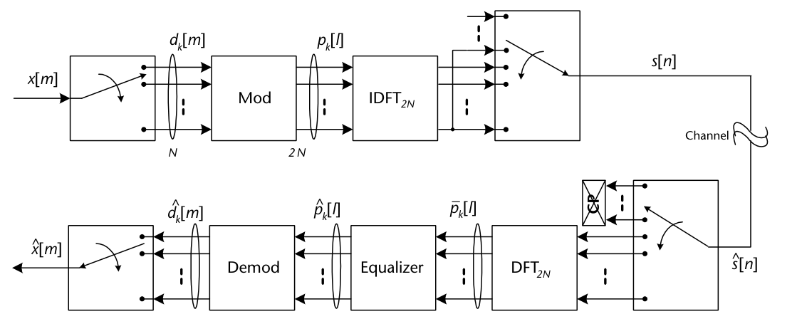

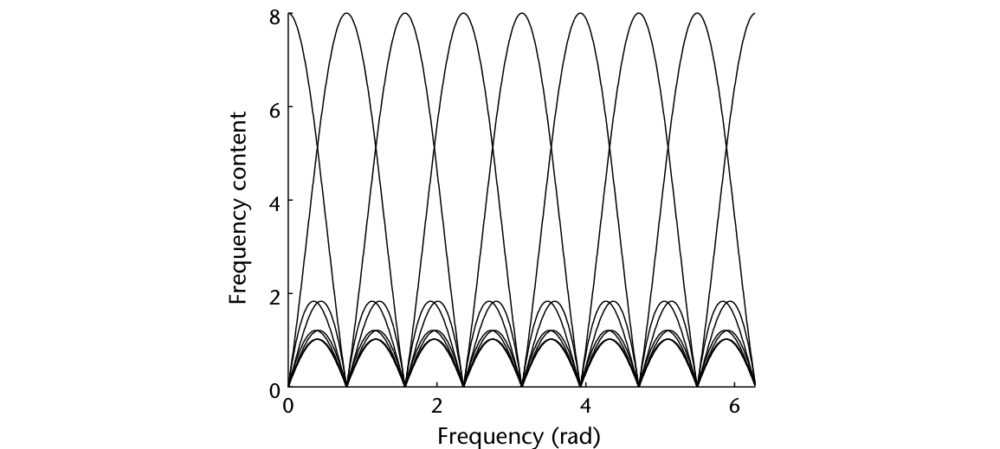

### 10.2.1　循环扩展

CIR 建模为与发射信号采样卷积的有限冲激响应滤波器时，会使过去的采样拖尾到当前采样、当前又拖尾到未来。这种拖尾造成发射信号失真，增大系统总 BER、损失性能。

虽然可以设计均衡器来撤销信道效应，但均衡器的选择存在复杂度与失真最小化的折中。尤其是"上一个 OFDM 符号拖尾到下一个符号"的失真是难题。一个简单的解决方案：在符号之间放几个**哑采样**来捕获符号间拖尾效应。这 $K$ 个哑采样最流行的选择是当前 OFDM 符号的**最后 $K$ 个采样**——这种哑采样称为**循环前缀**（CP），如图 10.4(a) 所示。

于是，带循环前缀的 OFDM 符号经过信道时，来自先前符号的拖尾被循环前缀捕获（图 10.4(b)）。结果各符号只经历自己符号内部采样的拖尾。接收端移除循环前缀（图 10.4(c)），OFDM 符号继续解调与均衡。

尽管循环前缀有用，也有几个缺点。其一，循环前缀长度必须足以捕获 CIR 的影响，否则无法防止其他符号引入的失真。其二，循环前缀引入开销：给符号加缓冲采样就得向接收端发更多信息——要达到无 CP 系统的吞吐量，必须以更高速率发送。

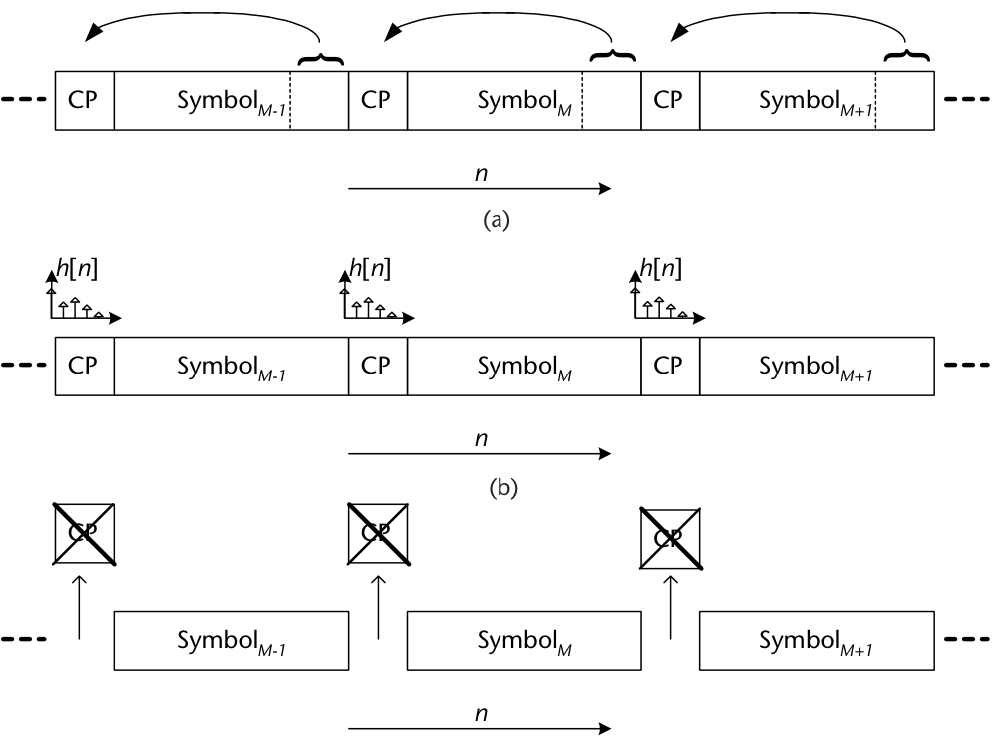

## 10.3　常见 OFDM 波形结构

10.2 节讨论了一般 OFDM 传输模型与限制 ISI 的 CP。接下来考察许多标准（如 IEEE 802.11）使用的 OFDM 符号内部常见结构。首先，OFDM 符号的子载波数 $N_s$ 通常取 2 的幂——用于调制解调的 DFT/IDFT 高效实现（FFT/IFFT）在这些长度上最高效。但典型实现会使用 $N_g$ 个**保护载波**占据 OFDM 符号的外侧频率位置。例如图 10.5 中 $N_s=64$、$N_g=14$：前七个与后七个子载波空置，用于限制影响邻信道信号的带外干扰。代价是保护载波降低总体数据率。注意这是**加 CP 之前**的 OFDM 符号（CP 长度为 $N_{cp}$）。此外，会选择部分子载波作为训练或**导频音**，由接收端均衡器用于校正相位与频率偏移以及信道效应。类似图 10.5，所选子载波通常在符号内均匀选取，以覆盖整个 OFDM 符号。这些导频音在接收端已知。

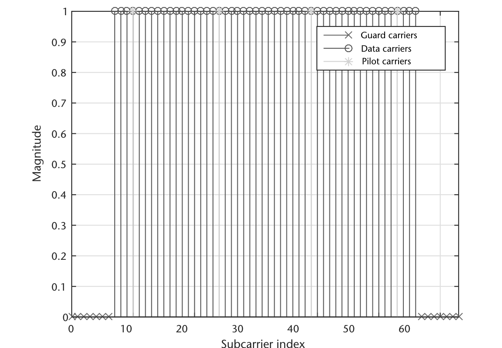

OFDM 调制与 CP 应用于已调符号后，模拟发射前还可以向帧添加额外结构，依据传输类型而定。例如连续发射系统（LTE 或广播信号）会以周期速率向各帧做小插入，使接收机能够同步。这些训练/同步符号可以很精简——接收机可以多次尝试与发射机同步。而突发式系统（如无线局域网 WLAN）会有大的前导码结构，给接收机更多同步时间——这额外的时间允许高概率恢复帧、无需重传。对采用载波侦听多路访问（CSMA）/冲突避免（CA）MAC 方案的无线系统，重传的性能代价可能很高。

我们先考察 WLAN 的帧结构——它是 OFDM 系统的常见实现。数字视频地面广播（DVB-T2）使用与 WLAN 类似的结构，但前导码数据的调制方式不同 [10]。我们选择从标准视角考察 OFDM 收发有两个原因：第一，OFDM 实现因系统设计而异，但大体遵循此处讨论的两种模式；第二，本节讨论的标准在工业界应用广泛，理解其工作原理弥足珍贵——工程师职业生涯中多半会与 WLAN 或 LTE 打交道。

由图 10.6 可见，WLAN 帧的前导码由四个完整 OFDM 符号组成，无论模式或 MCS 链路设置如何都保持不变。第一段是前导码的短训练部分——IEEE 802.11 标准称为 Legacy Short Training Field（LSTF）[11]——含十个重复的短序列副本。该序列的目的是让接收机的自动增益控制（AGC）在给定的 8 µs 内稳定，并执行载波频偏（CFO）估计。这一般被视为接收机的**分组检测**阶段。

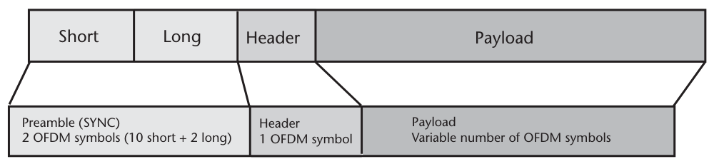

分组检测与 CFO 校正后，接收机利用长训练部分——IEEE 802.11 标准称为 Legacy Long Training Field（LLTF）[11]——含两个重复序列与一个 CP。前导码的这一部分设计用于信道估计。总体而言，OFDM 接收机先识别分组起点、校正频偏、校正信道效应、再去除残余相位失真。相比前几章考察单载波传输的顺序，这一处理可谓"倒着来"。

前导码用于校正接收帧后，帧头符号将用于确定剩余载荷的长度与 MCS。最后，载荷中的导频音将用于校正任何残余偏移与信道失真。类似的帧可由代码 10.1 生成。

为提供使用 OFDM 的标准的另一视角，LTE 是绝佳例子。不同于把同步全部集中在前导码几个符号里的 WLAN，LTE 使用主同步信号（PSS）与辅同步信号（SSS），如图 10.7 所示。接收机经互相关检测，同时利用帧边界与散布在资源块（RB）中的导频音在接收端校正。由于下行信号在小间隔内恒定，漏掉一个 PSS/SSS 可以直接在下一个出现的序列中找到。一旦同步，接收机将持续解码来自基站的信息——不同于更偏突发式的 WLAN。

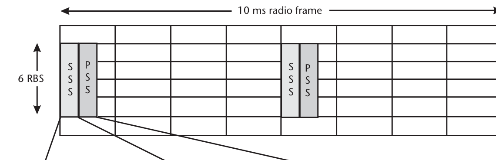

**代码 10.1　生成 OFDM 分组：genOFDMPacket.m**

```matlab
NumFrames = 1;
%% Build OFDM Modulator
FFTLength            = 64;
NumGuardBandCarriers = [6; 5];
NumDataCarriers      = 48;
CyclicPrefixLength   = 16;
PilotCarrierIndices  = [12;26;40;54];
NumOFDMSymInPreamble = 5;
NumBitsPerCharacter  = 7;
% Convert message to bits
msgInBits = repmat(randi([0 1], NumDataCarriers, 1),10, 1);
PayloadBits = msgInBits(:);
% Calculate number of OFDM symbols per frame
NumOFDMSymbols = ceil(length(PayloadBits)/NumDataCarriers);
% Calculate number of bits padded in each frame
NumPadBits = NumDataCarriers * NumOFDMSymbols - length(PayloadBits);
% Get preamble for each frame
Preamble = double(getOFDMPreambleAndPilot('Preamble', ...
    FFTLength, NumGuardBandCarriers));
% Get pilot for each frame
Pilots = double(getOFDMPreambleAndPilot('Pilot', NumOFDMSymbols));
% BPSK modulator
BPSKMod = comm.BPSKModulator;
% OFDM modulator
DataOFDMMod = comm.OFDMModulator(...
    'FFTLength' ,           FFTLength, ...
    'NumGuardBandCarriers', NumGuardBandCarriers, ...
    'InsertDCNull',         true, ...
    'PilotInputPort',       true, ...
    'PilotCarrierIndices',  PilotCarrierIndices, ...
    'CyclicPrefixLength',   CyclicPrefixLength, ...
    'NumSymbols',           NumOFDMSymbols);

%% Modulate Data
symPostBPSK = BPSKMod.step([PayloadBits; randi([0 1], NumPadBits, 1)]);
% OFDM modulation for one frame
symPostOFDM = DataOFDMMod.step(reshape(symPostBPSK, ...
    NumDataCarriers, NumOFDMSymbols), Pilots);
% Repeat the frame
y = repmat([Preamble; symPostOFDM], NumFrames, 1);
```

## 10.4　分组检测

前导码中 LSTF 结构背后的原理基于 Schmidl 与 Cox 的工作 [12]。他们在论文中给出了一种符号定时恢复策略：寻找时域中**两半完全相同**的训练符号——经过信道后两半仍相同，只是存在由载波频偏引起的相位差。让训练符号两半相同（IFFT 之后）的方法是：在**偶数频率**上发伪噪声（PN）序列、奇数频率置零。这意味着每个偶数频率上发送源星座（WLAN 为旋转 BPSK）的一个点。给定这一结构可以完成两件事：其一，利用时域中已知的重复序列经相关估计前导码起点；其二，依据训练符号两半之间的相位差估计频率。[12] 有很多扩展（如 Minn [13]、[14]），但都保持"频率与时间上对称的前导码"这一原则。

数学上，[12] 的分组检测定时度量为

$$M(k)=\frac{\left|\sum_{m=0}^{L-1}r^{\ast}(k+m)r(k+m+L)\right|^{2}}{\left(\sum_{m=0}^{L-1}|r(k+m+L)|^{2}\right)^{2}},\tag{10.3}$$

其中 $r$ 是接收信号、$L$ 是半个训练符号的长度。WLAN 中该长度为 16 个采样（0.8 µs）。(10.3) 利用前导码中长度 $L$ 的重复序列。

代码 10.2 提供了执行 (10.3) 的简单示例——它依赖前面的代码 10.1 按 WLAN 802.11a 规格生成 OFDM 分组。结果度量绘于图 10.8：可以观察到从前导码起点的真实位置开始出现明显的平台。低 SNR 时 LSTF 序列的平台更难观察但仍可辨认。不过，度量 $M$ 的目的只是二元地判断"是否发了分组"——并不需要前导码的精确起点，这一接收阶段只需 LSTF 大致位于数据何处的粗略估计。

实践中该方法成为门限检测问题，必须把接收机建成能应对不同条件。(10.3) 是自相关实现——只用了接收信号。该实现有用之处在于自归一化输入、尽量把输出压到 0 与 1 之间。如图 10.8 所示这并非总能做到，但即使在低 SNR 下前导码的输出 $M$ 也高于载荷数据。因此，对度量 $M$ 选择恰当的门限值对判断信号空间中是否存在分组很重要。该参数在某些 Cisco 商用硬件中确实可调，定义为接收机分组起始检测门限（Rx SOP）[15]。概念上，改变该参数会改变无线小区尺寸、并反向影响接收分组差错率。

**代码 10.2　检测分组起点：packetDetect.m**

```matlab
%% Generate OFDM Waveform
genOFDMPacket;
% Add random offset
offset = randi([0 1e2]);
y = [zeros(offset,1);y];

%% Schmidl and Cox: Coarse Packet Detection
L = 16;  % Short sync field length
m = L;   % Distance between fields
N = 300; % Autocorrelation samples
M = zeros(N,1);
SNR = [0,5,10];
for SNRindx = 1:length(SNR)
    r = awgn(y,SNR(SNRindx),'measured');
    % Determine timing metric
    for k=1:N
        P = r(k:k+m)' *  r(k+L:k+m+L);
        a = abs(y(k+L:k+m+L));
        R = a'*a;
        M(k) = abs(P)^2/(R^2);
    end
    % Plot
    subplot(length(SNR),1,SNRindx);stem(M);
    hold on; stem(offset+1,M(offset+1),'r*'); hold off;
    grid on;xlabel('k');ylabel('M');
    legend('Autocorrelation','True Start');
    title(['SNR: ',num2str(SNR(SNRindx)),'dB']);
end
```

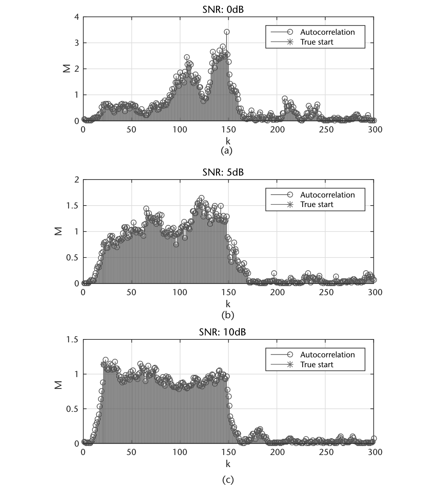

## 10.5　CFO 估计

OFDM 的一个问题与频偏有关。当接收符号经历的偏移超过子载波带宽的一半时，信号失去正交性——破坏了与信号相关的恢复假设。因此，OFDM 信号解调（即 FFT 处理）之前必须先考虑频率校正。如 10.4 节所述，前导码序列两半的相位差与接收波形经历的频偏直接相关。这很容易证明：给定频偏 $\Delta f$ 与发射波形 $s(t)$：

$$r(t)=s(t)e^{j2\pi\Delta ft/f_s}\tag{10.4}$$

利用 LSTF 中长度各为 $L$ 的符号两半，可以写出

$$p(k)=\sum_{m=0}^{L-1}r^{\ast}(k+m)r(k+m+L)=\sum_{m=0}^{L-1}s(k+m)^{\ast}e^{-j2\pi\Delta f(k+m)/f_s}s(k+m+L)e^{j2\pi\Delta f(k+m+L)/f_s}$$
$$=e^{j2\pi\Delta f(L)/f_s}\sum_{m=0}^{L-1}s(k+m)^{\ast}s(k+m+L)=e^{j2\pi\Delta f(L)/f_s}\sum_{m=0}^{L-1}|s(k+m)|^{2}.\tag{10.5}$$

因此，频偏是前导码两半相位差的直接结果。对频偏 $\Delta f$，前导码符号两半之间的相位差 $\varphi$ 直接相关：

$$\varphi=\frac{2\pi L\Delta f}{f_s},\tag{10.6}$$

其中 $f_s$ 是采样率。于是 $\varphi$ 可估计为

$$\hat{\varphi}=\tan^{-1}\frac{\Im(P(k))}{\Re(P(k))},\tag{10.7}$$

其中

$$P(k)=\sum_{m=0}^{L-1}r^{\ast}(k+m)r(k+m+L),\tag{10.8}$$

且 (10.7) 中的 $k$ 位于短前导码序列的前九个符号内。由于 $\varphi$ 至多为 $\pi$，可直接确定最大偏移：

$$\Delta f_{\max}=\frac{f_s}{2LN}.\tag{10.9}$$

WLAN 802.11a 的情形下 $\Delta f_{\max}=625$ kHz。但 IEEE 标准要求接收机维持 20 PPM 振荡器——5.3 GHz 处收发差至多 212 kHz [11]。

代码 10.3 在多个频偏上实现了 (10.5)–(10.8) 的技术。结果以归一化偏移分析——这很常见，因为频偏依赖系统采样率，可用于补偿大偏移：简单地把电台跑在更快速率就能降低恢复算法看到的归一化偏移。

**代码 10.3　确定 CFO：freqEstOFDM.m**

```matlab
%% Generate OFDM Waveform
genOFDMPacket;
% Add random offset
offset = randi([0 1e2]); y = [zeros(offset,1);y];
SNR = 20;
%% CFO Estimation
L = 16;  % Short sync field length
m = L;   % Distance between fields
N = 300; % Autocorrelation samples
Fs = 1e6; % Sample rate
% CFO estimation over multiple frequencies
subchannelSpacing = Fs/FFTLength;
CFOs = subchannelSpacing.*(0.01:0.01:0.5);
cfoError = zeros(size(CFOs));
for cfoIndx = 1:length(CFOs)
    % Add noise
    r = awgn(y,SNR,'measured');
    % Frequency offset data
    pfOffset = comm.PhaseFrequencyOffset('SampleRate',Fs,...
        'FrequencyOffset',CFOs(cfoIndx));
    r = pfOffset(r);
    % Determine frequency offsets
    freqEst = zeros(N,1);
    for k=1:N
        P = r(k:k+m)' *  r(k+L:k+m+L);
        freqEst(k) = Fs/L*(angle(P)/(2*pi));
    end
    % Select estimate at offset estimated position
    freqEstimate = freqEst(offset);
    % Calculate CFO error
    cfoError(cfoIndx) = abs(freqEstimate-CFOs(cfoIndx))/subchannelSpacing;
end
```

由于前导码的短训练部分含同一序列的十个副本，至多可做九次估计。但受 AGC 收敛影响，短前导码的早期符号不太可能被检测到或可用——这正是提供额外短前导码副本的原因。若短前导码恢复得早（检测到大量符号），则可做更多频率估计并最终平均。

前导码的长训练部分保持与短训练部分相同的对称性，但只有两半可比较。仅用 LLTF 会因 $L$ 增大而缩小估计范围。不过，若 AGC 来不及锁定，LLTF 可能只能用于频率估计。在理想情形（长短前导码序列都能用）下，可以实现**分级补偿**设计：类似第 7 章讨论的单载波实现——短序列提供粗偏移估计，长前导码用于精细频率估计。之所以这样分级，是因为估计时可用的数据量不同：长前导码对给定的一次 $P$ 计算通常能用更多数据，给出更可靠的估计。该分析直接来自 [12]，其估计 $\Delta f$ 估计值的方差为

$$\sigma^{2}=\frac{1}{L\times\mathrm{SNR}}.\tag{10.10}$$

## 10.6　符号定时估计

分组检测与频率校正之后，可以进行符号定时。符号定时与分组检测类似，但提供时域中前导码序列的**符号级**精度估计。为提供这一额外精度，用**已知的发射前导码序列**做互相关。互相关提供更好的相关 SNR，但若不加额外缩放则不直接归一化到任何范围——取值范围不定，使互相关不适合初始分组检测。

OFDM 符号定时估计中的互相关技术用于确定短训练序列与长训练序列的边界（采样级精度）——此时 LSTF 的后续使用已无必要。示例实现：用 LLTF 序列（记为 $d_{\mathrm{LLTF}}(t)$）的前 80 个采样。$d_{\mathrm{LLTF}}$ 与接收信号 $r$ 的度量 $c$ 为

$$c(k)=\left|\sum_{m=0}^{L-1}d^{\ast}_{\mathrm{LLTF}}(m)r(m+k)\right|^{2}.\tag{10.11}$$

代码 10.4 给出计算 $c$ 的两种实现，见图 10.9。两者结果相同，但滤波器实现在计算上更高效。绘制代码 10.4 任一实现的 $c$ 应得到类似图 10.9 的图——清晰显示相距 64 个采样的两个峰。这些峰代表 LLTF 两半的强相关，即使低 SNR 下也很突出。由这些采样位置可直接确定 OFDM 符号边界、用 FFT 执行 OFDM 解调。

实际偏移可按代码 10.5 轻松算出：由于相关操作，第一个峰的位置会偏移 LLTF 长度（1 个 OFDM 符号）的一半。

**代码 10.4　确定精细符号偏移度量：fineSymEst.m**

```matlab
genOFDMPacket;
% Add random offset with noise
offset = randi([0 1e2]); y = [zeros(offset,1);y];
SNR = 0; r = awgn(y,SNR,'measured');
%% Estimate fine sample offset
LSTF = Preamble(1:160);
LLTF = Preamble(161:161+160-1);
symLen = 80; % FFTLength + CPLen
known = LLTF(1:symLen,1);
% Filter
coeff = conj(flipud(known));
c_filt = abs(filter(coeff, 1, r)).^2;
% Correlation
m = abs(xcorr(r,known)).^2;
padding = length(r)-symLen+1;% Remove padding added to known sequence
c_cor = m(padding:end);
```

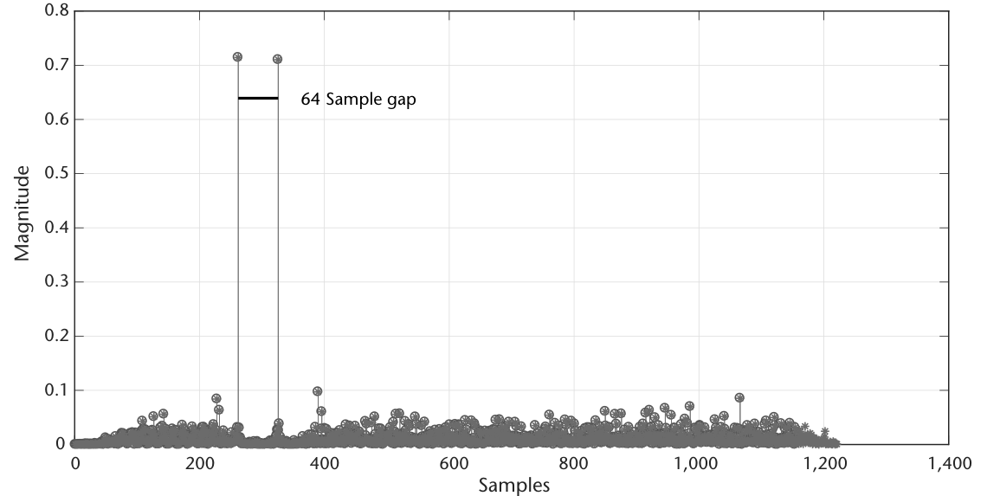

**代码 10.5　计算偏移位置：fineSymEst.m**

```matlab
[v1,peak1] = max(c_cor);
c_cor(peak1) = 0;
[v2,peak2] = max(c_cor);
% Get numerical offset
if abs(peak2-peak1)==FFTLength
    % Adjust position from start of LLTF
    p = min([peak1 peak2]);
    LLTF_Start_est = p-symLen;
    LSTF_Start_est = LLTF_Start_est - length(LSTF);
    % Display
    disp([offset LSTF_Start_est]);
end
```

## 10.7　均衡

接收机的最后一块是均衡器——负责削弱信道效应、去除接收信号中残余的相位或频率偏移。这里讨论的技术在 OFDM 解调**之后**执行，但也存在可在 FFT 之前实现的其他方法。

循环前缀的主要优点之一：它把发射信号 $s[n]$ 与信道冲激响应 $h[n]$ 之间的线性卷积变换成逐符号的**循环卷积**。为看清这一点，细看一个带循环前缀的 OFDM 符号（符号从时刻 $n=0$ 开始）。用 $s[0],\ldots,s[2N-1]$ 表示发射机 IDFT 对第一个 OFDM 符号的 $2N$ 个输出采样，添加循环前缀得到新信号：

$$\tilde{s}[n]=\begin{cases}s[n+2N-K], & 0\le n\le K-1\\ s[n-K], & K\le n\le 2N-1\end{cases}$$

记 $\tilde{r}[n]$ 为 $\tilde{s}[n]$ 与长度 $L$ 的信道冲激响应 $h[n]$ 卷积的结果：

$$\begin{aligned}
\tilde{r}[n]&=\sum_{k=0}^{L-1}h[k]\tilde{s}[n-k]\\
&=\begin{cases}\displaystyle\sum_{k=0}^{n-K}h[k]s[n\!-\!K\!-\!k]+\sum_{k=n-K+1}^{L-1}s[n\!-\!k\!+\!2N\!-\!K], & K\le n\le K\!+\!L\!-\!1\\[6pt] \displaystyle\sum_{k=0}^{L-1}h[k]s[n\!-\!K\!-\!k], & K\!+\!L\le n\le 2N\!-\!1\end{cases}
\end{aligned}$$

由上式容易看出：移除循环前缀后，接收序列 $r[n]=\tilde{r}[n+K]$ 等于

$$r[n]=\sum_{k=0}^{2N-1}h[k]s[((n-k))_{2N}]=h[n]\circledast_{2N}s[n].\tag{10.12}$$

于是，移除循环前缀得到的接收采样由发送信号（每符号 $2N$ 个采样）与信道冲激响应 $h[n]$ 的**循环卷积**构成。在频域观察 (10.12)：

$$R[k]=H[k]\cdot S[k],$$

其中大写字母表示对应序列的 $2N$ 点 DFT。回看图 10.2：接收采样的 $2N$ 点 DFT $R[k]$ 已算出，记为 $\bar{p}_k[\ell]$。

参照图 10.3 与图 10.1(b)：考虑对应频率采样相乘，可见每个子载波经历不同的信道增益 $H[k]$。因此要做的，是给每个子载波乘以作用于该子载波的信道频率响应的**逆**增益——这就是**逐音均衡**的原理。

知道不同子载波处的信道频率增益后，可用它们除各子载波、反转信道造成的失真。例如系统有 64 个子载波、中心频率 $\omega_k=2\pi k/64$（$k=0,\ldots,63$），则取 CIR $h[n]$ 做 64 点 FFT 得频率响应 $H[k]$（$k=0,\ldots,63$）。然后为反转信道对每个子载波的影响，只需取该子载波对应信道频率响应点的倒数：

$$W[k]=\frac{1}{H[k]},\tag{10.13}$$

与该子载波相乘。

回看 WLAN 的帧结构：LLTF 最适合信道估计——它接收端永远已知、且子载波覆盖整个 OFDM 符号。LLTF 有两个完整 OFDM 符号都用于信道估计，对其估计取平均得到更可靠的结果。OFDM 解调用 `comm.OFDMDemodulator`——它可以方便地从匹配必要设置的调制器对象生成（见代码 10.6，原书此处误标为 10.8）。

**代码 10.6　OFDM 调制器/解调器：exampleMod.m**

```matlab
% Modulator
Mod = comm.OFDMModulator(...
        'FFTLength' ,           FFTLength,...
        'NumGuardBandCarriers', [6;5],...
        'CyclicPrefixLength',   0,...
        'NumSymbols', 2,...
        'InsertDCNull', true);
% Demodulator
Demod = comm.OFDMDemodulator(Mod);
```

用该解调器对象可解调 LLTF 并用所述最小二乘（迫零）法估计信道。LLTF 的解调、信道估计与数据符号的均衡见代码 10.7。但即使做了这一步的校正，数据中仍可能存在频偏。幸运的是，数据符号内仍嵌有导频用于纠正这些问题——代码 10.7 也给出了用插入导频的均衡。

导频的用法很简单：校正数据中逐符号可能经历的加性相位旋转。该旋转同样是复增益，估计方式与 LLTF 类似 [16]。假设数据中的导频也已被 LLTF 估计校正，则把数据 OFDM 符号中的 $N_p$ 个导频 $\hat{p}(k)$ 与已知导频 $p(k)$ 对照产生单一增益：

$$e(k)=\frac{1}{N_p}\sum_{n=0}^{N_p-1}p_n(k)\hat{p}^{\ast}_n(k).\tag{10.14}$$

该复增益 $e(k)$ 随后与第 $k$ 个 OFDM 符号中的每个采样相乘。说明：$p_n(k)$ 是第 $k$ 个 OFDM 符号的第 $n$ 个已知导频。

**代码 10.7　OFDM 均衡：eqOFDM.m**

```matlab
genOFDMPacket;
% Add random offset
offset = randi([0 1e2]); y = [zeros(offset,1);y];
%% Equalization Example
r = awgn(y(offset+1:end),15,'measured'); Fs = 1e6;
pfOffset = comm.PhaseFrequencyOffset('SampleRate',Fs,...
    'FrequencyOffset',Fs*0.001);
r = pfOffset(r);
%% Channel estimation
preambleOFDMMod = comm.OFDMModulator(...
    'FFTLength' ,           FFTLength,...
    'NumGuardBandCarriers', NumGuardBandCarriers,...
    'CyclicPrefixLength',   0,'NumSymbols', 2,'InsertDCNull', true);
od = comm.OFDMDemodulator(preambleOFDMMod);
od.PilotOutputPort = true;
% OFDM Demodulate LLTF
LLTF = Preamble(161:161+160-1); rLLTF = r(161+32:161+160-1);
[rLLTFFreq,rp] = od(rLLTF); [LLTFFreq,p] = od(LLTF(33:end));% remove CP
% Estimate channel
ls = rLLTFFreq./LLTFFreq; % Least-square estimate
chanEst = mean(ls,2); % Average over both symbols
CSI = real(chanEst.*conj(chanEst));
ls = rp./p; % Least-square estimate
chanEstPilots = mean(ls,2); % Average over both symbols
CSIPilots = real(chanEstPilots.*conj(chanEstPilots));
%% Perform Equalization
data = r(2*length(LLTF)+1:end);
odd = comm.OFDMDemodulator(DataOFDMMod);
[dataFreq,pilots] = odd(data);
% Apply LLTF's estimate to data symbols and data pilots
postLLTFEqData = bsxfun(@times, dataFreq, conj(chanEst(:))./CSI(:));
postLLTFEqPilots = ...
    bsxfun(@times, pilots, conj(chanEstPilots(:))./CSIPilots(:));
% Visualization objects
tt1 = comm.ConstellationDiagram;tt2 = comm.ConstellationDiagram;
tt2.Position = tt2.Position + [500 0 0 0];
% Estimate remaining offsets with pilots
correctedSymbols = zeros(size(postLLTFEqData));
for symbol = 1:size(postLLTFEqData,2)
    % Estimate rotation across pilots
    p = postLLTFEqPilots(:,symbol);
    e = conj(mean(p.*conj(Pilots(:,symbol))));
    % Equalize
    sig = postLLTFEqData(:,symbol).*e;
    correctedSymbols(:,symbol) = sig;
    % Visualize
    tt1(sig);tt2(postLLTFEqData(:,symbol));pause(0.1);
end
```

## 10.8　比特与功率分配

资源分配是 OFDM 设计的重要方面——它决定 OFDM 系统的 BER 性能。给定固定比特率与发射功率约束，通过在子载波间恰当分配比特与功率电平可以最小化 BER。本节介绍比特与功率分配的理论与技术。

大多数 OFDM 系统在全部子载波上使用同一信号星座（图 10.10(a)）——换向器给每个子载波分配相同大小的比特组。但其总差错概率受**性能最差的子载波**支配。为改善性能，可采用**自适应比特分配**：各子载波上信号星座尺寸的分布依据实测 SNR 值变化（图 10.10(b)）——换向器分配不同大小的比特组。极端情况下，子载波 SNR 太差时可以直接关断或置零。

假设收发双方都掌握子载波 SNR 电平，就能确定各子载波的 BER 值。由于子载波 BER 依赖于给定 SNR 下所选的调制方式，可以改变各子载波的调制方案来改变其 BER。更大的星座（如 64-QAM）需要更大 SNR 才能达到小星座（如 4-QAM）在更小 SNR 下的相同 BER。

我们直接按

$$b_i=\log_2\left(1+\frac{\gamma_i}{\Gamma}\right),\tag{10.15}$$

给子载波 $i$ 分配比特数 $b_i$，其中 $\gamma_i$ 是子载波 $i$ 的 SNR（非 dB）。当然，由此得到的 $b_i$ 附近会出现非整数比特，需适当取整。

信道响应不总是平坦的：某些频率可能远比其他频率衰减得多。可以证明，子载波的最优功率分布应为常数 $K$。确定该电平通过**注水**完成——选择某频率处的功率 $P(f)$，使所有 $P(f_1)=P(f_n)$。$P(f)$ 由下式给出：

$$P(f)=\begin{cases}\lambda-\frac{N(f)}{|H(F)|^{2}}, & f\in F\\ 0, & f\in F'\end{cases}$$

其中 $N(f)$ 是高斯噪声的 PDF、$H(f)$ 是表示线性信道的传递函数、$\lambda$ 是满足

$$\int_{F}P(f)df=P$$

的值（即图 10.11 中曲线下的面积）。这样注水是为了让所有子载波的误比特概率相同。

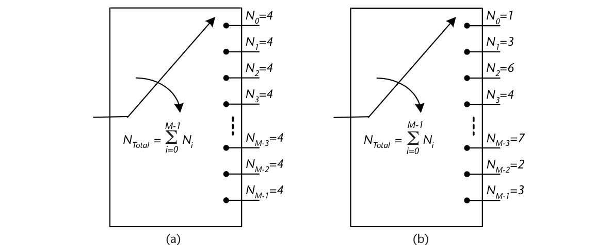

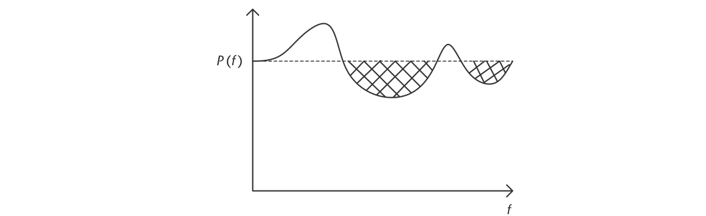

## 10.9　组装成整体

至此，恢复经空中发射的 OFDM 符号所需的全部接收机算法都已给出。显然整体设计还可以用信道编码与扰码器进一步降低接收 BER，但基本构件已齐。作为回顾，图 10.12 给出接收机流程图，注释了前导码与导频的用法。目标是最大限度利用前导码符号提供主要的同步校正——这在很多方面不同于主要依赖调制方案本身的单载波实现。

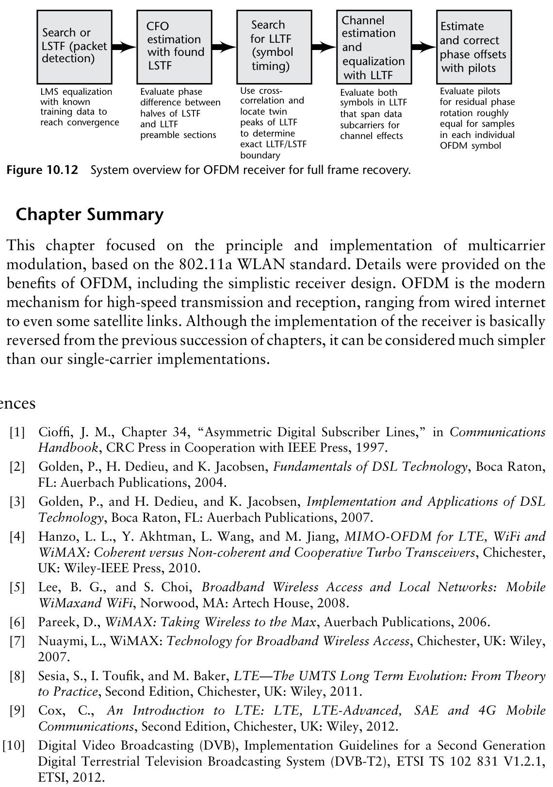

## 10.10　本章小结

本章聚焦多载波调制的原理与实现，基于 802.11a WLAN 标准。详述了 OFDM 的优点（包括简洁的接收机设计）。OFDM 是现代高速收发机制——从有线互联网到某些卫星链路。尽管接收机的实现基本与前几章的顺序相反，它却可以被认为比单载波实现简单得多。

## 参考文献

[1] Cioffi, J. M., Chapter 34, "Asymmetric Digital Subscriber Lines," in *Communications Handbook*, CRC Press in Cooperation with IEEE Press, 1997.

[2] Golden, P., H. Dedieu, and K. Jacobsen, *Fundamentals of DSL Technology*, Boca Raton, FL: Auerbach Publications, 2004.

[3] Golden, P., H. Dedieu, and K. Jacobsen, *Implementation and Applications of DSL Technology*, Boca Raton, FL: Auerbach Publications, 2007.

[4] Hanzo, L. L., Y. Akhtman, L. Wang, and M. Jiang, *MIMO-OFDM for LTE, WiFi and WiMAX: Coherent versus Non-coherent and Cooperative Turbo Transceivers*, Chichester, UK: Wiley-IEEE Press, 2010.

[5] Lee, B. G., and S. Choi, *Broadband Wireless Access and Local Networks: Mobile WiMax and WiFi*, Norwood, MA: Artech House, 2008.

[6] Pareek, D., *WiMAX: Taking Wireless to the Max*, Auerbach Publications, 2006.

[7] Nuaymi, L., *WiMAX: Technology for Broadband Wireless Access*, Chichester, UK: Wiley, 2007.

[8] Sesia, S., I. Toufik, and M. Baker, *LTE—The UMTS Long Term Evolution: From Theory to Practice*, Second Edition, Chichester, UK: Wiley, 2011.

[9] Cox, C., *An Introduction to LTE: LTE, LTE-Advanced, SAE and 4G Mobile Communications*, Second Edition, Chichester, UK: Wiley, 2012.

[10] Digital Video Broadcasting (DVB), *Implementation Guidelines for a Second Generation Digital Terrestrial Television Broadcasting System (DVB-T2)*, ETSI TS 102 831 V1.2.1, ETSI, 2012.

[11] IEEE, *Standard for Information Technology–Telecommunications and Information Exchange between Systems, Local and Metropolitan Area Networks–Specific Requirements–Part 11: Wireless LAN Medium Access Control (MAC) and Physical Layer (PHY) Specifications–Amendment 4: Enhancements for Very High Throughput for Operation in Bands below 6 GHz*, IEEE Std 802.11ac-2013, December 2013, pp. 1–425.

[12] Schmidl, T. M., and D. C. Cox, "Robust Frequency and Timing Synchronization for OFDM," *IEEE Transactions on Communications*, Vol. 45, No. 12, December 1997, pp. 1613–1621.

[13] Minn, H., M. Zeng, and V. K. Bhargava, "On Timing Offset Estimation for OFDM Systems," *IEEE Communications Letters*, Vol. 4, No. 7, 2000, pp. 242–244.

[14] Kang, K. W., J. Ann, and H. S. Lee, "Decision-Directed Maximum-Likelihood Estimation of OFDM Frame Synchronisation Offset," *IEEE Electronics Letters*, Vol. 30, No. 25, December 1994, pp. 2153–2154.

[15] Cisco Inc., "Configuring Receiver Start of Packet Detection Threshold," *Cisco Wireless Controller Guide*, Release 8, April 2015, pp. 517–523.

[16] van Zelst, A., and T. C. W. Schenk, "Implementation of a MIMO OFDM-Based Wireless LAN System," *IEEE Transactions on Signal Processing*, Vol. 52, No. 2, February 2004, pp. 483–494.
