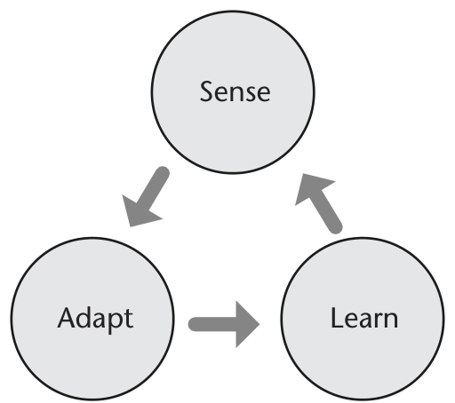
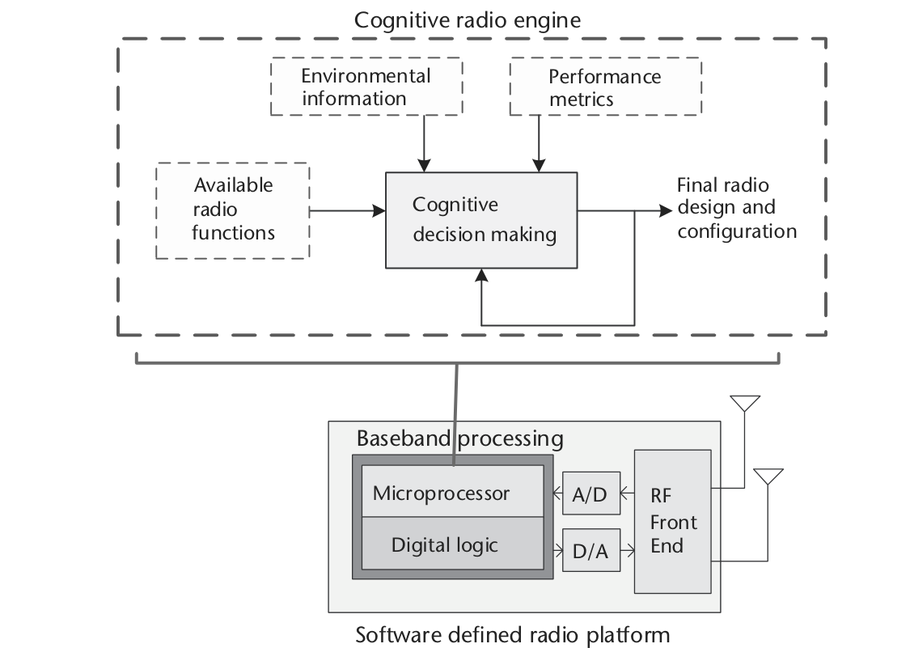
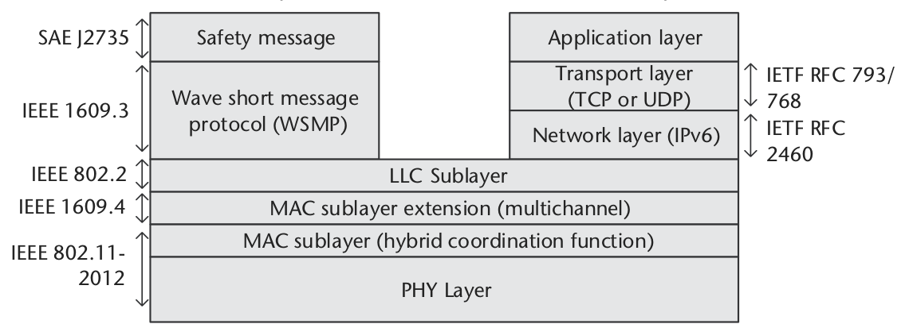

# 第 11 章　SDR 的应用

到目前为止，本书聚焦于理解与掌握用软件定义无线电技术构建成功通信系统的工具。通信系统各构建块的理论概念与实现它们的实用洞察都已广泛覆盖。此刻你可能会问：**我能用 SDR 做什么？**SDD 确实是设计、探索与实验通信系统的强大工具，但如何挥舞它去创新与创造？本章讨论两个显著受益于 SDR 多功能性与性能的应用：**认知无线电**与**车联网**。特别地，将讨论认知无线电中实现智能与学习的两种途径——熊蜂行为建模与强化学习；车联网方面则聚焦定义车载自组织网络（VANET）中车对车（V2V）与车对基础设施（V2I）通信的 IEEE 802.11p 与 IEEE 1609 标准。本章的目标是为读者提供 SDR 如何应用于这些前沿应用的洞察。

## 11.1　认知无线电

认知无线电的概念由 Joseph Mitola 于 2000 年提出 [1]，是一种强大的通信方法：网络中的每台电台都能感知环境、适应其运行行为、并在遇到新情况时即时学习（见图 11.1）。由于认知无线电具备感知、适应与学习的能力，它要求其运行的通信系统高度多功能——因此 SDR 技术非常适合实现基于认知无线电的通信系统。

虽然 SDR 看似非常适合认知无线电应用，仍需解决若干设计与实现考量。看图 11.2：认知无线电引擎在 SDR 平台的基带处理部分之上形成一层。基带处理可以是若干计算技术之一——通用微处理器、FPGA、DSP、GPU、ARM 及其他嵌入式计算技术；甚至可能多种基带处理技术共存于同一系统。给定具体 SDR 系统的计算技术后，需要留意：并非所有 SDR 都一样，每种计算技术各有优劣。例如 FPGA 不易重编程——不适合频繁变更的通信系统操作；但非常胜任要求原始算力的应用。选对计算硬件会显著影响认知无线电的性能。

细看图 11.2，认知无线电引擎由若干输入（感知的环境信息、期望的性能指标、可用的电台配置）、一个输出（待实施的电台配置）与一条反馈回路组成。引擎的核心是**决策过程**——依据过往经验、可用电台配置、感知的环境参数与期望性能指标，确定最佳可实施的电台配置。决策过程常用机器学习实现，可选项极多。为理解认知无线电引擎的设计考量，逐一细看这些要素。

机器学习技术已被广泛研究用于部分或完全自动化（重）配置过程（见 [2–6] 及其文献）。但这些技术产生的解通常需要对无线设备与目标网络行为有所了解（如高速率、高纠错、低时延 [7]）。不过，机器学习技术非常适合处理设备配置解空间极大的场景 [4–6]。

影响认知无线电系统的一个主要问题是其决策的准确性——取决于认知引擎输入信息的质量与数量。信息越多，引擎决策越好，越精确地达成期望的用户体验。回看图 11.2，认知无线电系统使用三类参数：

1. **设备配置**：可改变设备当前运行状态的一组参数。注意若干潜在配置可能无法实施，会被适应算法禁止。
2. **环境参数**：表示设备当前状态的信息，以及用外部传感器感知的无线环境信息。
3. **目标网络体验**：这些指标近似描述普通人类用户操作无线设备时的体验。认知无线电的目标是为给定指标取得尽可能好的值。

由于所有应用运行在不同环境、需求各异，认知引擎为某一应用产出优异性能的解，用于另一应用时可能不可接受。

**最优决策**的定义：达成目标网络体验优于任何其他可用组合的"设备配置+环境参数"组合。为认知无线电系统定义恰当的设备配置参数清单至关重要。构造良好的清单由一组各自对目标网络行为影响巨大的常用无线参数组成。表 11.1 给出无线网络设备常用的九个传输参数。

| 参数 | 说明 |
|---|---|
| 发射功率 | 原始发射功率 |
| 调制类型 | 调制的种类 |
| 调制阶数 | 给定调制方案的符号数 |
| 载波频率 | 载波的中心频率 |
| 带宽 | 发射信号带宽 |
| 信道编码率 | 具体编码率 |
| 帧大小 | 发射帧的尺寸 |
| 时分双工 | 发射时间占比 |
| 符号率 | 每秒符号数 |

: 常用无线网络设备配置参数（据 [5, 8]）

环境参数告知系统周围环境特性，包括设备运行状态的内部信息与代表无线信道环境的外部信息，两者都可辅助认知无线电决策。这些变量连同目标网络体验一起作为算法输入。表 11.2 给出可影响认知无线电设备运行状态的六个环境参数。

| 参数 | 说明 |
|---|---|
| 信号功率 | 接收端看到的信号功率 |
| 噪声功率 | 给定信道的噪声功率密度 |
| 时延扩展 | 信道路径时延及其幅度的方差 |
| 电池寿命 | 电池剩余能量的估计 |
| 功耗 | 当前配置的功耗 |
| 频谱信息 | 频谱占用信息 |

: 常用无线网络环境参数（据 [5, 8]）

基于机器学习的认知无线电系统的目的，是为人类操作者自主改善无线网络体验。但"改善体验"可以指多种事情：大量研究聚焦同一网络内容纳更多无线用户；其他重要方面包括无差错通信、高速率、限制用户间干扰、乃至无线设备的实际功耗（移动应用中极其重要）。表 11.3 定义了引导认知无线电走向特定最优解的五个常用目标网络体验。

| 目标 | 说明 |
|---|---|
| 最小化误码率 | 改善传输环境的总体 BER |
| 最大化数据吞吐量 | 提高电台发射的总数据吞吐量 |
| 最小化功耗 | 降低系统消耗的功率 |
| 最小化干扰 | 减少无线干扰贡献 |
| 最大化频谱效率 | 最大化频谱的高效利用 |

: 常用无线网络目标体验（据 [5, 8]）

表 11.3 的目标体验是引导认知无线电无线系统状态的手段。认知无线电通过"描述如何修改设备参数达成这些目标"的关系来使用这些体验。为便于决策，每个目标网络体验必须用数学关系表示——把设备配置与环境参数映射到描述该组合达成特定目标程度的标量 [5, 8]。这些函数为认知无线电提供了对"配置+环境参数组合"排序的方式，最终导向决策。

注意可以同时指定多个目标网络体验，总分用数值表示：各目标体验的分数按其在具体应用中的重要性加权求和，形成最终总分 [5]。

### 11.1.1　熊蜂行为模型

到目前为止聚焦于认知引擎决策过程的框架，还未真正探索在电台上做决策的不同途径。来看两种潜在的决策执行方案。第一种是基于熊蜂行为的仿生方法 [9]。

谈到认知无线电时，人们听到"认知"就会联想到某种驱动决策的人类智能。但就我们追求的性能与计算复杂度的显著成本而言，这可能大材小用。因此，若干研究者转而聚焦认知能力更简单的生命形式，作为认知引擎及其他应用中决策过程的基础。过去几十年，研究者考察了蚁群与蜜蜂的行为作为智能高效决策的基础。这些生命形式是社会性动物——相互交换信息、执行产生最佳回报的行动。但蚁群与蜜蜂是**社会依赖型**生命形式：一个个体的行动完全依赖于集体。把这些仿生决策过程移植到认知无线电与 SDR 时，会产生极具挑战的运行环境。假设每台电台运行一个认知引擎，收集自身环境信息以及邻近电台的信息——有了这些丰富信息，我们期望电台对自己的配置做出出色决策。但若使用这些社会依赖模型，也约束了逐电台的决策方式。

**熊蜂**也是在群体中生活的社会性生命形式，但与蜜蜂和蚁群不同，熊蜂本质上是**社会独立型**——它们从环境收集信息、彼此分享信息，但**自己做决定**、不受集体控制。正是这种灵活性使熊蜂非常适合可能随时间快速变化的运行环境。把熊蜂行为模型用于认知无线电，很适合这样的环境：网络拓扑频繁变化、信道条件与频谱可用性随时间变化、网络中电台数量变化。让每台电台运行基于熊蜂行为模型的认知引擎非常棒——它们收集环境信息、然后行动增强自身性能。

为在认知无线电引擎中实现熊蜂行为模型，需要借助**觅食理论**——熊蜂与许多其他生命形式收集资源时所采用的理论 [9]。本质上，觅食理论是生命形式用来采集食物、猎捕猎物、寻找庇护所等操作的资源优化形式。就熊蜂而言，可以把它们的活动与对周围世界的解读映射到采用 SDR 的无线通信环境。例如表 11.4 给出了熊蜂行为与感知到动态频谱接入的车联网之间的映射。可以看到熊蜂的许多行为与基于认知无线电的车辆网络有某种程度的相似。

| 车辆 | 熊蜂 |
|---|---|
| 带内干扰 | 蜂群在同一花卉物种上觅食 |
| 带外干扰 | 蜂群在替代花卉物种上觅食 |
| 最小信道能量级 | 每个花卉物种的最大花蜜级 |
| 计算/处理时间 | 处理/搜索时间 |
| 时延 vs 可靠性 | 采样频率 vs 选择准确性 |
| 信道间切换成本/时间 | 花卉物种间切换成本/时间 |
| 信道活动随时间变化 | 花卉物种占用随时间变化 |
| 信道-用户分布 | 蜂群在花卉物种间的分布 |

: 车联网通信中的若干定义及其在熊蜂中的对应定义（据 [9]）

### 11.1.2　强化学习

近来备受关注的另一类决策过程是**强化学习**——机器学习的一种形式。如图 11.3 所示，强化学习采用一个**智能体**：输入上一次行动的回报及相关状态，决定新的行动。行动可以是任何东西，但就构建认知引擎而言，行动主要是具体的电台配置——使通信系统在当前运行条件（如色散无线信道）下性能可接受。接收端计算与该行动相关的**回报**——定义行动选得好不好。它经开销信道送回智能体闭合反馈回路，使智能体调整未来的行动（回忆图 11.2 认知引擎中的反馈回路）。

![用强化学习方法智能适配通信系统到其运行环境的概念图 [10]](images/fig_1103.png)

虽然图 11.3 的结构看似直接，但一个顾虑是闭合回路所需的开销信道。若能最小化开销信道在该框架中的影响，强化学习方法可以更稳健。最小化开销信道影响同时保持不错性能的一种方案是使用**神经网络**。神经网络本质上是个黑箱：可以用大量数据训练，形成复杂的输入-输出关系来代替闭式数学表达式。看图 11.4：神经网络在强化学习框架内辅助智能体依据过往回报与状态决定行动的示例。事实证明，若神经网络训练充分、能数学地建模通信信道的相关回报，就可以用它运行强化学习智能体——直到信道条件显著变化、需要重新训练网络为止。

![通信系统的混合强化学习框架 [11]](images/fig_1104.png)

## 11.2　车联网

有了认知无线电的洞察，接下来探索一个"认知无线电+SDR 技术"真能改变格局的应用：**车联网**。

车联网在过去几十年被广泛研究 [12]，尤其是车对车（V2V）与车对基础设施（V2I）通信 [13–16]。鉴于运行环境的复杂本质——快速变化的网络拓扑 [17]、时变的传播介质物理特性 [18, 19]、对稳健介质访问控制（MAC）协议的需求 [20]——车联网是学术界与工业界共同攻关的挑战性研究领域。

IEEE 802.11p（专用短程通信 DSRC）与 IEEE 1609（车载环境无线接入 WAVE）是实现 V2V 与 V2I 网络架构的已批准标准 [13, 16, 20–23]。由于这些标准是流行 IEEE 802.11 无线网络架构族的相对简单扩展，部署合规无线设备的成本相当低。但与使用 Wi-Fi 的室内环境不同，车联网环境复杂得多，带来了 Wi-Fi 社区此前未曾经历过的问题。

VANET 是专门针对移动地面车辆场景的移动自组织网络（MANET）的一种。三类 VANET 应用包括 [16]：

- **道路安全应用**：告警应用与紧急车辆告警应用。这些应用的消息拥有最高优先级。
- **交通管理应用**：本地与地图信息。
- **信息娱乐**：基于传统 IPv6 互联网的多媒体内容。

VANET 架构中可以同时存在 V2V 与 V2I 链路。V2V 中每辆车装备车载单元（OBU），V2V 通信在各车的 OBU 之间进行，主要用于道路安全与交通管理应用 [24]（V2V DSRC 的测量见 [15]）。V2I 应用中，路边基础设施可装备路侧单元（RSU）。为支持这些通信，VANET 有两个标准化协议：IEEE 802.11p 与 IEEE 1609。图 11.5 给出了采用 IEEE 802.11p 与 IEEE 1609 的车载电台单元协议栈的图形表示。

参照图 11.5：IEEE 802.11p [13] 规定 PHY 与 MAC 层，上层由 IEEE 1609.x 协议定义。IEEE 802.11p 具有许多与 IEEE 802.11-2012 标准 [23] 相似的特性。但为降低高度动态车辆通信环境中的通信时延，MAC 层需要能支持网络拓扑的快速变化与低时延通信。因此 IEEE 802.11p 与 IEEE 1609.4 都为 MAC 层定义了新特性。例如 IEEE 802.11 中无线节点可组成服务集（SS）——节点拥有相同 SSID 并共享通信。带接入点（AP）的网络称为基本服务集（BSS），无 AP 的网络（自组织网络）称为独立 BSS（IBSS）；多个 BSS 可连成扩展服务集（ESS），共享同一扩展 SSID（ESSID）。对 VANET 而言问题在于：任何通信开始前先组建 SS 可能相当耗时——不适合快速变化的车联网环境。为处理该问题，IEEE 802.11p 标准提出了**上下文外 BSS**（OCB）：OCB 模式适用于单个无线电链路覆盖区内的多台设备。OCB 模式下，车辆可随时收发数据，无需组建或加入 SS。此外，IEEE 802.11p 把认证、关联与数据保密机制从 MAC 层移除、移到 IEEE 1609.2 定义的独立更高层 [21]。反过来，IEEE 802.11p 仍保留 BSS 模式，主要用于经 V2I 通信的信息娱乐应用。

MAC 方面，传统 IEEE 802.11 使用载波侦听多路访问（CSMA）/冲突避免（CA）。IEEE 802.11p 仍采用 CSMA 机制，但还采用混合协调功能（HCF）——通过 IEEE 802.11e 定义的增强分布式信道接入（EDCA）保证服务质量（QoS）。不同服务的数据依据重要性有不同优先级。例如，CSMA/CA 与提议的自组织时分多址（STDMA）机制的对比显示 STDMA 的丢包率更低 [25]。但该论文未完整考虑 HCF 机制（未评估基于 QoS 的 EDCA 与基于无竞争期 CFP 的 HCCA）。也有为 WAVE 提出的基于优先级的 TDMA MAC 机制以降低传输丢包率 [26]。

基于 IEEE 802.11p 的 VANET PHY 层衍生自 IEEE 802.11a 标准，有三种信道带宽选项：5 MHz、10 MHz 与 20 MHz，其中推荐 10 MHz。与 IEEE 802.11a 一样，IEEE 802.11p 使用 OFDM：52 个载波（48 个数据载波 + 4 个导频）、8 µs 符号间隔。物理信道支持 BPSK、QPSK、16-QAM 与 64-QAM。除 IEEE 802.11p 外，IEEE 1609.4 定义 MAC 层的多信道行为 [20]：PHY 层由七个信道组成，IEEE 1609.4 定义控制信道（CCH）与服务信道（SCH）间的信道切换机制。IEEE 1609.3 定义 VANET 中两类消息：WAVE 短消息协议（WSMP）与 IPv6 栈 [22]。IPv6 通常用于信息娱乐应用，安全应用则经 WAVE 短消息（WSM）传输。此外，SAE J2945 规定 SAE J2735 DSRC 消息集及相关数据帧、数据元素的最小通信性能要求。为确保车辆间互操作性，SAE J2945 进一步定义 BSM 发送率、发射功率控制与自适应消息率控制。

SAE 标准已被汽车工业广泛用于安全消息实现。特别是 SAE J2735 定义了 15 类安全消息，如基本安全消息（BSM）、信号相位时间（SPT）消息与 MAP 消息 [16]。

BSM 以 10 Hz 频率向周围车辆周期性广播，公布车辆的位置、速度、加速度、航向等状态信息 [27]。使用**选择性广播**：DSRC 发射范围边缘的其他车会转发某辆车发的消息；原始发送者收到转发消息后取消自己的广播。BSM 消息特性在 DSRC 中是强制项。注意 VANET 的选择性广播已在 NS-3 中实现 [28]。SAE J2735 中 BSM 消息由两部分组成：基本部分与可选部分 [29]。基本部分包括车辆的位置、运动、时间与一般状态信息，始终使用 DER 编码与若干八位组二进制大对象编码的组合发送 [27]。可选部分仅在必要时发送，为接收设备的进一步处理提供辅助信息。

DSRC 范围内的车辆可通过 BSM 相互共享态势感知信息，场景包括：

- **变道告警**：车辆在 DSRC 范围内经 V2V 通信周期性共享位置、航向、方向与速度等态势信息。当驾驶员示意变道意图时，OBU 能判断其他车辆是否位于盲区。若盲区确有车辆则向驾驶员告警（盲区告警）；若无，OBU 会依据 BSM 交通信息预测相邻车道的间隙是否足够安全变道。若相邻车道间隙不足，向驾驶员提供变道告警。
- **碰撞告警**：车辆动态接收 BSM 交通信息，与自身位置、速度、航向、道路信息比对。依据比对算法的结果，车辆判断潜在碰撞是否可能发生，并向驾驶员提供碰撞告警。
- **紧急车辆告警**：紧急车辆发射信号，通知附近车辆有紧急车辆正在接近。

除常规安全消息外，BSM 消息也可用于传输控制消息：协助协作碰撞告警环境 [30]、安全消息路由应用 [17]、或改善功率控制 [31]。对应急信道（即信道 172 与信道 184），BSM 可传达功率控制信息以协调各信道的发射功率。反过来，BSM 也可作为车辆控制算法的输入。控制消息在范围内的车辆间传输。

给定这些 VANET 通信的规范与标准，个人完全有可能实现自己的具备 V2V 与 V2I 通信能力的电台。虽然整个协议栈浩大、电台设计复杂度不小，但信息足以造出符合 IEEE 802.11p 与 IEEE 1609 的电台。在 SDR 平台上实现 IEEE 802.11p 与 IEEE 1609 需要考虑的主要问题包括：电台自身的计算性能、可达成吞吐量意义上的带宽限制、以及协议栈每个功能的实时性。尽管有这些挑战，构建能在路上实时组网的车辆通信 SDR 系统的机会是存在的。

## 11.3　本章小结

本章简要考察了两个可以大量借助 SDR 技术的现实应用：认知无线电与车联网。认知无线电方面，我们探索了如何在 SDR 平台上搭建认知引擎，并给出了构造决策过程的至少两种方式——熊蜂行为模型或强化学习方法。车联网方面，我们简要介绍了 IEEE 802.11p 与 IEEE 1609 标准——它们使我们能用 SDR 技术从零构建自己的车联网。

在本书中，我们深入探讨了信号、系统与通信的理论基础，继而探索了通信系统相关的现实问题及缓解这些损伤所需的解决方案，最后在介绍认知无线电与车联网等现实应用之前，展示了均衡与 OFDM 实现的若干高级主题。当然，本书只是掀开了整个通信系统领域的冰山一角，但希望它能成为掌握这一重要主题的起点。

## 参考文献

[1] Mitola, J., *Cognitive Radio—An Integrated Agent Architecture for Software Defined Radio*, Ph.D. dissertation, Royal Institute of Technology, Stockholm, Sweden, 2000.

[2] Barker, B., A. Agah, and A. M. Wyglinski, "Mission-Oriented Communications Properties for Software Defined Radio Configuration," in *Cognitive Radio Networks*, Y. Xiao and F. Hu (eds.), Boca Raton, FL: CRC Press, 2008.

[3] Newman, T., A. M. Wyglinski, and J. B. Evans, "Cognitive Radio Implementation for Efficient Wireless Communication," in *Encyclopedia of Wireless and Mobile Communications*, B. Furht (ed.), Boca Raton, FL: CRC Press, 2007.

[4] Newman, T., R. Rajbanshi, A. M. Wyglinski, J. B. Evans, and G. J. Minden, "Population Adaptation for Genetic Algorithm-Based Cognitive Radios," *Mobile Networks and Applications*, Vol. 13, No. 5, 2008, pp. 442–451.

[5] Newman, T. R., B. A. Barker, A. M. Wyglinski, A. Agah, J. B. Evans, and G. J. Minden, "Cognitive Engine Implementation for Wireless Multicarrier Transceivers," *Journal on Wireless Communications and Mobile Computing*, Vol. 7, No. 9, November 2007, pp. 1129–1142.

[6] Rieser, C. J., *Biologically Inspired Cognitive Radio Engine Model Utilizing Distributed Genetic Algorithms for Secure and Robust Wireless Communications and Networking*, Ph.D. Thesis, Virginia Polytechnic Institute and State University, Blacksburg, VA, 2005.

[7] Troxel, G. D., E. Blossom, and S. Boswell, et al., "Adaptive Dynamic Radio Open-source Intelligent Team (ADROIT): Cognitively Controlled Collaboration among SDR Nodes," in *Proceedings of the IEEE Communications Society Conference on Sensors, Mesh and Ad Hoc Communications and Networks (SECON)—Workshop on Networking Technologies for Software Defined Radio Networks*, Reston, VA, August 2006.

[8] Wyglinski, A. M., M. Nekovee, and T. Hou, *Cognitive Radio Communications and Networks: Principles and Practice*, Burlington, MA: Academic Press, 2009.

[9] Aygun, B., R. J. Gegear, E. F. Ryder, and A. M. Wyglinski, "Adaptive Behavioral Responses for Dynamic Spectrum Access-Based Connected Vehicle Networks," *IEEE Comsoc Technical Committee on Cognitive Networks*, Vol. 1, No. 1, December 2015.

[10] Ferreira, P. V. R., R. Paffenroth, A. M. Wyglinski, T. M. Hackett, S. G. Bilen, R. C. Reinhart, and D. J. Mortensen, "Multi-Objective Reinforcement Learning for Cognitive Radio-Based Satellite Communications," in *34th AIAA International Communications Satellite Systems Conference*, Cleveland, OH, October 2016.

[11] Ferreira, P. V. R., R. Paffenroth, A. M. Wyglinski, T. M. Hackett, S. G. Bilen, R. C. Reinhart, and D. J. Mortensen, "Multi-Objective Reinforcement Learning-Based Deep Neural Networks for Cognitive Space Communications," in *Cognitive Communications for Aerospace Applications Workshop (CCAA)*, Cleveland, OH, June 2017.

[12] Hartenstein, H., and L. Laberteaux, "A Tutorial Survey on Vehicular Ad Hoc Networks," *IEEE Communications Magazine*, Vol. 46, No. 6, 2008, pp. 164–171.

[13] IEEE, *Standard for Information Technology–Local and Metropolitan Area Networks–Specific Requirements–Part 11: Wireless LAN Medium Access Control (MAC) and Physical Layer (PHY) Specifications Amendment 6: Wireless Access in Vehicular Environments*, Technical Report, July 2010.

[14] Kenney, J. B., "Dedicated Short-Range Communications (DSRC) Standards in the United States," *Proceedings of the IEEE*, Vol. 99, No. 7, 2011, pp. 1162–1182.

[15] Muller, M., "WLAN 802.11p Measurements for Vehicle to Vehicle (V2V) DSRC," *Application Note Rohde & Schwarz*, Vol. 1, 2009, pp. 1–25.

[16] IEEE, *Guide for Wireless Access in Vehicular Environments (WAVE)—Architecture*, IEEE Std 1609.0-2013, March 2014, pp. 1–78.

[17] Tonguz, O., N. Wisitpongphan, F. Bai, P. Mudalige, and V. Sadekar, "Broadcasting in VANET," *2007 Mobile Networking for Vehicular Environments, MOVE*, June 2007, pp. 7–12.

[18] Akhtar, N., S. C. Ergen, and O. Ozkasap, "Vehicle Mobility and Communication Channel Models for Realistic and Efficient Highway VANET Simulation," *IEEE Transactions on Vehicular Technology*, Vol. 64, No. 1, January 2015, pp. 248–262.

[19] Akhtar, N., O. Ozkasap, and S. C. Ergen, "VANET Topology Characteristics under Realistic Mobility and Channel Models," in *2013 IEEE Wireless Communications and Networking Conference (WCNC)*, April 2013, pp. 1774–1779.

[20] IEEE, *Standard for Wireless Access in Vehicular Environments (WAVE)–Multi-Channel Operation Corrigendum 1: Miscellaneous Corrections*, IEEE P1609.4-2010/Cor1/D4, August 2014, pp. 1–24.

[21] IEEE, *Draft Trial-Use Standard for Wireless Access in Vehicular Environments–Security Services for Applications and Management Messages*, IEEE Std P1609.2/D6, 2006.

[22] IEEE, *Approved Draft Standard for Wireless Access in Vehicular Environments (WAVE)–Networking Services*, IEEE P1609.3v3/D6, November 2015, pp. 1–162.

[23] IEEE, *Standard for Information Technology–Telecommunications and Information Exchange between Systems Local and Metropolitan Area Networks–Specific Requirements Part 11: Wireless LAN Medium Access Control (MAC) and Physical Layer (PHY) Specifications*, Technical Report, March 2012.

[24] Uzcátegui, R. A., A. J. De Sucre, and G. Acosta-Marum, "WAVE: A Tutorial," *IEEE Communications Magazine*, Vol. 47, No. 5, 2009, pp. 126–133.

[25] Bilstrup, K., E. Uhlemann, E. G. Strom, and U. Bilstrup, "Evaluation of the IEEE 802.11p MAC Method for Vehicle-to-Vehicle Communication," in *Vehicular Technology Conference, VTC2008-Fall, IEEE 68th*, 2008, pp. 1–5.

[26] Li, B., M. S. Mirhashemi, X. Laurent, and J. Gao, "Wireless Access for Vehicular Environments," *Journal on Wireless Communications and Networking*, 2009: 576217. https://doi.org/10.1155/2009/576217.

[27] SAE International, *DSRC Implementation Guide: A Guide to Users of SAE J2735 Message Sets over DSRC*, February 2010.

[28] Bür, K., and M. Kihl, "Selective Broadcast for VANET Safety Applications," in *SNOW—the 2nd Nordic Workshop on System and Network Optimization for Wireless*, Salen, Sweden, 2011.

[29] RITA Intelligent Transportation Systems Joint Program Office, *Vehicle Information Exchange Needs for Mobility Applications*, February 2012 [online]. http://www.its.dot.gov/.

[30] ElBatt, T., S. K. Goel, G. Holland, H. Krishnan, and J. Parikh, "Cooperative Collision Warning Using Dedicated Short Range Wireless Communications," *Proceedings of the 3rd International Workshop on Vehicular Ad Hoc Networks—VANET '06*, p. 1, 2006 [online]. http://portal.acm.org/citation.cfm?doid=1161064.1161066.

[31] Yoon, Y., and H. Kim, "Resolving Distributed Power Control Anomaly in IEEE 802.11p WAVE," *IEICE Transactions on Communications*, Vol. E94-B, No. 1, 2011, pp. 290–292.
